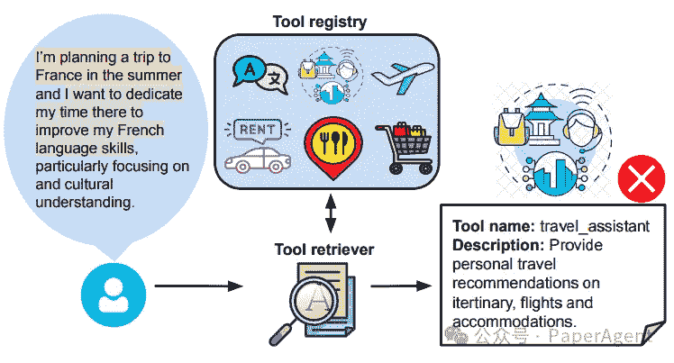
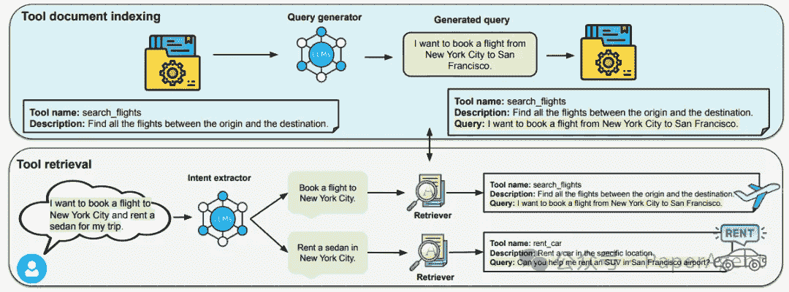
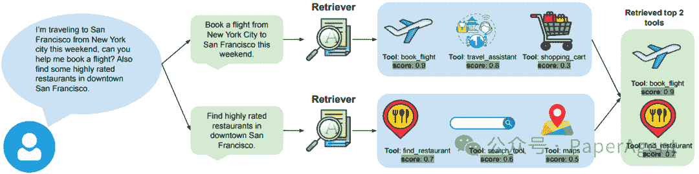
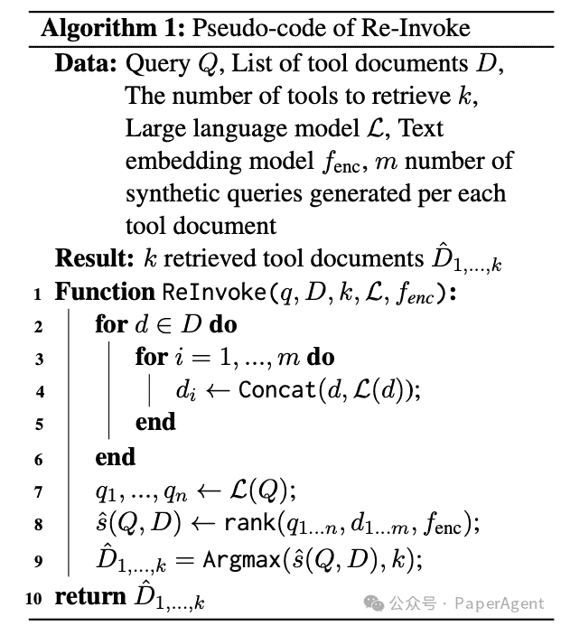
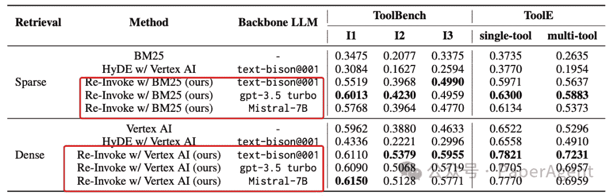
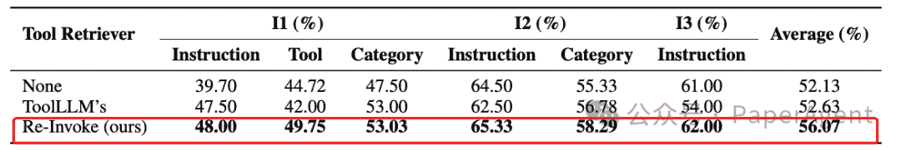
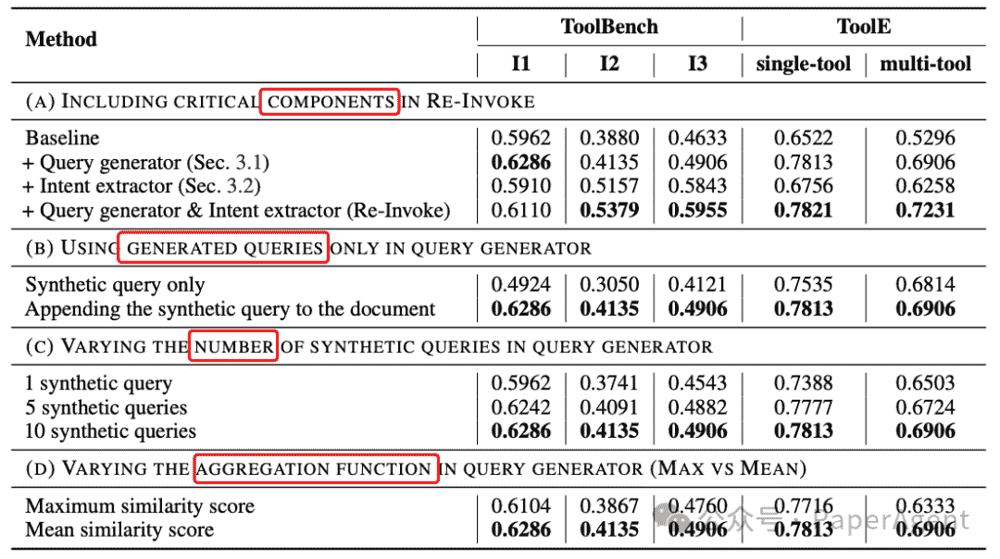
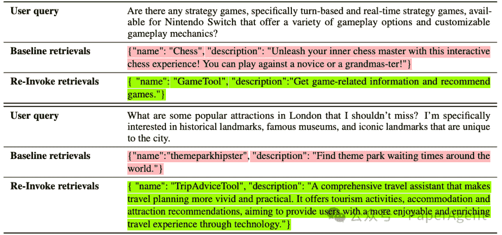
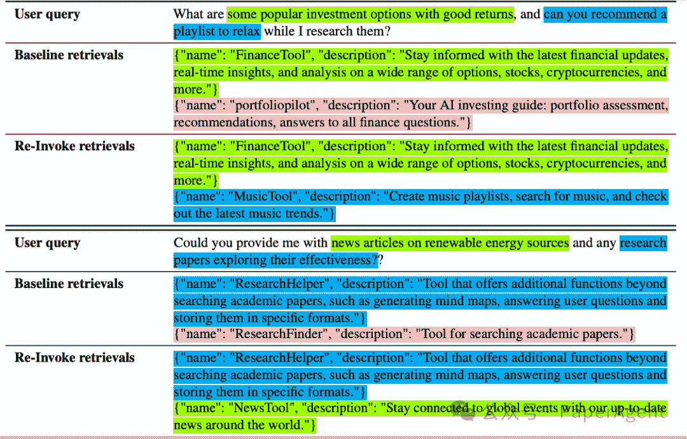
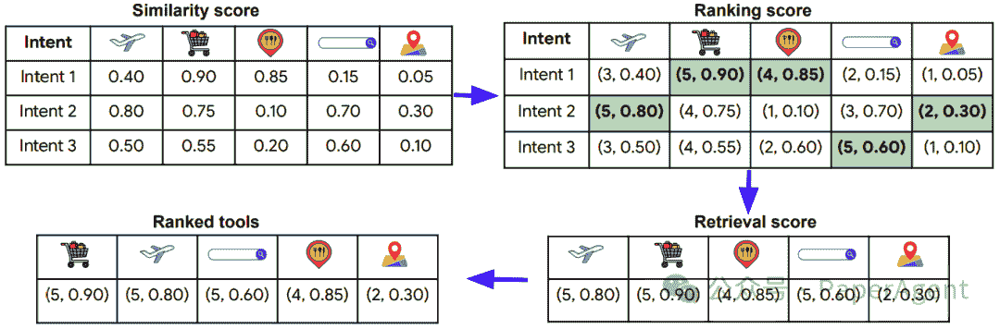

# 谷歌Re-Invoke多视图重排，让Agent多工具调用提升39%！

> 来源：[https://agijuejin.feishu.cn/docx/WBiGdGGotoG8eSxHYbZcmbRMnTg](https://agijuejin.feishu.cn/docx/WBiGdGGotoG8eSxHYbZcmbRMnTg)

> 作者：PaperAgent

> 原文：[https://mp.weixin.](https://mp.weixin.qq.com/s/Xr9Qg2fraX3SENwS3P-SdQ)qq.com/s/Xr9Qg2fr...

大型语言模型（LLMs）在复杂任务上展现出了令人印象深刻的能力，包括数学、推理和编程等。然而，随着 工具集（tools）规模的增长 ，有效识别给定任务最相关工具成为一个关键瓶颈，这限制了工具的可靠使用。

**一个低效检索方法的例子 **，由于上下文“ **计划去法国旅行 **”，未能识别实际用户意图“ **提高法语水平 **”。它选择了 **相似但不正确的工具 **，即旅行助手工具，而不是从给定工具池中选择正确的语言学习工具。



为了解决这个问题，由 **G** o ogl e** 以 及 Google** Clo ud AI R** esear**ch 、 G oogle D**eepMin**d 联**合 提 出了 **Re- Invoke ， 提供了一种新颖的、 完全无监督 的工具检索方法，可以扩展到 大型工具集 ，而 无需训练数据 。

Re-Invoke在工具检索任务中的概述 。（上**）查询生成器从工具文档中****生成多样化的合成查**询，每个合成查询与工具文档连接，以创建 多个扩展工具文档的副本 。（下）意图提取器从用户查询中 综合多个潜在意图 ，以检索相关工具。



ReInvoke 方法包括3个核心组件：

+   **查询生成器 **：在工具索引阶段，利用大型语言模型生成多样化的合成查询，这些查询全面覆盖与每个工具文档相关联的查询空间的不同方面。

+   **意图提取器 **：在推理阶段，利用大型语言模型理解查询的能力，从用户查询中提取与工具相关的上下文和潜在意图。

+   **多视图相似性排名策略 **：基于意图，采用新颖的多视图相似性排名策略，为每个查询精确地找出最相关的工具。

检索过程中多视图相似度排名算法的说明 。可以**从用户查询中**提取多个意图，首**先计算扩展后的工具**文档与嵌入空间中每个意图之间的 相似度得分 。对每个意图的 顶部工具进行排名 并检索，作为最终检索到的工具。





ReInvoke 利用大型语言模型增强工具文档的上下文，并提取用户意图，从而在不同用例中提高工具检索性能。 ReIn**voke在单**工具和多工具场景中都显著**优于最先**进的替代方案，所**有这些均在完**全无监督的**设置中实**现。在ToolE数据集上，在 单工具检索 的nDCG@5上实现了 20% 的相对改进，在 多工具检索 上实现了 39% 的改进。

**在**Too**lBenc**h I1**、I2、I**3和ToolE单工具、多工具数据集上使用稀疏和密集检索方法的nDCG@5指标 。在 稀疏检索 方法中，应用BM25检索和基于BM25的HyDE检索作为两个基线。text-bison@001用于在HyDE方法中生成假设文档。将Re-Invoke与BM25嵌入集成，使用text-bison@001、gpt-3.5-turbo和Mistral-7B-Instruct-v0.3作为三种不同的主干大型语言模型（LLMs）。在 密集检索 方法中，应用Vertex AI文本嵌入检索和基于Vertex AI文本嵌入的HyDE检索作为两个基线。text-bison@001用于在HyDE方法中生成假设文档。还集成了Re-Invoke与Vertex AI文本嵌入，使用text-bison@001、gpt-3.5-turbo和Mistral-7B-Instruct-v0.3作为三种不同的主干LLMs。 最高的nDCG@5指标用粗体标记。



在ToolBench数据集上的端到端性能 。遵循使用通过率作为评估指标。将ToolLLaMA与DFSDT集成作为agent，使用一组没有检索器的参考工具、ToolLLM的检索器和Re-Invoke检索器。最高的性能指标用粗体标记。



在ToolBench I1、I2、I3数据集以及ToolE单工**具和多工具****数据集上的nDCG@5指**标的 消融研究 。评估了Re-Invoke中每个关键组件的影响： 查询生成器和意图提取器 。在查询生成器组件内，进一步比较了 不同数量的合成查询、不同的聚合函数来聚合相关性得分 ，以及是否将合成查询附加到工具文档上的nDCG@5指标。最高的检索指标用粗体标记。



# **附录**

从工具文档生成合成查询的Prompt模板

```
Suppose you are an assistant and you have access to the following API to answer user&#x27;s queries.
You are provided with a tool and its available API function including the description and
parameters.
Your task is to generate a possible user query that can be handled by the API.
You must include the input parameters required in the API call. Please be creative and generate
random but specific information for the required parameters.
Now you are given the API documentation below:
&lt;tool document&gt;
Please generate a user query that you will need to call this tool. Note the generated query should
be complex enough to describe the scenarios that you will need to call the provided API to address
them.
The relevant query is:
```

从用户查询提取潜在意图的Prompt模板

```
**Instructions**
Suppose you are a query analyzer and your task is to extract the underlying user intents from the
input query. You should preserve all the underlying user request and the extracted user intents
should be easily understood without extra context information.
You should carefully read the given user query to understand its different intents. Then identify
what are the specific intents. Each individual intent should be separated by a newline.
Here are some examples of how you should solve the task.
**Example**
Query: I&#x27;m planning to travel to Paris next weekend to visit my family, could you help me book a
round trip flight ticket? I want to fly in economy class.
Intent:
book a round-trip flight ticket in economy class to Paris next weekend
Query: I&#x27;m a potential buyer looking for a condominium in the city of Miami. I am specifically
interested in properties that have a minimum of two bathrooms. It should have walkable distance to
the grocery stores.
Intent:
buy a real estate in Miami with a minimum of two bathrooms and walkable distance to the grocery
stores
Query: I want to learn Spanish by talking to the native speakers at any time. Additionally, can you
recommend some interesting books, preferably fictions, so that I can learn by reading? Also include
the websites that I can buy them.
Intent:
learn Spanish by talking to the native speakers
recommend fictions to learn Spanish by reading
suggest the websites to buy Sanish fictions
**Begin!**
Query: &lt;user query&gt;
Intent:
```

给定用户查询生成假设工具文档的One-shot Prompt模板

```
Suppose you are an assistant and you have access to the API documentation to answer user&#x27;s queries.
Please generate an API documentation in the JSON format that can be called to handle this query.
The API documentation should be general enough to handle the cases beyond the provided queries.
Please provide detailed descriptions on the parameters.
**Examples**
Query: I&#x27;m planning to travel to Paris next weekend to visit my family, could you help me book a
round trip flight ticket? I want to fly in economy class.
The API documentation is:
{
&quot;api_name&quot;: &quot;flights&quot;,
&quot;api_description&quot;: &quot;Search the flight ticket on a specific travel date.&quot;
&quot;required_parameters&quot;: [
{
&quot;name&quot;: &quot;departure_date&quot;,
&quot;type&quot; DATETIME,
&quot;description&quot;: &quot;The departure date for the flight.&quot;
},
{
&quot;name&quot;: &quot;from&quot;,
&quot;type&quot; STRING,
&quot;description&quot;: &quot;The city where the flight departs.&quot;
},
{
&quot;name&quot;: &quot;to&quot;,
&quot;type&quot; STRING,
&quot;description&quot;: &quot;The city where the flight arrives.&quot;
},
{
&quot;name&quot;: &quot;fare_class&quot;,
&quot;type&quot;: STRING,
&quot;description&quot;: &quot;The fare class for the flight, economy, business or first.&quot;
}
],
&quot;optional_parameters&quot;: [
{
&quot;name&quot;: &quot;return_date&quot;,
&quot;type&quot;: DATETIME,
&quot;description&quot;: &quot;The return date for the flight.&quot;
}
]
}
**Begin!**
Query: &lt;user query&gt;
The API documentation is:
```

**ToolE单工具 **数据集中精选的示例查询列表，包括基线和使用Vertex文本嵌入API的Re-Invo**ke查**询生成器检索的前1个工具。Re-Invoke的查询生成器检索正确的工具（ 绿色 ），而基线检索错误的工具（ 红色 ）。



**ToolE多工具 **数据集中精选的示例查询列表，包括基线和使用Vertex文本嵌入API的Re-Invoke意图提取器组件检索的2个工具。Re-Invoke的意图提取器识别意图（ 绿色和蓝色 ）并检索正确的工具（ 绿色和蓝色 ），而基线检索错误的工具（ 红色 ）。



多视图相似度排名算法的一个示例 。从意图-工具相似度得分中，定义排名得分为每个工具在相同意图和相似度得分内的反转排名顺序的元组（即，最低相似度得分将具有反转排名顺序为1）。然后，为每个工具文档在多个意图中找到最大的排名得分，以计算检索得分。检索得分将用于根据用户查询检索和排名顶部的工具。



```
https://arxiv.org/pdf/2408.01875
Re-Invoke: Tool Invocation Rewriting for Zero-Shot Tool Retrieval
Google Cloud AI Research, Google DeepMind, Google
```

**推荐阅读**

+   对齐LLM偏好的直接偏好优化方法：DPO、IPO、KTO

+   一篇搭建AI大模型应用平台架构的全面指南

+   [RAG全景图：从RAG启蒙到高级RAG之](http://mp.weixin.qq.com/s?__biz=Mzk0MTYzMzMxMA==&mid=2247487375&idx=1&sn=e16bc2fdaac04e58e99cfd2a1dc0b0cb&chksm=c2ce35fef5b9bce80dcf0a70b753707036fe7f962d7888d60396490841a538b0f46e952f53f0&scene=21#wechat_redirect)36技，再到终章Agentic RAG！

+   [A](http://mp.weixin.qq.com/s?__biz=Mzk0MTYzMzMxMA==&mid=2247485322&idx=1&sn=71ffb345fca514aa5ce2848cb2c9f071&chksm=c2ce3dfbf5b9b4edd5b98e45c6179890bdea748fb5220636d25f42006954ea5c81afa8735725&scene=21#wechat_redirect)gent到多模态Agent再到多模态Multi-Agents系统的发展与案例讲解（1.2万字，20+文献，27张图）

---

欢迎关注我的公众号“ **PaperAgent **”， 每天一篇大模型（LLM）文章来锻炼我们的思维，简单的例子，不简单的方法，提升自己。