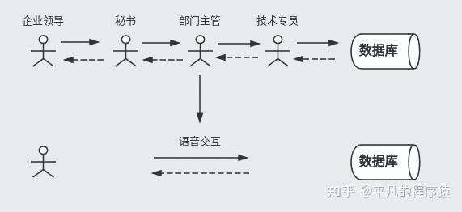
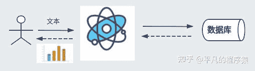
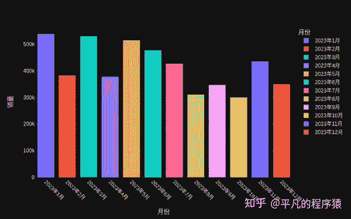
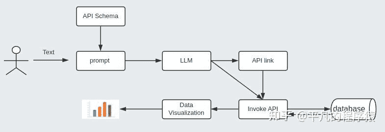
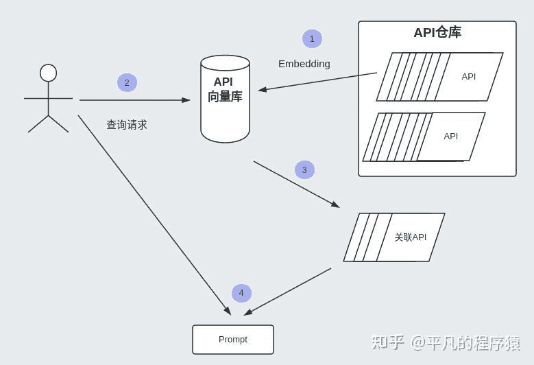
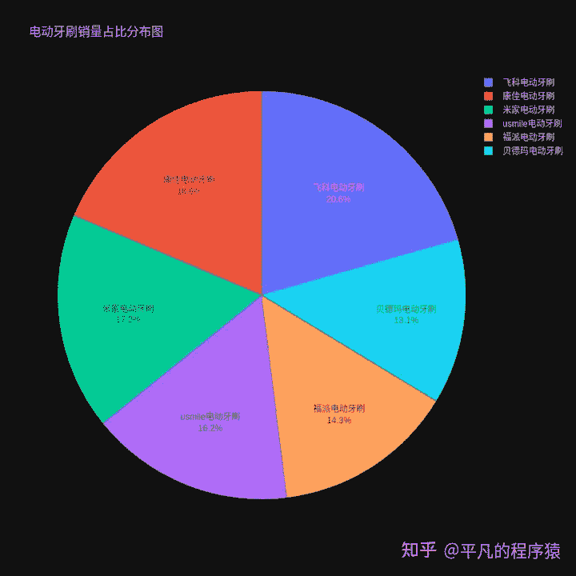
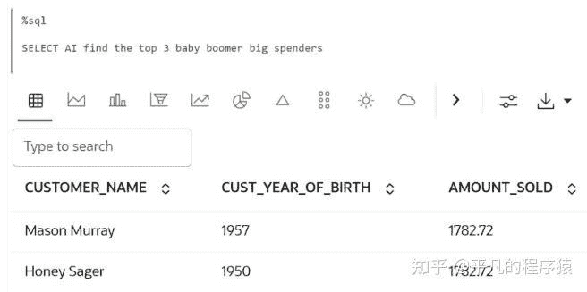

# 数据可视化Agent-企业应用中基于LLM的数据分析方案

> 来源：[https://agijuejin.feishu.cn/docx/Ff7UdGVMcoRcxOxAH9CcKmrHnwb](https://agijuejin.feishu.cn/docx/Ff7UdGVMcoRcxOxAH9CcKmrHnwb)

> 作者：王大锤

> 原文： [https://zhuanlan.z](https://zhuanlan.zhihu.com/p/681364650)hihu.com/p/681364...

## 一. 背景

商业[智能(Bus](https://zhida.zhihu.com/search?q=%E6%95%B0%E6%8D%AE%E5%8F%AF%E8%A7%86%E5%8C%96&zhida_source=entity&is_preview=1)iness Intelligence, BI)系统在企业商业决策中扮演着举足轻重的角色。在大型企业数据分析，预测等业务场景有着较大的应用场景。其中，ETL,数据存储和BI智能分析， 数据可视化 ，构成一套完整的端到到端系统。本文主要介绍基于BI系统的智能分析和数据可视化模块，探讨大语言模型LLM在该领域的应用。

### 1.1 问题

[对于现有的企业](https://zhida.zhihu.com/search?q=%E7%BB%8F%E8%90%A5%E5%88%86%E6%9E%90%E7%B3%BB%E7%BB%9F&zhida_source=entity&is_preview=1)数据分析应用而言，BI工具在 经营分析系统 的决策支持中发挥了重大作用，仍然存在着一些问题，主要包括以下几个方向:


**产出效率低 **: 业务和技术之前可能存在对于分析需求理解上的差异，在公司高层需要进行决策时，需求一层一层进行传递，实现需求对齐后由技术人员进行确认后执行查询操作，效率过于低下。

**使用率低 **: 不断的业务需求迭代，会导致原始的BI系统中存在大量功能的堆积，并且使用率会比较低。

**缺少实时性 **: 如果需要实时查看某类数据信息，当完成层级的需求透传后，该需要可能已经失去了价值。

**专业性依赖 **: 虽然能够支持多维分析，数据洞察等功能，但是在一定程度上对业务人员不够友好。

### 1.2 业务模式的改变

大模型的出现，提供了一种基于自然语言的交互界面可能，在语义理解能力上有了革命性的飞跃，那么是否存在一种可能: 让业务需求方直接和系统进行基于自然语言的交互，系统返回相应的数据报表，从而简化数据分析的过程?



对于基于语音交互的数据可视化Agent而言，重新了定义了我们与数据交互的形式，不需要冗长的交互和开发流程，也不需要繁琐复杂的专业开发工具；只需要"说话"，即可实时完成相关数据的查询操作。



利用数据可视化Agent, 业务员可以通过自然语言高效[地和Age](https://zhida.zhihu.com/search?q=%E7%BB%9F%E8%AE%A1%E5%88%86%E6%9E%90&zhida_source=entity&is_preview=1)nt进行对话，完成数据查询、 统计分析 和数据洞察。具备以下几点优点:

**简单 **: 能直接用自然语言和系统进行交互，直接获取相应的查询结果。

**快速 **: 无需冗长的定制开发、也无需过多的人员参与。

**交互 **: 基于对话的自然形式实现交互，无需查找各个维度的菜单。

**节约 **: 无大量不常用数据报表的信息。

### 1.3 应用场景

作为现有数据分析手段的一种有效补充，在部分的需求场景下，数据可视化Agent能给经营人员提供一种更易于使用与交互的分析工具。其主要的应用场景包括:

**实时的数据查询需求 **: 提供对运营或统计数据的简单自定义查询，当然只需要使用自然语言。

**传统BI工具能力的升级 **: 利用LLM强大的语义理解能力，将传统的BI中的部分功能优化为基于自然语言的交互式分析，大幅提升效率。

**简单的数据挖掘与洞察 **: 在某些场景下的交互式数据挖掘与洞察，可以利用大语言模型的Code生成能力和算法功能，实现对数据隐藏模式的发现。

## 二. 技术实现

从技术实现层面思考这个问题，如何把输入的自然语言转换为对软件系统的操作，最终返回决策人员需要看到的报告。如:

输入query=查询电动牙刷类目近一年的总销量。

返回结果:



基于目前大模型的能力，可以有以下实现的技术途径:

### 2.1 Text2API

[类似于现](https://zhida.zhihu.com/search?q=%E8%AF%AD%E4%B9%89%E5%B1%82&zhida_source=entity&is_preview=1)有的部分BI工具，会开放一些属于自己系统的 语义层 的独立API, 因此可以通过把自然语言转成对这些数据分析API的调用，也是一种很自然实现的数据可视化的形式。当然，这个API也完全可以自行实现。



**实现流程 **:

这种Text2API的模式需要预先定义好各种查询的API接口，API接口设计比较依赖于专业的研发人员对业务的理解，形成API的使用说明书(API schema)。通过结合用户输入信息文本和API schema，生成相应的prompt参数信息，然后结合大模型的推理，判断需要调用哪个API,以及对应API的参数信息。根据大模型返回的API信息，对相关的API进行调用，获取数据库中符合相应条件的数据信息，最终通过数据可视化接口将查询到的数据以图表的形式进行展示。

这种实现方案比较依赖于API层的制约，一般这类API都是企业内部进行开发的的订制化功能，很难实现通用的text2API模型。如果你用的是OpenAI的大模型，可以直接借助OpenAI的Function Call功能来实现API调用功能；在国内的大部分私有化部署业务需求场景下，一般需要借助提示词工程让大模型完成这种业务的转换，参考Prompt：

```
&#x27;&#x27;&#x27;
请遵循以下几点要求和约束条件:
[1. 参](https://zhida.zhihu.com/search?q=%E4%BD%BF%E7%94%A8%E5%B7%A5%E5%85%B7&amp;zhida_source=entity&amp;is_preview=1)考以下的工具列表信息，找到需要使用的工具，并输出以下JSON格式内容用来使用工具。注意确保下面内容在输出结果中只出现一次:
{&#x27;api_calls&#x27;:[
        {
                &#x27;name&#x27;: &#x27;name of tool&#x27;,
                &#x27;args&#x27;: {&#x27;arg1&#x27;: value1, &#x27;arg2&#x27;: value2.....}
        }
]}
2. 请根据工具的定义参数描述来生成调用文本，参考示例如下:
工具列表:
[
        {
                &#x27;name&#x27;: &#x27;get_current_weather&#x27;,
                &#x27;description&#x27;: &#x27;获取给定位置的当前天气信息&#x27;,
                &#x27;parameters&#x27;: {
                        &#x27;type&#x27;: &#x27;object&#x27;,
                        &#x27;properties&#x27;: {
                                &#x27;location&#x27;: {&#x27;type&#x27;: &#x27;string&#x27;, &#x27;description&#x27;: &#x27;需要查询天气的城市&#x27;},
                                &#x27;date&#x27;: {&#x27;type&#x27;: &#x27;string&#x27;, &#x27;description&#x27;: &#x27;需要查询天气的日期，格式为yyyy-mm-dd&#x27;}
                        }
                        &#x27;required&#x27;: [&#x27;location&#x27;]
                }
        }
],
用户输入: 查询北京的天气
返回调用后JSON格式文本信息:
{
        &#x27;api_calls&#x27;: [
                {
                        &#x27;name&#x27;: &#x27;get_current_weather&#x27;,
                        &#x27;args&#x27;: {&#x27;location&#x27;: &#x27;北京&#x27;}
                }
]}
3. 如果有无法理解的用户意图，请直接回复&quot;我无法理解您的意图，请换个说法试试。&quot;。
4. 请根据用户问题与上下文来推理与提取本次工具调用需要的参数信息。
5. 仅仅需要输出上述JSON格式的推理结果，不需要包含整体的推理过程信息。
上下文:
{context}
工具列表:
{tools}
用户问题:
{question}
&#x27;&#x27;&#x27;
```

这种方式在实践时需要对prompt进行精细化的调优并测试整体的准确率和稳定性，以保证系统有较好的结果返回。

**业务问题 **:

在大型的BI系统中，数据分析的需求可能会比较复杂，在仅考虑部分功能的需求实现时，其潜在的API数量可能会非常多，在大模型进行业务推理时，容易引起TMP问题和tokens溢出问题。对此，有两种可以作为候选的解决方案:

**方案一 **:

针对于APIs做个简单API chema, 建立API 和API的功能描述信息即可，在需要LLM进行Text2API转换时，利用用户输入问题和简单的API chema 做个API的召回，然后再用召回后的部分API进行prompt片段编码，完成后续的推理流程。

```
#原来的API Schema信息包括API的定义，API的描述以及全量的参数信息，如:
[
        {
                &#x27;name&#x27;: &#x27;get_current_weather&#x27;,
                &#x27;description&#x27;: &#x27;获取给定位置的当前天气信息&#x27;,
                &#x27;parameters&#x27;: {
                        &#x27;type&#x27;: &#x27;object&#x27;,
                        &#x27;properties&#x27;: {
                                &#x27;location&#x27;: {&#x27;type&#x27;: &#x27;string&#x27;, &#x27;description&#x27;: &#x27;需要查询天气的城市&#x27;},
                                &#x27;date&#x27;: {&#x27;type&#x27;: &#x27;string&#x27;, &#x27;description&#x27;: &#x27;需要查询天气的日期，格式为yyyy-mm-dd&#x27;}
                        }
                        &#x27;required&#x27;: [&#x27;location&#x27;]
                }
        }
]

#如果将参数信息信息这部分先不进行prompt编码，可以得到下列格式的信息:
[
        {
                &#x27;name&#x27;: &#x27;get_current_weather&#x27;,
                &#x27;description&#x27;: &#x27;获取给定位置的当前天气信息&#x27;        
        },
        {
                &#x27;name&#x27;: &#x27;get_current_date&#x27;,
                &#x27;description&#x27;: &#x27;获取当前日期&#x27;
        }
        {
                &#x27;name&#x27;: &#x27;get_current_datetime&#x27;,
                &#x27;description&#x27;: &#x27;获取当前时刻&#x27;
        }
]
```

**方案二 **:

借助于向量数据库的搜索能力，对候选的APIs进行一次过滤，在每次需要LLM进行text2API的转换时，仅对与用户问题相关的API Schema进行prompt片段生成，这样可以大幅减少tokens的大小。



通过Text2API获取到具体的数据结果后，通常的前端呈现有简单的结果和列表，但更好的交互形式是采用可视化图表的形式进行数据展现。针对后一种情况，需要考虑结合一些可视化的解决方案，如借助LLM来实现智能化的图表展现。

比如[将API](https://zhida.zhihu.com/search?q=%E5%AE%A2%E6%88%B7%E7%AB%AF&zhida_source=entity&is_preview=1)的调用结果加入到用户输入，重新输入LLM，要求LLM根据用户的要求输出最佳的图表建议类别以及所需要的数据。调用端根据LLM的输出，结合本地的可视化方案进行处理。最终返回如下的信息到 客户端 。



**总结 **[: 这种技术实](https://zhida.zhihu.com/search?q=%E8%87%AA%E7%84%B6%E8%AF%AD%E8%A8%80%E5%A4%84%E7%90%86&zhida_source=entity&is_preview=1)现方案，在本质上是在传统的数据分析上增加一层 自然语言处理 UI，核心的数据分析功能需要自行设计API来实现。所以这种方案的好处主要包括:

+   核心的分析逻辑不依赖于大模型，相对来说，对输出结果更加可控。

+   对于包含复杂分析逻辑的任务，如涉及多数据源，多推理逻辑等，可以把内部的复杂性对大模型屏蔽。

+   对于分析逻辑经常变化的任务，能减少对输出稳定性的影响。

这种方案的不足主要表现在:

+   核心分析逻辑API实现，需要极高的业务理解和抽象能力。

+   灵活性与扩展能力差，受限于已经实现的开放API库。

本方案更适合用在 **输入输出结构上较简单(API更简**洁)，但是内部数据处理与分析逻辑较复杂 的任务。

### 2.2 Text2SQL

这[种形式是目](https://zhida.zhihu.com/search?q=%E8%A7%A3%E9%87%8A%E6%89%A7%E8%A1%8C&zhida_source=entity&is_preview=1)前最受关注的一种大模型能力，属于一种特殊的Text2Code. 由于SQL属于一种标准化的数据库查询语言，并且完全由数据库自身来 解释执行 ，因此把自然语言转成SQL是最简单合理，实现路径最短的一种解决方案。目前已经有部分关系数据库内置了SQL AI的功能，比如Oralce最新的SQL AI功能:



### 2.3 Text2Code

简单来说，这种方式是让大模型自己编写代码，然后自动在本地或者服务器上运行获得分[析结果。目](https://zhida.zhihu.com/search?q=%E4%BC%81%E4%B8%9A%E5%BA%94%E7%94%A8&zhida_source=entity&is_preview=1)前这类方式大多是针对本地数据的分析处理，如csv等格式的文件，在面对 企业应用 中的数据库内数据时，一般需要针对使用场景特别考虑。

text2SQL和Text2Code的方案，作者在后续的文章中单独做详细说明，敬请关注。