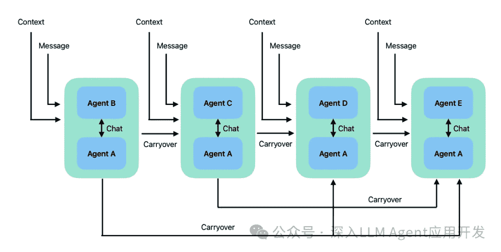
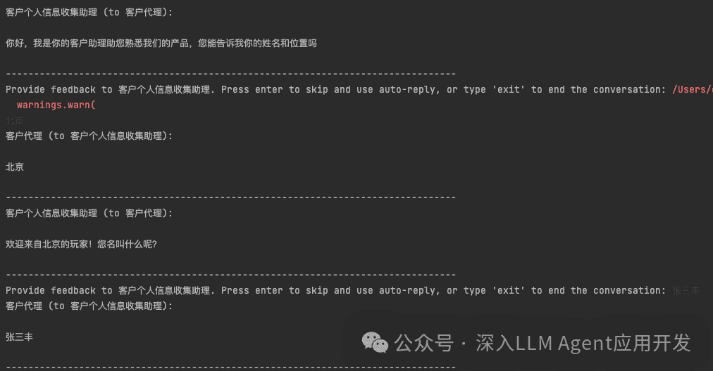

# 26K star！LLM多智能体AutoGen教程2 顺序对话：登机服务

> 来源：[https://agijuejin.feishu.cn/docx/HOipd70rtoxwD6xUqwnccNGynGh](https://agijuejin.feishu.cn/docx/HOipd70rtoxwD6xUqwnccNGynGh)

> 作者：还就可 | 深入LLM Agent应用开发

> 原文： [https://mp.weixin.](https://mp.weixin.qq.com/s/RDStW7GVyVxfGftRcKhuFQ)qq.com/s/RDStW7GV...

继上文《 [26K star！多智能体AutoGen教程](http://mp.weixin.qq.com/s?__biz=MzI0OTAzNTEwMw==&mid=2247483841&idx=1&sn=855d38ff1798042177777734f3d40532&chksm=e996e1f1dee168e722e6f92e1a1cac4b3a6d9b01600b663de3a2906f35dea60576f640c8aad3&scene=21#wechat_redirect)1：让两个LLM Agent给我说相声 》之后，我们已经介绍了AutoGen中 ConversableAgent 的基本概念和用法，相信你已经学会如何发起一个对话或者两两对话。本篇我们不再局限于两两对话，而是类似口口相传的对话模型，官方的说法叫做顺序对话。和这种对话场景比较相似的莫过于谣言的传播了，最近有热搜说 董明珠称「打工人想要休闲可以辞职，我三十几年没休息过，觉得很幸福」 ，这就是媒体的断章取义的结果了。本篇先以一个deeplearning教程中的登机服务为例开始讲解和理解顺序对话，如果可能的话会在下一篇中尝试通过顺序通信模拟一下这种断章取义式谣言的到底是如何传播的。

[如果你还不知道AutoGen怎么安装，请看上](http://mp.weixin.qq.com/s?__biz=MzI0OTAzNTEwMw==&mid=2247483841&idx=1&sn=855d38ff1798042177777734f3d40532&chksm=e996e1f1dee168e722e6f92e1a1cac4b3a6d9b01600b663de3a2906f35dea60576f640c8aad3&scene=21#wechat_redirect)篇《 26K star！多智能体AutoGen教程1：让两个LLM Agent给我说相声 》。

## ** 1. 顺序对话**

顾名思义，这是两两对话的升级版，一组两两对话通过一种名为结转(carryover)的机制串联起来的，将前两人的对话摘要传递给后面两人，具体细节如下图所示。这种模式的对话非常适用于将复杂人物拆解为互相依赖的子任务。



为了说明这种模式，我们以一种登机服务为例说明，这个登机服务的例**子来自deeplearning.ai的 **AI Age**ntic Design Patterns with AutoGen** [1] 课程，原课程中讲解较为简单，对于为什么这么做没有说清楚，为什么是这个API，这里的参数怎么回事，有什么问题等都没有说明，本篇文章就以这个例子进行深入讲解。首先我们需要获取客户的姓名位置，然后获取客户的偏好，最后根据客户的偏好，给用户推荐有意思的新闻、笑话或者故事。从这个场景描述上看，很明显我们可以将其分为三组两两对话，第一组收集客户的姓名和位置，然后第二组获取客户的偏好，第三组根据以上收集的信息提供信息。

## ** 2. 实现登机服务**

初始化 llm_config

```
llm_config = {
    &quot;config_list&quot;: [
        {&quot;model&quot;: &quot;qwen-max-1201&quot;, &quot;api_key&quot;: os.getenv(&quot;QWEN_API_TOKEN&quot;), &quot;temperature&quot;: 0.1,
         &quot;base_url&quot;: &quot;https://dashscope.aliyuncs.com/compatible-mode/v1&quot;, &quot;max_tokens&quot;: 200}],
}
```

### ** 2.1 收集客户信息助理 **

实例化一个收集客户信息的 ConversableAgent 。

```
from autogen import ConversableAgent
personal_information_agent = ConversableAgent(
    name=&quot;客户个人信息收集助理&quot;,
    system_message=&#x27;&#x27;&#x27;你是一名热心的客户登机助理，
    你在这里帮助新客户开始使用我们的产品。
    你的工作是收集客户的姓名和所在地。
    不要询问其他信息。当你收集到所有信息时，返回&quot;TERMINATE&quot;。&#x27;&#x27;&#x27;,
    llm_config=llm_config,
    code_execution_config=False,
    human_input_mode=&quot;NEVER&quot;,
)
```

### ** 2.2 收集客户偏好助理 **

```
topic_preference_agent = ConversableAgent(
    name=&quot;客户偏好收集助理&quot;,
    system_message=&#x27;&#x27;&#x27;你是一名热心的客户登机助理，
    你在这里帮助新客户开始使用我们的产品。
    你的工作是收集客户对新闻话题的偏好。
    不要询问其他信息。当你收集到所有信息时，返回&quot;TERMINATE&quot;。&#x27;&#x27;&#x27;,
    llm_config=llm_config,
    code_execution_config=False,
    human_input_mode=&quot;NEVER&quot;,
)
```

### ** 2.3 客户互动助理 **

```
customer_engagement_agent = ConversableAgent(
    name=&quot;客户互动助理&quot;,
    system_message=&#x27;&#x27;&#x27;你是一名热心的客户服务代理，
    负责根据用户的个人信息和话题偏好提供有趣内容。
    这些内容可以包括有趣的事实、笑话或有趣的故事。
    请确保内容具有吸引力和趣味性！
    当你完成时，返回&quot;TERMINATE&quot;。&#x27;&#x27;&#x27;,
    llm_config=llm_config,
    code_execution_config=False,
    human_input_mode=&quot;NEVER&quot;,
    is_termination_msg=lambda msg: &quot;terminate&quot; in msg.get(&quot;content&quot;).lower(),
)
```

### ** 2.4 客户代理 **

以上我们定义了3个提供服务的Agent，我们还需要一个客户代理，帮助用户无缝接入对话，依照上节介绍，设定该Agent的 human_input_mode 为 ALWAYS 。

```
customer_proxy_agent = ConversableAgent(
    name=&quot;客户代理&quot;,
    llm_config=False,
    code_execution_config=False,
    human_input_mode=&quot;ALWAYS&quot;,
    is_termination_msg=lambda msg: &quot;terminate&quot; in msg.get(&quot;content&quot;).lower(),
)
```

### ** 2.5 串联对话 **

那么如何串联对话呢，以及如何传递各个客户服务助理收集到的信息呢？对于后者也就是我们可以通过结转机制来传递信息。将这整个对话串联起来，我们需要使用autogen提供的 initial_chats ，它的定义如下。

```
def initiate_chats(chat_queue: List[Dict[str, Any]]) -&gt; List[ChatResult]:
```

那么参数chat_queue是个什么东西呢？它是一个list，这个list中每个元素是一个dict，每个dict元素支持以下键。

+   sender - 发起对话的Agent

+   recipient - 接收对话Agent

+   clear_history - bool值，是否要清楚历史记录，默认为True。

+   silent - bool或者None，是否要静默不打印输出，默认False。

+   cache - Cache或者None，缓存客户端或者为None，默认None。

+   max_turns (int or None) - 最大会话次数，如果为None的话，连续对话知道遇到停止对话条件，默认为None。

+   summary_method (str or callable) - 一个字符串或者是一个能从对话中提取summary的可调用方法，默认是 last_msg .

+   summary_args (dict) - 一个字典，用于指定summary_method参数，默认 {} ，支持的参数没有明说，已知的参数有 summary_prompt 和 cache ，其中默认的摘要Prompt为 Summarize the takeaway from the conversation. Do not add any introductory phrases. ，还提供一个.

+   "message" (str, callable or None) -如果为None，输入会从input()获取

+   **context - 上下文

+   "carryover" - 用于指定传递到这个对话的结转信息，如果传递进来，会将这个结转信息和message组合起来作为上下文。

+   "finished_chat_indexes_to_exclude_from_carryover" - 用于指定是否要从carryover的总结中剔除已经结束的对话index。

那么接下来就是使用 initial_chats 来串联了。

```
chats = [
    {
        &quot;sender&quot;: personal_information_agent,
        &quot;recipient&quot;: customer_proxy_agent,
        &quot;clear_history&quot;: True,
        &quot;summary_method&quot;: &quot;reflection_with_llm&quot;,
        &quot;summary_args&quot;: {
            &quot;summary_prompt&quot;: &quot;以JSON结构体{&#x27;name&#x27;: &#x27;&#x27;, &#x27;location&#x27;: &#x27;&#x27;}返回客户信息&quot;
        },
        &quot;max_turns&quot;: 2,
        &quot;message&quot;:
            &quot;你好，我是你的客户助理助您熟悉我们的产品，您能告诉我你的姓名和位置吗&quot;,
    },
    {
        &quot;sender&quot;: topic_preference_agent,
        &quot;recipient&quot;: customer_proxy_agent,
        &quot;message&quot;:
            &quot;太棒了，可以告诉我你喜欢什么主题类的读物吗？&quot;,
        &quot;summary_method&quot;: &quot;reflection_with_llm&quot;,
        &quot;max_turns&quot;: 1,
        &quot;clear_history&quot;: False
    },
    {
        &quot;sender&quot;: customer_proxy_agent,
        &quot;recipient&quot;: customer_engagement_agent,
        &quot;message&quot;: &quot;让我找找有哪些有趣的&quot;,
        &quot;max_turns&quot;: 1,
        &quot;summary_method&quot;: &quot;reflection_with_llm&quot;,
    },
]

from autogen import initiate_chats
chat_results = initial_chats(chats)
```

运行这个脚本，他会要求你输入姓名和位置，然后总结的json作为结转信息传递给偏好Agent，偏好Agent收集到信息后总结出喜欢什么类的读取，最后将这两个结转信息继续传递到最后一个环节。大概的经过流程如下：



image-20240604151616939

你可以看到，我没有完全提供信息时候，他会再问相关信息，并且能够识别出那个实体是姓名哪个是地址。最后

---

> 客户代理 (to 客户互动助理):

> 让我找找有哪些有趣的 Context: {"name": "张三丰", "location": "北京"} 张三丰喜欢阅读有关历史主题的读物。

---

> 客户互动助理 (to 客户代理):

> 张三丰同学有个很特别的兴趣哦！历史真的是个充满趣事和故事的领域，能从中挖掘很多好玩的内容。比如说，你有听过关于清帝退位的有趣故事吗？

> 传说在乾隆年间，皇帝下了一道圣旨：“今后皇上一旦寿终谢世，子孙接续皇位，不必再为我做任何事，直接将朕推入地宫就好。” 所以在陵寝里就有了地宫、地底长廊、明堋这样的设计。乾隆皇帝为了避免后来人争权夺利，竟然亲手设计了一条“迷宫”，想要让未来的继承人好好思考如何从容对付权力斗争！

> 真的是很有趣的设计 如果三丰对清朝历史有兴趣，是否想听听宫里的故事呢？如酥脆的宫斗剧我也可以为你娓娓道来哦～ TERMINATE.

呵，还酥脆的宫斗剧。这其中结转的信息，就是通过我们在 initial_chats 中设定的两两对话的summary，除了第一个要求总结为JSON格式化，其他都是 relefction_with_llm 。总结的信息如下：

+   {"name": "张三丰", "location": "北京"}

+   张三丰喜欢阅读有关历史主题的读物。

+   张三丰喜欢阅读历史书籍。小助手分享了关于乾隆皇帝的一个有趣故事：他为了避免后代皇子们为接班而争斗，设计了一个复杂陵寝布局让他们专注解决难题。

**注意 **：每次会话总结信息，都会作为结转信息传递到下一组对话中，然后再和下一组的会话总结组成新的列表，传递到下一组中。所以对于最后一个Agent，他其实收到了两条结转信息。

## ** 3. 遇到的问题**

+   通义千问没法使用

+   最近使用阿里的通义千问大模型，跑AutoGen应用时候，总是会遇到400报错。于是我将请求导出来进行debug。

```
curl --location &#x27;https://dashscope.aliyuncs.com/compatible-mode/v1/chat/completions&#x27; \
--header &#x27;accept: application/json&#x27; \
--header &#x27;Content-Type: application/json&#x27; \
--header &#x27;Authorization: Bearer your api token&#x27; \
--data &#x27;{
    &quot;model&quot;: &quot;qwen-max-1201&quot;,
    &quot;messages&quot;: [
        {
            &quot;role&quot;: &quot;system&quot;,
            &quot;content&quot;: &quot;你是一名热心的客户登机助理，你在这里帮助新客户开始使用我们的产品。你的工作是收集客户的姓名和所在地。不要询问其他信息。当你收集到所有信息时，返回\&quot;TERMINATE\&quot;。&quot;
        },
        {
            &quot;role&quot;: &quot;assistant&quot;,
            &quot;content&quot;: &quot;你好，我是你的客户助理助您熟悉我们的产品，您能告诉我你的地址和位置吗&quot;
        },
        {
            &quot;role&quot;: &quot;user&quot;,
            &quot;content&quot;: &quot;张三&quot;
        }
    ],
    &quot;stream&quot;: false,
    &quot;temperature&quot;: 0.7
}&#x27;
```

你总能得到类似 User and assistant need to appear alternately in the message 这样400错误。

```
{
    &quot;error&quot;: {
        &quot;code&quot;: &quot;invalid_parameter_error&quot;,
        &quot;param&quot;: null,
        &quot;message&quot;: &quot;User and assistant need to appear alternately in the message&quot;,
        &quot;type&quot;: &quot;invalid_request_error&quot;
    }
}
```

说的是构建的消息列表，assistant和user必须交替出现。我猜测是个bug，反馈给通义千问了，不知道是否会回复。我用ollama安装的command R 32B模型没有出现这个问题。还有一个解决方法是，在system之后插入一条role为user的消息，也能避免这个问题。

+   Command R模型中文弱鸡

我发现Command R 35B这个模型中文输出是真弱鸡，回复中经常夹一个英文单词，莫不是使用香港人讲话的语料训练的。就连上面总结中我其实输入的是北京张三，他都能给你处理成unicode。 {"name": "\u5f39\u4e09\u82b3", "location": "\u5316\u5ea6"} ，我是服气的，打算最近换掉这个模型，属实拉跨。

## ** 4. 总结**

本文以登机服务为例，讲解了如何使用AutoGen实现多智能体协作的登机服务，人类如何无缝介入，总结如何设计，顺序通信如何设计，对话摘要结转(carryover)的原理。本文不仅是一次技术实践的展示，也是对AutoGen框架在实际应用中潜力的探索，特别是在构建复杂交互流程和服务场景方面的灵活性和有效性。通过深入分析和解决实际操作中遇到的挑战，有助于读者加深对多智能体顺序对话系统设计的理解和实施能力。

下一篇，我们将尝试使用AutoGen中构建多智能体的群聊功能，仍然会以一个有趣的应用展开。如果你意犹未尽，想要参与LangChain实战课程，可以考虑点击原文购买《LangChain 实战：LLM 应用开发指南》，亲历LLM应用开发之旅。

关注点赞收藏不迷路，获取即时更新。

## **参考资料**

[1]**AI Agentic Design Pa**tterns with AutoGen : https://learn.deeplearning.ai/courses/ai-agentic-design-patterns-with-autogen/lesson/3/sequential-chats-and-customer-onboarding