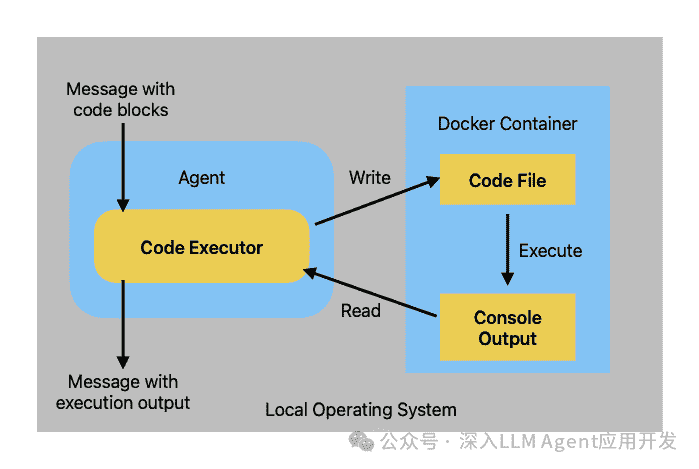
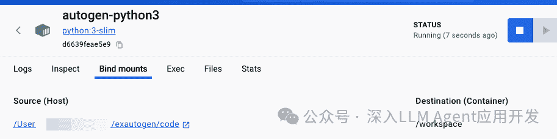

# 26k star！LLM多智能体AutoGen教程3：我的外包弟弟写代码

> 来源：`https://agijuejin.feishu.cn/docx/OHmDddAt2oF0jwxrmRGchN8wnfd`

> 作者：还就可 | 深入LLM Agent应用开发

> 原文：`https://mp.weixin.qq.com/s/kt4WRZW8ejpbd7Idlr10aQ`

书接上回《26K star！LLM多智能体AutoGen教程2 顺序对话：登机服务》`(http://mp.weixin.qq.com/s?__biz=MzI0OTAzNTEwMw==&mid=2247483847&idx=1&sn=da163d771392a003af6dd2a31f2125cd&chksm=e996e1f7dee168e153d8597641d2412ccca2bde62d2cea681fdffb25079501ace2297894c253&scene=21#wechat_redirect)`，读到这里想必已经入门AutoGen了，但怎么让它自动写代码自动调试啊，我也想要一个外包弟弟给我干活，我就喝杯茶摸摸鱼审核一下代码就好了呀。这不巧了，最近PM要求我给他弄一份UltimateALPR支持车厂的列表，这种简单的事情在以前我都是教给ChatGPT，给它一点样例数据，然后指导它写脚本，然后我自己拷贝代码执行，想必现在不少人都是这么做的吧？现在有了AutoGen，我连拷贝代码自己执行调试的工作都省了，真是招了一个外包小弟。进入正题，本篇我们将介绍AutoGen中的代码执行器，他赋予Agent与环境交互和执行代码和计算的能力。

## 1. 代码执行器

在AutoGen中有两种类型的代码执行器，一种是命令行式的执行代码（类似 `python script.py`），另一种是Jupyter式的执行代码（以 `jupyter kernel` 这种交互式的执行）。每种每类的执行器都可以运行在本地或者是Docker容器中，我个人的建议是不要直接运行在本地，而是使用Docker，谁知道LLM会不会生成 `rm -r *` 呢？当然即使生成类似的危险命令，也需要通过 `LocalCommandlineCodeExecutor` 中危险命令列表的安全检查，所以开发环境可以用一下，生产最好还是Docker。他们三个分别位于以下目录中。

+ `autogen.coding.docker_commandline_code_executor.DockerCommandLineCodeExecutor`
+ `autogen.coding.local_commandline_code_executor.LocalCommandlineCodeExecutor`
+ `autogen.coding.jupyter.jupyter_code_executor.JupyterCodeExecutor`

以 `DockerCommandLineCodeExecutor` 为例，它使用以下参数进行初始化：

+ `image` - docker镜像名称，默认 `python:3-slim`
+ `container_name` - 容器名称，为 `None` 时会自动生成。
+ `time_out` - 代码执行超时时间
+ `work_dir` - 工作目录，默认代码执行目录，默认是当前目录，这里有个要注意的地方，后面实际使用的时候会说到。
+ `auto_remove` - 是否执行完成后自动删除容器
+ `stop_container` - 是否自动停止

它的工作原理比较简单，如下图所示。



使用如下代码，实例化一个Docker容器代码执行器就比较明确了。

```
work_dir = "code"
executor = DockerCommandLineCodeExecutor(
    image="python:3-slim",
    container_name="autogen-python3",
    timeout=60,
    work_dir=work_dir,
    auto_remove=True,
    stop_container=True
)
```

接下来就是实例化两个Agent了，一个外包弟弟Agent，专门负责写代码和修改代码，一个是用户代理，也就是我，负责提需求和审查代码。

## 2. 实例化Agent

在此之前，我们都使用 `ConversableAgent` 进行实例化，其实AutoGen提供了两个 `ConversableAgent` 的子类 `AssistantAgent` 和 `UserProxyAgent` 方便使用，就是为简化代码编写类Agent的初始化和人类代理的初始化。

其中 `UserProxyAgent` 初始化参数和 `ConversableAgent` 一致，只有一些默认配置变了，比如

+ `human_input_mode` - 默认就是 `ALWAYS`，父类是 `TERMINATE`
+ `llm_config` - 默认为 `False` ，父类是 `None`
+ `code_execution_cofnig` - 默认为空字典，父类是 `None`
+ `description` - 默认是根据 `human_input_mode` 从字典 `DEFAULT_USER_PROXY_AGENT_DESCRIPTIONS` 中选取描述，父类默认是和 `system_message` 一致。

```
DEFAULT_USER_PROXY_AGENT_DESCRIPTIONS = {
    "ALWAYS": "An attentive HUMAN user who can answer questions about the task, and can perform tasks such as running Python code or inputting command line commands at a Linux terminal and reporting back the execution results.",
    "TERMINATE": "A user that can run Python code or input command line commands at a Linux terminal and report back the execution results.",
    "NEVER": "A computer terminal that performs no other action than running Python scripts (provided to it quoted in ```python code blocks), or sh shell scripts (provided to it quoted in ```sh code blocks).",
}
```

它的默认描述，是用于LLM自动选择Agent应答时候使用。

`AssistantAgent` 就是针对写代码的Agent进行一些默认化配置，比如

+ `system_message` - 默认系统Prompt设定，由 `DEFAULT_SYSTEM_MESSAGE` 设定。
+ `human_input_mode` - 默认为 `NEVER`

默认系统Prompt说明它的任务是通过编码和语言技能解决任务，要求在遇到需要收集信息，诸如：浏览网络，读取下载文件，打印网页或者文件，获取当前事件，检查操作系统等。亦或是在需要执行代码任务和输出结果时。这里再次引导LLM解决任务要一步一步，并且解释计划等，而且要求输出整段代码不要使用代码块。要求它在代码第一行放入文件名。此外，如果遇到错误，要自行分析问题，自行修正代码。最后，找到问题答案时候，在最后输出 `TERMINATE` 。

```
DEFAULT_SYSTEM_MESSAGE = """You are a helpful AI assistant.

Solve tasks using your coding and language skills.

In the following cases, suggest python code (in a python coding block) or shell script (in a sh coding block) for the user to execute.

    1. When you need to collect info, use the code to output the info you need, for example, browse or search the web, download/read a file, print the content of a webpage or a file, get the current date/time, check the operating system. After sufficient info is printed and the task is ready to be solved based on your language skill, you can solve the task by yourself.

    2. When you need to perform some task with code, use the code to perform the task and output the result. Finish the task smartly.

Solve the task step by step if you need to. If a plan is not provided, explain your plan first. Be clear which step uses code, and which step uses your language skill.

When using code, you must indicate the script type in the code block. The user cannot provide any other feedback or perform any other action beyond executing the code you suggest. The user can't modify your code. So do not suggest incomplete code which requires users to modify. Don't use a code block if it's not intended to be executed by the user.

If you want the user to save the code in a file before executing it, put # filename: <filename> inside the code block as the first line. Don't include multiple code blocks in one response. Do not ask users to copy and paste the result. Instead, use 'print' function for the output when relevant. Check the execution result returned by the user.

If the result indicates there is an error, fix the error and output the code again. Suggest the full code instead of partial code or code changes. If the error can't be fixed or if the task is not solved even after the code is executed successfully, analyze the problem, revisit your assumption, collect additional info you need, and think of a different approach to try.

When you find an answer, verify the answer carefully. Include verifiable evidence in your response if possible.

Reply "TERMINATE" in the end when everything is done.

"""
```

使用如下代码实例化外包弟弟Agent和用户Agent：

```
assistant = AssistantAgent(
    name="assistant",
    llm_config=llm_config,
    code_execution_config=False,
)

user = UserProxyAgent(
    name="executor",
    code_execution_config={"executor": executor},
    human_input_mode="ALWAYS",
    default_auto_reply="continue"
)
```

你应该注意到，在实例化 `UserProxyAgent` 中有设置 `default_auto_reply` 为 `continue` ，这是因为通义千问不允许空的回复给它，否则可能会400报错。

```
openai.BadRequestError: Error code: 400 - {'error': {'code': 'invalid_parameter_error', 'param': None, 'message': 'Role must be user or assistant and Content length must be greater than 0', 'type': 'invalid_request_error'}}
```

之后使用 `initial_chat` 描述任务开始执行。

```
user.initiate_chat(assistant, max_turns=5, message="""

读取一个位于https://github.com/xxx/vmmr.txt文件，该文件每一行类似acura_cdx_2016格式，要求提取第一个_之前的字符串，它是车厂名字，提取所有的车厂后将其写到一个vm.txt文件中

""")
```

## 3. 执行

在它编写出第一段程序后，我审查了代码，我告诉它车厂需要去重，他立刻修改了代码，我审查后表示没问题。开始执行代码报错，因为没有按住 `requests` 包，他又自己安装 `request` 包，然后执行并将车厂名称文件保存到 `vm.txt`。那么生成的代码和文件存储在哪里呢？就是我们在 `code_executor` 中设置的 `work_dir`，它在启动Docker容器时候会将该目录映射到自己的工作目录，因此如果你有文件需要处理可以保存到这个目录，Docker中的程序就能读取到，如下图所示。



`image-20240605112255074`

完整的流程比较长就不贴了，只贴刚开始的

> `executor` (to `assistant`):
>
> 读取一个位于https://xxx/vmmr.txt文件，该文件每一行类似acura_cdx_2016格式，要求提取第一个_之前的字符串，它是车厂名字，提取所有的车厂后将其写到一个vm.txt文件中
>
> ################
>
> `_assistant` (to `executor`):
>
> 为了提取出所有车厂的名字，我们可以使用Python来读取文件并处理每一行。以下是一个简单的脚本，它将从给定的URL下载文件，提取每个行的第一个_之前的字符串，并将其写入到名为"vm.txt"的输出文件中。

```
# filename: extract_car_makers.py

import requests

import re

# Download the file from the given URL

response = requests.get("https://xxxx/vmmr.txt")

file_content = response.text

# Extract car makers and write them to a file

with open("vm.txt", "w") as output_file:

for line in file_content.splitlines():

  car_maker = re.search(r'^([^\_]+)', line)

  if car_maker:


```
output_file.write(car_maker.group(1) + "\n")

print("Car makers have been extracted and saved to vm.txt.")
```

请保存上面的代码为`extract_car_makers.py`文件并在命令行中执行：

```
python extract_car_makers.py
```

这将运行脚本并创建一个名为`vm.txt`的文件，其中包含所有提取的汽车制造商名称。如果您在执行此脚本时遇到任何问题，请告诉我错误消息以便我帮助您解决。

################

Provide feedback to assistant. Press enter to skip and use auto-reply, or type 'exit' to end the conversation: 车厂名称需要去重

`executor` (to assistant): 车厂名称需要去重 ...

最后输出的文件，也存储在我们设置的`code`文件夹中。

## 4. 总结

本篇演示了如何使用`AutoGen`编写一个自动完成代码编写和修改的案例，实际上我们还可以再增加一个审查代码的`Agent`负责`review`，并增加一个测试负责编写测试用例等。本篇只是`AutoGen`自动编码测试的小试牛刀，更高阶的用法等着我们去探索和实现。其中也遇到不少关于通义千问使用中的问题，希望对你有所帮助。

如果你意犹未尽，想要参与`LangChain`实战课程，可以考虑点击原文购买《LangChain 实战：LLM 应用开发指南》，亲历LLM应用开发之旅。

关注点赞收藏不迷路，获取即时更新。
