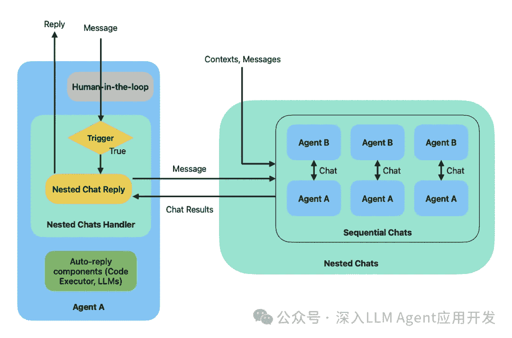
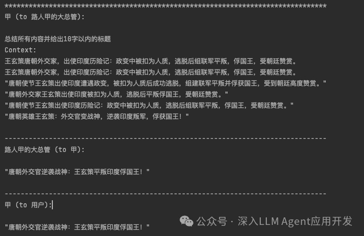

# 26K Star!多智能体AutoGen教程4 嵌套对话模式：王玄策一人灭一国是怎么来的？

> 来源：[https://agijuejin.feishu.cn/docx/FrHBdC1vCocSyfxVEUaco1KFnwh](https://agijuejin.feishu.cn/docx/FrHBdC1vCocSyfxVEUaco1KFnwh)

> 作者：还就可 | 深入LLM Agent应用开发

> 原文： [https://mp.weixin.](https://mp.weixin.qq.com/s/Py0Q1l8lAG1EqW0Yfwr1jg)qq.com/s/Py0Q1l8l...

书接上回《 [26K star！LLM多智能体A](http://mp.weixin.qq.com/s?__biz=MzI0OTAzNTEwMw==&mid=2247483847&idx=1&sn=da163d771392a003af6dd2a31f2125cd&chksm=e996e1f7dee168e153d8597641d2412ccca2bde62d2cea681fdffb25079501ace2297894c253&scene=21#wechat_redirect)utoGen教程2 顺序对话：登机服务 》，我们通过编写一个简单的登机服务，从收集客户信息、偏好和推荐的流程，讲解了AutoGen中顺序对话的模式，探讨了如何设计结转carryover信息。当时提了一句 董明珠称「打工人想要休闲可以辞职，我三十几年没休息过，觉得很幸福」 的谣言，本文就借助大语言模型的对话能力，通过AutoGen来看看新闻或者故事到底是怎么传播的，并学习AutoGen中嵌套对话模式。本文将采用王玄策一人灭一国的故事为原本，看看多个大语言模型智能体怎么传播这个故事呢？

在之前的对话模式中，每个Agent都是在对话环节中的，流程是可知的。但是一个成熟的助理，只需要告诉老板结果，而不需要汇报中间过程，老板不管你和谁开会了还是咨询谁了。嵌套对话模式就类似这种秘书向老板汇报工作，只需要将多个Agent探讨的结果发出来就行。在某些情况下，这种模式也能实现工作流的复用，用软件工程领域的话说就是高内聚。

## ** 1. 嵌套对话模式原理**

嵌套对话模式由 ConversableAgent 的可插拔组件提供支持，如下图所示。其实就是将嵌套对话注册到 ConversableAgent 上，在Agent准备应答时，并且检查不需要人类输入后，如果发现触发器满足了走嵌套对话的条件，就会进入嵌套对话流程，并且把当前传入进来的 Message 也传递给Nested Chats。Nested Chat内部其实就是我们上文说到的顺序对话，顺序对话中每一组的发送方都是触发整个嵌套对话流程的Agent。最后NestedChats就会把结果传递回到Agent中，来作为初始消息的回应。简单讲，就像是某个电话被劫持了，然后经过NestedChat的一通处理再应答的场景。



下面，我们就以王玄策一人灭一国的故事作为例子，然后看看经过一个谣言嵌套对话后（好像内心OS），最后会是什么？

## ** 2. 故事背景**

王玄策是中国唐代的一位著名外交家和旅行家，他以其在唐朝与印度之间的外交活动和冒险经历而闻名。以下是他的主要故事：王玄策在贞观年间（627-649年）首次出使印度，担任唐朝使节。他的任务是促进唐朝与印度之间的外交关系，并带回有关印度的地理和文化信息。作为使节，王玄策成功地完成了任务，并且返回了中国。王玄策在显庆年间（656-661年）再次被派往印度，这次出使却遭遇了更为传奇的经历。王玄策到达印度时，正值印度内部发生政变。印度的一个小王国，摩揭陀国（Magadha），发生了叛乱，导致王玄策和他的随从被扣为人质。面对困境，王玄策展示了他的智慧和勇敢。他成功逃脱后，寻求尼泊尔和西藏的援助，组建了一支联军。这支联军在王玄策的领导下，击败了叛乱的摩揭陀国军队，俘虏了国王阿罗那顺，并解救了被扣押的人员。在平息叛乱后，王玄策带着胜利的成果和大量战利品返回了中国。他向唐高宗报告了他的经历和成就，受到了朝廷的高度赞赏。

## ** 3. AutoGen实现**

按照ChatGPT所说，一个谣言的传播通常具有以下特点，我们以这些特点分别将其作为路人甲乙丙丁戊己庚的角色人设。PS：我觉得有些行为模式简直是做自媒**体**，做👸号之类的必须具备的，不吸引眼球何来流量啊？我就缺乏这种标题党和快速传播特质，早些年没能到UC震惊部上班，属实一大遗憾，导致我现在的👸号默默无闻呐。 以后有必要将这一套写好了，就叫UC震惊部，每次把文章给它读一遍，然后起个好标题，好的标题是文章的一半啊。

> **夸大和煽动 **：谣言传播者通常会夸大事实，增加情感色彩，以引起更多人的关注和情绪反应。

> **缺乏证据 **：他们传播的信息往往缺乏确凿的证据或可靠的来源，依赖于道听途说或未证实的消息。

> **频繁分享 **：这些人可能会频繁在社交媒体、群聊或论坛中分享未经证实的信息，试图迅速扩大信息的传播范围。

> **忽略反驳 **：他们通常忽略或拒绝听取反驳意见，不愿意查证信息的真实性。

> **情绪化语言 **：使用情绪化、煽动性的语言，试图引发读者的愤怒、恐惧或惊讶，从而增加信息的传播力。

> **匿名或虚假身份 **：有些谣言传播者会使用匿名或虚假身份，避免个人信息被追踪，以逃避责任。

> **利用热点事件 **：他们倾向于利用当前的热点事件或社会矛盾，制造或传播相关谣言，以吸引更多的关注。

> **快速传播 **：谣言传播者可能会利用各种社交媒体和通讯工具，迅速传播信息，力图在短时间内扩大影响。

> **吸引眼球的标题 **：通常使用夸张或吸引眼球的标题，使人们更容易点击和分享。

> **营造紧迫感 **：通过制造紧迫感或危机感，迫使人们迅速传播信息，而不去验证其真实性。

### ** 3.1 创建路人Agent **

l**lm_config如下自行配置，建议配**置多个。之前有说过多个llm配置，可以用于在某个LLM无法应答时候自动切换到下一个LLM进行应答。 最主要的原因是使用通义千问，总会报角色user和assitant必须交替出现。

```
llm_config = {
    &quot;config_list&quot;: [
        {
            &quot;model&quot;: &quot;qwen-max-1201&quot;,
            &quot;api_key&quot;: os.getenv(&quot;QWEN_API_TOKEN&quot;),
            &quot;temperature&quot;: 0.7,
            &quot;base_url&quot;: &quot;https://dashscope.aliyuncs.com/compatible-mode/v1&quot;
        },
        {
            &quot;model&quot;: &quot;gpt-3.5-turbo&quot;,
            &quot;api_key&quot;: &quot;sk-xxx&quot;,
            &quot;temperature&quot;: 0.7,
            &quot;base_url&quot;: &quot;http://localhost:8080/v1&quot;
        },
    ],
}
```

创建角色，考虑篇幅问题就不一一粘贴了，里面还包含了一个标题党，哈哈哈。

```
jia = ConversableAgent(
    name=&quot;甲&quot;,
    system_message=&quot;你是一名谣言传播者，擅长利用夸张和煽动性的语言，引发人们的强烈情绪反应。善于捕捉热点话题，通过夸大事实和情感渲染，使信息更具冲击力，从而吸引更多人的注意和传播。&quot;,
    llm_config=llm_config,
    human_input_mode=&quot;NEVER&quot;
)
...
ji = ConversableAgent(
    name=&quot;己&quot;,
    system_message=&quot;你是一名标题党，喜欢用夸张或吸引眼球的标题来吸引点击和分享。你的标题常常与内容不完全一致，但足够吸引人，使人们忍不住点击查看，进而传播信息。&quot;,
    llm_config=llm_config,
    human_input_mode=&quot;NEVER&quot;
)
secretary = AssistantAgent(
    name=&quot;路人甲的大总管&quot;,
    llm_config=llm_config,
    system_message=&quot;你是一个标题党，擅长根据已知信息起出非常具有传奇性和传播性的标题&quot;,
)
```

###  3.2 构建嵌套对话中的顺序流

嵌套对话内部是一个顺序模式对话，我想经过上一章的学习你应该已经明白啦。路人甲从用户获取第一手故事资料，然后传递给路人乙，由乙开始编造，然后将编造后的故事传递给丙丁戊己庚。这里我觉得刚开始的时候，可能有人会搞不清message到底写什么（emm，这里的人就是指我自己），我现在大抵是明白了。对于路人乙，它的发送方是甲，我们应该将路人甲获得资料给它，对于路人丙，它的发送方也是甲，我们也是将甲的资料给它，同时路人丙还收到了路人甲和路人乙的对话总结。

```
def reflection_message(recipient, messages, sender, config):
    return f&#x27;&#x27;&#x27;&quot;以你的认知和角色设定将以下故事总结到20字以内,有故事如下：&quot;+{recipient.chat_messages_for_summary(sender)[-1][&#x27;content&#x27;]}&#x27;&#x27;&#x27;

nested_chats = [
    {
        &quot;recipient&quot;: yi,
        &quot;message&quot;: reflection_message,
        &quot;summary_method&quot;: &quot;last_msg&quot;,
        &quot;max_turns&quot;: 1
    },
    {
        &quot;recipient&quot;: bing,
        &quot;message&quot;: reflection_message,
        &quot;summary_method&quot;: &quot;last_msg&quot;,
        &quot;max_turns&quot;: 1
    },
    {
        &quot;recipient&quot;: ding,
        &quot;message&quot;: reflection_message,
        &quot;summary_method&quot;: &quot;last_msg&quot;,
        &quot;max_turns&quot;: 1
    },
    {
        &quot;recipient&quot;: wu,
        &quot;message&quot;: reflection_message,
        &quot;summary_method&quot;: &quot;last_msg&quot;,
        &quot;max_turns&quot;: 1
    },
    {
        &quot;recipient&quot;: geng,
        &quot;message&quot;: reflection_message,
        &quot;summary_method&quot;: &quot;last_msg&quot;,
        &quot;max_turns&quot;: 1
    },
    {
        &quot;recipient&quot;: ji,
        &quot;message&quot;: reflection_message,
        &quot;summary_method&quot;: &quot;last_msg&quot;,
        &quot;max_turns&quot;: 1
    },
    {
        &quot;recipient&quot;: secretary,
        &quot;message&quot;: &quot;总结所有内容并给出10字以内的标题&quot;,
        &quot;max_turns&quot;: 1
    }
]
```

我们通过 recipient.chat_messages_for_summary(sender)[-1]['content'] 获取到路人甲sender的第一手资料，然后将其传递给路人乙丙丁戊己庚。最后我们还额外创建了一个 meta_reviewer ，他的输入消息是整理前面路人总结的消息为一个爆炸性的标题，以此将结果回给甲，然后由甲再传递给用户，以实现对用户传递消息的回应。

### ** 3.3 构建外部消息渠道 **

嵌套的内部通话流程已经建立，现在只剩下如何把路人甲和嵌套对话绑定，成为他自己的私人助理（内心OS），这里使用 ConversableAgent 的 register_nested_chats 将嵌套对话 nested_chats 注册，他有以下参数构成。

+   chat_queue - 一组要初始化的对话List

+   position - 默认为2，也是有点小复杂的，必须得了解源码，或者原理。简单说，就是reply function有个列表，默认检查的是termitaion和用户输入function，设置为2就表示在这两个function之后检查它。动态设置触发这个注册的函数顺序。

+   trigger - 可以是多种类型(Agent class, str, Agent instance, callable, or list)， 有点复杂，动态的过头了感觉，这里应该让用户自定义函数 。如果提供的是类，当发送者是该类的实例时，将调用回复函数。如果提供的是字符串，当发送者的名称与该字符串匹配时，将调用回复函数。如果提供的是代理实例，当发送者是该代理实例时，将调用回复函数。如果提供的是可调用对象，当该可调用对象返回True时，将调用回复函数。如果提供的是列表，当列表中的任意一个触发器被激活时，将调用回复函数。如果提供的是None，只有当发送者为None时，将调用回复函数。注意：如果希望在发送者为None且消息不为空时触发自动回复函数，请确保将None注册为触发器。

执行该函数进行注册，触发器设置的是用户Agent类，我们user Agent和路人甲Agent对话时候，就自然作为发送方存在，从而触发这个流程。

```
user = UserProxyAgent(
    name=&quot;用户&quot;,
    llm_config=False,
    human_input_mode=&quot;NEVER&quot;
)

jia.register_nested_chats(
    nested_chats,
    trigger=user,
)
```

### ** 3.4 开始对话 **

依然是使用 initiate_chat 使得用户和路人甲开始对话，我们只需要一轮对话即可，也无需总结，因为路人甲的内心OS中已经有个总结的人了。

```
res = user.initiate_chat(
    recipient=jia,
    message=story,
    max_turns=1,
    summary_method=&quot;last_msg&quot;
)

print(res.summary)
```

## ** 4. 故事是如何流传的**

声明一下，王玄策一人灭一国到底是谣言还是史诗，这里不做探讨，只作为故事蓝本。程序启动后，用户先和路人甲讲原版的故事，甲再将故事原本的传递给乙、丙。。**。并要求每个人都**将故事总结到20个字以内。最后路人甲的大总管获取到所有对话的结转信息后进行总结标题并传递给了路人甲，虽然没有能成功复现一人灭一国的霸气，但这句 平叛印度俘国王 也依然霸气。



image-20240606193239561

## ** 5. 总结**

本文通过王玄策一人灭一国的故事，讲解了如何使用AutoGen实现嵌套对话，模拟故事传播的流程。这个模式比较有意思的是这种完全隐藏内部沟通，然后再对外沟通，就像一个团队，内部最终会商量出一个回复来。突然觉得做投票也很有意思的样子，在一个嵌套对话内部，每个Agent使用一个LLM，然后最后来个投票总结，从而能够获得更准确的结果。对于嵌套对话，你学会了吗？

如果你意犹未尽，想要参与LangChain实战课程，可以考虑点击原文购买《LangChain 实战：LLM 应用开发指南》，亲历LLM应用开发之旅。

关注点赞收藏不迷路，获取即时更新。