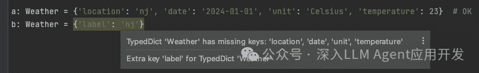
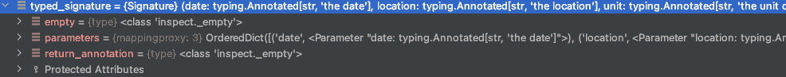

# LLM多智能体AutoGen教程6：Python typing是如何自动生成工具调用请求参数的？

> 来源：[https://agijuejin.feishu.cn/docx/MIHldcJY7oc2fpxa2xtc5ULYn4W](https://agijuejin.feishu.cn/docx/MIHldcJY7oc2fpxa2xtc5ULYn4W)

> 作者：还就可 | 深入LLM Agent应用开发

> 原文： [https://mp.weixin.](https://mp.weixin.qq.com/s/_w3D_RJr33XKZQTByI🐧Wg)qq.com/s/_w3D_RJr...

书接上文《26K Star!LLM多智能体Aut...oGen教程5：函数调用之避免捏造参数》，我们使用`typing`对可调用函数进行注解，`AutoGen`据此自动生成`OpenAI API`函数调用时的请求参数。本文将简要介绍`Python`中`typing`包的基础操作，顺便简单的介绍一下`Pydantic`，然后深入`AutoGen`的流程，探查`AutoGen`如何通过`typing`帮助自动生成`Open AI API`工具调用的参数。

由于`Python`是动态解释型语言，不像静态语言，必须得声明类型，而`Python`通常无需声明类型，采用自动推导。而`typing`包的引入，就是为了支持类型提示，注意是提示，而不是声明，他的类型在运行时依然是动态的。而`Pydantic` [1] 是 `Python` 中最广泛使用的数据验证库，快速且可扩展，`Pydantic`可以很好地配合你的代码检查工具/`IDE`/`思维方式`，采用纯正的、规范的 `Python 3.8+` 定义数据的格式。`Pydantic`之所以是最快的，是因为它是采用`Rust`编写的。

## 1 Python内置typing

使用`Python`时候，我们常常并不添加函数参数类型，阅读代码时候，常常需要根据上下文才能得知具体的类型。比如上文 `get_current_weather` 函数，通常我们直接写作：

```
def get_current_weather(date, location, unit):
    pass
```

当然，有时候我们还会采用注释来说明函数功能，参数类型，如下所示。

```
def get_current_weather(date, location, unit):
    """Get the current weather in a given location

    Args:
        date: the date of weather
        loction: the location of weather
        unit: the unit of temperature, should be one of Celsius and Fahrenheit

    Returns:
        Returned a dict contain the current weather of given location and date like
        {'date': '2024-01-02',
        'location': '南京',
        'unit': 'Celsius',
        'temeprature': 23}
    """
```

虽然注释已经说明了函数的功能、输入和输出，但是并没有一个统一的标准，只能作为阅读文档参考。所以`Python`自`3.5`引入了`typing`来支持类型提示，让我们简单过一遍`typing`的使用方法，本文并不打算对着`typing`文档翻译，而是选择我们常用的`typing`进行解决，更深入的仍然需要读者自行探索。此外，在 `PEP-484` [2] 仍然备注到：

> `Python` 仍然是一种动态类型语言，并且作者不希望强制使用类型提示，即使按照惯例。

### 1.1 简单类型提示

```
def greeting(name: str, age: int) -> str:
    return f'Hello {name}, you are {age} years old'
```

使用参数名：类型以设置参数类型，通过 `->` 来设置预期返回值的类型。除了这些通用类型，对于`dict`、`tuple`和`list`，也同样适用标注。

```
from typing import List, Tuple, Dict 

x: List[Union[int, float]] = [2, 3, 4.1]
dim: Tuple[int, int, int] = (11, 22, 33)
rectangle: Dict[str, int] = {
    'height': 340,
    'width': 500,
}
```

然而，我们经常一个参数多个类型，我们可以使用`Union`来表示参数可选类型。

```
def greeting(name: str, age: int, height: Union[int, float]) -> str:
    return f'Hello {name}, you are {age} years old and {height} cm'
```

对于同时支持输入除了自身类型，还可以为 `None` ，除了使用`Union`表示 `Union[str, None]` ，还可以使用更简洁的 `Optional` 。

```
def greeting(name: Optional[str], age: int, height: Union[int, float]) -> str:
    return f'Hello {name}, you are {age} years old and {height} cm'
```

有时候我们会使用`enum`来限定输入参数的值选项，在类型提示中也有用于限定输入参数的字面量可选值 `Literal` ，比如打开文件的模式选择，

```
type Mode = Literal['r', 'rb', 'w', 'wb']
def open_helper(file: str, mode: Mode) -> str:
    ...
```

### 1.2 自定义类型提示

以上文中自定义的天气类型为例，我们是用`TypedDict`这一特殊构造函数来添加类型提示到字典`dict`中。有时候，我们经常使用`dict`来传递参数，然而`dict`中有哪些键值是不明确的。个人觉得这并不是是一个好的工程方式，当然`Python`本身是支持这种动态特性的。使用`TypedDict`可以用来限定的`dict`的`key`和类型，如下所示，如果没有提供定义的`key`，也只是在类型提示时候会报错，运行时并不会出问题。

```
from typing import TypedDict
class Weather(TypedDict):
    location: str
    date: str
    unit: str
    temperature: int
a: Weather = {'location': 'nj', 'date': '2024-01-01', 'unit': 'Celsius', 'temperature': 23}  # OK
b: Weather = {'label': 'nj'}           # Fails type check
```



image-20240611125440453

默认 `TypedDict` 是需要填入所有参数才不会提示报错。但如果为了实现`key`是可选的，即部分`key`强制包含，其他可选，可以配合 `total` 使用 `Required` 。

```
class Weather2(TypedDict, total=False):
    location: Required[str]
    date: str
    unit: str
    temperature: int

c: Weather2 = {'location': 'nj'}  # OK
```

> 注意：`Required`只在`3.11`才提供，之前版本需要使用 `from typing_extensions import Required` 。

### 1.3 标注可调用对象

对于函数，我们使用`Callable`标注，使用类似于 `Callable[[int], str]` 来注解，语法包含两个参数，前者是参数类型列表，后者表示返回类型，返回类型必须是单一类型。

```
from typing import Callable

def concat(x: str, y: str) -> str:
    return x + y

x: Callable[..., str] = concat
```

### 1.4 给注解添加元数据

使用`Annotated`给注解加入元数据，方法是使用形如 `Annotated[T, x]` 将元数据`x`添加到给定类型`T`。有点抽象，举个例子，就是在使用`LLM`的工具调用时候，参数也需要类型和注释，`Annotated` 就能实现。

```
def get_current_weather(date: Annotated[str, "the date"], location: Annotated[str, "the location"],
                        unit: Annotated[str, "the unit of temperature"]) -> Annotated[
    Weather, "A dictionary representing a weather with location, date and unit of temperature"]:
    """Get the current weather in a given location"""
    return {
        "location": location,
        "unit": unit,
        "date": date,
        "temperature": 23
    }
```

通过使用 `Annotated` 我们给参数 `date` 、 `location` 、 `unit` 甚至是返回值自定义类型都加上了类型和参数说明。

### 1.5 类型变量TypeVar

类型变量，构造类型变量的推荐方式是使用泛型函数、泛型类和泛型类型别名的专门语法。

```
typing.TypeVar(name, *constraints, bound=None, covariant=False, contravariant=False, infer_variance=False)
```

其中`name`，比如说定义泛型类型`T`，就是这个`T`。`bound`用来将泛型类型绑定到特定类型，这样在静态类型检查器就可以知道他们到底接受的是什么类型，它可以作为泛型类型、泛型函数和类型别名定义形参。

```
T = TypeVar('T')  # Can be anything
S = TypeVar('S', bound=str)  # Can be any subtype of str
A = TypeVar('A', str, bytes)  # Must be exactly str or bytes

def repeat[T](x: T, n: int "T") -> Sequence[T]:
    """Return a list containing n references to x."""
    return [x]*n

def print_capitalized[S: str](x: S "S: str") -> S:
    """Print x capitalized, and return x."""
    print(x.capitalize())
    return x

def concatenate[A: (str, bytes)](x: A, y: A "A: (str, bytes)") -> A:
    """Add two strings or bytes objects together."""
    return x + y
```

## 2. Pydantic

前面已经说到`Pydantic`是世界上最广泛使用的`Python`的`validation`库，它基于`typing`包进行数据验证和序列化，采用`Rust`编写最快的内核验证代码，可以轻易生成`JSON Schema`，支持常见数据类型转换（比如`str`解析为`int`、字符串转换为时间），还兼容`dataclass`和`TypedDict`等。

```
pip install pydantic
```

基本使用方法，是定义类型，并继承自`Pydantic`的`BaseMode`。

```
from datetime import datetime
class User(BaseModel):
    id: int
    name: str = "X2046"
    birthday: Optional[datetime] = None
    age: Annotated[int, Field(description="the age of user", alias="age", gt=18)]
    address: Annotated[str, Field(default='nj', description="the default location of user", alias="city")]

user = User(id='123', birthday='2024-06-01')
assert user.id == 123
print(user.name)
> X2046
print(isinstance(user.id, int))
> True
print(user.model_dump())
> {'id': 123, 'name': 'X2046', 'birthday': datetime.datetime(2024, 6, 1, 0, 0), 'age': 20, 'address': 'nj'}
print(user.model_dump_json())
> {"id":123,"name":"X2046","birthday":"2024-06-01T00:00:00","age":20,"address":"nj"}
print(user.model_dump_json(by_alias=True))
> {"id":123,"name":"X2046","birthday":"2024-06-01T00:00:00","age":20,"city":"nj"}
```

在实例化`User`时，会执行所有的解析和验证，可以看到

+   `id`类型为`int`，但传入的是`str`，自动解析为`int`类型。

+   `birthday`，类型为`datetime`或者`None`，但传入的是字符串，也被自动解析为`datetime`类型

+   `name`和`birthday` 都有默认值，在`typing`中这被认为 `NotRequired` ，而`id`是 `Required` ，因此在`validation`阶段如果`id`没填就会报错。


使用 `BaseModel` 的 `model_dump` 方法可以将类型转换为 `dict` ，也可以使用 `dict(user)` 转换，但前者支持对嵌套类型转换，而后者不会递归只能转换第一层。 `model_dump_json()` 支持将类型转换为JSON字符串。之前就有说到`Pydantic`完全兼容Python的`typing`，因此我们也能够使用`Annotated`标注注解，并且结合`Pydantic`的 `Field` 设定一些一些额外的元数据，比如描述、默认值、序列化的标签以及一些简单的限制。你可以看到我们对`age`设定了参数描述，并且要求必须大于等于18，否则`validation`就会报错。而在`address`中，我们要求`alias`为`city`，所以在序列化为JSON时候并且指定`by_alias`时，即可输出定义的别名。

其他诸如`Serialization`、`Validators`等特性需要读者自行探索 `Pydantic`官方文档 [3] ，本文所述已经足够日常基本使用。

## 3. AutoGen如何将其转换为tools参数呢？

上文我们使用 `ConversableAgent` 的方法 `register_for_llm` 将函数注册到 `Agent` 上，并且提供了函数的描述。为啥需要单独提供函数的说明呢？因为 `typing` 也没有提供描述函数功能的API，所以还是需要单独描述一下。

```
assistant.register_for_llm(name="get_current_weather", description="Get the current weather in a given location")(
    get_current_weather)
```

那么 `register_for_llm` 内部是如何实现的呢？如下代码显示，`F` 是用来定义函数类型，并且将其绑定到一个 `Callable[..., Any]` ，然后返回的注解是 `Callable[[F], F]` ，其内部是实现一个装饰器。这里注意那个 `api_style` 它使用了字面量进行注解，其值可以是 `function` 和 `tool` ，并且默认是 `tool` ，这是因为OpenAI API自v1.1.0弃用了 `function` 转而采用 `tool` 。

```
F = TypeVar("F", bound=Callable[..., Any])

def register_for_llm(
        self,
        *,
        name: Optional[str] = None,
        description: Optional[str] = None,
        api_style: Literal["function", "tool"] = "tool",
    ) -> Callable[[F], F]:
    
    def _decorator(func: F) -> F:
      ...
      return func
    return _decorator
```

`_decorator` 接收一个函数参数，如下代码所示，代码有所省略。

```
def _decorator(func: F) -> F:
    ...
    # get JSON schema for the function
    f = get_function_schema(func, name=func._name, description=func._description)
    ...
    elif api_style == "tool":
        self.update_tool_signature(f, is_remove=False)
    else:
        raise ValueError(f"Unsupported API style: {api_style}")

    return func
```

从这个代码来看，它将函数的注释、名称保存到`func`上，并且最后通过 `update_tool_signature` 将`f`更新到`llm_config`的`tools`上。其中 `get_function_schema` 获取`function`的JSON Schema。

```
def get_function_schema(f: Callable[..., Any], *, name: Optional[str] = None, description: str) -> Dict[str, Any]:
    
    typed_signature = get_typed_signature(f)
    required = get_required_params(typed_signature)
    default_values = get_default_values(typed_signature)
    param_annotations = get_param_annotations(typed_signature)
    return_annotation = get_typed_return_annotation(f)
    missing, unannotated_with_default = get_missing_annotations(typed_signature, required)
    ...
    fname = name if name else f.__name__
    parameters = get_parameters(required, param_annotations, default_values=default_values)
    function = ToolFunction(
        function=Function(
            description=description,
            name=fname,
            parameters=parameters,
        )
    )

    return model_dump(function)
```

这个方法通过获取函数的签名信息，然后将函数转换为`Pydantic`的子类，从而就可以通过`Pydantic`的`model_dump`转换为`tools`的`dict`行驶。该函数中最主要的是 `get_typed_signature` ，它采用`python`的 `inspect` 包实现对函数的解析，也被称为现场检查对象，在其他语言中差不多就是反射。这里我们只看 `signature` ，它获取方法和函数签名，一般来讲函数签名通常包括函数名、参数类型列表、返回类型等。

```
signature = inspect.signature(call)
```

具体如何反射就不多说了，大家可以搜索相关教程或者参考官方文档，它将返回如下信息。



image-20240611185602357

之后就是从返回的`signature`中获取参数要求，它会通过`parameters`中获取到想要的一切信息，比如 `param_annotations` ，生成一个`dict`。

```
def get_param_annotations(typed_signature: inspect.Signature) -> Dict[str, Union[Annotated[Type[Any], str], Type[Any]]]:
    return {
        k: v.annotation for k, v in typed_signature.parameters.items() if v.annotation is not inspect.Signature.empty
    }
```

然后实例化 `ToolFunction` 并将其导出为`dict`，其中 `ToolFunction` 是`AutoGen`自定义的类，它继承自`Pydantic`的`BaseModel`，其内部字段`function`也是继承自`Pydantic`，如下代码所示。

```
class ToolFunction(BaseModel):
    """A function under tool as defined by the OpenAI API."""

    type: Literal["function"] = "function"
    function: Annotated[Function, Field(description="Function under tool")]

class Function(BaseModel):
    """A function as defined by the OpenAI API"""

    description: Annotated[str, Field(description="Description of the function")]
    name: Annotated[str, Field(description="Name of the function")]
    parameters: Annotated[Parameters, Field(description="Parameters of the function")]
```

最后，通过`Pydantic`的`model_dump`将继承自`Pydantic` `BaseModel`的`ToolFunction`转换成字典，也就是Open AI API所需的`tools`参数。

```
def model_dump(model: BaseModel) -> Dict[str, Any]:
    return model.dict()
```

```
{'type': 'function', 'function': {'description': 'Get the current weather in a given location', 'name': 'get_current_weather', 'parameters': {'type': 'object', 'properties': {'date': {'type': 'string', 'description': 'the date'}, 'location': {'type': 'string', 'description': 'the location'}, 'unit': {'type': 'string', 'description': 'the unit of temperature'}}, 'required': ['date', 'location', 'unit']}}}
```

回到装饰器中，此时已经获得了函数schema `f` ，然后通过 `update_tool_signature` 将其赋值到 `self.llm_config["tools"] = [tool_sig]` 。

## 4. 总结

本文通过简单介绍Python的类型提示系统`typing`和Python中广受开发者爱好的数据验证器`Pydantic`，并深入分析`AutoGen`中工具调用的流程分析，从而为我们如何更好的进行工具调用打下了坚实的基础。下一篇我们开始分析如何使用`AutoGen`进行规划分析。

如果你意犹未尽，想要参与LangChain实战课程，可以考虑点击原文购买《LangChain 实战：LLM 应用开发指南》，亲历LLM应用开发之旅。现在正在参加618活动，价格只有平时一半。

关注点赞收藏不迷路，获取即时更新。

## 参考资料

[1]Pydantic: https://docs.pydantic.dev/latest/

[2]PEP-484: https://peps.python.org/pep-0484/

[3]Pydantic官方文档: https://docs.pydantic.dev/latest/concepts/models/
