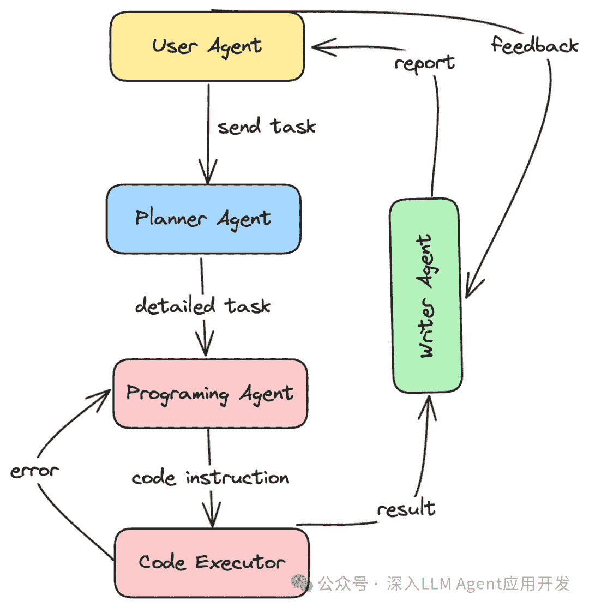
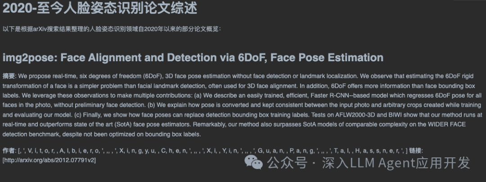
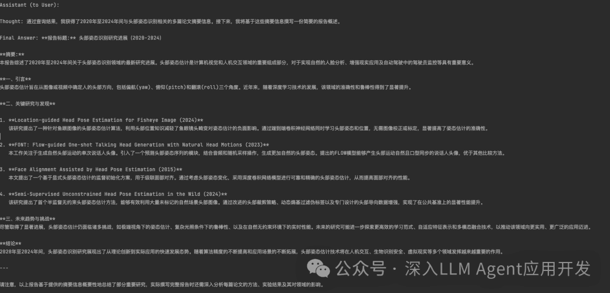

# 什么你还在自己查阅论文？快用AutoGen自动获取多篇论文并撰写报告

> 来源：[https://agijuejin.feishu.cn/docx/EtxVdCc9soxmtlx9yqFcc0cpnDb](https://agijuejin.feishu.cn/docx/EtxVdCc9soxmtlx9yqFcc0cpnDb)

> 作者：还就可 | 深入LLM Agent应用开发

> 原文： [https://mp.weixin.](https://mp.weixin.qq.com/s/MFe70LYtZ_Irfk8WEiJTgQ)qq.com/s/MFe70LYt...

本篇是 LLM多智能体AutoGen教程系列 的第7篇。

---

最近需要优化人脸姿态评估模型，往常我需要调研当前业界最新论文，在`arxiv`上查阅论文，然后到 `paperwithcode` [1] 上查看相关算法`benchmark`上的排名，最后选定论文和模型。今天在`deeplearning.ai`的课程上看到使用`AutoGen`自动获取`NVIDIA`最近一年的股价并撰写一篇股票分析报告的实验，于是突发奇想，我为什么不用`AutoGen`写一个根据我的需求自动调研最近4年人脸姿态评估论文并撰写一个报告给我呢？这样至少给我节省不少时间，而且最终会给我输出一份中文报告岂不美哉？正所谓 `Talk is cheap, show me your code` ，开干！

## 1. 对话流程设计

要实现这样的任务，需要获取自动编码获取论文和摘要，然后根据获取到的论文摘要进行论文撰写报告。所以大概需要发布任务的Agent、规划任务步骤的Agent、编码获取信息的Agent、执行编码的Agent以及撰写报告的Agent。大致流程如下图所示

+ `UserAgent`发送任务给`PlannerAgent`

+ `PlannerAgent`开始规划任务

+ `ProgrammingAgent` 通过编写程序获取规划任务中的信息并发送给`Code Executor`

+ `Code Executor`执行编码

+ 如果程序运行出错，则反馈给`ProgrammingAgent`，其根据反馈调整代码，再次给到`Code Executor`

+ 如果程序运行成功，则输出结果给到`WriterAgent`

+ `WriterAgent`根据给定信息开始撰写报告，并发送给`UserAgent`审核

+ 如果审核通过，结束

+ 如果审核失败，则反馈给`Writer`让其优化。



## 2. 对话实现

想必大家已经熟悉了如何编写`llm_config`，如何实例化 `ConversableAgent` ，这里不再多说，其中system prompt较长有所删减，有需要的同学评论区留言。

```
user_proxy = autogen.ConversableAgent(
    name="Admin",
    system_message="Give the task, and send instructions to writer to refine the blog post.",
    code_execution_config=False,
    llm_config=llm_config,
    human_input_mode="ALWAYS",
)

planner = autogen.ConversableAgent(
    name="Planner",
    system_message="Given a task, please determine "
    "...",
    description="Given...",
    llm_config=llm_config,
)

engineer = autogen.AssistantAgent(
    name="Engineer",
    llm_config=llm_config,
    description="Write code based on the plan "
    "provided by the planner.",
)

writer = autogen.ConversableAgent(
    name="Writer",
    llm_config=llm_config,
    system_message="Writer. Please write blogs in markdown format (with relevant titles)",
    description="After all ...",
)

executor = autogen.ConversableAgent(
    name="Executor",
    description="Execute the code written by the engineer and report the result.",
    human_input_mode="NEVER",
    code_execution_config={
        "last_n_messages": 3,
        "work_dir": "coding",
        "use_docker": False,
    },
)
```

我们在《 [100行代码演绎AI版“狼人杀”-伟大](http://mp.weixin.qq.com/s?__biz=MzI0OTAzNTEwMw==&mid=2247483827&idx=1&sn=127025966b7121aa1952d2f0fb2c82b3&chksm=e996e183dee16895313ba090477bf40f03c58143ba900e279e0d90924cdec872aedb8b6a8cbd&scene=21#wechat_redirect) 的人类竟因展现出的战争哲学和领导力出局 》已经讲解了 `GroupChat` ，当时我们采用 round robin 轮询式的对话模式。`AutoGen`还支持自定义对话目标Agent，方法是通过设定`GroupChat`的参数。我们先了解一下`GroupChat`的参数都有哪些，它的参数比较多，我们捡重点的说明

+ `agents` - `List[Agent]` 一组对话的Agent

+ `message` - `List[Dict]` 需要传入groupchat的消息列表

+ `max_round` - 最大允许对话的次数

+ `speaker_selection_methond` - 支持字面量和可调用对象，默认是`auto`模式，由LLM自动根据Agent的描述选择

+ `allowed_or_disallowed_speaker_transitions` - `Dict` 这个参数命名真长，顾名思义就是话筒传递设定，接受一个dict，key为source agent也就是当前持有话筒的Agent，其value是`List[Agent]`，可传递或者禁止传递话筒的目标Agent列表。

+ `spearker_transitions_type` 设定上面话筒传递列表是允许传递还是禁止传递方向，`allowed`或者`disallowed`

+ `send_introductions` - `bool` 默认为`False`，是否要群聊开始前各自介绍一下自己，方便自动转换。

所以按照第一节图中设计的对话顺序，实例化`GroupChat`如下

```
groupchat = autogen.GroupChat(
    agents=[user_proxy, engineer, writer, executor, planner],
    messages=[],
    max_round=10,
    allowed_or_disallowed_speaker_transitions={
        user_proxy: [writer, planner],
        engineer: [executor],
        writer: [user_proxy],
        executor: [engineer],
        planner: [engineer],
    },
    speaker_transitions_type="allowed",
)
```

群已组好，然后实例化群管理员`GroupChatManager`。`GroupChatManager`，继承自 `ConversableAgent` ，除了其父类的参数，还另外包含以下几个参数

+ `groupchat` - `GroupChat` 把群赋给它

+ `name` - `Optional[str]` 管理员名称

因此如下实例化`GroupChatManager`，并通过 `initial_chat` 发起对话。

```
manager = autogen.GroupChatManager(
    groupchat=groupchat, llm_config=llm_config
)

task = "使用arxiv获取2020-2024年期间所有人脸姿态识别的论文并写一篇报告"
groupchat_result = user_proxy.initiate_chat(
    manager,
    message=task,
)
```

## 3. 运行

由于自动编码调试，无法输出稳定的结果。虽然它可以在`engineer`和`executor`之间不断调试代码，但是流程仍然是难以控制，无法稳定到输出结果给到`Writer`进行撰写报告。调试了一下午，只有一次通过爬虫获取到了部分论文的标题摘要，而且LLM并没有自动选择使用`Writer`撰写最后的报告。另外，个人认为使用LLM自动选择Agent来发言，是一个不太成熟的方法，对于LLM本身要求应该比较高，还是直接设定流程，会比较稳定一些。



`image-20240614194956705`

## 4. 优化

在整个环节中，因为自动编码无法稳定输出获取的论文，可以考虑尝试自己编写获取`arxiv`论文的代码，这样能够稳定输出论文，从而能够充分利用大语言模型自动撰写报告。

### 4.1 arXiv

`arXiv` 是一个开放给所有人的精选研究共享平台。作为数字开放获取的先锋，`arXiv.org` 现在托管着超过二百万篇学术文章，这些文章涵盖了**八个学科领域，并**由强大的志愿者社区进行筛选和管理。这8个领域包括：物理学、数学、计算机科学、定量生物学、定量金融、统计学、电气工程和系统科学、经济学。它开放了 `API` [2] 方便获取，而在`Python`中我们可以通过`arxiv`的`pip`包进行检索或者获取论文。`arxiv`包较为简单，包含三个类型`Client`、`Search`和`Result`。其中`Client`用于指定可重用的获取结果的策略，`Search`用于指定查询条件，`Result`则是获取的结果，还包括一个下载论文的辅助方法。

+ 首先安装`arxiv`的`pip`包

```
pip install arxiv
```

+ 编写获取论文代码

```
import arxiv
client = arxiv.Client()
# 设定检索条件
search = arxiv.Search(
  query = "head pose estimation",
  max_results = 10,
  sort_by = arxiv.SortCriterion.SubmittedDate
)
# 获取返回结果
paper = next(client.results(search))
print(paper.title, paper.summary)
```

检索论文就是如此方便，这里需要注意的 `client.results(search)` 返回的是 `Generator[Result, None, None]` ，因此你需要使用generator来获取调用结果。接下来，我们尝试在上文《26K Star!LLM多智能体AutoGen教程6：Python typing是如何自动生成工具调用请求参数》讨论使用的`Python typing`来注解这个函数。此外，由于`arxiv`没有时间过滤功能，要么自己获取大量论文后，手动按照时间过滤，这请求量会比较大，本文暂不考虑时间过滤，其次，考虑到论文的数量不宜过多，可能会超过`LLM`的`Context Window`，因此限制数量大小默认为10。后面学习`LlamaIndex`后，或许可以考虑`RAG`式的方法。

```
class Paper(TypedDict):
    title: str
    published: str
    summary: str

def search_arxiv(query: Annotated[str, "query string of arxiv"],
                 max_results: Annotated[Optional[int], "the max result from arxiv"] = 10) -> Annotated[List[Paper], "a List of paper contains paper's title, published and summary"]:
    import arxiv
    client = arxiv.Client()
    # 执行检索
    search = arxiv.Search(
        query=query,
        max_results=max_results,
        sort_by=arxiv.SortCriterion.Relevance
    )

    results = list(client.results(search))
    papers = []
    for result in results:
        papers.append(Paper(title=result.title, published=result.published.strftime("%Y-%M-%d"), summary=result.summary))
    return papers
```

### 4.2 编写对话流

在`4.1`中已经实现适合`LLM`函数调用的检索`arxiv`方法，在这一节我们将尝试使用`ReAct`式的流程来实现函数调用。根据官方教程中教程 `ReAct` [3] 的用法，它的`Prompt`是根据`Langchain`中`Prompt`模板来设置的。`ReAct`能够推导当前要做什么`Thought`，`Action`是什么，然后执行`Action`，再把结果给到`Observation`，如果对话继续，`Thought`会根据`Observation`得出是否要继续下一步。以下是`Prompt`模板：

```
ReAct_prompt = """
Answer the following questions as best you can. You have access to tools provided.
Use the following format:
Question: the input question you must answer
Thought: you should always think about what to do
Action: the action to take
Action Input: the input to the action
Observation: the result of the action
... (this process can repeat multiple times)
Thought: I now know the final answer
Final Answer: the final answer to the original input question
Begin!
Question: {input}
"""
```

实例化用户和助手`Agent`，代码如下：

```
user_proxy = UserProxyAgent(
    name="User",
    is_termination_msg=lambda x: x.get("content", "") and x.get("content", "").rstrip().endswith("TERMINATE"),
    human_input_mode="ALWAYS",
    max_consecutive_auto_reply=10,
    code_execution_config={"work_dir": "coding", "last_n_messages": 3, "use_docker": False},
)

assistant = AssistantAgent(
    name="Assistant",
    system_message="Only use the tools you have been provided with. Reply TERMINATE when the task is done.",
    llm_config=llm_config,
)
```

将函数注册到两个`Agent`上：


```
register_function(
    search_arxiv,
    caller=assistant,
    executor=user_proxy,
    name="search_arxiv",
    description="Search the arxiv for the given query to get the paper",
)
```

最后调用对话，其中自定义了 `message` 使用 `react_prompt_message` 方法构造Prompt输入。

```
def react_prompt_message(sender, recipient, context):
    return ReAct_prompt.format(input=context["question"])

task = "使用arxiv包获取2020-2024年期间所有头部姿态识别的论文并撰写一篇报告"
papers = user_proxy.initiate_chat(
    assistant,
    message=react_prompt_message,
    question=task,
)
```

## 4.3 运行

首先ReAct推导当前的需要做的事情，最终输入到LLM的参数如下，可以看到 `tools` 参数：

```
{'messages': [{'content': 'Only use the tools you have been provided with. Reply TERMINATE when the task is done.', 'role': 'system'}, {'content': '\nAnswer the following questions as best you can. You have access to tools provided.\n\nUse the following format:\n\nQuestion: the input question you must answer\nThought: you should always think about what to do\nAction: the action to take\nAction Input: the input to the action\nObservation: the result of the action\n... (this process can repeat multiple times)\nThought: I now know the final answer\nFinal Answer: the final answer to the original input question\n\nBegin!\nQuestion: 使用arxiv包获取2020-2024年期间所有头部姿态识别的论文并撰写一篇报告\n', 'role': 'user'}], 'tools': [{'type': 'function', 'function': {'description': 'Search the arxiv for the given query to get the paper', 'name': 'search_arxiv', 'parameters': {'type': 'object', 'properties': {'query': {'type': 'string', 'description': 'query string of arxiv'}, 'max_results': {'anyOf': [{'type': 'integer'}, {'type': 'null'}], 'default': 10, 'description': 'the max result from arxiv'}}, 'required': ['query']}}}], 'model': 'qwen-max', 'temperature': 0.7}
```

此时LLM给出推导 `Thought` 和 `Action` 以及 `Action` 的输入，并且字段 `tools` 告知AutoGen需要调用工具 `search_arxiv` 并且给出了参数：

```
ChatCompletionMessage(content='Thought: 首先，我需要使用search_arxiv函数来搜索相关的论文。由于直接查询可能无法精确限定年份和主题范围，我将首先尝试使用一个宽泛的查询字符串，然后在结果中筛选出符合2020-2024年且关于头部姿态识别的论文。不过，请注意，实际执行此任务时，我只能调用函数，无法直接撰写报告，但我可以提供如何根据检索结果撰写报告的指导和建议。\n\nAction: search_arxiv\nAction Input: {"query": "head pose estimation", "max_results": 50}', role='assistant', function_call=None, tool_calls=[ChatCompletionMessageToolCall(id='', function=Function(arguments='{"query": "head pose estimation", "max_results": 50}', name='search_arxiv', type='function')])
```

调用 `search_arxiv` 函数返回如下50条论文信息，由于返回太多，考虑阅读体验，做了删减。此外，除非LLM的Token限制比较大，否则这里最好是给他反馈将参数调小，不然很容易报502。

```
[{"title": "Location-guided Head Pose Estimation for Fisheye Image", "published": "2024-33-28", "summary": "Camera with ..."}, ...]}
```

既然工具调用已经结束，那么工具返回的结果，如何请求呢？从下面的调用请求上来看，这里ReAct Prompt里 `Observation` 是没有填写的，不似我们之前在文章《[LLM-Agents]万字长文深度解析Agent反思工作流框架Reflexion中篇：ReAct》解析 `Reflexion` 中所见那样，手动填写 `Observation`。它是每一轮都从 `Thought`、`Action`、`Action Input` 走一遍，最后工具调用的结果放在角色为 `tool` 的消息中。

```
{'content': 'Only use the tools you have been provided with. Reply TERMINATE when the task is done.', 'role': 'system'}

{'content': '...Begin!\nQuestion: 使用arxiv包获取2020-2024年期间所有头部姿态识别的论文并撰写一篇报告\n', 'role': 'user'}

{'content': 'Thought: 首先，...。Action: search_arxiv\nAction Input: {"query": "head pose estimation", "max_results": 50}', 'tool_calls': [{'id': '', 'function': {'arguments': '{"query": "head pose estimation", "max_results": 50}', 'name': 'search_arxiv'}, 'type': 'function'}], 'role': 'assistant'}

{'role': 'tool', 'tool_call_id': '', 'content': 'USER INTERRUPTED'}

{'content': '最大结果数量改为10条', 'role': 'user'}

{'content': 'Thought: 由于用户希望减少最大结果数量以获取更精炼的信息，我将重新执行查询，这次将最大结果数量设置为10。\n\nAction: search_arxiv\nAction Input: {"query": "head pose estimation", "max_results": 10}', 'tool_calls': [{'id': '', 'function': {'arguments': '{"query": "head pose estimation", "max_results": 10}', 'name': 'search_arxiv'}, 'type': 'function'}], 'role': 'assistant'}

{'tool_call_id': '', 'role': 'tool', 'content': '[{"title": "Location-guided Head Pose Estimation for Fisheye Image", "published": "2024-33-28", "summary": "..."}, {"title": "FONT: Flow-guided One-shot Talking Head Generation with Natural Head Motions", "published": "2023-25-31", "summary": "..."}, {"title": "Face Alignment Assisted by Head Pose Estimation", "published": "2015-07-11", "summary": "..."}, {"title": "Human Head Pose Estimation by Facial Features Location", "published": "2015-15-09", "summary": "..."}, {"title": "Towards Head Motion Compensation Using Multi-Scale Convolutional Neural Networks", "published": "2018-57-10", "summary": "..."}, {"title": "Deep Entwined Learning Head Pose and Face Alignment Inside an Attentional Cascade with Doubly-Conditional fusion", "published": "2020-42-14", "summary": "..."}, {"title": "A Marker-free Head Tracker Using Vision-based Head Pose Estimation with Adaptive Kalman Filter", "published": "2021-20-24", "summary": "..."}, {"title": "Nose, eyes and ears: Head pose estimation by locating facial keypoints", "published": "2018-04-03", "summary": "..."}, {"title": "Semi-Supervised Unconstrained Head Pose Estimation in the Wild", "published": "2024-01-03", "summary": "..."}]'}
```

从输入的消息来看，输入是包括了历史的输入和输出，因此最后的输出依然是重新推理要做的事情，并没有因为输入较多，导致LLM丢失要做的事情，它依然推导出下一步需要撰写报告。报告如下：



`image-20240617145428010`

## 5. 总结

本文尝试从查找论文入手，获取关于头部姿态评估的研究，并使用AutoGen自动编码来实现数据收集和报告撰写。我们设计了包括规划、工程、执行和写作等多个 `Agent`，并通过群聊和自动选择 `Agent` 的应答和转换来协调工作。然而，发现该流程过于动态，对LLM的要求较高，失败几率较大。

最终，我们决定编写检索论文的代码，并采用ReAct Prompt范式来完成报告撰写。尽管ReAct在任务执行上高效，但也显示出 `AssitantAgent` 承担了过多职责。它的设定应尽量简单。我们应该坚持专人专事的原则，分别使用不同的 `Agent` 来获取arXiv论文和撰写文档。这种做法允许我们对撰写文档的 `Agent` 设定更专业的Prompt，从而提高工作效率和专业性。

如果你意犹未尽，想要参与LangChain实战课程，可以考虑点击原文购买《LangChain 实战：LLM 应用开发指南》，亲历LLM应用开发之旅。现在正在参加618活动，价格只有平时一半。

关注点赞收藏不迷路，获取即时更新。

## 参考资料

[1] paperwithcode: https://paperswithcode.com/

[2] API: https://info.arxiv.org/help/api/user-manual.html

[3] ReAct: https://microsoft.github.io/autogen/docs/topics/prompting-and-reasoning/react/
