# 英伟达爆火智能体研究：AI逼真还原人类情感！会饿会孤独，会跑步会发火

> 来源：[https://agijuejin.feishu.cn/docx/OtZsdQPg4oDXl0xK6pJca8v4nKd](https://agijuejin.feishu.cn/docx/OtZsdQPg4oDXl0xK6pJca8v4nKd)

> 作者：新智元

> 原文：https://mp.weixin.qq.com/s/aPjhHMVHsKV1icUalSZv_w

**【新智元导读】**英伟达、华盛顿大学等机构提出的Humanoid Agents，行为竟如此接近人类！累了要休息，孤独要找人陪，发泄怒火时会跑步或冥想。

AI智能体，竟然能反映人类的真实情感，还有人际关系中微妙的距离感？


最近，来自英伟达、华盛顿大学、港大的研究人员发布了类人智能体Humanoid Agents。从名字就可以看出，这种智能体能够反映人类的基本需求。以往的智能体模拟，智能不完全地模仿人类行为，原因就在于，它们并没有真正反映出人类的基本需求、真实情感及人际间微妙的距离感。而Humanoid Agents的初衷，就是研发一个融合上述元素的、更贴近人类的智能体。

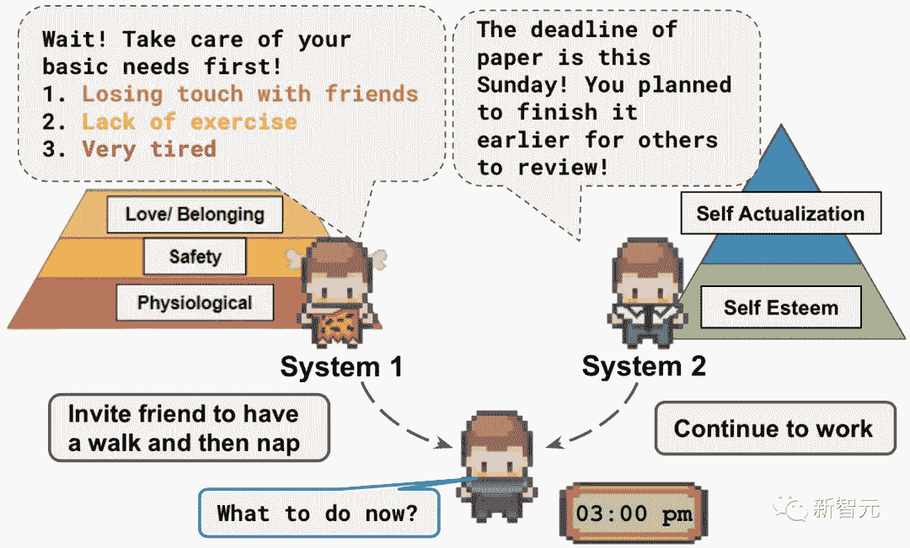

智能体受系统1思维和系统2思维的指导，系统1思维会响应具体条件（如基本需求），而系统2思维则涉及明确的规划

目前，论文已被EMNLP System Demonstrations 2023接收。

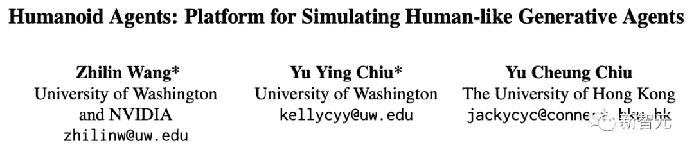

论文地址：https://arxiv.org/abs/2310.05418从这个视频可以看出，Humanoid Agents逼真地再现了《生活大爆炸》中谢耳朵和Penny交互的有趣场景。

【观看视频请阅读原文】

# **Humanoid Agents**

正如原子、分子和细胞的计算模拟塑造了我们研究科学的方式，类人智能体的真实模拟，也成为了研究人类行为的宝贵工具。

要知道，以往的智能体有一个缺点，它们虽然可以完成看似可信的行动，但跟真实的人类思维方式并不像。

绝大多数人类，并不会提前制定计划，然后在日常生活中精确到一丝不苟地执行这些计划。

为了减轻这个缺点的影响，研究者从心理学中汲取了灵感，提出了Humanoid Agents。

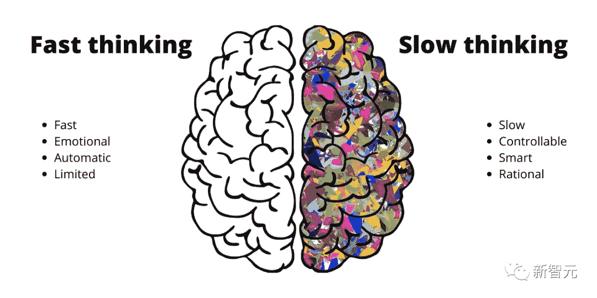

心理学家Kahneman认为，人类有两个互补的思维过程：系统1（直觉的、轻松的、即时的）和系统2（逻辑的、有意的、缓慢的）。

而这次研究者提出的Humanoid Agents，就引入了系统1所需的三个要素——基本需求（饱腹感、健康和能量）、情感和关系亲密程度，来让智能体表现得更像人类。

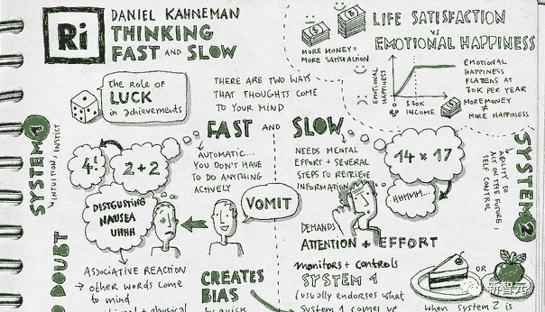

利用这些元素，智能体就能调整自己的日常活动，以及和其他智能体的对话。

而且，智能体也会像人一样，遵守马斯洛需求理论。

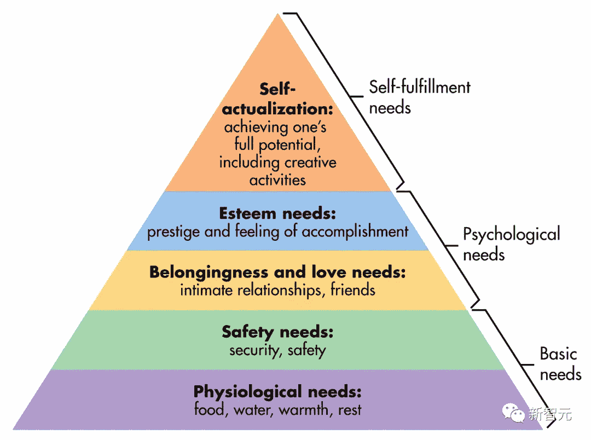

如果它们没有与他人充分地互动，它就会感到孤独；如果没有保持健康，就会得病；如果没休息够，就会感到疲劳。

如果仅靠系统2的规划，就可以让智能体规划休息时间，满足基本的需求。

然而如果没有系统1的反馈，智能体即使感到疲倦，也无法在下午3点小憩，因为就寝时间安排在午夜。

而如果智能体感到愤怒，它就需要干一些能发泄情绪的事情，比如跑步或冥想。


并且，智能体之间的关系密切程度，也会影响它们之间互动的方式。

社会大脑假说提出，我们的认知能力很大程度上是为了追踪社会关系的质量而进化的。

这就意味着，人们经常根据与他人相处的感觉和亲密程度，来调整与他人的互动。


为了更好地模仿人类，研究者让智能体能够根据彼此之间的距离，来调整对话。他们提出了一个平台，可以在生活大爆炸、老友记、Lin Family中模拟人形智能体的行为，然后用Unity WebGL游戏界面将它们可视化，并使用交互式分析仪表板，显示智能体随时间变化的状态。


实验证明，对于系统1各方面的变化，Humanoid Agents都可以有效响应并推断。而且，这种系统还可以扩展到更多方面，比如个性、道德价值观、同理心、乐于助人、文化背景等等。

# **工作原理**

Humanoid Agents中，研究人员采用了OpenAI的ChatGPT-3.5。

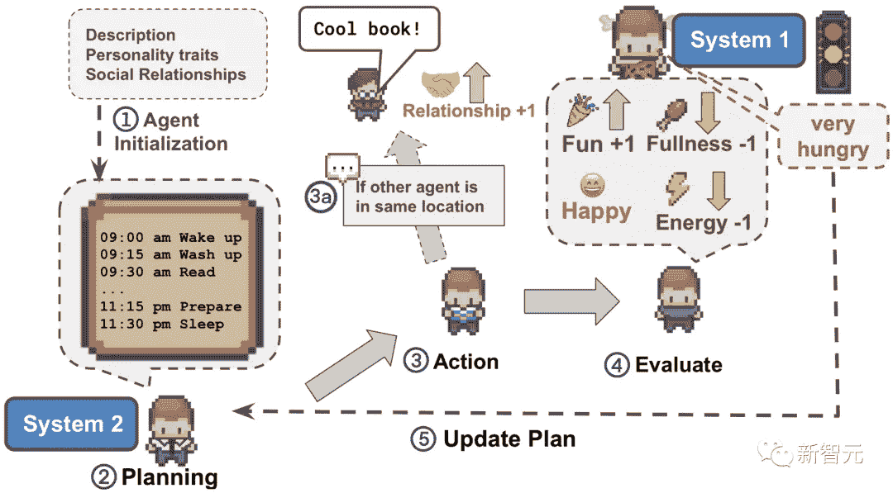

第1步：根据用户提供的种子信息初始化Agent。

简单说，就是每个Agent的人物设定，它们的名字、年龄、日程、喜好等，对其做出人物规划。

比如，「John Lin是一个Willow Market的药店店主，喜欢帮助他人」，特点是友好和善良。


此外，Humanoid Agents的默认情绪被设置为7种可能的情绪：愤怒、悲伤、恐惧、惊讶、高兴、中立和厌恶。

第2步：Agent开始计划自己的一天。

**第**3步：Agent根据自己的计划采取行动。如果同在一个地点，Agent可以相互交谈，进而影响他们之间的关系。

Agent日计划以1小时为间隔，能够递归地分解计划，然后，以15分钟为间隔，来改进活动随时间的逻辑一致性。

每15分钟，Agent在它们的计划中执行一项活动。

不过，Agent可以根据内部状态，即情绪和基本需求，的变化更新计划，或做补充。

比如，如果Agent目前非常饥饿，但计划是在3个小时后吃一顿饭。

这里，Agent可以在继续当前活动的同时，吃点零食，这就特别像打工人，开饭前可能发生的行为。


那么，这些Agent过利用情感和基本需求状态，以及与其他Agent亲密关系，将其转换成自然语言描述，进而决定如何与Agent相处。

在对话结束时，每个Agent将通过对话历史，来确定自己是否享受对话。

如果是这样，它们与其他Agent的亲密度将增加一倍，否则，亲密度将减少一倍。

从亲密关系逐渐改变，可以映射到人与人之间的关系如何随着时间的推移而发展。

此外，谈话历史也用来来确定Agent的情绪是否受到谈话的影响。

第4步：Agent评估所采取的行动是否改变了他们的基本需求和情绪。

第5步：根据基本需求和情感的满足情况，Agent可以更新未来的计划。

除了默认的五种需求（饱腹感、社交、健康、娱乐和能量）之外，还可以为Agent添加/删除更多的基本需求。

为此，用户需要按照以下格式，创建自己的default_agent_config.json文件：

```
{
    &quot;name&quot;: &quot;fullness&quot;, 
    &quot;start_value&quot;: 5, 
    &quot;unsatisfied_adjective&quot;: &quot;hungry&quot;, 
    &quot;action&quot;: &quot;eating food&quot;, 
    &quot;decline_likelihood_per_time_step&quot;: 0.05, 
    &quot;help&quot;: &quot;from 0 to 10, 0 is most hungry; increases or decreases by 1 at each time step based on activity&quot;
}
```

### 基本需求对活动的影响

Humanoid Agents是一个动态系统，由许多组成部分组成，因此将每个基本需求对Agent活动的影响分离出来是一个挑战。为了调查每个基本需求的贡献，研究人员模拟了一个Agent的世界。这些Agent最初有一个基本需求设置为0，让Agent在一天开始时，极度饥饿、孤独、疲劳、不适或无聊。


作者研究了在一个模拟的一天中，Agent为了满足基本需求而进行活动花费的时间。比如，为了克服饥饿而吃食物，为了缓解孤独而进行社交活动。

然后，研究人员将其与Agent在正常情况下（每个基本需求设置为5，能量设置为10）执行此类活动所花费的时间，进行比较，从而，计算出在测试条件下，用于满足每种基本需求所花费时间的增加百分比。

如下表所示，当健康（156%）、能量（56%）和饱腹感（35%）等基本需求被初始化为0时，Humanoid Agents对其活动的适应程度最高。

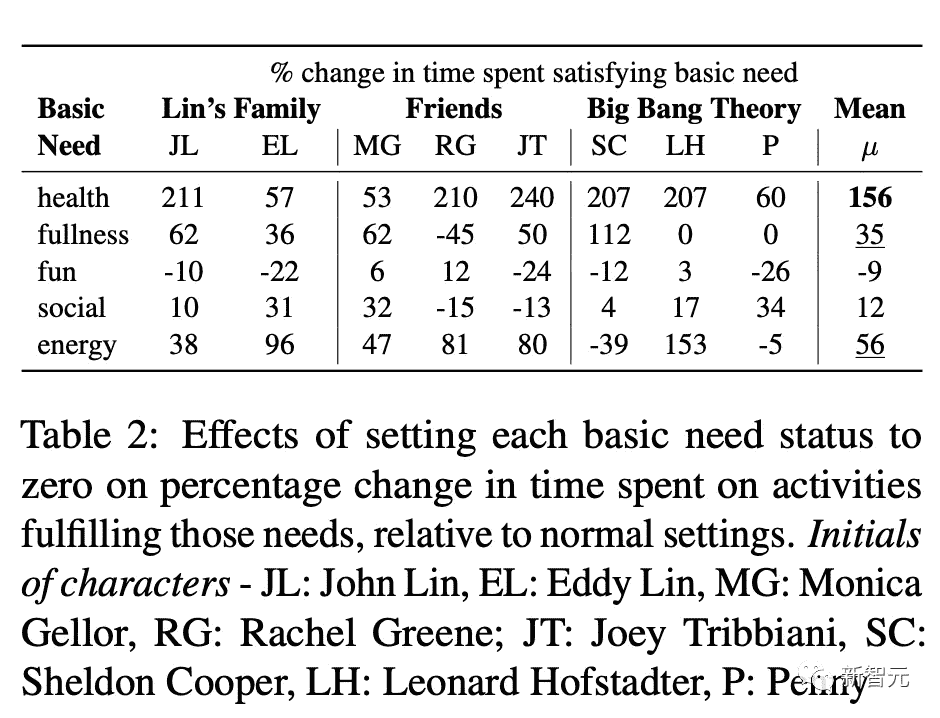

马斯洛将它们归类为低层次的「生理和安全需求」，人们在满足其他需求之前需要先满足这些需求，这证明了其重要性。

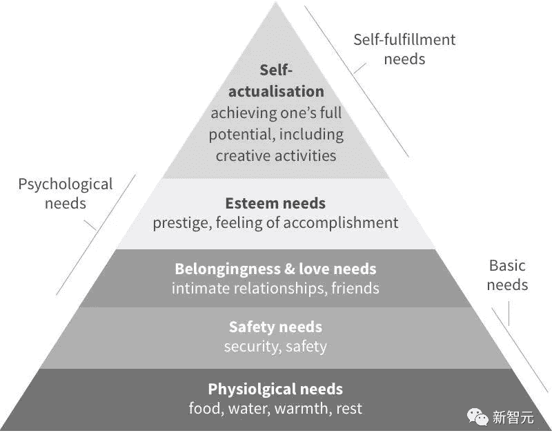

在这种情况下，行为主体通常会看病、休息、觅食等等。

另一方面，当Agent因缺乏社会交往而感到孤独时，它们只会稍微调整自己的行为（+12%），与其他Agent进行更多的交流。


此外，Agent社交和娱乐活动变化较小的另一个原因是：正常情况下，行为主体已经花费大量的时间，来做满足这些基本需求的活动。

平均而言，它们花费11个小时做自己喜欢的事，8.75个小时用于社交互动，只有5.75个小时用于休息，2.75个小时用于吃饭和做一些改善健康的事情。

这意味着，一开始将娱乐或社交设置为0的效果，在一天中很早时候消失，取而代之的是其他优先事项，包括工作义务，比如Penny在芝士蛋糕坊工作。

### 情绪对活动的影响

这里，作者研究了在一天的模拟中，Agent进行表达每种情绪的活动的次数（间隔15分钟）。

例如，当Agent生气的时候，会跑步来发泄愤怒；当伤心的时候，会寻求一个值得信赖的朋友的倾诉；当厌恶的时候，会练习深呼吸和冥想；当感到惊讶的时候，会花时间来处理和思考这些令人惊讶的发现。


然后，研究人员计算Agent在正常设置中，执行此类活动的次数的差值。

在正常情况下，Agent通常不会表现出悲伤、愤怒、恐惧、厌恶或惊讶的行为，不过实验结果显示，与正常情况下的Agent相比，表达这些情绪的行为数量有所增加。

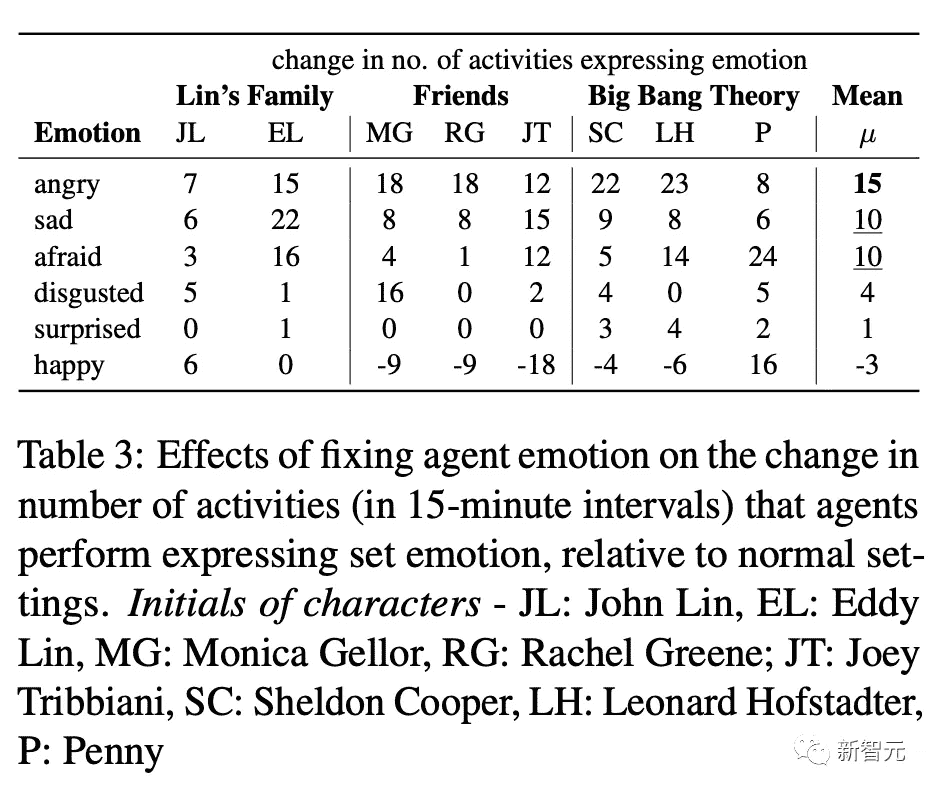

如上表所示，愤怒对行为主体影响最大（+15个活动） ，其次是悲伤和恐惧（各+10） ，然后是厌恶（+4）和惊讶（+1） ，最后是快乐（-2）。


负面情绪似乎比正面情绪更能影响Agent，因为Agent通常不会计划做带有负面情绪的活动，因此不得不显著调整自己的计划来管理负面情绪。

有趣的是，观察到Agent在快乐的时候，为了使自己保持快乐，而减少做一些活动。

### 亲密关系对活动的影响

另外，作者还研究了初始关系亲密度对2个Agent之间对话的影响。

如下表所示，随着亲密度的增加，谈话平均转折点次数呈倒U形。

Agent距离较远的时候说话少，距离近的时候说话多，但是在距离非常近的时候，又会逐渐减少。

这点与人类非常相似，当我们感觉与他人非常亲近时，就不那么需要进行礼貌的谈话。

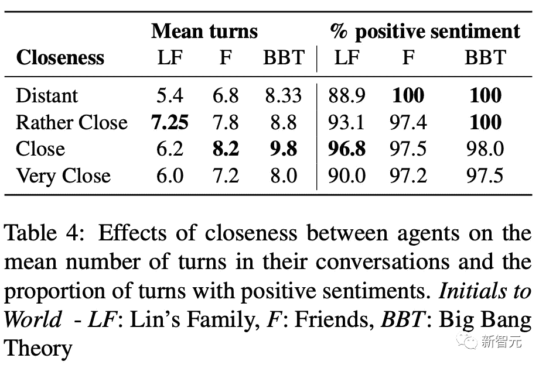

有趣的是，在Lin’s Family中，这个转折点发生在「rather close」处。

而在老友记和生活大爆炸中，转折点在发生在「close」处。

或许是因为，Lin中的两个Agent是父子关系，在较低的亲密程度下进行较少的交流就很舒服，不会让关系紧张。

而在老友记和生活大爆炸中，Agent彼此之间是朋友和邻居，需要更积极的沟通来维持关系。

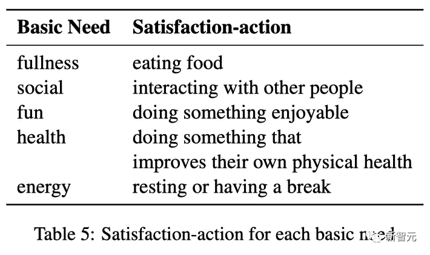

### 与人类标注的比较

为了评价Humanoid Agents的预测能力（比如活动是否满足自己的基本需求、活动中自己会表现出什么情绪、对话是否会使两个Agent更亲近），研究者将系统的预测与人类标注进行了比较。

三位人类标记者会使用和ChatGPT相同的指令，来标记林氏家族世界中一天的模拟。

每个标注者针对情感和基本需求都独立标注了144项活动，针对用户对话对则有30项标注。

然后，研究者对所有标注者进行多数投票，并计算了多数投票与系统预测之间的 micro-F1。

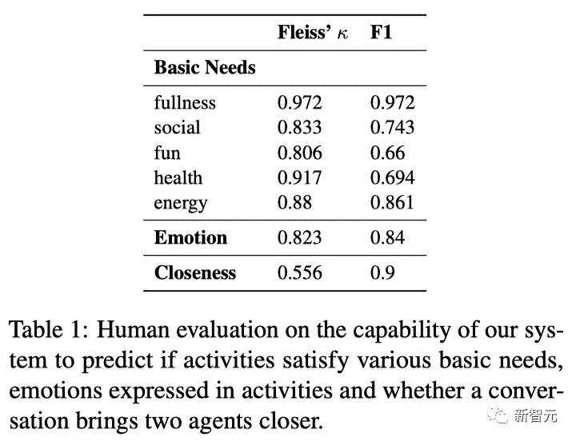

表1显示，在所有基本需求、情感和关系亲密程度方面，评分者之间的信度良好（Fleiss'κ>=0.556）。

研究者还发现，如果一项活动增加了饱腹感和能量，Agent就能在分类方面表现良好 (F1 >= 0.84) 。

而且Agent能在活动中表达出情绪，对话还能拉近不同Agent之间的距离。


然而，Agent在给活动是否满足乐趣、健康和社交的基本需求时，却表现不佳。

原因或许在于，Agent系统大大高估了满足这些需求的活动数量。比如健康占Agent预测活动的34% vs 人类标注活动的4.9%，娱乐占44.4 vs 10.4%，社交占 47.2% vs 24.3%。

Agent会认为因为John Lin在药房工作，这些活动就有助于Agent的身体健康；收到教授的反馈，或帮助老客户买到药物，就会令自己愉快。

研究者判断，如果使用更理解常识的语言模型，可能会缓解这个问题。

# 都是用LLM构建AI智能体，创新在哪

斯坦福西部世界小镇的里程碑式论文一出，业界被激发了许多想象力，用LLM构建可想象的人类行为智能体研究也层出不穷。

Humanoid Agents跟之前大热的BabyAGI、AutoGPT等智能体，区别在哪里呢？


研究者指出，Humanoid Agents应该是目前唯一模拟类人智能体日常活动的工作，其他的工作一般都是实现外部定义的目标。

比如Langchain Agents 、BabyAGI、AutoGPT、AgentVerse、Voyager和CAMEL，都是构建以任务为导向的智能体，通过递归将用户定义的任务分解为更简单的子任务来解决。

而且根据情感、游戏角色描述和个人事实生成的多轮对话响应，并不是由智能体动态模拟出的，而是基于一组静态的、与角色无关的文本信息。

这些先前的工作，并不能模拟出动态属性的影响，比如无法反映出一对智能体之间亲密度的变化。

而且，Humanoid Agents在生成对话响应时，可以同时考虑到基本需求、情感、亲密度等多个方面，就像真正的人类一样。

而此前的这些工作，一次只考虑了一个方面。

## 定制Agent

目前，系统支持三种内置设置：

1.  生活大爆炸（Big Bang Theory）

```
--map_filename ../locations/big_bang_map.yaml \ --agent_filenames ../specific_agents/sheldon_cooper.json ../specific_agents/leonard_hofstadter.json ../specific_agents/penny.json
```

1.  老友记（Friends）

```
--map_filename ../locations/friends_map.yaml \ --agent_filenames ../specific_agents/joey_tribbiani.json ../specific_agents/monica_gellor.json ../specific_agents/rachel_greene.json
```

1.  Lin Family

```
--map_filename ../locations/lin_family_map.yaml \ --agent_filenames ../specific_agents/eddy_lin.json ../specific_agents/john_lin.json
```

同时，用户还可以通过自定义设置，创建自己的地图和Agent。

需要注意的是，Agent和地图并不是完全分离的。对于指定的每一个agent_filename，它的name字段都必须作为关键字包含在Agents下的map.yaml中。

## 分析面板

Agent在活动过程中所生成的数据，可通过交互式仪表盘直观显示。它包括基本需求图和社会关系图，以及相应的信息，包括情感和对话细节。

```
cd humanoidagents
python run_dashboard.py --folder &lt;folder/containing/generation/output/from/run_simulation.py&gt;
```

**所需参数**

+   --folder是run_simulation.py生成的输出结果存放的文件夹

+   --mode是从文件夹中选择数据的方法。它有两种模式：（1）all：显示文件夹中的所有文件（2）date_range：显示所选日期范围内的文件（需要在参数中说明）

**可选参数**

+   当--mode = date_range时，--start_date是起始日期（包含）。格式为YYYY-MM-DD，如2023-01-03

+   当--mode = date_range时，--end_date是结束日期（包含）。格式为YYYY-MM-DD，如2023-01-04

# **作者介绍**

**Zhilin Wang**Zhilin Wang是英伟达NeMo NLP团队的高级应用科学家。此前，他曾获得华盛顿大学硕士学位，学习的是自然语言处理，研究对话系统和计算社会科学。

参考资料：https://github.com/HumanoidAgents/HumanoidAgents