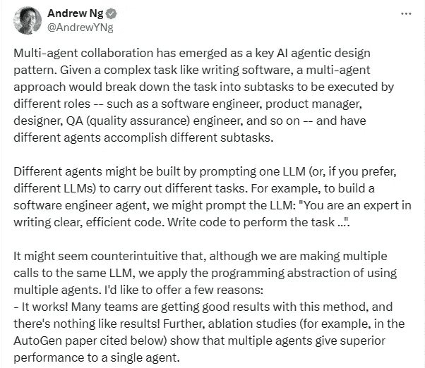
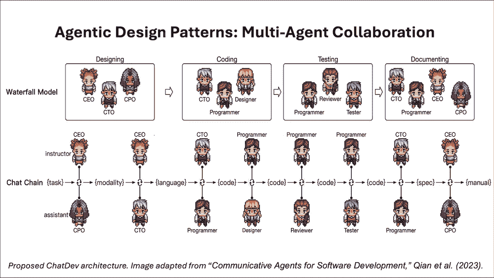
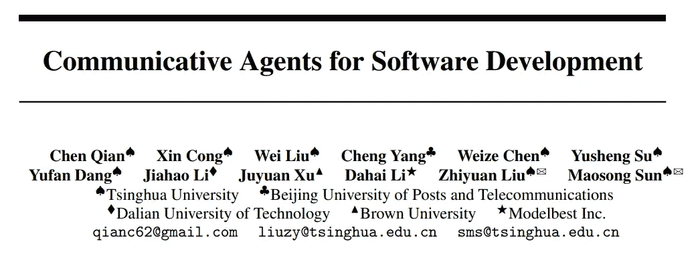
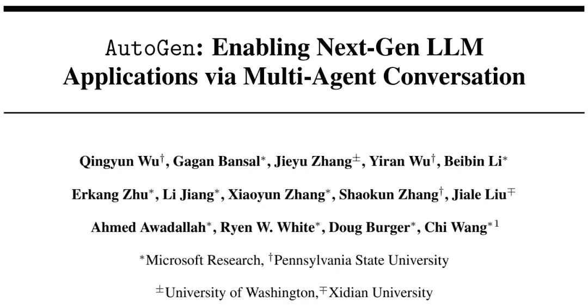
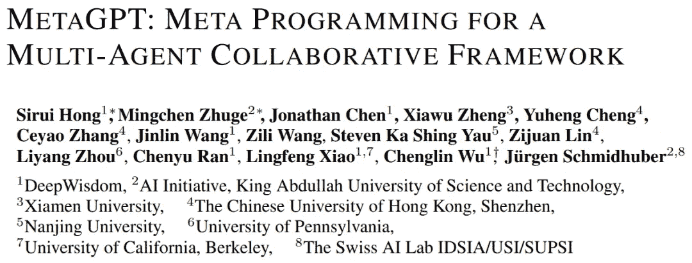
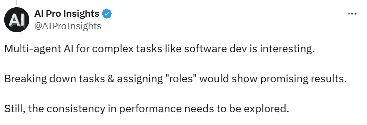

# 吴恩达：多智能体协作是新关键，软件开发等任务将更高效

> 来源：[https://agijuejin.feishu.cn/docx/CUePdsFANoMyNuxvddMcs9H4nXb](https://agijuejin.feishu.cn/docx/CUePdsFANoMyNuxvddMcs9H4nXb)

> 作者：机器之心

> 原文：https://mp.weixin.qq.com/s/yBrELZ5-oC7-vPxuzLGsJw

> 招很多智能体来帮我干活。

前不久，斯坦福大学教授吴恩达在演讲中提到了智能体的巨大潜力，这也引起了众多讨论。其中，吴恩达谈到基于 GPT-3.5 构建的智能体工作流在应用中表现比 GPT-4 要好。这表明，将目光局限于大模型不一定可取，智能体或许会比其所用的基础模型更加优秀。

在软件开发领域，这些智能体展示了其独特的能力，能够高效协作，处理编程中的复杂问题，甚至进行代码自动生成。最新的技术动态显示，AI 智能通在软件开发中显示出巨大的潜力。还记得 Devin 吗？号称世界第一个 AI 软件工程师的它出场就惊艳到了我们，一个智能体就能带给我们如此体验，如果是多个智能体合作，是不是能够直接把体验值直接拉满呢？

想象一下，一个由多个智能体组成的团队，每一个成员都擅长于特定的任务，如代码审查、错误检测或新功能实现。这些智能体可以互补彼此的能力，共同推进软件项目的进度。这岂不是解放了码农的双手，再也不怕腱鞘炎了。

吴恩达撰新文一篇带我们深入这一领域，探索智能体系统的最新动态。文章中提及的 AutoGen 和 LangGraph 等工具，正是在这一大背景下应运而生。这些工具旨在帮助开发者更容易地部署和管理 AI 智能体，从而充分发挥其潜力。凭借它们的力量，即使是没有深厚编程背景的人也能够利用 AI 智能体来优化和自动化软件开发流程。以下是机器之心不改变原义的整理与翻译。

原文链接：https://www.deeplearning.ai/the-batch/issue-245/

多智能体协作是我在最近几封信中描述的四种关键 AI 智能体设计模式中的最后一种。对于像编写软件这样的复杂任务，多智能体方法会将任务分解成由不同角色（如软件工程师、产品经理、设计师、QA 工程师等）执行的子任务，并让不同的智能体完成不同的子任务。

不同的智能体可以通过提示一个 LLM（或多个 LLM）执行不同的任务来构建。例如，要建立一个软件工程师智能体，我们可以提示 LLM：「你是编写清晰、高效代码的专家。请编写代码来执行任务......」。

尽管我们多次调用同一个大型语言模型（LLM），但我们采用多智能体的编程抽象方法，这看似违反直觉，但却有几个理由支持：

1.  它有效！许多团队使用这种方法取得了良好的效果，没有什么比结果更有说服力的了。此外，消融研究（例如在 AutoGen 论文中）表明，多智能体的表现优于单一智能体。

1.  虽然现今的一些 LLM 能接受非常长的输入上下文（例如，Gemini 1.5 Pro 可以接受 100 万个 token），但它们真正理解长而复杂输入的能力是参差不齐的。采用智能体工作流，让 LLM 一次专注于一件事，可以获得更好的表现。

1.  最重要的是，多智能体设计模式为开发者提供了一个框架，用以将复杂任务分解成子任务。当在单个 CPU 上运行代码时，我们经常将程序分解成不同的进程或线程。这种抽象有助于我们将任务分解成更易于编码的子任务。使用多智能体角色进行思考同样是一个有用的抽象。

在许多公司中，管理者通常会决定招聘哪些角色，然后如何将复杂项目 —— 如编写一大块软件或准备研究报告 —— 分解为更小的任务分配给具有不同专长的员工。使用多个智能体的做法与此类似。每个智能体实施自己的工作流程，拥有自己的记忆（这本身是智能体技术中一个迅速发展的领域：一个智能体如何记住足够多的过去互动以在未来的任务中表现得更好），并可能请求其他智能体的帮助。智能体还可以进行规划和使用工具。这会产生了大量的 LLM 调用和智能体间的信息传递，可能形成非常复杂的工作流程。

虽然管理人员困难，但这是我们非常熟悉的，它为我们如何「雇佣」和分配任务给我们的 AI 智能体提供了一个心理框架。幸运的是，管理不善 AI 智能体的损害远低于管理不善人类！

像 AutoGen、Crew AI 和 LangGraph 这样的新兴框架为解决问题提供了丰富的多智能体解决方案。如果你对玩乐趣十足的多智能体系统感兴趣，不妨看看 ChatDev，这是一个运行虚拟软件公司的智能体集合的开源实现。你可以查看他们的 GitHub repo，也许克隆 repo 并亲自运行系统。虽然它可能不总是产生你想要的结果，但你可能会对它的表现感到惊讶。

就像规划这一设计模式一样，我发现多智能体协作的输出质量很难预测，特别是当允许智能体自由交互并为它们提供多种工具时。更成熟的反思和工具使用模式更为可靠。希望你能享受这些智能体设计模式的乐趣，并且它们能为你带来惊人的结果！如果你有兴趣了解更多，可以阅读以下文章：

+   论文标题：Communicative Agents for Software Development

+   论文链接：https://arxiv.org/pdf/2307.07924.pdf

+   论文标题：AutoGen: Enabling Next-Gen LLM Applications via Multi-Agent Conversation

+   论文链接：https://arxiv.org/pdf/2308.08155.pdf

+   论文标题：METAGPT: META PROGRAMMING FOR A MULTI-AGENT COLLABORATIVE FRAMEWORK

+   论文链接：https://arxiv.org/pdf/2308.00352.pdf

更多详细内容，请阅读原文。

看了本篇文章，网友们大受启发，不过也有网友提出，多智能体系统在执行相同或类似任务时表现出的稳定性和可预测性还有待考量。你觉得多智能体协作的益弊何在呢？

