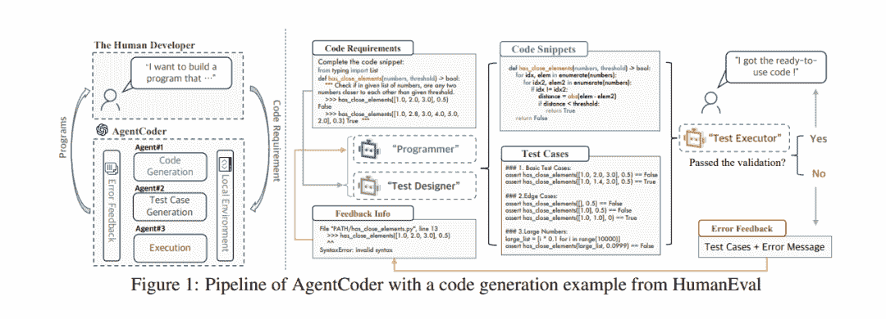
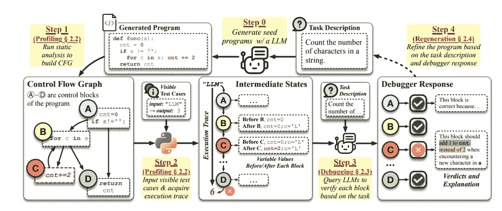
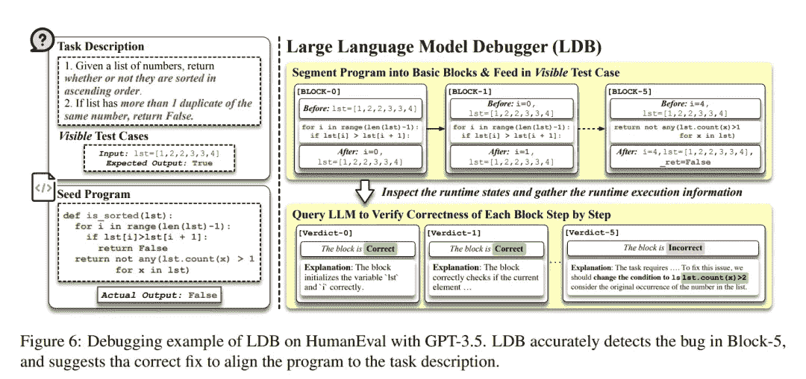
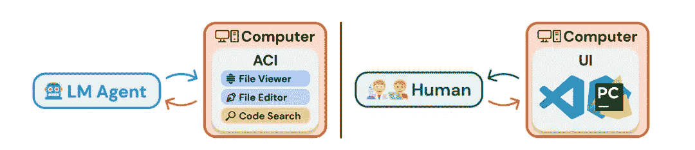

# 吴恩达揭秘：编程Agent如何革新软件开发行业

> 来源：[https://agijuejin.feishu.cn/docx/B8jKdCTcwo11bKxurpKcqjc3n5f](https://agijuejin.feishu.cn/docx/B8jKdCTcwo11bKxurpKcqjc3n5f)

> 作者：AI小智

> 原文：https://mp.weixin.qq.com/s/pQjCz2ePYy-xhu_z3OmS-Q

> 人工智能 (AI) 正以惊人的速度重塑着各行各业，软件开发领域也不例外。近年来，AI 驱动的编程助手如雨后春笋般涌现，极大地改变了开[**发者的工作方式，使他们能**](https://mp.weixin.qq.com/mp/appmsgalbum?__biz=Mzg2ODA5NTM1OA==&action=getalbum&album_id=3115055723522015235&token=162966106&lang=zh_CN#wechat_redirect)够以前所未有的效率和精度编写代码。在这些 AI 驱动的助手领域中，编程 Agent 正日益受到关注，并有望彻底改变我们构建软件的方式。 本系列合集，点击链接查看

作为 AI 领域的杰出人物， **吴恩达 **教授对编程 Agent 的兴起表示了极大的兴趣。他认为，编程 Agent 有潜力通过自动执行繁琐的任务、提高代码质量和加速开发周期来彻底改变软件开发行业。

本文将深入探讨吴恩达对编程 Agent 的见解，

+   **多代理系统质量保证**

+   **LDB调试测试**

+   **Agent专用研发工作流程**

等关键概念。通过实际案例和深入分析，我们将探索这些技术如何协同工作，使编程 Agent 能够以更高的效率和有效性构建软件。

###  通过多代理系统实现开发与测试的隔离与分工

在传统的软件开发模式中，开发和测试通常由不同的个人或团队执行。这种分离旨在确保代码质量，因为测试人员可以从不同的角度提供客观的评估。

然而通过单一Agent模式很难实现这种隔离方案。为了解决这个问题，多Agent编码系统应运而生，为软件开发提供了一种更加协作和高效的方法。在多代理系统中，不同的“代理”被赋予特定的角色和职责，例如代码生成、测试和调试。这些代理可以相互交互和协作，以实现共同的目标，例如构建高质量的软件。

####   AgentCoder：多代理代码生成框架

AgentCoder 是一个很好的多代理系统应用案例，它是一个利用多个代理进行迭代测试和优化的代码生成框架。



AgentCoder 架构图

**在 Agen****tCoder** 中，一个代理充当 代码生成器 ，负责根据给定的规范或用户需求生成代码片段。另一个代理充当 代码测试器 ，评估生成的代码是否存在任何错误、漏洞或性能问题。

这两个代理协同工作，迭代地改进代码质量。代码生成器生成代码片段，代码测试器提供反馈，然后代码生成器根据该反馈改进其输出。这个循环会持续进行，直到生成满足所需规范的代码。

####   **多代理系统的好处 **

通过将开发和测试过程分离到不同的代理中，多代理系统为软件开发带来了许多好处：

+   **隔离： **开发和测试代理可以独立运作，减少不同开发阶段之间发生冲突或依赖的可能性。

+   **专业化： **代理可以专门负责其专业领域，从而提高整体效率和代码质量。

+   **可扩展性： **可以轻松地添加或移除代理以适应项目的规模和复杂性。

####   **示例：多代理系统的应用 **

让我们考虑一个简单的例子来说明多代理系统是如何工作的。假设我们想要创建一个计算两个数字之和的函数。我们可以使用多代理系统，其中一个代理负责生成代码，另一个代理负责测试代码。

```
# 代理 1：代码生成
def generate_sum_code():
    code = &quot;&quot;&quot;
def sum(a, b):
    return a + b
    &quot;&quot;&quot;
    return code

# 代理 2：测试生成
def generate_tests():
    tests = [
        {&quot;input&quot;: (2, 3), &quot;expected_output&quot;: 5},
        {&quot;input&quot;: (-1, 1), &quot;expected_output&quot;: 0},
        {&quot;input&quot;: (10, 20), &quot;expected_output&quot;: 30}
    ]
    return tests

# 运行代码并测试
code = generate_sum_code()
exec(code)
tests = generate_tests()
for test in tests:
    assert sum(*test[&quot;input&quot;]) == test[&quot;expected_output&quot;]
```

在这个例子中，代理 1 生成一个简单的 sum 函数，代理 2 生成一组测试用例来验证函数的正确性。通过这种方式，开发和测试过程是隔离的，但它们协同工作以确保生成的代码的质量。

###  **基于调试测试来准确地发现错误 **

**调试 **是软件开发的一个不可分割的环节，即使在编程 Agent 时代也是如此。识别和修复代码中的错误对于确保软件的可靠性和正确性至关重要。虽然编程 Agent 可以生成代码，但它们仍然可能犯错，因此有效的调试技术至关重要。

逐行测试是一种人类常用的调试技术，它同样可以应用于编程 Agent 生成的代码。通过在代码执行过程中逐行验证运行时执行，Agent可以准确地查明错误发生的位置以及代码行为偏离预期结果的位置。

####   **LDB：大型语言模型调试器 **

LDB（大型语言模型调试器）是一种利用逐行测试来调试大型语言模型 (LLM) 生成的代码的系统。



LDB 系统架构图

LDB 系统的工作原理是将 LLM 生成的代码作为输入，并通过解释器逐行执行。对于每一行，LDB 都会检查代码的运行时执行是否与预期行为一致。如果不一致，LDB 会将该行标记为潜在错误，并向开发人员提供有关该问题的详细信息。



####   **逐行测试的好处 **

通过利用逐行测试，LDB 可以识别各种类型的错误，包括：

+   **逻辑错误： **代码中导致意外结果的错误推理或顺序错误。

+   **语法错误： **违反编程语言规则的错误，例如拼写错误或缺少分号。

+   **语义错误： **代码在语法上是正确的，但没有产生预期结果的错误，例如使用错误的变量名或调用错误的函数。

###  为 Agent 提供专有研发工作流以提升效率

为了在软件开发领域取得成功，拥有结构化的工作流程和专门的工具至关重要。软件工程师依靠版本控制系统、代码编辑器和测试框架等工具来有效地管理软件开发的复杂性。同样，编程 Agent 可以受益于专用的研发工作流程，以提高其性能和效率。

####   SWE-agent：自动化软件工程的代理-计算机接口

SWE-agent（Agent-Computer Interfaces Enable Automated Software Engineering）是一个旨在通过提供自动化研发工作流程来增强编程 Agent 功能的系统。



SWE-agent 系统为编程 Agent 提供了全面的开发环境，包括：

+   **代码库： **对现有代码库的访问权限，允许代理从过去的项目中学习和重用代码。

+   **API： **与流行的软件工程工具和服务的集成，例如版本控制系统、问题跟踪器和持续集成/持续交付 (CI/CD) 管道。

+   **反馈机制： **从开发人员和用户那里收集反馈的渠道，允许代理随着时间的推移学习和改进。

####   **专用研发工作流的好处 **

通过为编程 Agent 提供专用的研发工作流程，SWE-agent 使它们能够：

+   **利用现有资源： **代理可以利用现有的代码库、API 和工具，减少从头开始编写所有代码的需要。

+   **与现有系统集成： **代理可以与软件开发中使用的标准工具和工作流程无缝集成，从而实现轻松协作和代码管理。

+   **从反馈中学习： **代理可以使用从开发人员和用户那里收集的反馈来改进其性能并解决代码中的任何问题。

####   **示例：专有研发工作流的应用 **

让我们考虑一个实际的例子来说明专用的研发工作流程如何使编程 Agent 受益。假设我们正在构建一个 Web 应用程序，并且我们希望自动化创建新页面的过程。

使用 SWE-agent，我们可以创建一个工作流程，该工作流程将以下任务自动化：

1.  **生成代码： **代理可以根据用户提供的规范生成新页面的代码。

1.  **测试代码： **代理可以针对新页面运行自动化测试，以确保其按预期工作。

1.  **将代码提交到版本控制： **代理可以将新页面代码提交到版本控制系统，例如 Git。

1.  **部署代码： **代理可以将新页面部署到生产环境。

通过自动化这些任务，SWE-agent 使开发人员能够专注于更高级别的任务，例如设计和用户体验。

###  **结论 **

随着编程 Agent 的不断发展，我们可以期待看到它们在软件开发中发挥越来越重要的作用，使开发人员能够专注于更高级别的任务，并推动创新。从简化代码生成到增强调试功能，编程 Agent 必将塑造软件开发的未来。