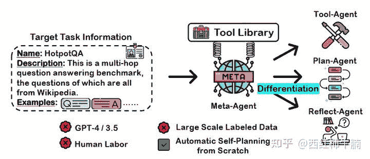
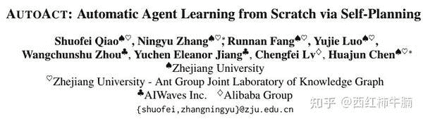
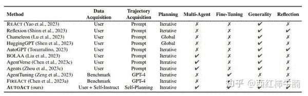

# 阿里巴巴吹牛agent发展新阶段：Meta-Agent

> 来源：[https://agijuejin.feishu.cn/docx/H8Irdu3lhoqub4xxlwFcBOXyn83](https://agijuejin.feishu.cn/docx/H8Irdu3lhoqub4xxlwFcBOXyn83)

> 作者：西红柿牛腩

> 原文：[https://zhuanlan.z](https://zhuanlan.zhihu.com/p/677330600)hihu.com/p/677330...

agent在23年已经炙手可热，24年更是焦点中的焦点，某些厂家或学术机构，一直在学术和商业变现寻求突破。目前名称已经不够用了，Meta-Agent终于出现了。浙江大学和阿里巴巴吹牛，要实现一个META-Agent

尽管agent领域不断探索，仍然面临巨大挑战：数据质量获取昂贵，不可复制；单一模型需要具备多种功能。

浙江大学联合阿里巴巴提出一种AUTOACT的Agent方式：不依赖大规模标注数据和封闭源模型（如GPT-4）的自动代理学习框架。在有限的数据和工具库的情况下，AUTOACT首先自动合成规划，无需人类或强大的封闭源模型的帮助。然后，AUTOACT利用分工策略根据目标任务信息和合成轨迹自动区分，生成一个子代理组来完成任务。论文使用不同的LLM进行了全面的实验，结果表明AUTOACT的性能优于或与各种强基线相当。当使用Llama-2-13b模型时，AUTOACT可以实现与GPT-3.5-Turbo代理相当的性能。（个人觉得有水分，对比的是zero shot条件下的GPT-3.5-Turbo Agent）。

论文宣称具有8大优势。数据获取是通过用户+Self-instruct，规划通过self-Planning,并且是迭代方式。Multi-Agent ,Fine-tuning, Generality通用的泛化能力, Reflection。

**论文的主要贡献：**

1、提出了AUTOACT的自动代理学习框架，它不依赖大规模的标注数据和封闭源模型的合成轨迹，同时遵循有限理性原则。

2、我们使用不同的LLM（大型语言模型）进行了全面的实验，结果表明AUTOACT的性能优于或与各种强大的基线相当。我们甚至注意到，当使用Llama-2-13b模型时，AUTOACT可以实现与GPT-3.5-Turbo代理相当的性能。

3、大量的实证分析表明，我们合适的分工策略以及AUTOACT生成的轨迹质量在多个方面明显优于其他方法。

AUTOACT仅需要目标任务信息和一个语言代理（我们称之为META-AGENT）来启动工作。META-AGENT首先通过自我指导从零开始扩充任务数据。此外，在有工具库的情况下，META-AGENT通过将其区分为具有不同功能的子代理并使它们执行特定于组任务的计划，来进行自动代理学习。我们将这个过程称为自我规划。