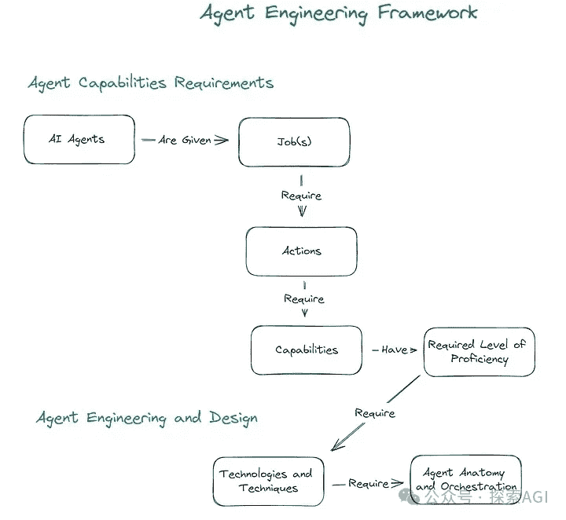

# 2024年：从prompt工程师到Agent工程师的转型

> 来源：[https://agijuejin.feishu.cn/docx/NshwdQbJno2BScx57Iycs9X5nGb](https://agijuejin.feishu.cn/docx/NshwdQbJno2BScx57Iycs9X5nGb)

> 作者：猕猴桃 | 探索AGI

> 原文：[https://mp.weixin.](https://mp.weixin.qq.com/s/o4pzlI0l2WdPFp9R5YQEaQ)qq.com/s/o4pzlI0l...

哈喽哈喽，大家好！这里是一个专注于AI智能体的频道！

自从ChatGPT横空出世，大家对AI的看法已经大变样了。人们意识到，这些AI系统可能已经达到了人类水平的能力和表现。ChatGPT就像个概念验证，告诉我们，我们离创造能执行人类智能任务的机器不远了。

随着像ChatGPT、Claude和Gemini这样的模型出现，它们在各种知识领域都表现出色，还能进行人类水平的对话。再加上新的能力，比如“视觉”和工具调用，AI智能体开发的舞台已经搭建好了。

这里简述一个基本的Agent框架，框架的核心思想其实挺简单的：给智能体分配任务，这些任务需要通过行动来完成，而行动又需要特定的能力。这些能力需要一定的熟练程度，而熟练程度又需要技术和技巧来实现。如下：

比如说，一个电商聊天机器人的工作可能包括处理咨询、分析顾客行为、推荐产品。而一个内容创作智能体的工作可能就是头脑风暴、起草文章或写博客帖子。这些工作都需要明确的动作和能力。

我们需要评估每种能力所需的可靠程度，比如内容创作代理的工具调用可靠性要达到75%，内容创意的生成要有75%的成功率，信息检索的精确度要达到99.99%等等。

然后就是如何将这些可靠程度映射到可用的技术和技巧上。这可能包括大型语言模型（LLMs）、检索增强生成（RAG）、模型微调等等。每种技术都有它的强项和成本效益考量。

最后，我们还要考虑智能体的解剖结构和协调方式。是把所有能力都注册到一个智能体上，还是每个能力分配给一个独特的智能体？我们如何开发可以轻松重新利用的能力？

从 Prompt Engineering 到 Agent Engineering 的旅程才刚刚开始，我们有很多东西要学习和完善。框架只是一个起点。随着构建智能体的模型和技术不断增多，我们需要一个能够超越任何特定技术或技术类别的通用框架。

好了，这就是我今天想分享的内容。如果你对构建AI智能体感兴趣，别忘了点赞、关注噢~