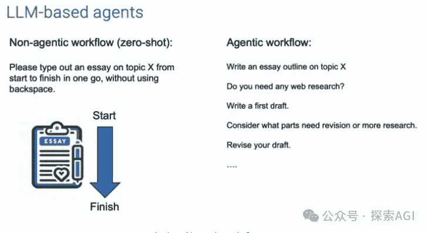

# 从Agent到Agentic ai的流程探讨与AGI的思考

> 来源：[https://agijuejin.feishu.cn/docx/QJDodAdJaowqsUxizYUc4Gjhnde](https://agijuejin.feishu.cn/docx/QJDodAdJaowqsUxizYUc4Gjhnde)

> 作者：猕猴桃 | 探索AGI

> 原文：[https://mp.weixin.](https://mp.weixin.qq.com/s/6IfCT8YjuhYKTY82qsNUSw)qq.com/s/6IfCT8Yj...

嘿，大家好！这里是一个专注于AI智能体的频道！

今天和大家聊聊Agentic AI，也就是自主智能AI。这可能是我们AI进化的下一个阶段哦。如果我们的AI能够自己做出更广泛的决策，还能适应不断变化的需求，这是非常酷的一件事啊！

最近，Andrew Ng在Sequoia Capital的AI Ascent上做了一个关于Agentic AI工作流及其潜力的演讲。

首先，让我们来区分一下非Agentic和Agentic的LLM工作流。非Agentic的LLM，也就是常说的zero-shot模型，它们在给出回应时是按顺序一个接一个地产生token，就像写一篇论文，从头到尾一气呵成，中间不修改。而Agentic工作流则是一个有计划的迭代过程，就像我们人类写论文一样，先有个大纲，然后收集研究资料，写草稿，最后再修订。

Andrew在他的演讲中提到了四种基本的设计模式：反思、工具使用、规划和多Agent协作。其中，反思和工具使用被认为是发展得比较好、可靠的。而规划和多Agent协作则还不太成熟，不太可靠。

反思，就是通过反馈循环迭代地改进回应。想象一下，你让模型写一个简单的程序，然后重新提示它去修复代码中的错误，最后可能还会要求它为了速度或格式来改进代码。

工具使用，就是LLM使用外部工具，比如网络搜索、代码解释器、编译器，或者其他AI模型，比如图像生成、图像字幕、目标检测和文本到语音等。使用这些工具可以帮助模型发现代码中的错误，然后自我提示去修正这些错误。

规划，就是将问题分解成多个步骤，每一步的输出都用于下一步的进一步细化。这有点像HuggingGPT论文中的例子，处理请求生成图像，然后用声音描述新图像。

多Agent协作，就是使用具有不同专业化和偏见的多个Agent来互相提示，迭代地改进它们的输出。比如，使用一个“批评Agent”作为反思设计模式的一部分，它被提示去发现需要改进的地方，然后它的回应用来为主力模型提供迭代反馈。

我对这些技术的看法是，虽然它们可以自动化LLM输出的手动细化过程，但如果没有人类操作者的方向引导，模型自身的自我反思和输出细化是有极限的。一个完全自动化的多Agent方法只是在一个已经封闭的反馈循环中增加了层次。这可能会受到模型崩溃的限制，或者在使用多个Agent进行协作（或辩论）的背景下，更像是模态崩溃。

至于AGI，我认为一个有能力的AGI必须能够通过自我反馈循环迭代地扩展其能力。我认为这在没有真实创造性的人类思想和指导的情况下是不可能的。人类有创造性的火花，我认为这是统计机器模型无法复制的。

总之，多Agent方法的进步将改进和细化在特定领域内工作的模型。最后提供一些参考论文：

反思模块： **S**el**f**-Refine: Iterative Refinement with Self-Feedback [1] 、 Reflexion: Language Agents with Verbal Reinforcement Learning [2]

工具使用： **G**or**i**lla: Large Language Model Connected with Massive APIs [3] 、 MM-REACT: Prompting ChatGPT for Multimodal Reasoning and Action [4]

规划： **Chain-of-Thought Prompting Elicits** R**easoning in Large Language Models [5]** 、 HuggingGPT: Solving AI Tasks with ChatGPT and its Friends in Hugging Face [6]

多智能体协作： **C**ha**tDev: Communicative Agents for Softw**are Development [7] 、 AutoGen: Enabling Next-Gen LLM Applications via Multi-Agent Conversation [8]

[1]Self-Refine: Iterative Refinement with Self-Feedback: https://arxiv.org/abs/2303.17651

[2]Reflexion: Language Agents with Verbal Reinforcement Learning: https://arxiv.org/abs/2303.11366

[3]Gorilla: Large Language Model Connected with Massive APIs: https://arxiv.org/abs/2305.15334

[4]MM-REACT: Prompting ChatGPT for Multimodal Reasoning and Action: https://arxiv.org/abs/2303.11381

[5]Chain-of-Thought Prompting Elicits Reasoning in Large Language Models: https://arxiv.org/abs/2303.11381

[6]HuggingGPT: Solving AI Tasks with ChatGPT and its Friends in Hugging Face: https://arxiv.org/abs/2303.17580

[7]ChatDev: Communicative Agents for Software Development: https://arxiv.org/abs/2307.07924

[8]AutoGen: Enabling Next-Gen LLM Applications via Multi-Agent Conversation: https://arxiv.org/abs/2308.08155

好了，这就是我今天想分享的内容。如果你对构建AI智能体感兴趣，别忘了点赞、关注噢~