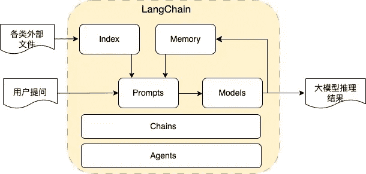
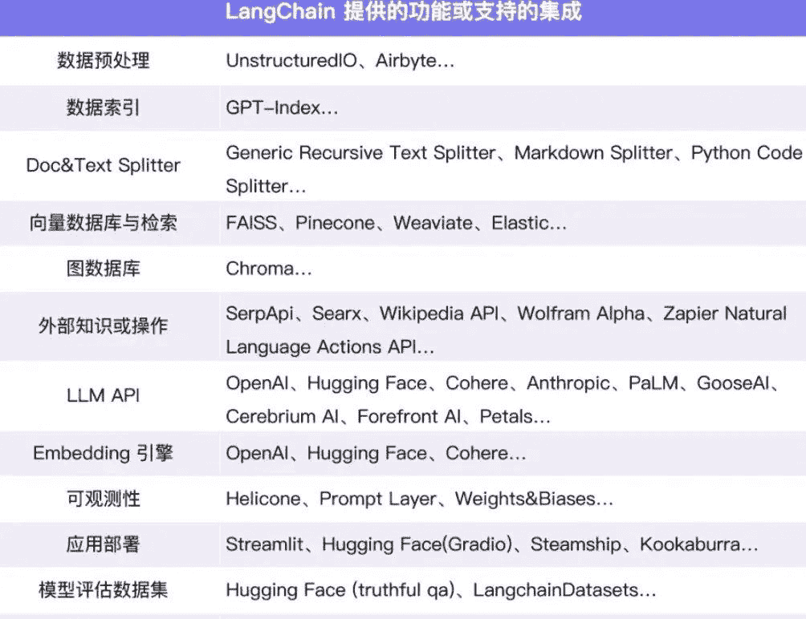
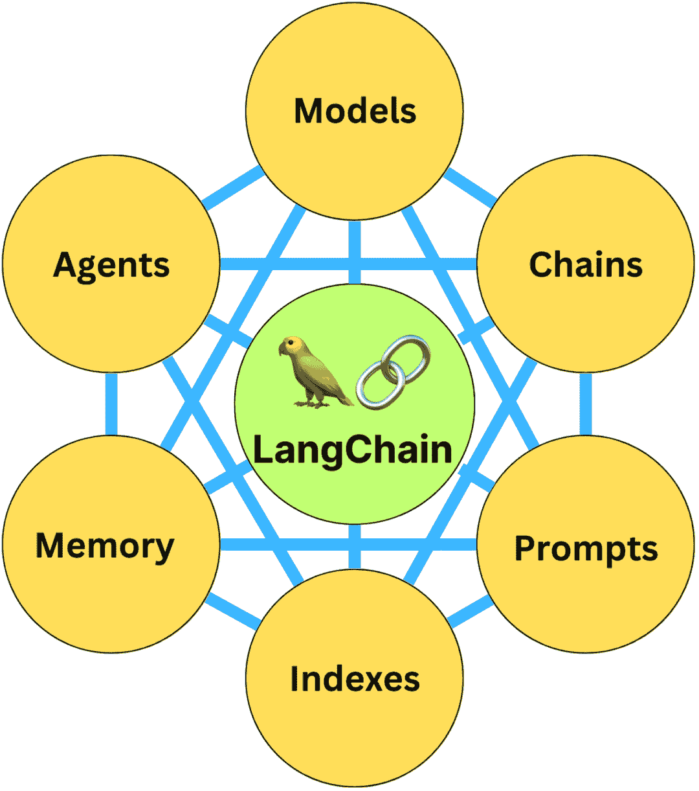
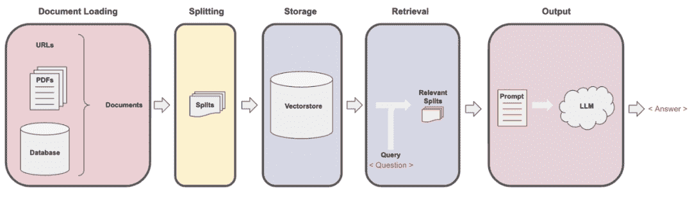
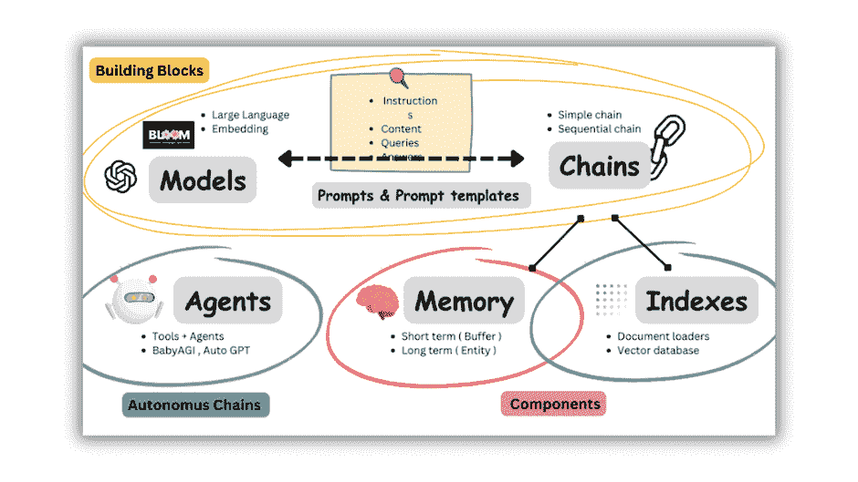
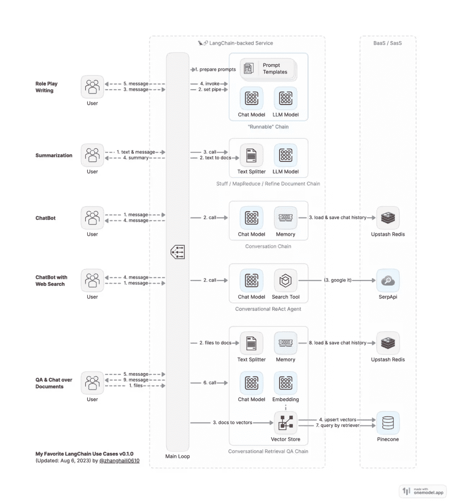

# 解读LangChain

> 来源：[https://agijuejin.feishu.cn/docx/IIN9dXLVcoCKmtxOlOYcJaEWnOe](https://agijuejin.feishu.cn/docx/IIN9dXLVcoCKmtxOlOYcJaEWnOe)

> 作者：半吊子全栈工匠 | 喔家ArchiSelf

> 原文：https://mp.weixin.qq.com/s/B_kWHE5qfJ8Ex-OuffMCTg

随着OpenAI在2020年发布了开创性的GPT-3，我们见证了LLM的普及度稳步攀升，如今还在逐渐升温发酵。这些强大的人工智能模型为自然语言处理应用带来了新的可能性，使开发人员能够创建更为复杂、类似于人类交互的聊天机器人、问答系统、摘要工具等产品。

LangChain作为一个多功能框架应运而生，旨在帮助开发人员充分发挥LLMs在各种应用中的潜力。基于“链式”不同组件的核心概念，LangChain简化了与GPT-3/4，Bloom、Huggingface等LLM的工作过程，允许开发者无缝地构建基于LLM的高级应用程序。



## 1. Langchain 是什么

L[angChain是一](http://mp.weixin.qq.com/s?__biz=MzAwOTcyNzA0OQ==&mid=2658976673&idx=1&sn=0a14457f08ea1a8934db61dc725142ae&chksm=80d35e87b7a4d79112debd71e0b327db99c6a01bf25f3c47edfb6cb398a1b27e771f279ea60d&scene=21#wechat_redirect)种创新性[的框架，是语言模型驱动的应用程](http://mp.weixin.qq.com/s?__biz=MzAwOTcyNzA0OQ==&mid=2658972846&idx=1&sn=c14af87e9fffcc3d971ee2a492259824&chksm=80d32988b7a4a09ed7281c8b384385e6e913a14d3c413f003a746726ae33a1f5b0ed607c0107&scene=21#wechat_redirect)序的开发方式，关于应用框架的概念和使用可以参考《 全栈认知：应用框架 》和《 探索嵌入式应用框架（EAF） 》。LangChain 是基于大模型的应用开发框架，是一个开源的Python库，旨在通过以下方式更轻松地构建基于LLM的应用程序：

+   向多种不同的基础模型提供通用接口，

+   提供管理Prompt提示的框架，以及

+   提供长期记忆能力、外部数据以及其他代理程序的中央接口，用于处理LLM无法处理的任务（例如计算或搜索）。

通过融合先进原则，LangChain正在重新定义通过传统API可以实现的极限。此外，LangChain应用程序是主动的，使语言模型能够轻松地与其环境交互和适应。Langchain由几个模块组成。正如其名称所示，连接不同的模块在一起是Langchain的主要目的。这里的想法是将每个模块链接在一个链中，并最终使用该链一次性调用所有模块。



## 2. LangChain 中的核心概念

LangChain简化了Prompt提示词的管理，提供提供了优化能力，为所有LLM提供了通用接口，并包括用于处理LLM的常用程序。LangChain为链式调用提供了标准接口，使开发人员能够创建超出单个LLM调用的调用序列。LangChain 还为开发人员提供了创建与外部数据源集成的链的能力，此功能使基于特定数据而不是用于训练语言模型的通用数据生成文本成为可能。而且，LangChain为开发人员提供了一个标准接口，使LLM能够根据LLM的输出做出明智的决策，确定采取哪些行动以及何时采取这些行动。记忆能力是LangChain中的一个关键概念，因为它涉及在链/代理的调用之间保留状态。LangChain还提供了一个标准的记忆接口、一系列的记忆实现以及使用记忆的链/代理的示例。



### **2.1. 模型**

大型语言模型（LLM）是指由具有众多参数的神经网络组成并在大量未标记的文本上进行训练的模型。有许多技术巨头和学术组织都有着自己的LLM，例如：OpenAI的GPT-3/4，Google的LaMDA/PaLM，Meta AI的LLaMA，百度的文心，阿里的千问，讯飞的星火，清华的GLM等等。借助Langchain，应用成效与大型语言模型的交互变得更容易。

LangChain轻松地集成和使用不同的语言模型，用于增强应用程序的功能，可连接到大多数第三方LLM可用的API。它具有与公共LLM、聊天和embedding模型的 ~40 个API连接。LangChain还通过asyncio库为LLM提供异步支持，还为同时调用多个LLMs的情况提供了异步支持。我们可以使用agenerate方法异步调用LLM，还可以编写自定义的LLM包装器。每个大模型都有自己的优点、令牌的使用次数和用例。更多的细节，可以到相关大模型的官网去阅读更多信息。

### **2.2. Prompt提示**

LangChain允许有效地管理、优化和序列化Prompt提示，允许开发者使用模板构建动态提示。它可以根据上下文窗口大小和用作上下文（对话历史记录，搜索结果，以前的答案等）的输入变量适应不同的LLM类型。这有助于从语言模型生成更准确且具有上下文相关性的响应。

Prompt提示是我们向LLM系统提供的输入，以改进我们的答案，使其更准确或更能够适应我们的具体用例。很多时候，我们可能希望获得比纯文本更具体结构化的信息。许多基于对比预训练和零样本学习的目标检测和分类算法都将Prompt作为有效的结果输入。例如，OpenAI的CLIP和META的Grounding DINO都使用Prompt作为预测的输入。


在Langchain中，可以根据我们想要的答案设置Prompt模板，然后将其链接到主链以进行输出预测，还有一个用于结果精炼的输出解析器的功能。输出解析器负责指示模型输出的格式，并将输出解析为所需的格式，必要时需要重试。

模板是指我们希望回答的特定格式或蓝图。LangChain提供了预先设计的Prompt模板，可以为不同类型的任务生成Prompt。然而，在某些情况下，预设模板可能无法满足要求，可以使用自定义的提示模板。

### **2.3. 记忆能力**

LangChain为记忆能力提供了标准接口和一系列实现，为LLM提供了访问对话历史记录的权限。它促进了在链或代理的调用之间保持状态的持久性，增强了模型的知识召回能力。

LangChain在默认情况下以无状态模式运行，这意味着独立处理每个传入的查询。然而，对于某些应用程序，如聊天机器人，无论是短期还是长期，保留前面的交互非常重要。这就是“记忆能力”概念发挥作用的地方。为了跟踪用户与语言模型的交互，LangChain的记忆能力涉及将聊天消息序列转化为ChatMessages，并从中摄取、捕获、转换和提取知识。在LangChain中有许多不同的记忆类型，每一种都有其处理消息序列的独特方式。在使用记忆能力时，一种是独立的函数，它们从消息序列中提取信息，另一种是如何在链中使用这种类型的记忆。LangChain的记忆能力可以返回多个信息，例如最近的N个消息或所有先前消息的摘要，返回的信息可以是一个字符串或一个消息列表。

LangChain提供了两种形式的记忆能力组件。 首先，提供了管理和操作以前聊天消息的辅助工具，这些工具被设计为模块化和可用的，适应于各种用例。 其次，LangChain提供了将这些 常 用程序集成到链中的简便方法，使它们具有高度的适应性。

### **2.4. 索引**

索引是指以LLM最佳地与它们交互的方式来构造文档的方法。为了增强语言模型的能力，LangChain有效地将LLM与用户的文本数据结合使用，包含用于处理文档、不同类型的索引的实用函数以及使用这些索引在链中的示例，提供了索引和搜索数据源的最佳实践。

LangChain提供了三种文档加载器：

+   转换加载器

+   公共数据集或服务加载器

+   专有数据集或服务加载器

转换加载器将数据从特定格式转换为文档格式，例如有用于CSV和SQL的转换器。大多数情况下，这些加载器从文件中输入数据，有时也可以从URL中输入数据。许多这些转换器的主要驱动程序是Unstructured模块。该包可以将许多类型的文件（文本、PowerPoint、图像、HTML、PDF 等）转换为文本数据。对于在公共领域创建的数据集和数据源，对于这些数据集和服务，我们不需要任何访问权限可以使用查询来搜索并下载所需的文档。对于不属于公共领域的数据集和服务，专有数据集或服务加载器主要用于转换特定格式的应用程序或云服务的数据，我们需要访问令牌和其他参数才能访问这些数据集和服务。



一般地，这些文档会以 embedding 的形式存储在向量数据库中，从而建立索引并实现搜索。

### **2.5. 链**

链是一系列调用，可以是语言模型或其他 常 用程序。 LangChain提供了链的标准接口，以及许多与常见应用程序集成好的链。

链是将一个或多个大型语言模型（LLM）以逻辑方式连接起来得到的结果，提供了将各种组件合并成一个统一应用的方法。例如，可以创建一个链，从用户那里接收输入，使用Prompt提示模版进行格式化，然后将格式化后的回复发送给LLM中，还可以通过将多个链条与其他组件集成来生成更复杂的链。LLMChain被认为是查询LLM对象最广泛使用的方法之一。它根据提示模板格式化提供的输入键值和需要记忆的键值，然后将格式化的字符串发送给LLM，LLM会生成返回的输出。在调用语言模型之后，可以采取一系列的步骤，并进行一系列对模型的调用。当希望将一个调用的输出用作另一个调用的输入时，这种做法的价值更大。在这一系列的链中，每个单独的链都有一个输入和一个输出，一个步骤的输出被用作下一个步骤的输入。

### **2.6. 代理**

代理使语言模型能够做出决策、采取行动、观察结果并重复这个过程，直到完成目标。LangChain为代理提供了标准接口、可供选择的代理以及端到端代理的示例。

某些应用程序可能不仅需要LLM/其他工具调用的预定序列，而且需要依赖于用户输入的不确定序列。这类序列包括一个可以访问一系列工具的“代理”。基于用户输入，代理可以确定应该调用这些工具中的哪一个，以及该工具的输入应该是什么。然后使用这个输入调用该工具，并记录一个观察结果。工具、工具输入和观察的历史记录会传回代理，代理决定下一步要采取什么步骤。重复此过程，直到代理决定不再需要使用工具，然后直接响应用户。

## 3. 使用LangChain 构建应用

我们或许正在经历着“AI的Linux时刻”，开发人员必须根据性能和成本之间的权衡选择专有或开源基础大模型。



### **3.1 构建开发环境**

首先，创建基于Python 的虚拟环境，虚拟环境是一个隔离的Python环境，允许您安装特定于特定项目的软件包和依赖项，而不会干扰系统范围的Python安装或其他项目。这种隔离有助于保持一致性并避免不同项目要求之间的潜在冲突。

然后，安装LangChain，例如： pip install langchain 。

最后，选择一个或多大模型，并安装相应的软件包， 以openai 为例， pip install openai 。进一步，还要配置访问权限，例如需要从OpenAI获取API密钥。

### **3.2 大模型的使用**

LangChain 提供了一个 LLM 类，专门用于与各种语言模型提供者（如 OpenAI 和 Hugging Face等等）进行交互。该类为所有 LLM 类型提供了标准接口。在使用大模型的基本能力时，可以先导入包，直接调用LLM实例即可根据问题的输入生成文本。

```
import os
from langchain.llms import OpenAI

os.environ[&quot;OPENAI_API_KEY&quot;] = &quot;&quot;

llm = OpenAI(model_name=&quot;text-ada-001&quot;, n=2, best_of=2)

result = llm(&quot;给我讲个笑话&quot;)

print(result)
```

如果希望获取包括多个响应，可以调用LLM实例的generate()方法，generate()方法需要一个提示列表作为输入，LLM为列表中的每个提示生成响应。

在使用OpenAI LLM的场景下，llm.generate的返回结果中包含了程序特定信息，尤其是token 的使用状况，例如completion_tokens ， total_tokens，prompt_tokens的统计数据。

### **3.3 构建链式服务**

构建一个典型的链式服务主要包括如下4个部分：

- 将LLM与提示模板结合

- 通过将第一个LLM的输出作为第二个LLM的输入，将多个LLM按顺序结合在一起（请参见本节）

- 将LLM与外部数据结合，例如用于问答

- 将LLM与长期记忆结合，例如用于聊天历史记录

如果已经创建了Prompt 模板，可以通过LangChain 将 Prompt 模板 应用于大模型：

```
from langchain.chains import LLMChain

chain = LLMChain(llm = llm,
                  prompt = prompt)
chain.run(my_query)
```

如果我们想要将第一个LLM的输出作为第二个LLM的输入，可以使用SimpleSequentialChain：

```
from langchain.chains import LLMChain, SimpleSequentialChain

# Define the first chain as in the previous  example
# ...

# Create a second chain with a prompt template and an LLM
second_prompt = PromptTemplate(
    input_variables=[&quot;company_name&quot;],
    template=&quot;Write a business domain for the following company: {company_name}&quot;,
)

chain_two = LLMChain(llm=llm, prompt=second_prompt)

# Combine the first and the second chain
overall_chain = SimpleSequentialChain(chains=[chain, chain_two], verbose=True)

# Run the chain specifying only the input variable for the first chain.
catchphrase = overall_chain.run(my_query)
```

LLM的一个限制是它们缺乏上下文信息（例如，无法访问某些特定的文档或电子邮件），我们可以通过让LLM访问特定的外部数据来解决这个问题。LangChain提供了各种加载程序，用于不同类型的文档。例如，加载我本地某一路径下的所有PDF文件——

```
from langchain.document_loaders import DirectoryLoader

loader = DirectoryLoader(
&#x27;./Abel/ePapers/llm&#x27;,# my local directory
    glob=&#x27;**/*.pdf&#x27;,# only get pdfs
    show_progress=True
)
papers_llm = loader.load()
papers_llm
```

在准备好将外部数据作为“文档”之后，可以使用文本嵌入模型在向量数据库中进行索引 。流行的向量数据库包括Pinecone、Weaviate和Milvus，已经无需API密钥的Faiss等等。

```
# pip install faiss-cpu
from langchain.vectorstores import FAISS

# create the vectorestore to use as the index
db = FAISS.from_documents(documents, embeddings)
```

将文档以嵌入形式存储在了向量数据库中之后，我们可以对此外部数据进行各种操作，例如使用信息检索器将其用于问答任务：

```
from langchain.chains import RetrievalQA

retriever = db.as_retriever()

qa = RetrievalQA.from_chain_type(
    llm=llm,
    chain_type=&quot;stuff&quot;,
    retriever=retriever,
    return_source_documents=True)

query = &quot;What am I never going to do?&quot;
result = qa({&quot;query&quot;: query})

print(result[&#x27;result&#x27;])
```

对于像聊天机器人这样的应用，能够记住以前的对话信息是至关重要的。但是默认情况下，LLM没有任何长期记忆，除非用户手工输入聊天历史记录。LangChain通过提供了几种处理聊天历史记录的方式：

+   保留所有对话，

+   保留最新的 k 条 对话，

+   总结对话。例如，我们使用ConversationChain来为这个应用程序提供对话的历史信息。

```
from langchain import ConversationChain

conversation = ConversationChain(llm=llm, verbose=True)

conversation.predict(input=&quot;Alice has a parrot.&quot;)

conversation.predict(input=&quot;Bob has two cats.&quot;)

conversation.predict(input=&quot;How many pets do Alice and Bob have?&quot;)
```

除了历史信息之外，LLM仍存在一些限制，例如，无法访问未包含在训练数据中的特定知识，数据还可能很快过时（例如，GPT-4是在2021年9月之前的数据上进行训练的），而且它们不擅长数学计算。因此，我们需要使用代理根据LLM的输出做出决策，决定使用哪些工具来完成任务。例如，通过建立代理，使用Wikipedia查找Barack Obama的出生日期，然后使用计算器计算他在2022年的年龄。

```
# pip install wikipedia
from langchain.agents import load_tools
from langchain.agents import initialize_agent
from langchain.agents import AgentType

tools = load_tools([&quot;wikipedia&quot;, &quot;llm-math&quot;], llm=llm)
agent = initialize_agent(tools,
                         llm,
                         agent=AgentType.ZERO_SHOT_REACT_DESCRIPTION,
                         verbose=True)


agent.run(&quot;When was Barack Obama born? How old was he in 2022?&quot;)
```

在使用LangChain的过程中，有一些链不需要LLM，主要是Prompt提示的 预处理 转换链，例如在将其输入LLM之前删除额外的空格，另一参考https://python.langchain.com/en/latest/modules/chains/generic/transformation.html。

## 4. 基于LangChain 的典型用例



LangChain 作为一款先进的语言模型应用开发框架，它赋能开发者基于底层语言模型打造出各种智能语言应用。常见用例如下：

1.  **自治的代理 **：LangChain支持自治代理的开发，如AutoGPT和BabyAGI，它们是长时间运行的代理，执行多个步骤以实现目标。

1.  **代理模拟 **：LangChain促进了创建沙盒环境，其中代理可以相互交互或对事件做出反应，提供对其长期记忆能力的洞察。

1.  **个人助理 **：LangChain非常适合构建个人助理，它可以执行操作、记住交互并访问您的数据，提供个性化的帮助。

1.  **问答 **：LangChain在回答特定文档中的问题方面表现出色，利用这些文档中的信息构建准确和相关的答案。

1.  **聊天机器人 **：利用语言模型的文本生成能力，LangChain赋予了创造引人入胜的聊天机器人的能力。

1.  **查询表格数据 **：LangChain提供了使用语言模型查询存储在表格格式中的数据（如CSV文件、SQL数据库或数据框）的指南。

1.  **代码理解 **：LangChain协助使用语言模型查询和理解来自GitHub等平台的源代码。

1.  **与API交互 **：LangChain使语言模型能够与API交互，为它们提供最新信息，并能够根据实时数据采取行动。

1.  **提取 **：LangChain帮助从非结构化文本中提取结构化信息，简化数据分析和解释。

1.  **摘要 **：LangChain支持将较长的文档摘要成简洁、易于消化的信息块，使其成为数据增强的强大工具。

1.  **评估 **：由于生成模型难以使用传统指标进行评估，LangChain提供提示和链来辅助使用语言模型本身进行评估过程。

## **5. 小结**

LangChain赋予了 开 发人员将LLM 与其他计算和知识来源相结合以构建应用程序的能力。 使用LangChain，开发人员可以使用一个抽象 LLM应用程序的核心构建块的框架。 探索LangChain的能力并尝 试其各个组件，会发现可能性几乎无限。 LangChain框架提供了一种灵活和模块化的语言生成方法，允许创建根据用户特定需要量身定制的定制解决方案。

但是， LangChain有着把简单问题复杂化的嫌疑，或许还存在着更好的选择等待我们去发现和探索。因此，保持好奇心并继续学习，LLM和生成式AI的世界还在快速发展，是机会，也是挑战。

【参考资料与关联阅读】

+   LangChain 中文网：https://www.langchain.asia/

+   LangChain 文档：https://python.langchain.com/docs/get_started/introduction

+   LangChain 博客：https://blog.langchain.dev/

+   https://minimaxir.com/2023/07/langchain-problem/

+   Qcon2023: 大模型时代的技术人成长（简）

+   论文学习笔记：增强学习应用于OS调度

+    《深入浅出Embedding》随笔

+   [LLM的工程实践思考](http://mp.weixin.qq.com/s?__biz=MzAwOTcyNzA0OQ==&mid=2658978144&idx=1&sn=e8bff055687f7e7ad17baca58dc26c23&chksm=80d35446b7a4dd507b02832851e2308a276edc328f3e79bca0f3ae931ab27db69aeccd8d7c8d&scene=21#wechat_redirect)

+   [解读大模型的微调](http://mp.weixin.qq.com/s?__biz=MzAwOTcyNzA0OQ==&mid=2658978125&idx=1&sn=b342e9c10734c1f7cd124ebc88aa75a8&chksm=80d3546bb7a4dd7d9c74dabd6046d1ccea01592760a8add3d71b2f75fa68712093a4834e6d88&scene=21#wechat_redirect)

+   [解读ChatGPT中的RLHF](http://mp.weixin.qq.com/s?__biz=MzAwOTcyNzA0OQ==&mid=2658977979&idx=1&sn=4d66d662595d9aba355e0564df545370&chksm=80d3559db7a4dc8b96a5f3ac4d01b53a2601d5e1dcb51789ee3d9974ec9ae5f028c3e469b5a5&scene=21#wechat_redirect)

+   [解读Toolformer](http://mp.weixin.qq.com/s?__biz=MzAwOTcyNzA0OQ==&mid=2658977935&idx=1&sn=9dd162f270f7c17a673291c0f136cf8c&chksm=80d355a9b7a4dcbf3ab824ac6de5c27d94a11455a681ebeb98a211e9b58ff867ddddf33d1c8d&scene=21#wechat_redirect)

+   [解读TaskMatrix.AI](http://mp.weixin.qq.com/s?__biz=MzAwOTcyNzA0OQ==&mid=2658977922&idx=1&sn=2f67513b540485d0177ded24c0807bcc&chksm=80d355a4b7a4dcb2495ab97febd0ac88cd0780e0d8e4b3bbc369250304289e289f71b0a76f0c&scene=21#wechat_redirect)

+   [浅析多模态机器学习](http://mp.weixin.qq.com/s?__biz=MzAwOTcyNzA0OQ==&mid=2658978122&idx=1&sn=baf54b7a1a0758e19bf6a3622a43d8fb&chksm=80d3546cb7a4dd7ab9b857ea75bcc3e361cb68489ff5c43ff4d8ab65b2da838b46621b2936b1&scene=21#wechat_redirect)

+   [Agent 与对象的辨析](http://mp.weixin.qq.com/s?__biz=MzAwOTcyNzA0OQ==&mid=2658977521&idx=1&sn=378ae6e0f2c53d31993515f62e295327&chksm=80d35bd7b7a4d2c174a99a8dc2910c193cc846d145e4351e768131f0a977410d3c9d0e668baa&scene=21#wechat_redirect)

+   [深度学习架构的对比分析](http://mp.weixin.qq.com/s?__biz=MzAwOTcyNzA0OQ==&mid=2658978063&idx=1&sn=f934c531bacfe1bf6c95ccbdababe439&chksm=80d35429b7a4dd3f8df5f8c439bd98420c13d4a115c609a60370a6e09ad7c667c4a8c95418c1&scene=21#wechat_redirect)

+   [老码农眼中的大模型（LLM）](http://mp.weixin.qq.com/s?__biz=MzAwOTcyNzA0OQ==&mid=2658977916&idx=1&sn=d38f03af2b3916251e9a8577d995e065&chksm=80d3555ab7a4dc4c0c919ce0a678adc9f3018d81994dc072e698cfa481665ec8faf788d606be&scene=21#wechat_redirect)

+   [系统学习大模型的20篇论文](http://mp.weixin.qq.com/s?__biz=MzAwOTcyNzA0OQ==&mid=2658978109&idx=1&sn=4d15334a5cccc300a18686b1dd2a2098&chksm=80d3541bb7a4dd0df321e516ad40c8e849dde084328b61259f4b17f5d24280686305a87fa8b5&scene=21#wechat_redirect)