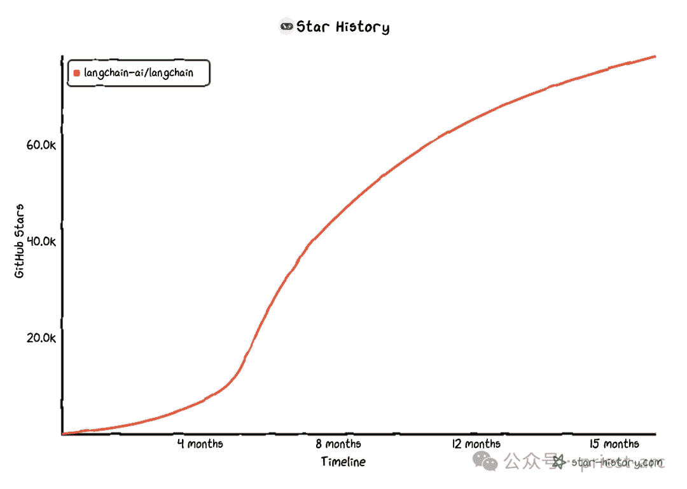
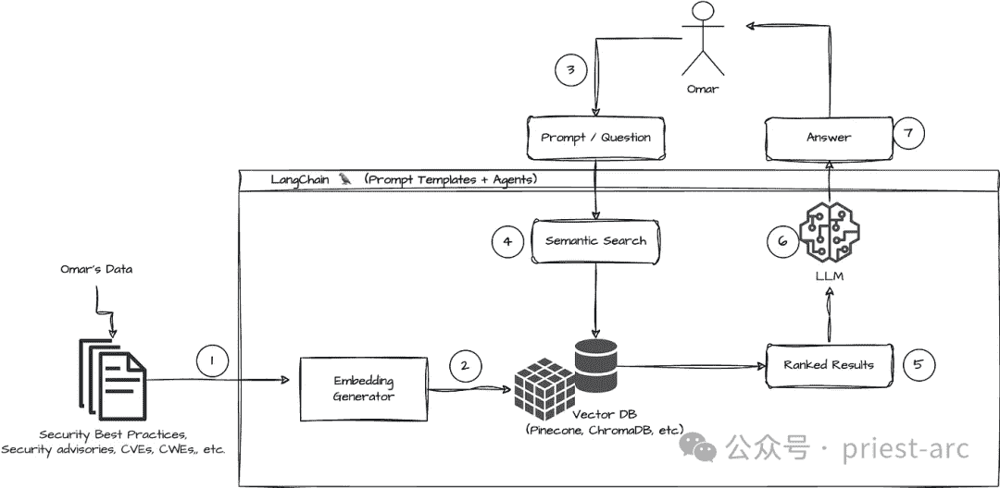
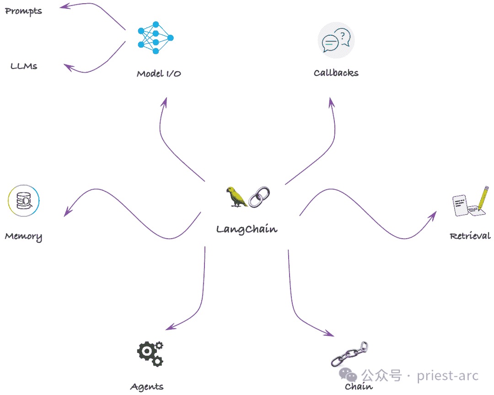
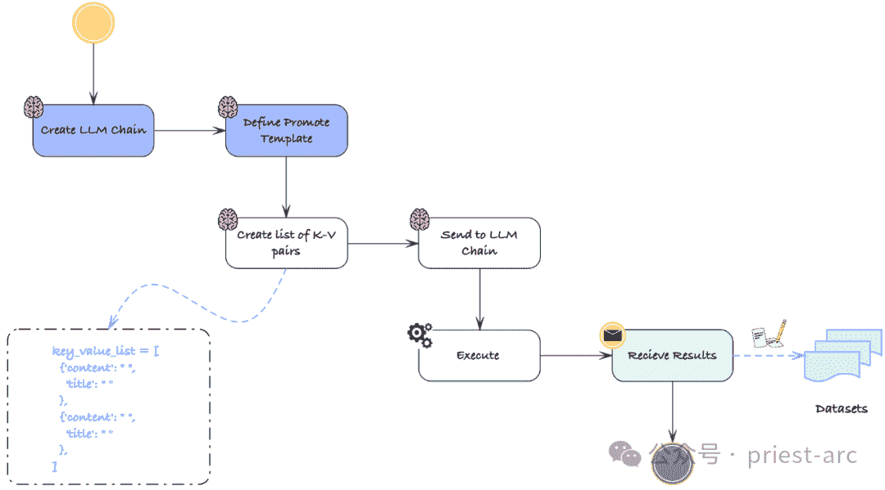

# 一文解析如何基于 `LangChain` 构建 `LLM` 应用程序

> 来源：[https://agijuejin.feishu.cn/docx/C4k5dO3DDoCksFxLUyBcRTWMn1f](https://agijuejin.feishu.cn/docx/C4k5dO3DDoCksFxLUyBcRTWMn1f)

> 作者：Luga Lee | 架构驿站

> 原文：https://mp.weixin.qq.com/s/iDI4FvnIdlHAAUWOpnrjpA

Hello folks，我是 Luga，今天我们继续来聊一下人工智能（AI）生态领域相关的技术 - `LangChain`，本文将继续聚焦在针对 `LangChain` 的技术进行剖析，使得大家能够了解 `LangChain` 实现机制以便更好地对利用其进行应用及市场开发。

在日新月异的人工智能领域，语言模型已经成为舞台主角，重新定义了人机交互的方式。`ChatGPT` 的广泛认可以及 `Google` 等科技巨头纷纷推出类似产品，使语言模型，尤其是 `LLM`，成为科技界瞩目焦点。

从某种意义上来讲，`LLM` 代表了人工智能理解、解释和生成人类语言能力的重大飞跃，经过海量文本数据的训练，能够掌握复杂的语言模式和语义细微差别。凭借前所未有的语言处理能力，`LLM` 可以帮助用户以卓越的准确性和效率生成高质量内容。

而 `LangChain` 作为一个围绕 `LLM` 构建的框架，为自然语言处理方面开辟了一个充满可能性的新世界，可以创建各种应用程序，并能够有效解决文本生成、情感分析以及语言翻译等难题，极大地释放了 `LLM` 的潜力。

## 什么是 `LangChain`？

作为一款开源的 `Python` 框架，`LangChain` 旨在促进基于 `LLM` 的应用程序开发。基于所提供了一套工具、组件和接口等套件，`LangChain` 简化了以 `LLM` 为核心的应用程序的构建过程。通过 `LangChain`，开发人员能够轻松管理与语言模型的交互，无缝连接不同的组件，并集成 `API` 和数据库等资源。

此外，借助 `LangChain` 技术，我们能够构建出一系列应用程序，这些应用程序能够生成创新性且与上下文相关的内容。无论是撰写博客文章、产品描述，与聊天机器人对话，还是生成问答（`GQA`）和摘要等，利用 `LLM` 的应用程序开发变得更加简便高效。



图：`LangChain` Github Star 历史（由 star-history.com 生成）

从另一角度而言，这种基于 `LangChain` 的技术应用使得开发人员可以利用 `LangChain` 提供的强大语言模型能力，快速开发出符合用户需求的应用，从而提升用户体验并节约开发时间和成本。

## `LLM` 的局限性与 `LangChain` 的解决方案

在实际的场景中，`LLM` 擅长在常规上下文下对提示做出响应，但在未接受过训练的特定领域却会遇到挑战。`Prompts` 则是人们用来引导 `LLM` 生成回复的查询。为了让 `LLM` 在特定领域发挥更佳效果，机器学习工程师需要将其与组织内部数据来源整合，并应用提示工程技术。

`LangChain` 的出现简化了开发数据响应式应用程序的中间步骤，并提高了 `Prompt Engineering` 的效率。同时，提供了一套易用、直观的工具和界面，使开发人员能够轻松地将 `LLM` 与数据源和提示工程技术进行整合。



作为一项重要技术，那么，`LangChain` 具备哪些核心的优势呢？

### 重新发挥语言模型的作用

借助 `LangChain`，组织可以将 `LLM` 的能力重新用于特定领域的应用程序，而无需重新培训或微调。开发团队可以构建引用专有信息的复杂应用程序，从而增强模型的响应能力。举例来说，我们可以利用 `LangChain` 构建应用程序，从存储的内部文档中检索数据，并将其整合为对话响应。我们还可以创建 `RAG` ( 检索增强生成 ) 工作流程，在提示期间向语言模型引入新信息。通过实施 `RAG` 和其他上下文感知工作流程，可以减少模型产生的幻觉，提高响应的准确性。

### 简化人工智能开发

`LangChain` 通过简化数据源集成的复杂性并快速提炼，简化了 `AI` 开发过程。开发人员可以自定义序列，快速构建复杂的应用程序。软件团队可以修改 `LangChain` 提供的模板和库，以减少开发时间，而不必从头编写业务逻辑。

### 开发者支持

`LangChain` 为 `AI` 开发者提供了连接语言模型和外部数据源的工具。毕竟，它是开源的，并得到活跃社区的支持。组织可以免费使用 `LangChain`，并获得其他熟悉该框架的开发人员的支持。

## `LangChain` 的核心组件解析

`LangChain` 的独特之处之一便是其灵活性和模块化。通过将自然语言处理管道分解为单独的组件，开发人员可以轻松混合和匹配这些构建块，以创建满足其特定需求的自定义工作流程，从而使得 `LangChain` 成为一个高度适应性的框架，可用于为广泛的用例和行业构建对话式人工智能应用程序。

`LangChain` 是提供了一组模块，能够构建完整的 `LLM`（`Language Model`）应用程序管道，并与各种数据加载器、向量存储和 `LLM` 提供程序等进行广泛的集成。`LangChain`的主要核心组件可参考如下图所示：



`LangChain` 关键组件

### `Model I/O`

`LangChain` 的核心是强大的语言模型（`LLM`），使应用程序能够理解和生成类似人类的文本。通过 `LangChain`，开发人员能够出色地完成各种与语言相关的任务。无论是理解用户查询、生成响应，还是执行复杂的语言任务，`LangChain` 的模型都是语言处理能力的支柱。

`Models` 模块负责管理与语言模型的交互。`LangChain` 支持一系列 `LLM`，包括 `GPT-3`、`OpenAI` 等。开发者可以使用 `Models` 模块来管理 `LLM` 的配置，例如设置温度、`top-p` 等参数。模型模块对于提高 `LLM` 的能力并使开发人员能够构建可生成创意和上下文相关内容的应用程序至关重要。

```
from langchain.llms import OpenAI
llm = OpenAI(model_name=&quot;text-davinci-003&quot;)

# The LLM takes a prompt as an input and outputs a completion
prompt = &quot;When can I achieve financial freedom?&quot;
completion = llm(prompt)
```

### `Chains`

`Chains` 模块在应用程序中负责链接不同的组件，开发人员可以利用 `Chains` 模块创建链式结构，将提示、模型和其他应用程序组件有机地连接在一起。这种链式结构对于构建需要多个组件协同工作的复杂应用程序至关重要。

通过 `Chains` 模块，开发人员可以灵活组合和配置不同的组件，形成一个完整的应用程序管道，实现高度定制化的功能和逻辑。

```
chain = LLMChain(llm = llm, 
                  prompt = prompt)

chain.run(&quot;ai&quot;)
```

### `Agents`

`Agents` 模块在应用程序中承担了管理应用程序与外界之间交互的重要角色。通过使用 `Agents` 模块，开发人员可以构建各种类型的应用程序，如个人助理、智能聊天机器人等。这些应用程序可以基于语音或文本输入进行交互，并通过分析和理解输入数据来提供相应的响应和服务。

`Agents` 模块为开发人员提供了一个灵活、可扩展的工具，使他们能够轻松构建具有交互功能的应用程序，为用户提供个性化、智能化的体验。

```
class Agent:

    def __init__(self, config):
        self.config = config
        self.chain = Chain(config)
        self.proxy = Proxy(config)
        self.memory = Memory(config)
        self.callback = Callback(config)

    def parse_input(self, input):
        # 解析用户的输入和上下文信息
        ...
```

### `Memory`

`LangChain` 的 `Memory` 模块承担了数据存储的管理任务。通过使用 `Memory` 模块，开发人员可以轻松地存储和检索各种类型的数据，如文本、图像、音频等。

`Memory` 模块 提供了高度可扩展的存储机制，可以适应不同规模和类型的数据存储需求。开发人员可以根据应用程序的需要，灵活地组织和管理存储的数据，以满足应用程序的要求。

```
conversation = ConversationChain(llm=llm, verbose=True)
conversation.predict(input=&quot;I am the last one.&quot;)
conversation.predict(input=&quot;he is first.&quot;)
conversation.predict(input=&quot;She is third from the bottom&quot;)
```

### `Retrieval`

以 `Indexes` 组件为例，`Indexs` 模块在应用程序中承担了数据索引的管理任务。开发人员可以利用 `Indexs` 模块创建用于搜索和检索数据的索引结构。`Indexs` 模块对于构建需要进行数据搜索和检索的应用程序至关重要。

使用 `Indexs` 模块，开发人员可以根据应用程序的需求创建不同类型的索引，如文本索引、关键词索引等。这些索引结构可以针对特定的数据属性或特征进行优化，以实现更快速和精确的数据搜索和检索。开发人员可以根据数据的特点和应用程序的需求，灵活地配置和管理索引结构。

```
retriever = db.as_retriever()

qa = RetrievalQA.from_chain_type(
    llm=llm, 
    chain_type=&quot;stuff&quot;, 
    retriever=retriever, 
    return_source_documents=True)

query = &quot;Forgive me for my unruly, indulgent love of freedom in this life?&quot;
result = qa({&quot;query&quot;: query})

print(result[&#x27;result&#x27;])
```

### `Calbacks`

`LangChain` 提供了一个回调系统，使的我们能够连接到 `LLM` 请求的不同阶段。这个回调系统对于日志记录、监控、流传输和其他任务非常有用。

通过使用这些回调函数，我们可以灵活地控制和管理 `LLM` 请求的各个阶段。同时，还可以根据应用程序的需求，自定义回调函数的行为，以实现特定的功能和逻辑。

```
class BaseCallbackHandler:
    &quot;&quot;&quot;Base callback handler that can be used to handle callbacks from langchain.&quot;&quot;&quot;

    def on_llm_start(
        self, serialized: Dict[str, Any], prompts: List[str], **kwargs: Any
    ) -&gt; Any:
        &quot;&quot;&quot;Run when LLM starts running.&quot;&quot;&quot;

    def on_chat_model_start(
        self, serialized: Dict[str, Any], messages: List[List[BaseMessage]], **kwargs: Any
    ) -&gt; Any:
        &quot;&quot;&quot;Run when Chat Model starts running.&quot;&quot;&quot;

    def on_llm_new_token(self, token: str, **kwargs: Any) -&gt; Any:
        &quot;&quot;&quot;Run on new LLM token. Only available when streaming is enabled.&quot;&quot;&quot;
```

通过对上述关键组件的解析，我们可以大致了解 `LangChain` 的工作原理和流程，即将 `Agents`、`Memory`、`Indexs` 和回调系统等关键组件结合起来，实现应用程序与外界的交互、数据的存储和索引，以及自定义操作的执行。

这种组合使得 `LangChain` 能够构建出强大、灵活的应用程序，为用户提供个性化、智能化的体验。具体可参考如下工作流：



`LLM` `LangChain` 工作流程

## 使用 `LangChain` 进行 `LLM` 应用程序构建

在开始之前，我们需要确保正确安装 `LangChain` 的软件包，并按照指南进行设置和配置。这包括安装所需的编程语言环境（如`Python`）、安装 `LangChain` 的相关库和依赖项，并进行必要的配置和设置，以确保 `LangChain` 可以正常运行。

一旦安装和设置完成，我们可以开始导入和使用 `LLM`。为了有效使用 `LLM`，我们需要导入适当的库和依赖项，以便在应用程序中能够调用和使用 `LLM` 的功能。

### 设置 `LangChain`

这里，主要为 `LangChain` 环境设置相关的依赖库，具体可参考如下：

```
import langchain
import openai
import os
import IPython
from langchain.llms import OpenAI
from dotenv import load_dotenv
from langchain.chat_models import ChatOpenAI
from langchain.schema import (
    AIMessage,
    HumanMessage,
    SystemMessage
)
from langchain.embeddings import OpenAIEmbeddings
from langchain.chains import LLMChain
from langchain.chains import RetrievalQA
from langchain import ConversationChain

load_dotenv()
# API configuration
openai.api_key = os.getenv(&quot;OPENAI_API_KEY&quot;)
```

### 初始化 `LLM`

要在 `LangChain` 中初始化 `LLM`，首先需要导入必要的库和依赖项。如果大家使用 `Python` 编程语言，我们可以导入名为 `langchain` 的库，并指定要使用的语言模型。

以下是一个示例代码片段，展示了如何导入 `langchain` 库和初始化 `LLM`，具体可参考：

```
# 导入必要的库和依赖项
import langchain

# 指定要使用的语言模型
language_model = &quot;gpt3.5-turbo&quot;  # 这里使用 GPT-3.5 Turbo 模型作为示例

# 初始化 LLM
llm = langchain.LLM(language_model)

# 接下来，可以使用 llm 对象来调用和使用 LLM 的各种功能和方法
# 例如，可以使用 llm.generate() 方法生成文本，或使用 llm.complete() 方法进行自动补全等

# 示例：使用 LLM 生成文本
prompt = &quot;Hello, LangChain!&quot;
response = llm.generate(prompt)
print(response)
```

### 输入 `Prompts`

初始化 `LLM` 后，我们可以通过输入提示来生成文本或获取响应。`Prompts` 是语言模型生成文本的起点。根据需求，我们可以提供单个或多个 `Prompts`。以下是一个简单的示例：

```
# 初始化 LLM
llm = langchain.LLM(language_model)

# 提供单个提示
prompt = &quot;Once upon a time&quot;
response = llm.generate(prompt)
print(response)

# 提供多个提示
prompts = [
    &quot;The sun is shining&quot;,
    &quot;In a galaxy far, far away&quot;,
    &quot;Once upon a time&quot;
]
responses = llm.generate(prompts)
for response in responses:
    print(response)
```

### 检索生成的文本或响应

输入 `Prompts` 后，我们可以从 `LLM` 中检索生成的文本或响应。生成的文本或响应将基于所提供的 `Prompts`，以及语言模型所具备的上下文理解和语言生成的功能。

当我们提供一个或多个 `Prompts` 时，`LLM` 会使用这些 `Prompts` 作为起点，并借助语言模型的能力来生成相关的文本。语言模型会考虑 `Prompts` 中的上下文信息，以及其在训练数据中学习到的语言规律和概率分布。这样，生成的文本将会在一定程度上与 `Prompts` 相关，并且具备一定的语法合理性和连贯性。


```
# Print the generated text
print(generated_text)

# Print the responses
for response in responses:
    print(response
```

总而言之，通过遵循上述步骤并实现相应的代码，我们可以无缝地使用 LangChain 和预训练的 LLM，充分利用它们在文本生成和理解任务上的能力。这为我们解决各种自然语言处理问题提供了一种高效且灵活的方法。无论是开发智能对话系统、构建文本生成应用，还是进行文本理解和分析，LangChain 和预训练的 LLM 都将成为有力的工具和技术基础。

综上所述，在构建支持 LLM 的应用程序方面，LangChain 为我们开辟了一个充满无限可能性的世界。如果大家对文本完成、语言翻译、情感分析、文本摘要或命名实体识别等领域感兴趣，LangChain 提供了直观易用的平台和强大的 API，让我们的想法转化为现实。

借助 LangChain 和 LLM 的强大能力，我们可以创建出具备理解和生成类人文本能力的智能应用程序，从而彻底改变我们与语言交互的方式。

### Reference

[1] `https://python.langchain.com/`

[2] `https://machinehack.com/story/langchain-to-build-llm-powered-applications`
