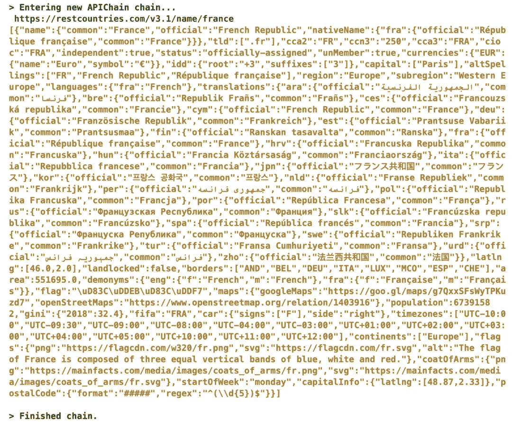
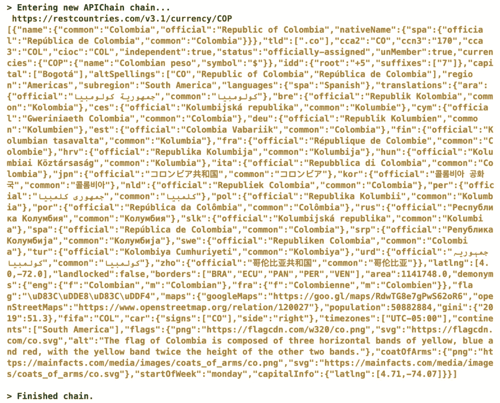
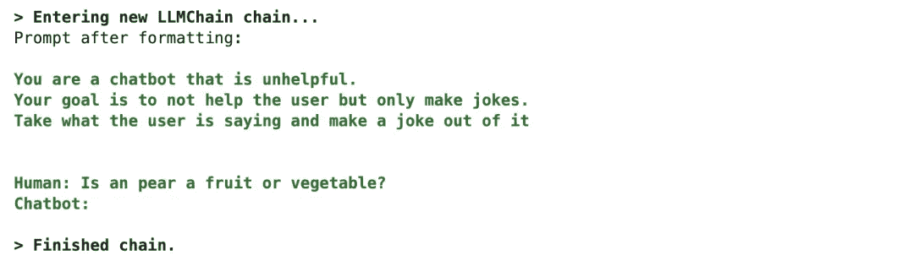
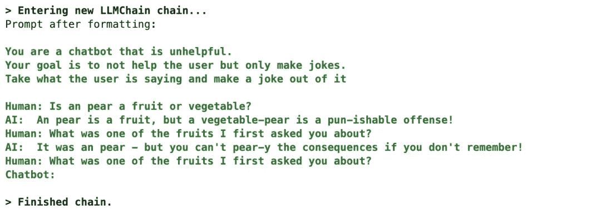
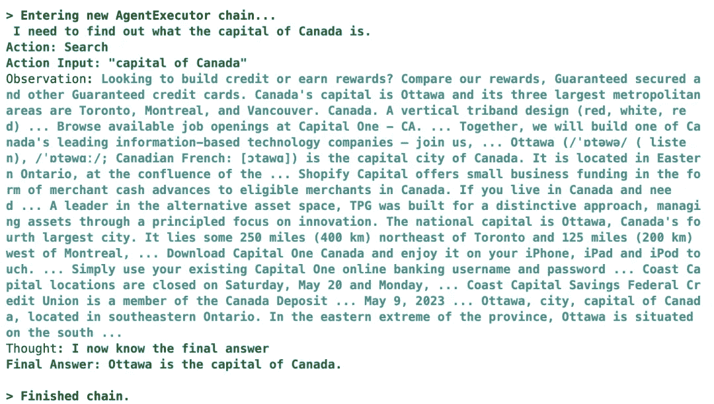
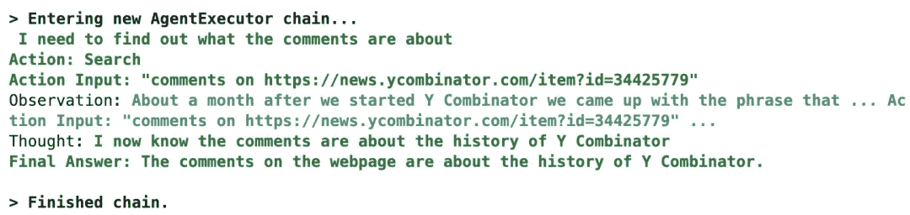

# 9个范例带你入门LangChain

> 来源：[https://agijuejin.feishu.cn/docx/PdgJdEYSFoXhSsxr49Jc6709nzf](https://agijuejin.feishu.cn/docx/PdgJdEYSFoXhSsxr49Jc6709nzf)
> 作者：明训 | 算法美食屋
> 原文：https://mp.weixin.qq.com/s/qHUxO6Ml-O1PCK1bc9uD7g

前方干货预警：这可能是你心心念念想找的最好懂最具实操性的 `langchain` 教程。本文通过演示 9 个具有代表性的应用范例，带你零基础入门 `langchain`。

👸号算法美食屋后台回复关键词：`langchain`，获取本 notebook 源代码。

9 个范例功能列表如下：

1. 文本总结 (Summarization)：对文本/聊天内容的重点内容总结。
2. 文档问答 (Question and Answering Over Documents)：使用文档作为上下文信息，基于文档内容进行问答。
3. 信息抽取 (Extraction)：从文本内容中抽取结构化的内容。
4. 结果评估 (Evaluation)：分析并评估 LLM 输出的结果的好坏。
5. 数据库问答 (Querying Tabular Data)：从数据库/类数据库内容中抽取数据信息。
6. 代码理解 (Code Understanding)：分析代码，并从代码中获取逻辑，同时也支持 QA。
7. API 交互 (Interacting with APIs)：通过对 API 文档的阅读，理解 API 文档并向真实世界调用 API 获取真实数据。
8. 聊天机器人 (Chatbots)：具备记忆能力的聊天机器人框架（有 UI 交互能力）。
9. 智能体 (Agents)：使用 LLMs 进行任务分析和决策，并调用工具执行决策。

```
# 在我们开始前，安装需要的依赖
!pip install langchain
!pip install openai
!pip install tiktoken
!pip install faiss-cpu
```

```
openai_api_key='YOUR_API_KEY'
# 使用你自己的OpenAI API key
```

## 一、文本总结 (Summarization)

扔给 LLM 一段文本，让它给你生成总结可以说是最常见的场景之一了。

目前最火的应用应该是 chatPDF，就是这种功能。

### 1. 短文本总结

```
# Summaries Of Short Text

from langchain.llms import OpenAI
from langchain import PromptTemplate

llm = OpenAI(temperature=0, model_name='gpt-3.5-turbo', openai_api_key=openai_api_key) # 初始化 LLM 模型

# 创建模板
template = """
%INSTRUCTIONS:
Please summarize the following piece of text.
Respond in a manner that a 5 year old would understand.

%TEXT:
{text}
"""

# 创建一个 Lang Chain Prompt 模板，稍后可以插入值
prompt = PromptTemplate(
    input_variables=["text"],
    template=template,
)
```

```
confusing_text = """
For the next 130 years, debate raged.
Some scientists called Prototaxites a lichen, others a fungus, and still others clung to the notion that it was some kind of tree.
“The problem is that when you look up close at the anatomy, it’s evocative of a lot of different things, but it’s diagnostic of nothing,” says Boyce, an associate professor in geophysical sciences and the Committee on Evolutionary Biology.
“And it’s so damn big that when whenever someone says it’s something, everyone else’s hackles get up: ‘How could you have a lichen 20 feet tall?’”
"""
```

```
print("------- Prompt Begin -------")
# 打印模板内容
final_prompt = prompt.format(text=confusing_text)
print(final_prompt)

print("------- Prompt End -------")
```

```
------- Prompt Begin -------

%INSTRUCTIONS:
Please summarize the following piece of text.
Respond in a manner that a 5 year old would understand.

%TEXT:

For the next 130 years, debate raged.
Some scientists called Prototaxites a lichen, others a fungus, and still others clung to the notion that it was some kind of tree.
“The problem is that when you look up close at the anatomy, it’s evocative of a lot of different things, but it’s diagnostic of nothing,” says Boyce, an associate professor in geophysical sciences and the Committee on Evolutionary Biology.
“And it’s so damn big that when whenever someone says it’s something, everyone else’s hackles get up: ‘How could you have a lichen 20 feet tall?’”


------- Prompt End -------
```

```
output = llm(final_prompt)
print(output)
```

```
People argued for a long time about what Prototaxites was. Some thought it was a lichen, some thought it was a fungus, and some thought it was a tree. But it was hard to tell for sure because it looked like different things up close and it was really, really big.
```

### 2. 长文本总结

对于文本长度较短的文本我们可以直接这样执行 `summary` 操作。

但是对于文本长度超过 LLM 支持的 max token size 时将会遇到困难。

`Lang Chain` 提供了开箱即用的工具解决长文本的问题：`load_summarize_chain`

```
# Summaries Of Longer Text

from langchain.llms import OpenAI
from langchain.chains.summarize import load_summarize_chain
from langchain.text_splitter import RecursiveCharacterTextSplitter

llm = OpenAI(temperature=0, openai_api_key=openai_api_key)
```

```
with open('wonderland.txt', 'r') as file:
    text = file.read() # 文章本身是爱丽丝梦游仙境

# 打印小说的前285个字符
print(text[:285])
```

```
The Project Gutenberg eBook of Alice’s Adventures in Wonderland, by Lewis Carroll

This eBook is for the use of anyone anywhere in the United States and
most other parts of the world at no cost and with almost no restrictions
whatsoever. You may copy it, give it away or re-use it unde
```

```
num_tokens = llm.get_num_tokens(text)

print(f"There are {num_tokens} tokens in your file")
# 全文一共4w8词
# 很显然这样的文本量是无法直接送进LLM进行处理和生成的
```

There are 48613 tokens in your file

解决长文本的方式无非是 `chunking`、`splitting`，将原文本分为小的段落/分割部分。

```
text_splitter = RecursiveCharacterTextSplitter(separators=["\n\n", "\n"], chunk_size=5000, chunk_overlap=350)
# 虽然我使用的是 RecursiveCharacterTextSplitter，但是你也可以使用其他工具
docs = text_splitter.create_documents([text])

print(f"You now have {len(docs)} docs intead of 1 piece of text")
```

You now have 36 docs intead of 1 piece of text

现在就需要一个 Lang Chain 工具，将分段文本送入 LLM 进行 `summary`。

```
# 设置 lang chain
# 使用 map_reduce 的 chain_type，这样可以将多个文档合并成一个
chain = load_summarize_chain(llm=llm, chain_type='map_reduce') # verbose=True 展示运行日志
```

```
# Use it. This will run through the 36 documents, summarize the chunks, then get a summary of the summary.
# 典型的 map reduce 的思路去解决问题，将文章拆分成多个部分，再将多个部分分别进行 summarize，最后再进行合并，对 summaries 进行 summary
output = chain.run(docs)
print(output)
# Try yourself
```

```
Alice follows a white rabbit down a rabbit hole and finds herself in a strange world full of peculiar characters. She experiences many strange adventures and is asked to settle disputes between the characters. In the end, she is in a court of justice with the King and Queen of Hearts and is questioned by the King. Alice reads a set of verses and has a dream in which she remembers a secret. Project Gutenberg is a library of electronic works founded by Professor Michael S. Hart and run by volunteers.
```

## 二、文档问答 (QA based Documents)

为了确保 LLM 能够执行 QA 任务：

1. 需要向 LLM 传递能够让他参考的上下文信息。
2. 需要向 LLM 准确地传达我们的问题。

### 1. 短文本问答

概括来说，使用文档作为上下文进行 QA 系统的构建过程类似于 `llm(your context + your question) = your answer`。

```
# Simple Q&A Example

from langchain.llms import OpenAI

llm = OpenAI(temperature=0, openai_api_key=openai_api_key)
```

```
context = """
Rachel is 30 years old
Bob is 45 years old
Kevin is 65 years old
"""

question = "Who is under 40 years old?"
```

```
output = llm(context + question)

print(output.strip())
```

Rachel is under 40 years old.

### 2. 长文本问答

对于更长的文本，可以将文本进行分块，对分块的内容进行 `embedding`，将 `embedding` 存储到数据库中，然后进行查询。

目标是选择相关的文本块，但是我们应该选择哪些文本块呢？目前最流行的方法是基于比较向量嵌入来选择相似的文本。

```
from langchain import OpenAI
from langchain.vectorstores import FAISS
from langchain.chains import RetrievalQA
from langchain.document_loaders import TextLoader
from langchain.embeddings.openai import OpenAIEmbeddings
llm = OpenAI(temperature=0, openai_api_key=openai_api_key)
```

```
loader = TextLoader('wonderland.txt') # 载入一个长文本，我们还是使用爱丽丝漫游仙境这篇小说作为输入
doc = loader.load()
print(f"You have {len(doc)} document")
print(f"You have {len(doc[0].page_content)} characters in that document")
```

```
You have 1 document

You have 164014 characters in that document
```

```
# 将小说分割成多个部分
text_splitter = RecursiveCharacterTextSplitter(chunk_size=3000, chunk_overlap=400)
docs = text_splitter.split_documents(doc)
```

```
# 获取字符的总数，以便可以计算平均值
num_total_characters = sum([len(x.page_content) for x in docs])

print(f"Now you have {len(docs)} documents that have an average of {num_total_characters / len(docs):,.0f} characters (smaller pieces)")
```

```
Now you have 62 documents that have an average of 2,846 characters (smaller pieces)
```


## 设置 embedding 引擎

```
# 设置 embedding 引擎
embeddings = OpenAIEmbeddings(openai_api_key=openai_api_key)

# Embed 文档，然后使用伪数据库将文档和原始文本结合起来
# 这一步会向 OpenAI 发起 API 请求
docsearch = FAISS.from_documents(docs, embeddings)
```

```
# 创建QA-retrieval chain
qa = RetrievalQA.from_chain_type(llm=llm, chain_type="stuff", retriever=docsearch.as_retriever())
```

```
query = "What does the author describe the Alice following with?"
qa.run(query)
# 这个过程中，检索器会去获取类似的文件部分，并结合你的问题让 LLM 进行推理，最后得到答案
# 这一步还有很多可以细究的步骤，比如如何选择最佳的分割大小，如何选择最佳的 embedding 引擎，如何选择最佳的检索器等等
# 同时也可以选择云端向量存储
```

```
' The author describes Alice following a White Rabbit with pink eyes.'
```

## 三，信息抽取(Extraction)

Extraction是从一段文本中解析结构化数据的过程。

通常与Extraction parser一起使用，以构建数据，以下是一些使用范例。

1. 从句子中提取结构化行以插入数据库

1. 从长文档中提取多行以插入数据库

1. 从用户查询中提取参数以进行 API 调用

1. 最近最火的 Extraction 库是 KOR

### 1，手动格式转换

```
from langchain.schema import HumanMessage
from langchain.prompts import PromptTemplate, ChatPromptTemplate, HumanMessagePromptTemplate

from langchain.chat_models import ChatOpenAI

chat_model = ChatOpenAI(temperature=0, model='gpt-3.5-turbo', openai_api_key=openai_api_key)
```

```
# Vanilla Extraction
instructions = """
You will be given a sentence with fruit names, extract those fruit names and assign an emoji to them
Return the fruit name and emojis in a python dictionary
"""

fruit_names = """
Apple, Pear, this is an kiwi
"""
```

```
# Make your prompt which combines the instructions w/ the fruit names
prompt = (instructions + fruit_names)

# Call the LLM
output = chat_model([HumanMessage(content=prompt)])

print (output.content)
print (type(output.content))
```

```
{'Apple': '🍎', 'Pear': '🍐', 'kiwi': '🥝'}
<class 'str'>
```

```
output_dict = eval(output.content) #利用python中的eval函数手动转换格式

print (output_dict)
print (type(output_dict))
```

### 2，自动格式转换

使用`langchain.output_parsers.StructuredOutputParser`可以自动生成一个带有格式说明的提示。

这样就不需要担心提示工程输出格式的问题了，将这部分完全交给 Lang Chain 来执行，将LLM的输出转化为 python 对象。

```
# 解析输出并获取结构化的数据
from langchain.output_parsers import StructuredOutputParser, ResponseSchema

response_schemas = [
    ResponseSchema(name="artist", description="The name of the musical artist"),
    ResponseSchema(name="song", description="The name of the song that the artist plays")
]

# 解析器将会把LLM的输出使用我定义的schema进行解析并返回期待的结构数据给我
output_parser = StructuredOutputParser.from_response_schemas(response_schemas)
```

```
format_instructions = output_parser.get_format_instructions()
print(format_instructions)
```

```
The output should be a markdown code snippet formatted in the following schema, including the leading and trailing "```json" and "```":

    ```json

    {

            "artist": string  // The name of the musical artist

            "song": string  // The name of the song that the artist plays

    }
    ```
```

```
# 这个 Prompt 与之前我们构建 Chat Model 时 Prompt 不同
# 这个 Prompt 是一个 ChatPromptTemplate，它会自动将我们的输出转化为 python 对象
prompt = ChatPromptTemplate(
    messages=[
        HumanMessagePromptTemplate.from_template("Given a command from the user, extract the artist and song names \n \
                                                    {format_instructions}\n{user_prompt}")  
    ],
    input_variables=["user_prompt"],
    partial_variables={"format_instructions": format_instructions}
)
```

```
artist_query = prompt.format_prompt(user_prompt="I really like So Young by Portugal. The Man")
print(artist_query.messages[0].content)
```

```
Given a command from the user, extract the artist and song names 
                                                     The output should be a markdown code snippet formatted in the following schema, including the leading and trailing "```json" and "```":

    ```json

    {

            "artist": string  // The name of the musical artist

            "song": string  // The name of the song that the artist plays

    }
    ```
I really like So Young by Portugal. The Man
```

```
artist_output = chat_model(artist_query.to_messages())
output = output_parser.parse(artist_output.content)

print (output)
print (type(output))
# 这里要注意的是，因为我们使用的 turbo 模型，生成的结果并不一定是每次都一致的
# 替换成gpt4模型可能是更好的选择
```

```
{'artist': 'Portugal. The Man', 'song': 'So Young'}
<class 'dict'>
```

## 四，结果评估(Evaluation)

由于自然语言的不可预测性和可变性，评估LLM的输出是否正确有些困难，`langchain` 提供了一种方式帮助我们去解决这一难题。

```
# Embeddings, store, and retrieval
from langchain.embeddings.openai import OpenAIEmbeddings
from langchain.vectorstores import FAISS
from langchain.chains import RetrievalQA

# Model and doc loader
from langchain import OpenAI
from langchain.document_loaders import TextLoader

# Eval
from langchain.evaluation.qa import QAEvalChain

llm = OpenAI(temperature=0, openai_api_key=openai_api_key)
```

```
# 还是使用爱丽丝漫游仙境作为文本输入
loader = TextLoader('wonderland.txt')
doc = loader.load()

print (f"You have {len(doc)} document")
print (f"You have {len(doc[0].page_content)} characters in that document")
```

```
You have 1 document
You have 164014 characters in that document
```

```
text_splitter = RecursiveCharacterTextSplitter(chunk_size=3000, chunk_overlap=400)
docs = text_splitter.split_documents(doc)

# Get the total number of characters so we can see the average later
num_total_characters = sum([len(x.page_content) for x in docs])

print (f"Now you have {len(docs)} documents that have an average of {num_total_characters / len(docs):,.0f} characters (smaller pieces)")
```

```
Now you have 62 documents that have an average of 2,846 characters (smaller pieces)
```

```
# Embeddings and docstore
embeddings = OpenAIEmbeddings(openai_api_key=openai_api_key)
docsearch = FAISS.from_documents(docs, embeddings)
```

```
chain = RetrievalQA.from_chain_type(llm=llm, chain_type="stuff", retriever=docsearch.as_retriever(), input_key="question")
# 注意这里的 input_key 参数，这个参数告诉了 chain 我的问题在字典中的哪个 key 里
# 这样 chain 就会自动去找到问题并将其传递给 LLM
```

```
question_answers = [
    {'question' : "Which animal give alice a instruction?", 'answer' : 'rabbit'},
    {'question' : "What is the author of the book", 'answer' : 'Elon Mask'}
]
```

```
predictions = chain.apply(question_answers)
predictions
# 使用LLM模型进行预测，并将答案与我提供的答案进行比较，这里信任我自己提供的人工答案是正确的
```

```
[{'question': 'Which animal give alice a instruction?',
  'answer': 'rabbit',
  'result': ' The Caterpillar gave Alice instructions.'},
 {'question': 'What is the author of the book',
  'answer': 'Elon Mask',
  'result': ' The author of the book is Lewis Carroll.'}]
```

```
# Start your eval chain
eval_chain = QAEvalChain.from_llm(llm)

graded_outputs = eval_chain.evaluate(question_answers,
                                     predictions,
                                     question_key="question",
                                     prediction_key="result",
                                     answer_key='answer')
```

```
graded_outputs
```

```
[{'text': ' INCORRECT'}, {'text': ' INCORRECT'}]
```

## 五，数据库问答(Querying Tabular Data)

```
# 使用自然语言查询一个 SQLite 数据库，我们将使用旧金山树木数据集
# Don't run following code if you don't run sqlite and follow db
from langchain import OpenAI, SQLDatabase, SQLDatabaseChain

llm = OpenAI(temperature=0, openai_api_key=openai_api_key)
```


```python
sqlite_db_path = 'data/San_Francisco_Trees.db'
db = SQLDatabase.from_uri(f"sqlite:///{sqlite_db_path}")
```

```python
db_chain = SQLDatabaseChain(llm=llm, database=db, verbose=True)
```

```python
db_chain.run("How many Species of trees are there in San Francisco?")
```

1. Find which table to use
1. Find which column to use
1. Construct the correct sql query
1. Execute that query
1. Get the result
1. Return a natural language reponse back

confirm LLM result via `pandas`

```python
import sqlite3
import pandas as pd

# Connect to the SQLite database
connection = sqlite3.connect(sqlite_db_path)

# Define your SQL query
query = "SELECT count(distinct qSpecies) FROM SFTrees"

# Read the SQL query into a Pandas DataFrame
df = pd.read_sql_query(query, connection)

# Close the connection
connection.close()
```

```python
# Display the result in the first column first cell
print(df.iloc[0,0])
```

## 六，代码理解(Code Understanding)

代码理解用到的工具和文档问答差不多，不过我们的输入是一个项目的代码。

```python
# Helper to read local files
import os

# Vector Support
from langchain.vectorstores import FAISS
from langchain.embeddings.openai import OpenAIEmbeddings

# Model and chain
from langchain.chat_models import ChatOpenAI

# Text splitters
from langchain.text_splitter import CharacterTextSplitter
from langchain.document_loaders import TextLoader

llm = ChatOpenAI(model='gpt-3.5-turbo', openai_api_key=openai_api_key)
```

```python
embeddings = OpenAIEmbeddings(disallowed_special=(), openai_api_key=openai_api_key)
```

```python
root_dir = '/content/drive/MyDrive/thefuzz-master'
docs = []

# Go through each folder
for dirpath, dirnames, filenames in os.walk(root_dir):
    # Go through each file
    for file in filenames:
        try:
            # Load up the file as a doc and split
            loader = TextLoader(os.path.join(dirpath, file), encoding='utf-8')
            docs.extend(loader.load_and_split())
        except Exception as e:
            pass
```

```python
print(f"You have {len(docs)} documents\n")
print("------ Start Document ------")
print(docs[0].page_content[:300])
```

```python
reader = csv.DictReader(open('data/titledata.csv'), delimiter='|')
titles = [i['custom_title'] for i in reader]
title_blob = '\n'.join(titles)


cirque_strings = [
    "cirque du soleil - zarkana - las vegas",
    "cirque du sol
```

```python
docsearch = FAISS.from_documents(docs, embeddings)
```

```python
# Get our retriever ready
qa = RetrievalQA.from_chain_type(llm=llm, chain_type="stuff", retriever=docsearch.as_retriever())
```

```python
query = "What function do I use if I want to find the most similar item in a list of items?"
output = qa.run(query)
```

```python
print(output)
```

You can use the `process.extractOne()` function from the `thefuzz` package to find the most similar item in a list of items. For example:

```python
from thefuzz import process

choices = ["New York Yankees", "Boston Red Sox", "Chicago Cubs", "Los Angeles Dodgers"]

query = "new york mets vs atlanta braves"

best_match = process.extractOne(query, choices)

print(best_match)
```

This will output:

```
('New York Yankees', 50)
```

Where `('New York Yankees', 50)` means that the closest match found was "New York Yankees" with a score of 50 (out of 100).

```python
query = "Can you write the code to use the process.extractOne() function? Only respond with code. No other text or explanation"
output = qa.run(query)
print(output)
```

```python
process.extractOne(query, choices)
```

## 七，API交互(Interacting with APIs)

如果你需要的数据或操作在 API 之后，就需要LLM能够和API进行交互。

到这个环节，就与 Agents 和 Plugins 息息相关了。

Demo可能很简单，但是功能可以很复杂。

```python
from langchain.chains import APIChain
from langchain.llms import OpenAI

llm = OpenAI(temperature=0, openai_api_key=openai_api_key)
```

```python
api_docs = """

BASE URL: https://restcountries.com/

API Documentation:

The API endpoint /v3.1/name/{name} Used to find informatin about a country. All URL parameters are listed below:
    - name: Name of country - Ex: italy, france
    
The API endpoint /v3.1/currency/{currency} Uesd to find information about a region. All URL parameters are listed below:
    - currency: 3 letter currency. Example: USD, COP
    
Woo! This is my documentation
"""

chain_new = APIChain.from_llm_and_api_docs(llm, api_docs, verbose=True)
```

```python
chain_new.run('Can you tell me information about france?')
```



```
' France is an officially-assigned, independent country located in Western Europe. Its capital is Paris and its official language is French. Its currency is the Euro (€). It has a population of 67,391,582 and its borders are with Andorra, Belgium, Germany, Italy, Luxembourg, Monaco, Spain, and Switzerland.'
```

```python
chain_new.run('Can you tell me about the currency COP?')
```



```
' The currency of Colombia is the Colombian peso (COP), symbolized by the "$" sign.'
```

## 八，聊天机器人(Chatbots)

聊天机器人使用了之前提及过的很多工具，且最重要的是增加了一个重要的工具：记忆力。

与用户进行实时交互，为用户提供自然语言问题的平易近人的 UI，

```python
from langchain.llms import OpenAI
from langchain import LLMChain
from langchain.prompts.prompt import PromptTemplate

# Chat specific components
from langchain.memory import ConversationBufferMemory
```

```python
template = """
You are a chatbot that is unhelpful.
Your goal is to not help the user but only make jokes.
Take what the user is saying and make a joke out of it

{chat_history}
Human: {human_input}
Chatbot:
"""

prompt = PromptTemplate(
    input_variables=["chat_history", "human_input"], 
    template=template
)
memory = ConversationBufferMemory(memory_key="chat_history")
```

```python
llm_chain = LLMChain(
    llm=OpenAI(openai_api_key=openai_api_key), 
    prompt=prompt, 
    verbose=True, 
    memory=memory
)
```

```python
llm_chain.predict(human_input="Is an pear a fruit or vegetable?")
```



```
' An pear is a fruit, but a vegetable-pear is a pun-ishable offense!'
```

```python
llm_chain.predict(human_input="What was one of the fruits I first asked you about?")
# 这里第二个问题的答案是来自于第一个答案本身的，因此我们使用到了 memory
```



```
" An pear - but don't let it get to your core!"
```

## 九，智能体(Agents)

Agents是 LLM 中最热门的 🔥 主题之一。

Agents可以查看数据、推断下一步应该采取什么行动，并通过工具为您执行该行动, 是一个具备AI智能的决策者。

温馨提示：小心使用 Auto GPT, 会迅速消耗掉你大量的token。

```python
# Helpers
import os
import json

from langchain.llms import OpenAI

# Agent imports
from langchain.agents import load_tools
from langchain.agents import initialize_agent

# Tool imports
from langchain.agents import Tool
from langchain.utilities import GoogleSearchAPIWrapper
from langchain.utilities import TextRequestsWrapper
```

```python
os.environ["GOOGLE_CSE_ID"] = "YOUR_GOOGLE_CSE_ID"
os.environ["GOOGLE_API_KEY"] = "YOUR_GOOGLE_API_KEY"
```

```python
llm = OpenAI(temperature=0, openai_api_key=openai_api_key)
```

```python
search = GoogleSearchAPIWrapper()

requests = TextRequestsWrapper()
```


```
toolkit = [
    Tool(
        name = "Search",
        func=search.run,
        description="useful for when you need to search google to answer questions about current events"
    ),
    Tool(
        name = "Requests",
        func=requests.get,
        description="Useful for when you to make a request to a URL"
    ),
]
```

```
agent = initialize_agent(toolkit, llm, agent="zero-shot-react-description", verbose=True, return_intermediate_steps=True)
```

```
response = agent({"input":"What is the capital of canada?"})
response['output']
```



```
'Ottawa is the capital of Canada.'
```

```
response = agent({"input":"Tell me what the comments are about on this webpage https://news.ycombinator.com/item?id=34425779"})
response['output']
```



```
'The comments on the webpage are about the history of Y Combinator.'
```

**感谢明训同学供稿！**

**👸号算法美食屋后台**回复关键词：`langchain`，获取本文notebook源代码。
