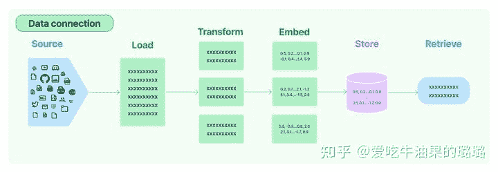

# 手把手教你认识学会LangChain

> 来源：[https://agijuejin.feishu.cn/docx/A9DAdQFwioWxaNxLDEccNZZKn3g](https://agijuejin.feishu.cn/docx/A9DAdQFwioWxaNxLDEccNZZKn3g)

> 作者：爱吃牛油果的璐璐

> 原文：https://zhuanlan.zhihu.com/p/640936557

### 什么是LangChain

LangChain: 一个让你的LLM变得更强大的开源框架。LangChain 就是一个 LLM 编程框架，你想开发一个基于 LLM 应用，需要什么组件它都有，直接使用就行；甚至针对常规的应用流程，它利用链(LangChain中Chain的由来)这个概念已经内置标准化方案了。下面我们从新兴的大语言模型（LLM）技术栈的角度来看看为何它的理念这么受欢迎。

### LangChain起源

LangChain 的作者是 Harrison Chase，最初是于 2022 年 10 月开源的一个项目，在 GitHub 上获得大量关注之后迅速转变为一家初创公司。2017 年 Harrison Chase 还在哈佛上大学，如今已是硅谷的一家热门初创公司的 CEO，这对他来说是一次重大而迅速的跃迁。Insider 独家报道，人工智能初创公司 LangChain 在种子轮一周后，再次获得红杉领投的 2000 万至 2500 万美元融资，估值达到 2 亿美元。

### LangChain六大主要领域

+   管理和优化prompt。不同的任务使用不同prompt，如何去管理和优化这些prompt是langchain的主要功能之一。

+   链，初步理解为一个具体任务中不同子任务之间的一个调用。

+   数据增强的生成，数据增强生成涉及特定类型的链，它首先与外部数据源交互以获取数据用于生成步骤。这方面的例子包括对长篇文字的总结和对特定数据源的提问/回答。

+   代理，根据不同的指令采取不同的行动，直到整个流程完成为止。

+   评估，生成式模型是出了名的难以用传统的指标来评估。评估它们的一个新方法是使用语言模型本身来进行评估。LangChain提供了一些提示/链来协助这个工作。

+   内存：在整个流程中帮我们管理一些中间状态。

总的来说LangChain可以理解为：在一个流程的整个生命周期中，管理和优化prompt，根据prompt使用不同的代理进行不同的动作，在这期间使用内存管理中间的一些状态，然后使用链将不同代理之间进行连接起来，最终形成一个闭环。

### LangChain的主要价值组件

+   组件：用于处理语言模型的抽象概念，以及每个抽象概念的实现集合。无论你是否使用LangChain框架的其他部分，组件都是模块化的，易于使用。

+   现成的链：用于完成特定高级任务的组件的结构化组合。现成的链使人容易上手。对于更复杂的应用和细微的用例，组件使得定制现有链或建立新链变得容易。

### LangChain组件

+   model I/O：语言模型接口

+   data connection：与特定任务的数据接口

+   chains：构建调用序列

+   agents：给定高级指令，让链选择使用哪些工具

+   memory：在一个链的运行之间保持应用状态

+   callbacks：记录并流式传输任何链的中间步骤

+   indexes：索引指的是结构化文件的方法，以便LLM能够与它们进行最好的交互

### 数据连接组件data connection

LLM应用需要用户特定的数据，这些数据不属于模型的训练集。LangChain通过以下方式提供了加载、转换、存储和查询数据的构建模块：

+   文档加载器：从许多不同的来源加载文档

+   文档转换器：分割文档，删除多余的文档等

+   文本嵌入模型：采取非结构化文本，并把它变成一个浮点数的列表 矢量存储：存储和搜索嵌入式数据

+   检索器：查询你的数据

### data connection整体流程



### data connection——文档加载器

python安装包命令：

```
pip install langchain
pip install unstructured
pip install jq
```

**CSV基本用法**

```
import os
from pathlib import Path

from langchain.document_loaders import UnstructuredCSVLoader
from langchain.document_loaders.csv_loader import CSVLoader
EXAMPLE_DIRECTORY = file_path = Path(__file__).parent.parent / &quot;examples&quot;


def test_unstructured_csv_loader() -&gt; None:
    &quot;&quot;&quot;Test unstructured loader.&quot;&quot;&quot;
    file_path = os.path.join(EXAMPLE_DIRECTORY, &quot;stanley-cups.csv&quot;)
    loader = UnstructuredCSVLoader(str(file_path))
    docs = loader.load()
    print(docs)
    assert len(docs) == 1

def test_csv_loader():
  file_path = os.path.join(EXAMPLE_DIRECTORY, &quot;stanley-cups.csv&quot;)
  loader = CSVLoader(file_path)
  docs = loader.load()
  print(docs)

test_unstructured_csv_loader()
test_csv_loader()
```

**文件目录用法**

```
from langchain.document_loaders import DirectoryLoader, TextLoader

text_loader_kwargs={&#x27;autodetect_encoding&#x27;: True}
loader = DirectoryLoader(&#x27;../examples/&#x27;, 
              glob=&quot;**/*.txt&quot;,  # 遍历txt文件
              show_progress=True,  # 显示进度
              use_multithreading=True,  # 使用多线程
              loader_cls=TextLoader,  # 使用加载数据的方式
              silent_errors=True,  # 遇到错误继续
              loader_kwargs=text_loader_kwargs)  # 可以使用字典传入参数

docs = loader.load()
print(&quot;\n&quot;)
print(docs[0])
```

**HTML用法**

```
from langchain.document_loaders import UnstructuredHTMLLoader, BSHTMLLoader
loader = UnstructuredHTMLLoader(&quot;../examples/example.html&quot;)
docs = loader.load()
print(docs[0])

loader = BSHTMLLoader(&quot;../examples/example.html&quot;)
docs = loader.load()
print(docs[0])
```

**JSON用法**

```
import json
from pathlib import Path
from pprint import pprint


file_path=&#x27;../examples/facebook_chat.json&#x27;
data = json.loads(Path(file_path).read_text())
pprint(data)

&quot;&quot;&quot;
{&#x27;image&#x27;: {&#x27;creation_timestamp&#x27;: 1675549016, &#x27;uri&#x27;: &#x27;image_of_the_chat.jpg&#x27;},
 &#x27;is_still_participant&#x27;: True,
 &#x27;joinable_mode&#x27;: {&#x27;link&#x27;: &#x27;&#x27;, &#x27;mode&#x27;: 1},
 &#x27;magic_words&#x27;: [],
 &#x27;messages&#x27;: [{&#x27;content&#x27;: &#x27;Bye!&#x27;,
               &#x27;sender_name&#x27;: &#x27;User 2&#x27;,
               &#x27;timestamp_ms&#x27;: 1675597571851},
              {&#x27;content&#x27;: &#x27;Oh no worries! Bye&#x27;,
               &#x27;sender_name&#x27;: &#x27;User 1&#x27;,
               &#x27;timestamp_ms&#x27;: 1675597435669},
              {&#x27;content&#x27;: &#x27;No Im sorry it was my mistake, the blue one is not &#x27;
                          &#x27;for sale&#x27;,
               &#x27;sender_name&#x27;: &#x27;User 2&#x27;,
               &#x27;timestamp_ms&#x27;: 1675596277579},
              {&#x27;content&#x27;: &#x27;I thought you were selling the blue one!&#x27;,
               &#x27;sender_name&#x27;: &#x27;User 1&#x27;,
               &#x27;timestamp_ms&#x27;: 1675595140251},
              {&#x27;content&#x27;: &#x27;Im not interested in this bag. Im interested in the &#x27;
                          &#x27;blue one!&#x27;,
               &#x27;sender_name&#x27;: &#x27;User 1&#x27;,
               &#x27;timestamp_ms&#x27;: 1675595109305},
              {&#x27;content&#x27;: &#x27;Here is $129&#x27;,
               &#x27;sender_name&#x27;: &#x27;User 2&#x27;,
               &#x27;timestamp_ms&#x27;: 1675595068468},
              {&#x27;photos&#x27;: [{&#x27;creation_timestamp&#x27;: 1675595059,
                           &#x27;uri&#x27;: &#x27;url_of_some_picture.jpg&#x27;}],
               &#x27;sender_name&#x27;: &#x27;User 2&#x27;,
               &#x27;timestamp_ms&#x27;: 1675595060730},
              {&#x27;content&#x27;: &#x27;Online is at least $100&#x27;,
               &#x27;sender_name&#x27;: &#x27;User 2&#x27;,
               &#x27;timestamp_ms&#x27;: 1675595045152},
              {&#x27;content&#x27;: &#x27;How much do you want?&#x27;,
               &#x27;sender_name&#x27;: &#x27;User 1&#x27;,
               &#x27;timestamp_ms&#x27;: 1675594799696},
              {&#x27;content&#x27;: &#x27;Goodmorning! $50 is too low.&#x27;,
               &#x27;sender_name&#x27;: &#x27;User 2&#x27;,
               &#x27;timestamp_ms&#x27;: 1675577876645},
              {&#x27;content&#x27;: &#x27;Hi! Im interested in your bag. Im offering $50. Let &#x27;
                          &#x27;me know if you are interested. Thanks!&#x27;,
               &#x27;sender_name&#x27;: &#x27;User 1&#x27;,
               &#x27;timestamp_ms&#x27;: 1675549022673}],
 &#x27;participants&#x27;: [{&#x27;name&#x27;: &#x27;User 1&#x27;}, {&#x27;name&#x27;: &#x27;User 2&#x27;}],
 &#x27;thread_path&#x27;: &#x27;inbox/User 1 and User 2 chat&#x27;,
 &#x27;title&#x27;: &#x27;User 1 and User 2 chat&#x27;}
&quot;&quot;&quot;
使用langchain加载数据：
```python
from langchain.document_loaders import JSONLoader
loader = JSONLoader(
    file_path=&#x27;../examples/facebook_chat.json&#x27;,
    jq_schema=&#x27;.messages[].content&#x27; # 会报错Expected page_content is string, got &lt;class &#x27;NoneType&#x27;&gt; instead.
    page_content=False, # 报错后添加这一行)

data = loader.load()
print(data[0])
```

**PDF用法**

```
&#x27;&#x27;&#x27;
第一种用法
&#x27;&#x27;&#x27;
from langchain.document_loaders import PyPDFLoader

loader = PyPDFLoader(&quot;../examples/layout-parser-paper.pdf&quot;)
pages = loader.load_and_split()

print(pages[0])

&#x27;&#x27;&#x27;
第二种用法
&#x27;&#x27;&#x27;
from langchain.document_loaders import MathpixPDFLoader

loader = MathpixPDFLoader(&quot;example_data/layout-parser-paper.pdf&quot;)

data = loader.load()
print(data[0])

&#x27;&#x27;&#x27;
第三种用法
&#x27;&#x27;&#x27;
from langchain.document_loaders import UnstructuredPDFLoader

loader = UnstructuredPDFLoader(&quot;../examples/layout-parser-paper.pdf&quot;)

data = loader.load()
print(data[0])
```

### data connection——文档转换

加载了文件后，经常会需要转换它们以更好地适应应用。最简单的例子是，你可能想把一个长的文档分割成较小的块状，以适应你的模型的上下文窗口。LangChain有许多内置的文档转换工具，可以很容易地对文档进行分割、组合、过滤和其他操作。

**通过字符进行文本分割**

```
state_of_the_union = &quot;&quot;&quot;
斗之力，三段！”

    望着测验魔石碑上面闪亮得甚至有些刺眼的五个大字，少年面无表情，唇角有着一抹自嘲，紧握的手掌，因为大力，而导致略微尖锐的指甲深深的刺进了掌心之中，带来一阵阵钻心的疼痛…

    “萧炎，斗之力，三段！级别：低级！”测验魔石碑之旁，一位中年男子，看了一眼碑上所显示出来的信息，语气漠然的将之公布了出来…

    中年男子话刚刚脱口，便是不出意外的在人头汹涌的广场上带起了一阵嘲讽的骚动。

    “三段？嘿嘿，果然不出我所料，这个“天才”这一年又是在原地踏步！”

    “哎，这废物真是把家族的脸都给丢光了。”

    “要不是族长是他的父亲，这种废物，早就被驱赶出家族，任其自生自灭了，哪还有机会待在家族中白吃白喝。”

    “唉，昔年那名闻乌坦城的天才少年，如今怎么落魄成这般模样了啊？”
&quot;&quot;&quot;

from langchain.text_splitter import CharacterTextSplitter
text_splitter = CharacterTextSplitter(        
    separator = &quot;\n\n&quot;,
    chunk_size = 128,  # 分块长度
    chunk_overlap  = 10,  # 重合的文本长度
    length_function = len,
)

texts = text_splitter.create_documents([state_of_the_union])
print(texts[0])

# 这里metadatas用于区分不同的文档
metadatas = [{&quot;document&quot;: 1}, {&quot;document&quot;: 2}]
documents = text_splitter.create_documents([state_of_the_union, state_of_the_union], metadatas=metadatas)
pprint(documents)

# 获取切割后的文本
print(text_splitter.split_text(state_of_the_union)[0])
```

**对代码进行分割**

```
from langchain.text_splitter import (
    RecursiveCharacterTextSplitter,
    Language,
)

print([e.value for e in Language])  # 支持语言
print(RecursiveCharacterTextSplitter.get_separators_for_language(Language.PYTHON))  # 分割符号

PYTHON_CODE = &quot;&quot;&quot;
def hello_world():
    print(&quot;Hello, World!&quot;)
# Call the function
hello_world()
&quot;&quot;&quot;
python_splitter = RecursiveCharacterTextSplitter.from_language(
    language=Language.PYTHON, chunk_size=50, chunk_overlap=0
)
python_docs = python_splitter.create_documents([PYTHON_CODE])
python_docs

&quot;&quot;&quot;
[Document(page_content=&#x27;def hello_world():\n    print(&quot;Hello, World!&quot;)&#x27;, metadata={}),
 Document(page_content=&#x27;# Call the function\nhello_world()&#x27;, metadata={})]
&quot;&quot;&quot;
```

通过markdownheader进行分割

举个例子： md = # Foo\n\n ## Bar\n\nHi this is Jim \nHi this is Joe\n\n ## Baz\n\n Hi this is Molly' . 我们定义分割头： [("#", "Header 1"),("##", "Header 2")] 文本应该被公共头进行分割，最终得到：`{'content': 'Hi this is Jim \nHi this is Joe', 'metadata': {'Header 1': 'Foo', 'Header 2': 'Bar'}} {'content': 'Hi this is Molly', 'metadata': {'Header 1': 'Foo', 'Header 2': 'Baz'}}

```
from langchain.text_splitter import MarkdownHeaderTextSplitter
markdown_document = &quot;# Foo\n\n    ## Bar\n\nHi this is Jim\n\nHi this is Joe\n\n ### Boo \n\n Hi this is Lance \n\n ## Baz\n\n Hi this is Molly&quot;

headers_to_split_on = [
    (&quot;#&quot;, &quot;Header 1&quot;),
    (&quot;##&quot;, &quot;Header 2&quot;),
    (&quot;###&quot;, &quot;Header 3&quot;),
]

markdown_splitter = MarkdownHeaderTextSplitter(headers_to_split_on=headers_to_split_on)
md_header_splits = markdown_splitter.split_text(markdown_document)
md_header_splits

&quot;&quot;&quot;
    [Document(page_content=&#x27;Hi this is Jim  \nHi this is Joe&#x27;, metadata={&#x27;Header 1&#x27;: &#x27;Foo&#x27;, &#x27;Header 2&#x27;: &#x27;Bar&#x27;}),
     Document(page_content=&#x27;Hi this is Lance&#x27;, metadata={&#x27;Header 1&#x27;: &#x27;Foo&#x27;, &#x27;Header 2&#x27;: &#x27;Bar&#x27;, &#x27;Header 3&#x27;: &#x27;Boo&#x27;}),
     Document(page_content=&#x27;Hi this is Molly&#x27;, metadata={&#x27;Header 1&#x27;: &#x27;Foo&#x27;, &#x27;Header 2&#x27;: &#x27;Baz&#x27;})]
&quot;&quot;&quot;
```

**通过字符递归分割**

默认列表为： ["\n\n", "\n", " ", ""]

```
 state_of_the_union = &quot;&quot;&quot;
斗之力，三段！”
望着测验魔石碑上面闪亮得甚至有些刺眼的五个大字，少年面无表情，唇角有着一抹自嘲，紧握的手掌，因为大力，而导致略微尖锐的指甲深深的刺进了掌心之中，带来一阵阵钻心的疼痛…
“萧炎，斗之力，三段！级别：低级！”测验魔石碑之旁，一位中年男子，看了一眼碑上所显示出来的信息，语气漠然的将之公布了出来…
中年男子话刚刚脱口，便是不出意外的在人头汹涌的广场上带起了一阵嘲讽的骚动。
“三段？嘿嘿，果然不出我所料，这个“天才”这一年又是在原地踏步！”
“哎，这废物真是把家族的脸都给丢光了。”
“要不是族长是他的父亲，这种废物，早就被驱赶出家族，任其自生自灭了，哪还有机会待在家族中白吃白喝。”
“唉，昔年那名闻乌坦城的天才少年，如今怎么落魄成这般模样了啊？”
&quot;&quot;&quot;

from langchain.text_splitter import CharacterTextSplitter
from pprint import pprint
text_splitter = CharacterTextSplitter(
    chunk_size = 128,
    chunk_overlap  = 10,
    length_function = len,
)

texts = text_splitter.create_documents([state_of_the_union])
pprint(texts[0].page_content)

&quot;&quot;&quot;
(&#x27;斗之力，三段！”\n&#x27;
 &#x27;\n&#x27;
 &#x27;望着测验魔石碑上面闪亮得甚至有些刺眼的五个大字，少年面无表情，唇角有着一抹自嘲，紧握的手掌，因为大力，而导致略微尖锐的指甲深深的刺进了掌心之中，带来一阵阵钻心的疼痛…&#x27;)
 
[&#x27;斗之力，三段！”\n&#x27;
 &#x27;\n&#x27;
 &#x27;望着测验魔石碑上面闪亮得甚至有些刺眼的五个大字，少年面无表情，唇角有着一抹自嘲，紧握的手掌，因为大力，而导致略微尖锐的指甲深深的刺进了掌心之中，带来一阵阵钻心的疼痛…&#x27;,
 &#x27;“萧炎，斗之力，三段！级别：低级！”测验魔石碑之旁，一位中年男子，看了一眼碑上所显示出来的信息，语气漠然的将之公布了出来…\n&#x27;
 &#x27;\n&#x27;
 &#x27;中年男子话刚刚脱口，便是不出意外的在人头汹涌的广场上带起了一阵嘲讽的骚动。&#x27;]
&quot;&quot;&quot;
```

**通过tokens进行分割**

我们知道，语言模型有一个令牌限制。不应该超过令牌的限制。因此，当你把你的文本分成几块时，计算标记的数量是一个好主意。有许多标记器。当你计算文本中的令牌时，你应该使用与语言模型中使用的相同的令牌器。

安装tiktoken安装包

```
pip install tiktoken
```

python代码实现如下：

```
state_of_the_union = &quot;&quot;&quot;
斗之力，三段！”
望着测验魔石碑上面闪亮得甚至有些刺眼的五个大字，少年面无表情，唇角有着一抹自嘲，紧握的手掌，因为大力，而导致略微尖锐的指甲深深的刺进了掌心之中，带来一阵阵钻心的疼痛…
“萧炎，斗之力，三段！级别：低级！”测验魔石碑之旁，一位中年男子，看了一眼碑上所显示出来的信息，语气漠然的将之公布了出来…
中年男子话刚刚脱口，便是不出意外的在人头汹涌的广场上带起了一阵嘲讽的骚动。
“三段？嘿嘿，果然不出我所料，这个“天才”这一年又是在原地踏步！”
“哎，这废物真是把家族的脸都给丢光了。”
“要不是族长是他的父亲，这种废物，早就被驱赶出家族，任其自生自灭了，哪还有机会待在家族中白吃白喝。”
“唉，昔年那名闻乌坦城的天才少年，如今怎么落魄成这般模样了啊？”
&quot;&quot;&quot;

from langchain.text_splitter import CharacterTextSplitter
from pprint import pprint
text_splitter = CharacterTextSplitter.from_tiktoken_encoder(
    chunk_size=128, chunk_overlap=10
)
texts = text_splitter.split_text(state_of_the_union)

pprint(texts)
for text in texts:
  print(len(text))
&quot;&quot;&quot;
WARNING:langchain.text_splitter:Created a chunk of size 184, which is longer than the specified 128
[&#x27;斗之力，三段！”&#x27;,
 &#x27;望着测验魔石碑上面闪亮得甚至有些刺眼的五个大字，少年面无表情，唇角有着一抹自嘲，紧握的手掌，因为大力，而导致略微尖锐的指甲深深的刺进了掌心之中，带来一阵阵钻心的疼痛…&#x27;,
 &#x27;“萧炎，斗之力，三段！级别：低级！”测验魔石碑之旁，一位中年男子，看了一眼碑上所显示出来的信息，语气漠然的将之公布了出来…&#x27;,
 &#x27;中年男子话刚刚脱口，便是不出意外的在人头汹涌的广场上带起了一阵嘲讽的骚动。&#x27;,
 &#x27;“三段？嘿嘿，果然不出我所料，这个“天才”这一年又是在原地踏步！”\n\n“哎，这废物真是把家族的脸都给丢光了。”&#x27;,
 &#x27;“要不是族长是他的父亲，这种废物，早就被驱赶出家族，任其自生自灭了，哪还有机会待在家族中白吃白喝。”&#x27;,
 &#x27;“唉，昔年那名闻乌坦城的天才少年，如今怎么落魄成这般模样了啊？”&#x27;]
8
83
61
37
55
50
32
&quot;&quot;&quot;

&#x27;&#x27;&#x27;
直接使用tiktoken
&#x27;&#x27;&#x27;
from langchain.text_splitter import TokenTextSplitter

text_splitter = TokenTextSplitter(chunk_size=128, chunk_overlap=0)

texts = text_splitter.split_text(state_of_the_union)
print(texts[0])
```

### 模型IO组件

模型包括LLM、聊天模型、文本嵌入模型。大型语言模型（LLM）是我们涵盖的第一种模型类型。这些模型接受一个文本字符串作为输入，并返回一个文本字符串作为输出。聊天模型是我们涵盖的第二种类型的模型。这些模型通常由一个语言模型支持，但它们的API更加结构化。具体来说，这些模型接受一个聊天信息的列表作为输入，并返回一个聊天信息。第三类模型是文本嵌入模型。这些模型将文本作为输入，并返回一个浮点数列表。

LangChain提供了连接任何语言模型的构建模块。

+   提示： 模板化、动态选择和管理模型输入

对模型进行编程的新方法是通过提示语。一个提示指的是对模型的输入。这种输入通常是由多个组件构成的。LangChain提供了几个类和函数，使构建和处理提示信息变得容易。常用的方法是：提示模板： 对模型输入进行参数化处；与例子选择器： 动态地选择要包含在提示中的例子。

一个提示模板可以包含：对语言模型的指示；一组少量的例子，以帮助语言模型产生一个更好的反应；一个对语言模型的问题。例如:

```
from langchain import PromptTemplate


template = &quot;&quot;&quot;/
You are a naming consultant for new companies.
What is a good name for a company that makes {product}?
&quot;&quot;&quot;

prompt = PromptTemplate.from_template(template)
prompt.format(product=&quot;colorful socks&quot;)

&quot;&quot;&quot;
    You are a naming consultant for new companies.
    What is a good name for a company that makes colorful socks?
&quot;&quot;&quot;
```

如果需要创建一个与角色相关的消息模板，则需要使用MessagePromptTemplate。

```
template=&quot;You are a helpful assistant that translates {input_language} to {output_language}.&quot;
system_message_prompt = SystemMessagePromptTemplate.from_template(template)
human_template=&quot;{text}&quot;
human_message_prompt = HumanMessagePromptTemplate.from_template(human_template)
```

MessagePromptTemplate的类型：LangChain提供不同类型的MessagePromptTemplate。最常用的是AIMessagePromptTemplate、SystemMessagePromptTemplate和HumanMessagePromptTemplate，它们分别创建AI消息、系统消息和人类消息。

通用的提示模板：假设我们想让LLM生成一个函数名称的英文解释。为了实现这一任务，我们将创建一个自定义的提示模板，将函数名称作为输入，并对提示模板进行格式化，以提供该函数的源代码。

我们首先创建一个函数，它将返回给定的函数的源代码。

```
import inspect


def get_source_code(function_name):
    # Get the source code of the function
    return inspect.getsource(function_name)
```

接下来，我们将创建一个自定义的提示模板，将函数名称作为输入，并格式化提示模板以提供函数的源代码。

```
from langchain.prompts import StringPromptTemplate
from pydantic import BaseModel, validator


class FunctionExplainerPromptTemplate(StringPromptTemplate, BaseModel):
    &quot;&quot;&quot;A custom prompt template that takes in the function name as input, and formats the prompt template to provide the source code of the function.&quot;&quot;&quot;

    @validator(&quot;input_variables&quot;)
    def validate_input_variables(cls, v):
        &quot;&quot;&quot;Validate that the input variables are correct.&quot;&quot;&quot;
        if len(v) != 1 or &quot;function_name&quot; not in v:
            raise ValueError(&quot;function_name must be the only input_variable.&quot;)
        return v

    def format(self, **kwargs) -&gt; str:
        # Get the source code of the function
        source_code = get_source_code(kwargs[&quot;function_name&quot;])

        # Generate the prompt to be sent to the language model
        prompt = f&quot;&quot;&quot;
        Given the function name and source code, generate an English language explanation of the function.
        Function Name: {kwargs[&quot;function_name&quot;].__name__}
        Source Code:
        {source_code}
        Explanation:
        &quot;&quot;&quot;
        return prompt

    def _prompt_type(self):
        return &quot;function-explainer&quot;
```

+   语言模型： 通过通用接口调用语言模型

LLMs和聊天模型有微妙但重要的区别。LangChain中的LLM指的是 纯文本完成模型 。它们所包含的API将一个字符串提示作为输入并输出一个字符串完成。OpenAI的GPT-3是作为LLM实现的。聊天模型通常由LLM支持，但专门为进行对话而进行调整。而且，至关重要的是，他们的提供者API暴露了一个与纯文本完成模型不同的接口。它们不接受单一的字符串，而是接受一个聊天信息的列表作为输入。通常这些信息都标有说话者（通常是 "系统"、"AI "和 "人类 "中的一个）。它们会返回一个（"AI"）聊天信息作为输出。GPT-4和Anthropic的Claude都是作为聊天模型实现的。

为了使LLM和聊天模型的交换成为可能，两者都实现了基础语言模型接口。这暴露了常见的方法 "predict "和 "pred messages"，前者接受一个字符串并返回一个字符串，后者接受消息并返回一个消息。如果你使用一个特定的模型，建议你使用该模型类的特定方法（例如，LLM的 "预测 "和聊天模型的 "预测消息"），但如果你正在创建一个应该与不同类型的模型一起工作的应用程序，共享接口会有帮助。

使用LLM的最简单方法是可调用：传入一个字符串，得到一个字符串完成。

generate: batch calls, richer outputs

generate让你可以用一串字符串调用模型，得到比文本更完整的响应。这个完整的响应可以包括像多个顶级响应和其他LLM提供者的特定信息，例如：

```
llm_result = llm.generate([&quot;Tell me a joke&quot;, &quot;Tell me a poem&quot;]*15)

len(llm_result.generations)

&#x27;&#x27;&#x27;
30
&#x27;&#x27;&#x27;
llm_result.generations[0]

&#x27;&#x27;&#x27;
    [Generation(text=&#x27;\n\nWhy did the chicken cross the road?\n\nTo get to the other side!&#x27;),
     Generation(text=&#x27;\n\nWhy did the chicken cross the road?\n\nTo get to the other side.&#x27;)]
&#x27;&#x27;&#x27;

llm_result.generations[-1]

&#x27;&#x27;&#x27;
    [Generation(text=&quot;\n\nWhat if love neverspeech\n\nWhat if love never ended\n\nWhat if love was only a feeling\n\nI&#x27;ll never know this love\n\nIt&#x27;s not a feeling\n\nBut it&#x27;s what we have for each other\n\nWe just know that love is something strong\n\nAnd we can&#x27;t help but be happy\n\nWe just feel what love is for us\n\nAnd we love each other with all our heart\n\nWe just don&#x27;t know how\n\nHow it will go\n\nBut we know that love is something strong\n\nAnd we&#x27;ll always have each other\n\nIn our lives.&quot;),
     Generation(text=&#x27;\n\nOnce upon a time\n\nThere was a love so pure and true\n\nIt lasted for centuries\n\nAnd never became stale or dry\n\nIt was moving and alive\n\nAnd the heart of the love-ick\n\nIs still beating strong and true.&#x27;)]


You can also access provider specific information that is returned. This information is NOT standardized across providers.
&#x27;&#x27;&#x27;

llm_result.llm_output

&#x27;&#x27;&#x27;
    {&#x27;token_usage&#x27;: {&#x27;completion_tokens&#x27;: 3903,
      &#x27;total_tokens&#x27;: 4023,
      &#x27;prompt_tokens&#x27;: 120}}
&#x27;&#x27;&#x27;
```

LongChain具体支持什么模型，不同模型是怎么使用的可以看官方文档： Language models | ️ Langchain

+   输出分析器： 从模型输出中提取信息

输出解析器是帮助结构化语言模型响应的类。有两个主要的方法是输出解析器必须实现的：

+   "获取格式说明"：该方法返回一个字符串，包含语言模型的输出应该如何被格式化的指示。

+   "解析"： 该方法接收一个字符串（假定是来自语言模型的响应）并将其解析为某种结构。

+   "带提示的解析"：该方法是可选方法，它接收一个字符串（假定是来自语言模型的响应）和一个提示（假定是产生这种响应的提示），并将其解析为一些结构。提示主要是在OutputParser想要重试或以某种方式修复输出的情况下提供的，并且需要从提示中获得信息来这样做。

```
from langchain.prompts import PromptTemplate, ChatPromptTemplate, HumanMessagePromptTemplate
from langchain.llms import OpenAI
from langchain.chat_models import ChatOpenAI

from langchain.output_parsers import PydanticOutputParser
from pydantic import BaseModel, Field, validator
from typing import List


model_name = &#x27;text-davinci-003&#x27;
temperature = 0.0
model = OpenAI(model_name=model_name, temperature=temperature)

# Define your desired data structure.
class Joke(BaseModel):
    setup: str = Field(description=&quot;question to set up a joke&quot;)
    punchline: str = Field(description=&quot;answer to resolve the joke&quot;)
    
    # You can add custom validation logic easily with Pydantic.
    @validator(&#x27;setup&#x27;)
    def question_ends_with_question_mark(cls, field):
        if field[-1] != &#x27;?&#x27;:
            raise ValueError(&quot;Badly formed question!&quot;)
        return field

# Set up a parser + inject instructions into the prompt template.
parser = PydanticOutputParser(pydantic_object=Joke)

prompt = PromptTemplate(
    template=&quot;Answer the user query.\n{format_instructions}\n{query}\n&quot;,
    input_variables=[&quot;query&quot;],
    partial_variables={&quot;format_instructions&quot;: parser.get_format_instructions()}
)

# And a query intented to prompt a language model to populate the data structure.
joke_query = &quot;Tell me a joke.&quot;
_input = prompt.format_prompt(query=joke_query)

output = model(_input.to_string())

parser.parse(output)

    Joke(setup=&#x27;Why did the chicken cross the road?&#x27;, punchline=&#x27;To get to the other side!&#x27;)
```

具体参见： Output parsers | ️ Langchain

### Chain链组件

更复杂的应用需要将LLM串联起来--要么相互串联，要么与其他组件串联。这时就需要用到Chain链组件。

LangChain为这种 "链式 "应用提供了Chain接口。其基本接口很简单：

```
class Chain(BaseModel, ABC):
    &quot;&quot;&quot;Base interface that all chains should implement.&quot;&quot;&quot;

    memory: BaseMemory
    callbacks: Callbacks

    def __call__(
        self,
        inputs: Any,
        return_only_outputs: bool = False,
        callbacks: Callbacks = None,
    ) -&gt; Dict[str, Any]:
        ...
```

使用不同链功能的演示，可参见官方文档： How to | ️ Langchain

最受欢迎的链可以参见： Popular | ️ Langchain

链允许我们将多个组件结合在一起，创建一个单一的、连贯的应用程序。例如，我们可以创建一个链，接受用户输入，用PromptTemplate格式化，然后将格式化的响应传递给LLM。我们可以通过将多个链组合在一起，或将链与其他组件组合在一起，建立更复杂的链。LLMChain是最基本的构建块链。它接受一个提示模板，用用户输入的格式化它，并从LLM返回响应。

我们首先要创建一个提示模板：

```
from langchain.llms import OpenAI
from langchain.prompts import PromptTemplate

llm = OpenAI(temperature=0.9)
prompt = PromptTemplate(
    input_variables=[&quot;product&quot;],
    template=&quot;What is a good name for a company that makes {product}?&quot;,
)
```

然后，创建一个非常简单的链，它将接受用户的输入，用它来格式化提示，然后将其发送到LLM。

```
from langchain.chains import LLMChain
chain = LLMChain(llm=llm, prompt=prompt)

# Run the chain only specifying the input variable.
print(chain.run(&quot;colorful socks&quot;))

    Colorful Toes Co.

&#x27;&#x27;&#x27;
如果有多个变量，可以用一个字典一次输入它们。
&#x27;&#x27;&#x27;
prompt = PromptTemplate(
    input_variables=[&quot;company&quot;, &quot;product&quot;],
    template=&quot;What is a good name for {company} that makes {product}?&quot;,
)
chain = LLMChain(llm=llm, prompt=prompt)
print(chain.run({
    &#x27;company&#x27;: &quot;ABC Startup&quot;,
    &#x27;product&#x27;: &quot;colorful socks&quot;
    }))

    Socktopia Colourful Creations.
```

也可以在LLMChain中使用一个聊天模型：

```
from langchain.chat_models import ChatOpenAI
from langchain.prompts.chat import (
    ChatPromptTemplate,
    HumanMessagePromptTemplate,
)
human_message_prompt = HumanMessagePromptTemplate(
        prompt=PromptTemplate(
            template=&quot;What is a good name for a company that makes {product}?&quot;,
            input_variables=[&quot;product&quot;],
        )
    )
chat_prompt_template = ChatPromptTemplate.from_messages([human_message_prompt])
chat = ChatOpenAI(temperature=0.9)
chain = LLMChain(llm=chat, prompt=chat_prompt_template)
print(chain.run(&quot;colorful socks&quot;))

    Rainbow Socks Co.
```

### 链的序列化，保存链到磁盘，从磁盘加载链：

Serialization | ️ Langchain

### 总结

LangChain 为特定用例提供了多种组件，例如个人助理、文档问答、聊天机器人、查询表格数据、与 API 交互、提取、评估和汇总。通过提供模块化和灵活的方法简化了构建高级语言模型应用程序的过程。通过了解组件、链、提示模板、输出解析器、索引、检索器、聊天消息历史记录和代理等核心概念，可以创建适合特定需求的自定义解决方案。LangChain 能够释放语言模型的全部潜力，并在广泛的用例中创建智能的、上下文感知的应用程序。

### 参考文献

LangChain指南：打造LLM的垂域AI框架

零代码入门大模型：一文全面搞懂LangChain