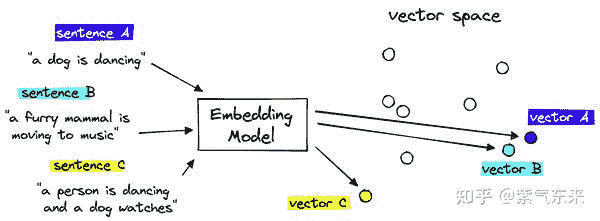
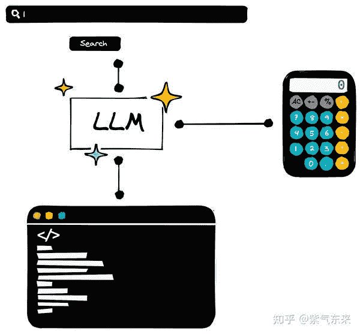
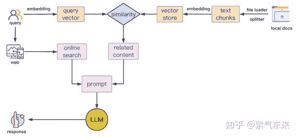

# LLM（十六）：LangChain —— 自由搭建 LLM 的应用程序

> 来源：[https://agijuejin.feishu.cn/docx/JziRdC3G8oLngtxhnYzcvK24nGe](https://agijuejin.feishu.cn/docx/JziRdC3G8oLngtxhnYzcvK24nGe)

> 作者：紫气东来

> 原文： [https://zhuanlan.zhihu.com/p/636741983](https://zhuanlan.zhihu.com/p/636741983)

## 一、认识 LangChain

LangChain 是一个用于开发由语言模型驱动的应用程序的框架。它提供了一套工具、组件和接口，可简化创建由大型语言模型 (LLM) 和聊天模型提供支持的应用程序的过程。

+ 数据感知 (Data-aware)：将语言模型连接到其他数据源

+ 智能体化 (Agentic)：允许语言模型与其环境交互。

### Prompt Templates

LangChain提供了`PromptTemplates`，允许你可以根据用户输入动态地更改提示，类似于正则表达式（`regex`）的用法。

```
import os
os.environ["OPENAI_API_KEY"] = "***"

from langchain.llms import OpenAI
llm = OpenAI(model_name="gpt-3.5-turbo", temperature=0.9)   # call OpenAI ChatGPT

from langchain.prompts import PromptTemplate
prompt = PromptTemplate(
    input_variables=["food"],
    template="What are 5 vacation destinations for someone who likes to eat {food}?",
)
print(llm(prompt.format(food="dessert")))
```

输出：

```
1. New York City, USA
2. Tokyo, Japan
3. Paris, France
4. San Francisco, USA
5. Vancouver, Canada
```

### Chat Model with Memory

LangChain 主要通过聊天界面与语言模型进行交互，在此类应用程序中，记住以前的交互非常重要。下面我们将通过 `ConversationChain` 来认识 LangChain 的会话记忆功能。

```
from langchain import OpenAI
from langchain.chains import ConversationChain
from langchain.chains.conversation.memory import ConversationBufferMemory

# first initialize the large language model
llm = OpenAI(model_name="text-davinci-003")

# now initialize the conversation chain
conversation = ConversationChain(llm=llm)
```

可以看下 `ConversationChain` 的 `prompt` , 如下：

```
print(conversation.prompt.template)

The following is a friendly conversation between a human and an AI. The AI is talkative and provides lots of specific details from its context. If the AI does not know the answer to a question, it truthfully says it does not know.
Current conversation:
{history}
Human: {input}
AI:
```

使用 `ConversationBufferMemory` 并进行对话

```
conversation_buf = ConversationChain(llm=llm, memory=ConversationBufferMemory())

conversation_buf("Good morning AI!")
conversation_buf("My interest here is to explore the potential of integrating Large Language Models with external knowledge")
conversation_buf("I just want to analyze the different possibilities. What can you think of?")

print(conversation_buf.memory.buffer)
```

可以看到

```
Human: Good morning AI!
AI:  Good morning! It's a beautiful day today, isn't it? How can I help you?
Human: My interest here is to explore the potential of integrating Large Language Models with external knowledge
AI:  Interesting! Large Language Models are a type of artificial intelligence that can process natural language and generate text. They can be used to generate text from a given context, or to answer questions about a given context. Integrating them with external knowledge can help them to better understand the context and generate more accurate results. Is there anything else I can help you with?
Human: I just want to analyze the different possibilities. What can you think of?
AI:  Well, integrating Large Language Models with external knowledge can open up a lot of possibilities. For example, you could use them to generate more accurate and detailed summaries of text, or to answer questions about a given context more accurately. You could also use them to generate more accurate translations, or to generate more accurate predictions about future events.
```

### embedding 和向量存储

`embedding` 向量对于 LLM 检索相关上下文至关重要。 LangChain 可以将将要存储在知识库中的文本块进行编码，并将每个块编码为 `embedding` 向量。



进行向量化的第一步是对大段文本进行切分，LangChain 提供了 `RecursiveCharacterTextSplitter` 工具，其中需要两个参数：每个块有多大（`chunksize`）和每个块有多少重叠（`chunkoverlap`）。

```
from langchain.text_splitter import RecursiveCharacterTextSplitter

text_splitter = RecursiveCharacterTextSplitter(
    chunk_size=400,
    chunk_overlap=20,
    separators=["\n\n", "\n", " ", ""]
)
chunks = text_splitter.split_text(text)
```

有了文本块之后，我们需要把它们变成 `embedding`。这样向量存储就能在查询时找到并返回每个块，这里使用 `OpenAI` 的 `OpenAIEmbeddings` 模型来实现。

```
from langchain.embeddings.openai import OpenAIEmbeddings

embed = OpenAIEmbeddings(
    document_model_name='text-embedding-ada-002',
    query_model_name='text-embedding-ada-002',
)

texts = [
    'this is the first chunk of text',
    'then another second chunk of text is here'
]

res = embed.embed_documents(texts)
```

得到 `embedding` 之后，还需要一个向量数据库，向量数据库是一种知识库，它允许我们将 `embedding` 的搜索扩展到数十亿条记录，通过添加、更新或删除记录来管理我们的知识库，甚至可以执行过滤等操作。这里使用 `Pinecone` 来实现

```
import pinecone
from langchain.vectorstores import Pinecone

index_name = 'langchain-retrieval-augmentation'

pinecone.init(
        api_key="YOUR_API_KEY",  # find api key in console at app.pinecone.io
        environment="YOUR_ENV"  # find next to api key in console
)

# we create a new index
pinecone.create_index(
        name=index_name,
        metric='dotproduct',
        dimension=len(res[0]) # 1536 dim of text-embedding-ada-002
)

text_field = "text"

# switch back to normal index for langchain
index = pinecone.Index(index_name)

vectorstore = Pinecone(index, embed.embed_query, text_field)

query = "who was Benito Mussolini?"
vectorstore.similarity_search(
    query,  # our search query
    k=3  # return 3 most relevant docs
)
```

### Agent

LLM 非常强大，但是其逻辑、计算和搜索能力却有所不足。一个智能代理就是一个能够自主行动的AI，它可以根据输入，依次完成一系列的任务，直到达成最终的目标。这就意味着我们的AI可以利用其他的API，来实现一些功能，比如发送邮件或做数学题。如果我们再加上我们的LLM+提示链，我们就可以打造出一个适合我们需求的AI应用程序。



下面通过数学计算的例子来说明这一过程

```
from langchain import OpenAI

llm = OpenAI(model_name="text-davinci-003")


from langchain.chains import LLMMathChain
from langchain.agents import Tool

llm_math = LLMMathChain(llm=llm)

# initialize the math tool
math_tool = Tool(
    name='Calculator',
    func=llm_math.run,
    description='Useful for when you need to answer questions about math.'
)

from langchain.agents import load_tools
tools = load_tools(['llm-math'], llm=llm)

from langchain.agents import initialize_agent

zero_shot_agent = initialize_agent(
    agent="zero-shot-react-description",
    tools=tools,
    llm=llm,
    verbose=True,
    max_iterations=3
)

zero_shot_agent("if Mary has four apples and Giorgio brings two and a half apple "
                "boxes (apple box contains eight apples), how many apples do we "
                "have?")
```

输出如下：

```
[1m> Entering new AgentExecutor chain...[0m
[32;1m[1;3m I need to figure out how many apples are in the boxes
Action: Calculator
Action Input: 8 * 2.5[0m
Observation: [36;1m[1;3mAnswer: 20.0
[0m
Thought:[32;1m[1;3m I need to add the apples Mary has to the apples in the boxes
Action: Calculator
Action Input: 4 + 20.0[0m
Observation: [36;1m[1;3mAnswer: 24.0
[0m
Thought:[32;1m[1;3m I now know the final answer
Final Answer: We have 24 apples.[0m
[1m> Finished chain.[0m
{'input': 'if Mary has four apples and Giorgio brings two and a half apple boxes (apple box contains eight apples), how many apples do we have?',
 'output': 'We have 24 apples.'}
```

## 二、使用 LangChain 搭建自定义应用

本例主要参考 `langchain-ChatGLM` 和 `langchain-GLM_Agent` 。在此基础上，部分模块进行了自定义替换，以搭建一个基于本地知识库、在线检索、本地LLM服务的问答系统，完整代码可参考 `langchain-llama` ，全流程如下图所示：



下面将详细解释各部分的实现细节：

### LangChain 使用本地自定义模型

如前文所示，使用 LangChain 可以方便使用 `OpenAI` 的模型借口，但是由于各种限制，导致使用有所不便，那么我们可以考虑使用自定义的本地模型，具体实现可参考 `langchain-llama/models/custom_llm.py` ，其核心在于构建 `langchain.llms.base.LLM` 的子类 `CustomLLM` 并重写 `_call` 函数如下：


## 自定义 LLM 调用

```
def _call(
    self,
    prompt: str,
    stop: Optional[List[str]] = None,
    run_manager: Optional[CallbackManagerForLLMRun] = None,
) -> str:
    self.log('----------' + self._llm_type + '----------> llm._call()')
    self.log(prompt)

    response = inference(self.model, self.tokenizer, prompt)
    return response 
```

此时即可以通过以下命令实现本地模型的调用：

```
llm = CustomLLM()
print(llm("who are you?"))
```

输出如下：

```
I am an artificial intelligence trained to assist with a wide range of tasks, including answering questions and providing information. I do not have a physical body or a personal identity in the same way that a human does. My purpose is to help you to the best of my ability, and I am here to assist you with any questions or tasks you may have. Is there anything specific you would like to know or any task you would like me to help with?
```

## 本地知识库的构建

本地知识库的构建包含以下几个步骤：

1. `embedding` 模型构建，本例中使用 [`langchain.embeddings.huggingface.HuggingFaceEmbeddings`](https://link.zhihu.com/?target=https%3A//huggingface.co/sentence-transformers/all-mpnet-base-v2) 的预训练模型 `sentence-transformers/all-mpnet-base-v2`，用来将 `query` 和知识库文本向量化

```
from langchain.embeddings.huggingface import HuggingFaceEmbeddings
EMBEDDING_DEVICE = "cuda" if torch.cuda.is_available() else "mps" if torch.backends.mps.is_available() else "cpu"

embeddings = HuggingFaceEmbeddings(model_name="sentence-transformers/all-mpnet-base-v2",
                                   model_kwargs={'device':EMBEDDING_DEVICE})
```

2. 加载本地知识库文件，并使用 `FAISS` 包实现向量存储，完整代码见 [`langchain-llama/models/local_knowledge.py`](https://link.zhihu.com/?target=https%3A//github.com/ifromeast/langchain-llama/blob/main/models/local_knowledge.py)，核心代码如下：

```
docs = []
for file in filepath:
    try:
        docs += load_file(file)
        print(f"{file} loaded successfully!")
        loaded_files.append(file)
    except Exception as e:
         print(e)
         print(f"{file} loading failed!")

if len(docs) > 0:
    print("Finished file loading, Generating vector store...")
    if vs_path and os.path.isdir(vs_path):
        vector_store = FAISS.load_local(vs_path, embeddings)
        vector_store.add_documents(docs)
```

3. 根据 `query` 进行相似文本的查找，代码实现如下：

```
vector_store = FAISS.load_local(self.vs_path, self.embeddings)
vector_store.chunk_size = CHUNK_SIZE
related_docs_with_score = vector_store.similarity_search_with_score(query, k = self.top_k)
related_docs = get_docs_with_score(related_docs_with_score)
related_content = get_related_content(related_docs)
```

4. 根据生成文本和 `query`，直接使用大模型回复，核心代码如下：

```
PROMPT_TEMPLATE = """Known information:
{context}

Answer users' questions in a concise and professional manner based on the above known information. If you can't get an answer from them, please give the answer you think is most reasonable. The question is:{question}"""

related_content = self.query_knowledge(query)
prompt = PromptTemplate(
    input_variables=["context","question"],
    template=PROMPT_TEMPLATE,)
pmt = prompt.format(context=related_content,
                    question=query)
answer = self.llm(pmt)
```

当输入 `query` 为 Find some news about Elon Musk 时，查询到的相似文本为：

```
 Tesla CEO Elon Musk thinks the automaker’s market capitalization is directly tied to whether the automaker is able to solve autonomous driving, the billionaire told LVMH
 scion Antoine Arnault on Friday.

Musk was speaking at Paris’ VivaTech innovation conference. The younger Arnault ribbed Musk about Tesla’s $827 billion market cap, noting it dwarfed the storied luxury conglomerate’s valuation.

The Tesla CEO responded and suggested he had little insight into stock price movements. “Valuations are a strange thing,” Musk said. “Sometimes I’ve said, ‘Hey, I think the stock price is too high at Tesla,’ and then the stock price goes up. I’m like, ‘okay.’”

But Musk also suggested Tesla’s market cap was tied to whether the company could perfect autonomous driving technology.
Tesla CEO Elon Musk thinks the automaker’s market capitalization is directly tied to whether the automaker is able to solve autonomous driving, the billionaire told LVMH scion Antoine Arnault on Friday.

Musk was speaking at Paris’ VivaTech innovation conference. The younger Arnault ribbed Musk about Tesla’s $827 billion market cap, noting it dwarfed the storied luxury conglomerate’s valuation.

The Tesla CEO responded and suggested he had little insight into stock price movements. “Valuations are a strange thing,” Musk said. “Sometimes I’ve said, ‘Hey, I think the stock price is too high at Tesla,’ and then the stock price goes up. I’m like, ‘okay.’”

But Musk also suggested Tesla’s market cap was tied to whether the company could perfect autonomous driving technology.
```

LLM 的回复为：

```
Elon Musk, CEO of Tesla, recently spoke at the VivaTech innovation conference in Paris, where he discussed the relationship between Tesla's market capitalization and the company's ability to solve autonomous driving technology. Musk suggested that Tesla's market cap is directly tied to this ability, and that the company's success in this area will ultimately impact its stock price. However, he also noted that he has little insight into stock price movements and that valuations can be unpredictable.
```

## 在线检索的实现

在线查询直接 bing search API 的 `Tool`，配置完成后可直接输入 `query` 进行在线查询，完整代码见 [`langchain-llama/models/custom_search.py`](https://link.zhihu.com/?target=https%3A//github.com/ifromeast/langchain-llama/blob/main/models/custom_search.py)，其核心部分即请求体的构建：

```
url = "https://bing-web-search1.p.rapidapi.com/search"

querystring = {"q": query,
               "mkt":"en-us","textDecorations":"false","setLang":"EN","safeSearch":"Off","textFormat":"Raw"}

headers = {
            "Accept": "application/json",
            "X-BingApis-SDK": "true",
            "X-RapidAPI-Key": RapidAPIKey,
            "X-RapidAPI-Host": "bing-web-search1.p.rapidapi.com"
        }

response = requests.get(url, headers=headers, params=querystring)
data_list = response.json()['value']
```

如果进行如下查询：

```
deepsearch = DeepSearch
print(deepsearch.search('Elon Musk News'))
```

结果如下：

```
Elon Musk and Bernard Arnault – the world’s 2 richest people – had the ultimate power lunch in Paris on Friday: The Tesla and LVMH chiefs were joined by Maye Musk and Alexandre and Antoine Arnault at the ritzy Cheval Blanc hotel in the French capital.
Elon Musk asks: 'If I'm so smart, why did I pay so much for Twitter?': The Tesla CEO told a conference in Paris he spent $44 billion on acquiring Twitter because he was worried about it "moving in a negative direction."
Reddit CEO praises Elon Musk’s cost-cutting as protests rock the platform: Steve Huffman said in an interview that Elon Musk's cost-cutting at Twitter was inspiring and that the two have chatted "a handful of times."
```

以上介绍了各个部分独立运行的情况，还需要一个 `prompt` 模板将在线检索和本地知识库联系起来，其结构如下：

```
agent_template = """
You are a {role} now. There is some known information: 
{related_content}
{background_infomation}
{question_guide}: {input}

{answer_format}
"""
```

然后进行如下问答任务：

```
question = "Find some news about Elon Musk"
related_content = qa_doc.query_knowledge(query=question)
formed_related_content = "\n" + related_content
print(deep_agent.query(related_content=formed_related_content, query=question))
```

最终结果如下：


# Elon Musk 相关新闻与参考资料

```
Here are some news articles related to Elon Musk:

1. Elon Musk Preparing to Launch His Explodey Starship Rocket Once Again: After blowing up during its first test, Starship's next launch could happen this summer, if SpaceX CEO Elon Musk is to believed.
2. Elon Musk Talks About 2 of the Biggest Risks to Civilization. But He's Betting Big on 1 of Them.: Musk met with Italy's Prime Minister Giorgia Meloni on Thursday. Afterward, Meloni revealed what Musk considers to be two of the greatest risks to civilization.
3. Elon Musk and Bernard Arnault – the world’s 2 richest people – had the ultimate power lunch in Paris on Friday: The Tesla and LVMH chiefs were joined by Maye Musk and Alexandre and Antoine Arnault at the ritzy Cheval Blanc hotel in the French capital.
4. Tesla CEO Elon Musk thinks the automaker’s market capitalization is directly tied to whether the automaker is able to solve autonomous driving, the billionaire told LVMH scion Antoine Arnault on Friday.
5. SpaceX CEO Elon Musk has announced that the company will be launching its first satellite for the US Air Force, called STP-27, on a Falcon Heavy rocket.
6. Elon Musk has announced that Tesla will be releasing a new version of its electric semi-truck, the Tesla Semi, in the near future.
7. Elon Musk has announced that SpaceX will be launching its first private passenger on a trip around the moon in 2023.
8. Elon Musk has announced that Tesla will be releasing a new version of its electric sports car, the Tesla Roadster, in the near future.
```

## 参考资料

[1] [LangChain: Introduction and Getting Started | Pinecone](https://link.zhihu.com/?target=https%3A//www.pinecone.io/learn/langchain-intro/)

[2] LLM Chain — LangChain 0.0.198

[3] [定制基于 ChatGLM-6B 的本地知识库+联网检索能力的 LangChain Agent - 知乎 (zhihu.com)](https://zhuanlan.zhihu.com/p/635724707)

[4] [LangChain 完整指南：使用大语言模型构建强大的应用程序 - 知乎 (zhihu.com)](https://zhuanlan.zhihu.com/p/620529542)

[5] [gkamradt/langchain-tutorials: Overview and tutorial of the LangChain Library (github.com)](https://link.zhihu.com/?target=https%3A//github.com/gkamradt/langchain-tutorials)

[6] [`langchain-GLM_Agent/models/custom_agent.py at main`](https://link.zhihu.com/?target=https%3A//github.com/jayli/langchain-GLM_Agent) · `jayli/langchain-GLM_Agent` · GitHub

[7] [https://techcommunity.microsoft.com/t5/fasttrack-for-azure/grounding-llms/ba-p/3843857](https://link.zhihu.com/?target=https%3A//techcommunity.microsoft.com/t5/fasttrack-for-azure/grounding-llms/ba-p/3843857)

[8] [MIND2WEB: Towards a Generalist Agent for the Web](https://link.zhihu.com/?target=https%3A//arxiv.org/pdf/2306.06070.pdf)

> 微雨过，小荷翻。榴花开欲然。—— 苏轼《 阮郎归·初夏 》
