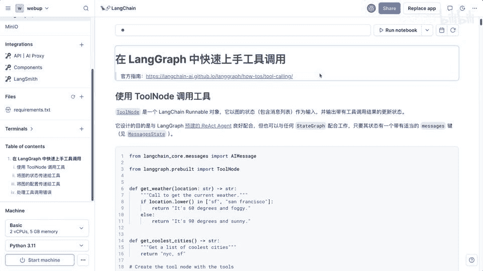

# LangGraph 快速上手工具调用

> 来源：[https://agijuejin.feishu.cn/docx/YLoadNgyPo9wuXxTp0wcyCDqnbc](https://agijuejin.feishu.cn/docx/YLoadNgyPo9wuXxTp0wcyCDqnbc)

# 👀快看👀

> **作者：**[**沧海九粟**](https://space.bilibili.com/28357052)

> **原文链接：**🦜🕸️ LangGraph 快速上手工具调用

> 示例代码：https://github.com/webup/notebooks/blob/main/langgraph-tool-node.ipynb

---

# ⚡️摘要⚡️

> 提供 LangGraph 的快速上手工具调用的示例代码链接，用于在 Jupyter Notebook 中使用 LangGraph 工具。

---

# 🤖分集🤖

# 🦜🕸️ LangGraph 快速上手工具调用

提供指向 GitHub 的链接，链接指向包含 LangGraph 工具示例代码的 Jupyter Notebook 文件，该工具用于处理 NLP 任务，示例代码助用户快速上手并在项目中应用。

[🦜🕸️ LangGraph 快速上手工具调用.mp4](https://internal-api-drive-stream.feishu.cn/space/api/box/stream/download/all/S5Ojb3mcDol4K5xNuMJc4dISn4g)

---

# ✏️课代表✏️

+   LangGraph 工具的应用：网页通过提供示例代码，强调了 LangGraph 工具在自然语言处理领域的应用，尤其是在 Jupyter Notebook 环境下的操作。

>

+   快速上手：通过详细的示例代码，网页旨在帮助用户快速学习和掌握 LangGraph 工具的基本使用方法。

>

+   开源资源：网页提供的示例代码托管在 GitHub 上，体现了开源精神，鼓励社区成员学习和贡献。

>

+   实践导向：网页内容侧重于实际操作，通过实际的代码示例帮助用户理解和应用 LangGraph 工具。