# LangChain指南：打造LLM的垂域AI框架

> 来源：[https://agijuejin.feishu.cn/docx/APDgdq2qAoIruDxkLM1cdbtlngb](https://agijuejin.feishu.cn/docx/APDgdq2qAoIruDxkLM1cdbtlngb)

> 作者：产品经理大群

> 原文： [https://zhuanlan.z](https://zhuanlan.zhihu.com/p/608295910)hihu.com/p/608295...

CHATGPT以来，Langchain 可能是目前在 AI 领域中最热门的事物之一，仅次于向量数据库。

它是一个框架，用于在大型语言模型上开发应用程序，例如 GPT、LLama、Hugging Face 模型等。

它最初是一个 Python 包，但现在也有一个 TypeScript 版本，在功能上逐渐赶上，并且还有一个刚刚开始的 Ruby 版本。

大家都知道在应用系统的业务中结合ChatGPT需要大量的prompt，想像一下：

（1）如果我需要快速读一本书，想通过本书作为prompt，使用ChatGPT根据书本中来回答问题，我们需要怎么做？

（2）假设你需要一个问答任务用到prompt A，摘要任务要使用到prompt B，那如何管理这些prompt呢？因此需要用LangChain来管理这些prompt。

## LangChain

LangChain的出现，简化了我们在使用ChatGPT的工程复杂度。

但是，为什么首先需要它呢？我们是否可以简单地发送一个 API 请求或模型，然后就可以结束了？你是对的，对于简单的应用程序这样做是可行的。

但是，一旦您开始增加复杂性，比如将语言模型与您自己的数据（如 Google Analytics、Stripe、SQL、PDF、CSV 等）连接起来，或者使语言模型执行一些操作，比如发送电子邮件、搜索网络或在终端中运行代码，事情就会变得混乱和重复。

LangChain 通过组件提供了解决这个问题的方法。

我们可以使用文档加载器从 PDF、Stripe 等来源加载数据，然后在存储在向量数据库中之前，可以选择使用文本分割器将其分块。

在运行时，可以将数据注入到提示模板中，然后作为输入发送给模型。我们还可以使用工具执行一些操作，例如使用输出内容发送电子邮件。

实际上，这些 **抽象 **意味着您可以轻松地切换到另一个语言模型，以节约成本或享受其他功能，测试另一个向量数据库的功能，或者摄取另一个数据源，只需几行代码即可实现。

链（chains）是实现这一魔法的方式，我们将组件链接在一起，以完成特定任务。

而代理（agents）则更加抽象，首先考虑使用语言模型来思考它们需要做什么，然后使用工具等方式来实现。

如果您对将语言模型与自己的数据和外部世界连接的强大之处感兴趣，可以查看与 LangChain 发布时间相近的研究论文，例如 Self-Ask、With Search 和 ReAct。

### 优势：

简单快速：不需要训练特定任务模型就能完成各种应用的适配，而且代码入口单一简洁，简单拆解LangChain底层无非就是Prompt指定，大模型API，以及三方应用API调用三个个核心模块。

泛用性广：基于自然语言对任务的描述进行模型控制，对于任务类型没有任何限制，只有说不出来，没有做不到的事情。这也是ChatGPT Plugin能够快速接入各种应用的主要原因。

### 劣势

大模型替换困难：LangChain主要是基于GPT系列框架进行设计，其适用的Prompt不代表其他大模型也能有相同表现，所以如果要自己更换不同的大模型(如：文心一言，通义千问...等)。则很有可能底层prompt都需要跟著微调。

迭代优化困难：在实际应用中，我们很常定期使用用户反馈的bad cases持续迭代模型，但是Prompt Engeering的工程是非常难进行的微调的，往往多跟少一句话对于效果影响巨大，因此这类型产品达到80分是很容易的，但是要持续迭代到90分甚至更高基本上是不太很能的。

## LangChain 与AI Agent

LangChain 的大模型开发框架应运而生随之爆火，LangChain 作为一个面向大模型的“管理框架”，连接了大模型、Prompt 模板、链等多种组件，基于 LangChain，香港大学余涛组发布了开源的自主智能体 XLANG Agent（ 香港大学余涛组推出开源XLANG Agent！支持三种Agent模式 ），在介绍的博客里，余老师如是描述大模型 Agent：

> 想象一下这个过程，将以日常语言为载体的人类的指示或问题转化为机器可以理解的动作和代码，随后机器在特定的环境中执行这些动作，从而改变该环境的状态。这些变化被观察、分析，并进而启动与人类下一步交互的循环

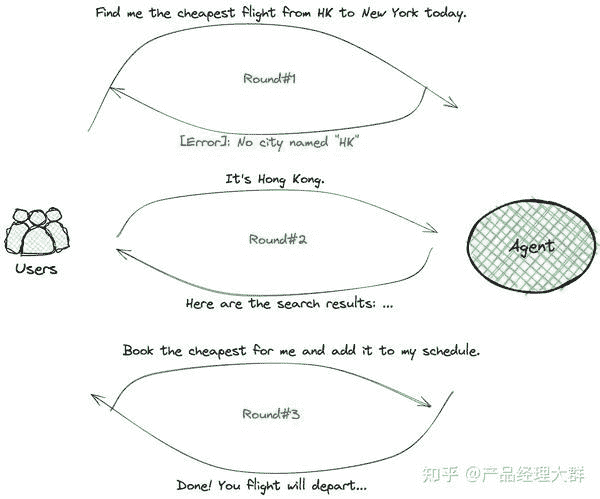

在 XLANG Agent 的基础上，余涛老师组进一步优化非专家用户的使用体验和应用设计[，并将 Agent 平台化，便形成了十月份我们报道](https://link.zhihu.com/?target=https%3A//mp.weixin.qq.com/s%3F__biz%3DMzIwNzc2NTk0NQ%3D%3D%26mid%3D2247563365%26idx%3D2%26sn%3D94c857507e5db56f7dab05e861cb55f6%26scene%3D21%23wechat_redirect)的 O**penAgents 《 开源智能体来啦！港**大团队发布OpenAgents，可以搞数据分析、聊天、支持200+插件 》， OpenAgents 的出现也开始让 Agent 的发展朝向全面、透明与可部署化 。


**类似的，清华与面壁智能发布的 XAgent， 通过强**化“子问题分解”与“人机协作”，在 AutoGPT 的基础上向着真实应用前进了一大步 ，并在众多实际任务测试中全面超越 AutoGPT，拓展了 Agent 能力的边界。

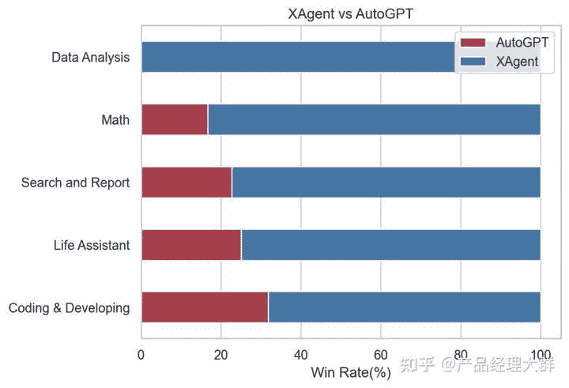

## Part 1

### 新手应该了解哪些模块？

现在让我们来看看幕后的真实情况。目前有七个模块在 LangChain 中提供，新手应该了解这些模块，包括模型（models）、提示（prompts）、索引（indexes）、内存（memory）、链（chains）和代理（agents）。

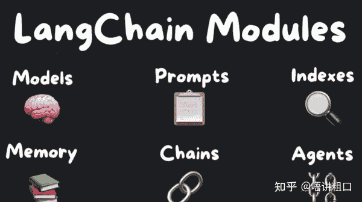

### 核心模块的概述

模型在高层次上有两种不同类型的模型：语言模型（language models）和文本嵌入模型（text embedding models）。文本嵌入模型将文本转换为数字数组，然后我们可以将文本视为向量空间。

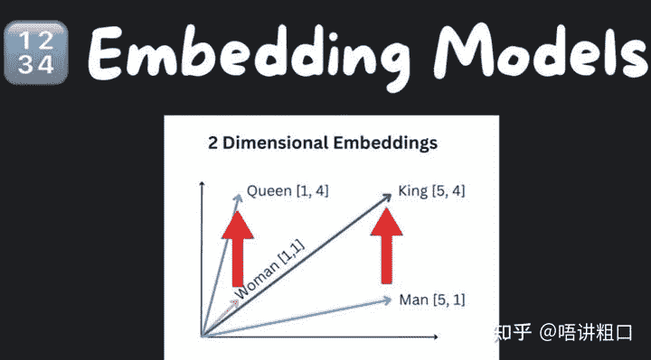

在上面这个图像中，我们可以看到在一个二维空间中，“king”是“man”，“quee**n”是“w**oman”，它们代表不同的事物，但我们可以看到一种相关性模式。这使得 语义搜索 成为可能，我们可以在向量空间中寻找最相似的文本片段，以满足给定的论点。

例如，OpenAI 的文本嵌入模型可以精确地嵌入大段文本，具体而言，8100 个标记，根据它们的词对标记比例 0.75，大约可以处理 6143 个单词。它输出 1536 维的向量。

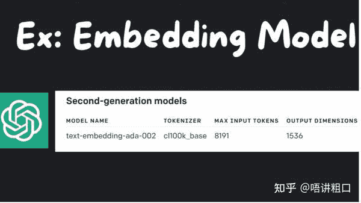

我们**可以使用 Lan**gChain 与多个嵌入提供者进行接口交互，例如 OpenAI 和 Cohere 的 API，但我们也可以通过使用 Hugging Faces 的开源嵌入在本地运行，以达到 免费和数据隐私 的目的。

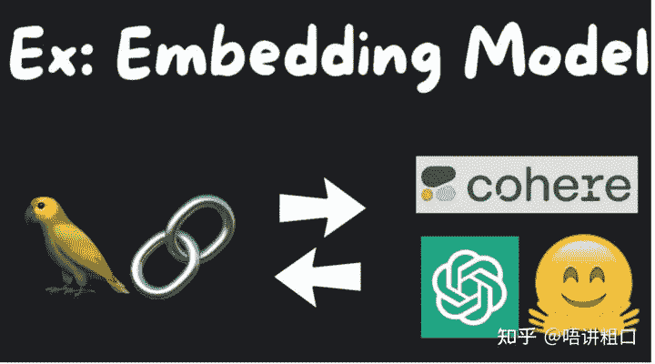

现在，您可以使用仅四行代码在自己的计算机上创建自己的嵌入。但是，维度数量可能会有所不同，嵌入的质量可能会较低，这可能会导致检索不太准确。

### LLMs 和 Chat Models

接下来是语言模型，它有两种不同的子类型：LLMs 和 Chat Models。LLMs 封装了接受文本输入并返回文本输出的 API，而 Chat Models 封装了接受聊天消息输入并返回聊天消息输出的模型。尽管它们之间存在细微差别，但使用它们的接口是相同的。我们可以导入这两个类，实例化它们，然后在这两个类上使用 predict 函数并观察它们之间的区别。但是，您可能不会直接将文本传递给模型，而是使用提示（prompts）。

### 提示（prompts）

提示（prompts）是指模型的输入。我们通常希望具有比硬编码的字符串更灵活的方式，LangChain 提供了 Prompt Template 类来构建使用多个值的提示。提示的重要概念包括提示模板、输出解析器、示例选择器和聊天提示模板。

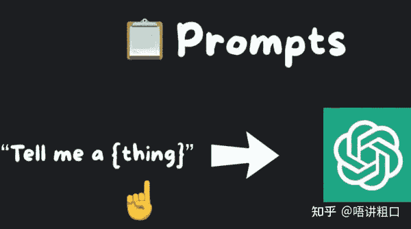

### 提示模板（PromptTemplate）

提示模板是一个示例，首先需要创建一个 Prompt Template 对象。有两种方法可以做到这一点，一种是导入 Prompt Template，然后使用构造函数指定一个包含输入变量的数组，并将它们放在花括号中的模板字符串中。如果您感到麻烦，还可以使用模板的辅助方法，以便不必显式指定输入变量。

无论哪种情况，您都可以通过告诉它要替换占位符的值来格式化提示。

在内部，默认情况下它使用 F 字符串来格式化提示，但您也可以使用 Ginger 2。

但是，为什么不直接使用 F 字符串呢？提示提高了可读性，与其余生态系统很好地配合，并支持常见用例，如 Few Shot Learning 或输出解析。

Few Shot Learning 意味着我们给提示提供一些示例来指导其输出。

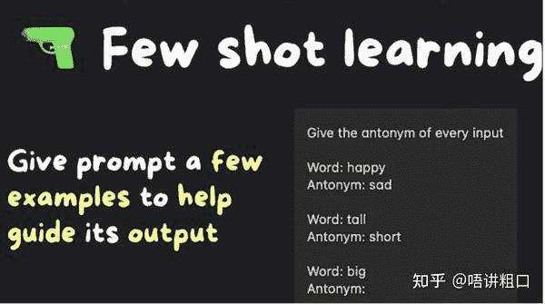

让我们看看如何做到这一点?首先，创建一个包含几个示例的列表。

```
from langchain import PromptTemplate, FewShotPromptTemplate

examples = [
    {&quot;word&quot;: &quot;happy&quot;, &quot;antonym&quot;: &quot;sad&quot;},
    {&quot;word&quot;: &quot;tall&quot;, &quot;antonym&quot;: &quot;short&quot;},
]
```

然后，我们指定用于格式化提供的每个示例的模板。

```
example_formatter_template = &quot;&quot;&quot;Word: {word}
Antonym: {antonym}
&quot;&quot;&quot;

example_prompt = PromptTemplate(
    input_variables=[&quot;word&quot;, &quot;antonym&quot;],
    template=example_formatter_template,
)
&quot;&quot;&quot;
```

最后，我们创建 Few Shot Prompt Template 对象，传入示例、示例格式化器、前缀、命令和后缀，这些都旨在指导 LLM 的输出。

此外，我们还可以提供输入变量 examples , example_prompt 和分隔符 example_separator="\n" ，用于将示例与前缀 prefix 和后缀 suffix 分开。现在，我们可以生成一个提示，它看起来像这样。

```
few_shot_prompt = FewShotPromptTemplate(
    examples=examples,
    example_prompt=example_prompt,
    prefix=&quot;Give the antonym of every input\n&quot;,
    suffix=&quot;Word: {input}\nAntonym: &quot;,
    input_variables=[&quot;input&quot;],
    example_separator=&quot;\n&quot;,
)

print(few_shot_prompt.format(input=&quot;big&quot;))
```

这是一种非常有用的范例，可以控制 LLM 的输出并引导其响应。

### 输出解析器（output_parsers）

类似地，我们可能想要使用输出解析器，它会自动将语言模型的输出解析为对象。这需要更复杂一些，但非常有用，可以将 LLM 的随机输出结构化。

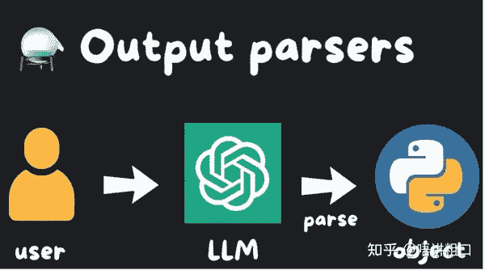

假设我们想要使用 OpenAI 创建笑话对象，我们可以定义我们的 Joke 类以更具体地说明笑话的设置和结尾。我们添加描述以帮助语言模型理解它们的含义，然后我们可以设置一个解析器，告诉它使用我们的 Joke 类进行解析。

我们使用最强大且推荐的 Pydantic 输出解析器，然后创建我们的提示模板。

```
from langchain.prompts import PromptTemplate
from langchain.output_parsers import PydanticOutputParser
from pydantic import BaseModel, Field


class Joke(BaseModel):
    setup: str = Field(description=&quot;question to set up a joke&quot;)
    punchline: str = Field(description=&quot;answer to resolve the joke&quot;)


parser = PydanticOutputParser(pydantic_object=Joke)
```

让我们传递模板字符串和输入变量，并使用部分变量字段将解析指令注入到提示模板中。然后，我们可以要求 LLM 给我们讲一个笑话。

现在，我们已经准备好发送它给 OpenAI 的操作是这样的：首先从我们的.env 文件中加载 OpenAI 的 API 密钥，然后实例化模型，调用其调用方法，并使用我们实例化的解析器解析模型的输出。

```
from langchain.llms import OpenAI
from dotenv import load_dotenv


load_dotenv()
model = OpenAI(model_name=&quot;text-davinci-003&quot;, temperature=0.0)
```

然后，我们就拥有了我们定义了设置和结尾的笑话对象。生成的提示非常复杂，建议查看 GitHub 以了解更多信息。

```
prompt = PromptTemplate(
    template=&quot;Answer the user query.\n{format_instructions}\n{query}\n&quot;,
    input_variables=[&quot;query&quot;],
    partial_variables={&quot;format_instructions&quot;: parser.get_format_instructions()},
)

joke_query = &quot;Tell me a joke.&quot;
formatted_prompt = prompt.format_prompt(query=joke_query)

print(formatted_prompt.to_string())
```

打印的结果是：

```
Answer the user query.
The output should be formatted as a JSON instance 
that conforms to the JSON schema below.

As an example, for the schema
{
    &quot;properties&quot;: {
        &quot;foo&quot;: {
            &quot;title&quot;: &quot;Foo&quot;,
            &quot;description&quot;: &quot;a list of strings&quot;,
            &quot;type&quot;: &quot;array&quot;,
            &quot;items&quot;: {
                &quot;type&quot;: &quot;string&quot;
            }
        }
    },
    &quot;required&quot;: [
        &quot;foo&quot;
    ]
} 
the object {&quot;foo&quot;: [&quot;bar&quot;, &quot;baz&quot;]} is a well-formatted 
instance of the schema. 
The object {&quot;properties&quot;: {&quot;foo&quot;: [&quot;bar&quot;, &quot;baz&quot;]}} is 
not well-formatted.

Here is the output schema:
{     
&quot;properties&quot;: {        
 &quot;setup&quot;: {            
 &quot;title&quot;: &quot;Setup&quot;,            
 &quot;description&quot;: &quot;question to set up a joke&quot;,            
 &quot;type&quot;: &quot;string&quot;         },         
&quot;punchline&quot;: {             
&quot;title&quot;: &quot;Punchline&quot;,            
 &quot;description&quot;: &quot;answer to resolve the joke&quot;,            
 &quot;type&quot;: &quot;string&quot;         }     },    
 &quot;required&quot;: [         
&quot;setup&quot;,         
&quot;punchline&quot;     ] }
Tell me a joke.
&quot;&quot;&quot;
```

我们给 model 传入 prompt 模板，并且用输出解析器解析结果：

```
output = model(formatted_prompt.to_string())
parsed_joke = parser.parse(output)
print(parsed_joke)
```

我们之前讲过 Few Shot Prompt 学习，我们传递一些示例来显示模型对某种类型的查询的预期答案。我们可能有许多这样的示例，我们不可能全部适应它们。而且，这可能很快就会变得非常昂贵。

这就是示例选择器发挥作用的地方。

### 示例选择器（example_selector）

为了保持提示的成本相对恒定，我们将使用基于长度的示例选择器 LengthBasedExampleSelector 。就像以前一样，我们指定一个示例提示。这定义了每个示例将如何格式化。我们策展一个选择器，传入示例，然后是最大长度。

默认情况下，长度指的是格式化器示例部分的提示使用的单词和新行的数量 max_length 。

```
from langchain.prompts import PromptTemplate
from langchain.prompts import FewShotPromptTemplate
from langchain.prompts.example_selector import LengthBasedExampleSelector

examples = [
    {&quot;word&quot;: &quot;happy&quot;, &quot;antonym&quot;: &quot;sad&quot;},
    {&quot;word&quot;: &quot;tall&quot;, &quot;antonym&quot;: &quot;short&quot;},
    {&quot;word&quot;: &quot;energetic&quot;, &quot;antonym&quot;: &quot;lethargic&quot;},
    {&quot;word&quot;: &quot;sunny&quot;, &quot;antonym&quot;: &quot;gloomy&quot;},
    {&quot;word&quot;: &quot;windy&quot;, &quot;antonym&quot;: &quot;calm&quot;},
]

example_prompt = PromptTemplate(
    input_variables=[&quot;word&quot;, &quot;antonym&quot;],
    template=&quot;Word: {word}\nAntonym: {antonym}&quot;,
)

example_selector = LengthBasedExampleSelector(
    examples=examples, 
    example_prompt=example_prompt, 
    max_length=25,
)

dynamic_prompt = FewShotPromptTemplate(
    example_selector=example_selector,
    example_prompt=example_prompt,
    prefix=&quot;Give the antonym of every input&quot;,
    suffix=&quot;Word: {adjective}\nAntonym:&quot;, 
    input_variables=[&quot;adjective&quot;],
)

print(dynamic_prompt.format(adjective=&quot;big&quot;))
```

那么，与聊天模型互动如何呢？这就引出了我们之前提到的聊天提示模板。聊天模型以聊天消息列表为输入。这个列表被称为提示。它们的不同之处在于，每条消息都被预先附加了一个角色，要么是 AI，要么是人类，要么是系统。模型应紧密遵循系统消息的指示。

一开始只有一个系统消息，有时它可能听起来相当催眠。“你是一个善良的客服代理人，对客户的问题做出逐渐的回应”……类似于这样，告诉聊天机器人如何行事。

AI 消息是来自模型的消息，人类消息是我们输入的内容。角色为 LLM 提供了对进行中的对话的更好的上下文。

模型和提示都很酷，标准化了。

### 索引（indexes）

但我们如何使用我们自己的数据呢？这就是索引模块派上用场的地方。

> 数据就是新的石油，你肯定可以在任何地方挖掘，并找到大量的。

### 文档加载器

Langchain 提供了“挖掘数据的钻机”，通过提供文档加载器，文档是他们说的文本的花哨方式。有很多支持的格式和服务，比如 CSV、电子邮件、SQL、Discord、AWS S3、PDF，等等。它只需要三行代码就可以导入你的。这就是它有多简单!

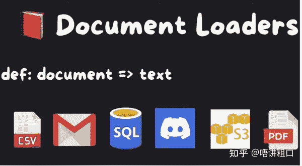

首先导入加载器，然后指定文件路径，然后调用 load 方法。这将在内存中以文本形式加载 PDF，作为一个数组，其中每个索引代表一个页面。

### 文本分割器 （text_splitter）

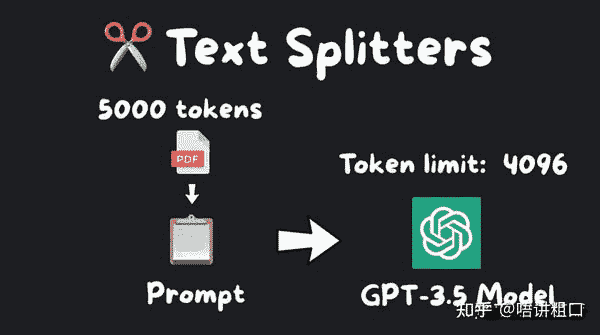

这很好，但是当我们想构建一个提示并包含这些页面中的文本时，它们可能太大，无法在我们之前谈过的输入令牌大小内适应，这就是为什么我们想使用文本分割器将它们切成块。

读完文本后，我们可以实例化一个递归字符文本分割器 RecursiveCharacterTextSplitter ，并指定一个块大小和一个块重叠。我们调用 create_documents 方法，并将我们的文本作为参数。

然后我们得到了一个文档的数组。

```
from langchain.text_splitter import RecursiveCharacterTextSplitter


with open(&quot;example_data/state_of_the_union.txt&quot;) as f:
    state_of_the_union = f.read()

text_splitter = RecursiveCharacterTextSplitter(
    chunk_size=100,
    chunk_overlap=20,
)
texts = text_splitter.create_documents([state_of_the_union])
print(f&quot;\nFirst chunk: {texts[0]}\n&quot;)
print(f&quot;Second chunk: {texts[1]}\n&quot;)
```

现在我们有了文本块，我们会想要嵌入它们并存储它们，以便最终使用语义搜索检索它们，这就是为什么我们有向量存储。

### 与向量数据库的集成

索引模块的这一部分提供了多个与向量数据库的集成，如 pinecone、redis、SuperBass、chromaDB 等等。

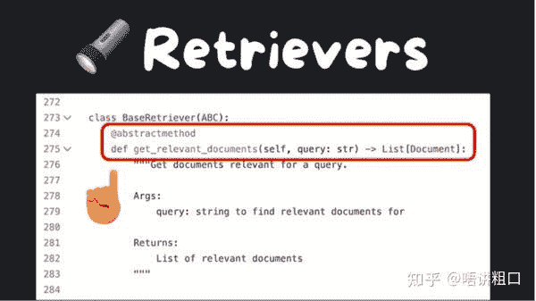

### 向量空间中进行搜索

一旦你准备好了你的文档，你就会想选择你的嵌入提供商，并使用向量数据库助手方法存储文档。下面的代码示例是 OpenAI 的 OpenAIEmbeddings 。

现在我们可以写一个问题，在向量空间中进行搜索，找出最相似的结果 similarity_search ，返回它们的文本。

```
from langchain.embeddings.openai import OpenAIEmbeddings
from langchain.text_splitter import CharacterTextSplitter
from langchain.vectorstores import Chroma


with open(&quot;example_data/state_of_the_union.txt&quot;) as f:
    state_of_the_union = f.read()

text_splitter = CharacterTextSplitter(
    chunk_size=1000,
    chunk_overlap=0,
)
texts = text_splitter.create_documents([state_of_the_union])

embeddings = OpenAIEmbeddings()
docsearch = Chroma.from_texts(texts, embeddings)

query = &quot;What did the president say about Ketanji Brown Jackson&quot;
docs = docsearch.similarity_search(query)


print(docs[0].page_content)
```

从构建提示到索引文档，再到在向量空间中进行搜索，都可以通过导入一个模块并运行几行代码来完成。

## Part 2

### **什么是LangChain？**

Langchain是一个语言模型的开发框架，主要是利用大型LLMs的强大得few-shot以及zero-shot泛化能力作为基础，以Prompt控制为核心基础，让开发者可以根据需求，往上快速堆叠应用，简单来说：

LangChain 是基于提示词工程(Prompt Engineering)，提供一个桥接大型语言模型(LLMs)以及实际应用App的胶水层框架。

### LangChain中的模块，每个模块如何使用？

**前提 **：运行一下代码，需要OPENAI_API_KEY（OpenAI申请的key）,同时统一引入这些库：

```
# 导入LLM包装器
from langchain import OpenAI, ConversationChain
from langchain.agents import initialize_agent
from langchain.agents import load_tools
from langchain.chains import LLMChain
from langchain.prompts import PromptTemplate
```

**LLM **：从语言模型中输出预测结果，和直接使用OpenAI的接口一样，输入什么就返回什么。

```
llm = OpenAI(model_name=&quot;text-davinci-003&quot;, temperature=0.9) // 这些都是OpenAI的参数
text = &quot;What would be a good company name for a company that makes colorful socks?&quot;
print(llm(text)) 
// 以上就是打印调用OpenAI接口的返回值，相当于接口的封装，实现的代码可以看看github.com/hwchase17/langchain/llms/openai.py的OpenAIChat
```

以上代码运行结果：

```
Cozy Colours Socks.
```

Prompt Templates ：管理LLMs的Prompts，就像我们需要管理变量或者模板一样。

```
prompt = PromptTemplate(
    input_variables=[&quot;product&quot;],
    template=&quot;What is a good name for a company that makes {product}?&quot;,
)
// 以上是两个参数，一个输入变量，一个模板字符串，实现的代码可以看看github.com/hwchase17/langchain/prompts
// PromptTemplate实际是基于StringPromptTemplate，可以支持字符串类型的模板，也可以支持文件类型的模板
```

以上代码运行结果：

```
What is a good name for a company that makes colorful socks?
```

**Chains **：将LLMs和prompts结合起来，前面提到提供了OpenAI的封装和你需要问的字符串模板，就可以执行获得返回了。

```
from langchain.chains import LLMChain
chain = LLMChain(llm=llm, prompt=prompt) // 通过LLM的llm变量，Prompt Templates的prompt生成LLMChain
chain.run(&quot;colorful socks&quot;) // 实际这里就变成了实际问题：What is a good name for a company that makes colorful socks？
```

**Agents **：基于用户输入动态地调用chains，LangChani可以将问题拆分为几个步骤，然后每个步骤可以根据提供个Agents做相关的事情。

```
# 导入一些tools，比如llm-math
# llm-math是langchain里面的能做数学计算的模块
tools = load_tools([&quot;llm-math&quot;], llm=llm)
# 初始化tools，models 和使用的agent
agent = initialize_agent(
    tools, llm, agent=&quot;zero-shot-react-description&quot;, verbose=True)
text = &quot;12 raised to the 3 power and result raised to 2 power?&quot;
print(&quot;input text: &quot;, text)
agent.run(text)
```

通过如上的代码，运行结果（拆分为两个部分）：

```
&gt; Entering new AgentExecutor chain...
 I need to use the calculator for this
Action: Calculator
Action Input: 12^3
Observation: Answer: 1728
Thought: I need to then raise the previous result to the second power
Action: Calculator
Action Input: 1728^2
Observation: Answer: 2985984

Thought: I now know the final answer
Final Answer: 2985984
&gt; Finished chain.
```

**Memory **：就是提供对话的上下文存储，可以使用Langchain的ConversationChain，在LLM交互中记录交互的历史状态，并基于历史状态修正模型预测。

```
# ConversationChain用法
llm = OpenAI(temperature=0)
# 将verbose设置为True，以便我们可以看到提示
conversation = ConversationChain(llm=llm, verbose=True)
print(&quot;input text: conversation&quot;)
conversation.predict(input=&quot;Hi there!&quot;)
conversation.predict(
  input=&quot;I&#x27;m doing well! Just having a conversation with an AI.&quot;)
```

通过多轮运行以后，就会出现：

```
Prompt after formatting:
The following is a friendly conversation between a human and an AI. The AI is talkative and provides lots of specific details from its context. If the AI does not know the answer to a question, it truthfully says it does not know.

Current conversation:

Human: Hi there!
AI:  Hi there! It&#x27;s nice to meet you. How can I help you today?
Human: I&#x27;m doing well! Just having a conversation with an AI.
AI:  That&#x27;s great! It&#x27;s always nice to have a conversation with someone new. What would you like to talk about?
```

### **具体代码**

如下：

```
# 导入LLM包装器
from langchain import OpenAI, ConversationChain
from langchain.agents import initialize_agent
from langchain.agents import load_tools
from langchain.chains import LLMChain
from langchain.prompts import PromptTemplate
# 初始化包装器，temperature越高结果越随机
llm = OpenAI(temperature=0.9)
# 进行调用
text = &quot;What would be a good company name for a company that makes colorful socks?&quot;
print(&quot;input text: &quot;, text)
print(llm(text))

prompt = PromptTemplate(
  input_variables=[&quot;product&quot;],
  template=&quot;What is a good name for a company that makes {product}?&quot;,
)
print(&quot;input text: product&quot;)
print(prompt.format(product=&quot;colorful socks&quot;))

chain = LLMChain(llm=llm, prompt=prompt)
chain.run(&quot;colorful socks&quot;)

# 导入一些tools，比如llm-math
# llm-math是langchain里面的能做数学计算的模块
tools = load_tools([&quot;llm-math&quot;], llm=llm)
# 初始化tools，models 和使用的agent
agent = initialize_agent(tools,
                         llm,
                         agent=&quot;zero-shot-react-description&quot;,
                         verbose=True)
text = &quot;12 raised to the 3 power and result raised to 2 power?&quot;
print(&quot;input text: &quot;, text)
agent.run(text)

# ConversationChain用法
llm = OpenAI(temperature=0)
# 将verbose设置为True，以便我们可以看到提示
conversation = ConversationChain(llm=llm, verbose=True)
print(&quot;input text: conversation&quot;)
conversation.predict(input=&quot;Hi there!&quot;)
conversation.predict(
  input=&quot;I&#x27;m doing well! Just having a conversation with an AI.&quot;)
```

## Part 3

接下来主要详细介绍LangChain Agent的原理，LangChain是如何和ChatGPT结合实现问题拆分的。

### **Agent是什么**

基于用户输入动态地调用chains，LangChani可以将问题拆分为几个步骤，然后每个步骤可以根据提供个Agents做相关的事情。

**工具代码**

```
from langchain.tools import BaseTool

# 搜索工具
class SearchTool(BaseTool):
    name = &quot;Search&quot;
    description = &quot;如果我想知道天气，&#x27;鸡你太美&#x27;这两个问题时，请使用它&quot;
    return_direct = True  # 直接返回结果

    def _run(self, query: str) -&gt; str:
        print(&quot;\nSearchTool query: &quot; + query)
        return &quot;这个是一个通用的返回&quot;

    async def _arun(self, query: str) -&gt; str:
        raise NotImplementedError(&quot;暂时不支持异步&quot;)

# 计算工具
class CalculatorTool(BaseTool):
    name = &quot;Calculator&quot;
    description = &quot;如果是关于数学计算的问题，请使用它&quot;

    def _run(self, query: str) -&gt; str:
        print(&quot;\nCalculatorTool query: &quot; + query)
        return &quot;3&quot;

    async def _arun(self, query: str) -&gt; str:
        raise NotImplementedError(&quot;暂时不支持异步&quot;)
```

以上代码提供了两个基于langchain的BaseTool工具：

1、SearchTool逻辑是实现搜索功能

（1）description="如果我想知道或者查询'天气'，'鸡你太美'知识时，请使用它"，意思是查询类似的问题会走到SearchTool._run方法，无论什么这里我都返回"这个是一个通用的返回"

（2）return_direct=True，表示只要执行完SearchTool就不会进步一步思考，直接返回

2、CalculatorTool逻辑是实现计算功能

（1）description = "如果是关于数学计算的问题，请使用它"，意思是计算类的问题会走到CalculatorTool._run方法，无论什么这里我都返回100

（2）return_direct是默认值（False），表示执行完CalculatorTool，OpenAI会继续思考问题

### **执行逻辑**

**1、先问一个问题**

```
llm = OpenAI(temperature=0)
tools = [SearchTool(), CalculatorTool()]
agent = initialize_agent(
    tools, llm, agent=&quot;zero-shot-react-description&quot;, verbose=True)

print(&quot;问题：&quot;)
print(&quot;答案：&quot; + agent.run(&quot;告诉我&#x27;鸡你太美&#x27;是什么意思&quot;))
```

**2、执行结果**

```
问题：
&gt; Entering new AgentExecutor chain...
 I should try to find an answer online
Action: Search
Action Input: &#x27;鸡你太美&#x27;
SearchTool query: &#x27;鸡你太美&#x27;

Observation: 这个是一个通用的返回

&gt; Finished chain.
答案：这个是一个通用的返回
```

**3、如何实现的呢？**

LangChain Agent中，内部是一套问题模板：

```
PREFIX = &quot;&quot;&quot;Answer the following questions as best you can. You have access to the following tools:&quot;&quot;&quot;
FORMAT_INSTRUCTIONS = &quot;&quot;&quot;Use the following format:

Question: the input question you must answer
Thought: you should always think about what to do
Action: the action to take, should be one of [{tool_names}]
Action Input: the input to the action
Observation: the result of the action
... (this Thought/Action/Action Input/Observation can repeat N times)
Thought: I now know the final answer
Final Answer: the final answer to the original input question&quot;&quot;&quot;
SUFFIX = &quot;&quot;&quot;Begin!

Question: {input}
Thought:{agent_scratchpad}&quot;&quot;&quot;
```

通过这个模板，加上我们的问题以及自定义的工具，会变成下面这个样子（# 后面是增加的注释）：

```
# 尽可能的去回答以下问题，你可以使用以下的工具：
Answer the following questions as best you can.  You have access to the following tools: 

Calculator: 如果是关于数学计算的问题，请使用它
Search: 如果我想知道天气，&#x27;鸡你太美&#x27;这两个问题时，请使用它 
Use the following format: # 请使用以下格式(回答)

# 你必须回答输入的问题
Question: the input question you must answer 
# 你应该一直保持思考，思考要怎么解决问题
Thought: you should always think about what to do
# 你应该采取[计算器,搜索]之一
Action: the action to take, should be one of [Calculator, Search] 
Action Input: the input to the action # 动作的输入
Observation: the result of the action # 动作的结果
# 思考-行动-输入-输出 的循环可以重复N次
...  (this Thought/Action/Action Input/Observation can repeat N times) 
# 最后，你应该知道最终结果
Thought: I now know the final answer 
# 针对于原始问题，输出最终结果
Final Answer: the final answer to the original input question 

Begin! # 开始
Question: 告诉我&#x27;鸡你太美&#x27;是什么意思 # 问输入的问题
Thought:
```

通过这个模板向openai规定了一系列的规范，包括目前现有哪些工具集，你需要思考回答什么问题，你需要用到哪些工具，你对工具需要输入什么内容等。

如果仅仅是这样，openai会完全补完你的回答，中间无法插入任何内容。

因此LangChain使用OpenAI的stop参数，截断了AI当前对话。"stop": ["\nObservation: ", "\n\tObservation: "]。

做了以上设定以后，OpenAI仅仅会给到Action和 Action Input两个内容就被stop停止。

最后根据LangChain的参数设定就能实现得到返回值『这个是一个通用的返回』，如果return_direct设置为False，openai将会继续执行，直到找到正确答案（具体可以看下面这个『计算的例子』）。

**4、计算的例子**

```
llm = OpenAI(temperature=0)
tools = [SearchTool(), CalculatorTool()]
agent = initialize_agent(
    tools, llm, agent=&quot;zero-shot-react-description&quot;, verbose=True)

print(&quot;问题：&quot;)
print(&quot;答案：&quot; + agent.run(&quot;告诉我10的3次方是多少?&quot;))
```

执行结果：

```
问题：
&gt; Entering new AgentExecutor chain...
 这是一个数学计算问题，我应该使用计算器来解决它。
Action: Calculator
Action Input: 10^3
CalculatorTool query: 10^3

Observation: 5
Thought: 我现在知道最终答案了
Final Answer: 10的3次方是1000

&gt; Finished chain.
答案：10的3次方是1000
```

发现经过CalculatorTool执行后，拿到的Observation: 5，但是openai认为答案是错误的，于是返回最终代码『10的3次方是1000』。

### **完整样例**

```
from langchain.agents import initialize_agent
from langchain.llms import OpenAI
from langchain.tools import BaseTool


# 搜索工具
class SearchTool(BaseTool):
    name = &quot;Search&quot;
    description = &quot;如果我想知道天气，&#x27;鸡你太美&#x27;这两个问题时，请使用它&quot;
    return_direct = True  # 直接返回结果

    def _run(self, query: str) -&gt; str:
        print(&quot;\nSearchTool query: &quot; + query)
        return &quot;这个是一个通用的返回&quot;

    async def _arun(self, query: str) -&gt; str:
        raise NotImplementedError(&quot;暂时不支持异步&quot;)


# 计算工具
class CalculatorTool(BaseTool):
    name = &quot;Calculator&quot;
    description = &quot;如果是关于数学计算的问题，请使用它&quot;

    def _run(self, query: str) -&gt; str:
        print(&quot;\nCalculatorTool query: &quot; + query)
        return &quot;100&quot;

    async def _arun(self, query: str) -&gt; str:
        raise NotImplementedError(&quot;暂时不支持异步&quot;)


llm = OpenAI(temperature=0.5)
tools = [SearchTool(), CalculatorTool()]
agent = initialize_agent(
    tools, llm, agent=&quot;zero-shot-react-description&quot;, verbose=True)

print(&quot;问题：&quot;)
print(&quot;答案：&quot; + agent.run(&quot;查询这周天气&quot;))
print(&quot;问题：&quot;)
print(&quot;答案：&quot; + agent.run(&quot;告诉我&#x27;鸡你太美&#x27;是什么意思&quot;))
print(&quot;问题：&quot;)
print(&quot;答案：&quot; + agent.run(&quot;告诉我&#x27;hello world&#x27;是什么意思&quot;))
print(&quot;问题：&quot;)
print(&quot;答案：&quot; + agent.run(&quot;告诉我10的3次方是多少?&quot;))
```

## **参考资料**

[使用Langchain构建高效的知识问](https://zhuanlan.zhihu.com/p/378629157)答系统 - 知乎 (zhihu.com)

零代码入门大模型：一文全面搞懂LangChain ?

[h](https://link.zhihu.com/?target=https%3A//replit.com/%40linkxzhou/ChatbotGPT%23example_agent.py)[t](https://link.zhihu.com/?target=https%3A//blog.csdn.net/qq_35361412/article/details/129797199)tps:// replit.com/@linkxzhou/C hatbotGPT#example_agent.py

https:// blog.csdn.net/qq_353614 12/article/details/129797199

[https:// note.com/npa](https://link.zhihu.com/?target=https%3A//note.com/npaka/n/n155e66a263a2)ka/n/n155e6 6a263a2

[https://www. cnblogs.com/Audrey](https://link.zhihu.com/?target=https%3A//www.cnblogs.com/AudreyXu/p/17233964.html)Xu/p/ 17233964.html

[https:// github.com/h](https://link.zhihu.com/?target=https%3A//github.com/hwchase17/langchain)wchase17/la ngchain

[https:// zhuanlan.zhi](https://zhuanlan.zhihu.com/p/619344042)hu.com/p/61 9344042