# 小白入门大模型：LangChain

> 来源：[https://agijuejin.feishu.cn/docx/IEgjdRt0Ho6g0gxcYBRc1jsLneg](https://agijuejin.feishu.cn/docx/IEgjdRt0Ho6g0gxcYBRc1jsLneg)
> 作者：产品经理大群
> 原文：[https://zhuanlan.z](https://zhuanlan.zhihu.com/p/656646499)hihu.com/p/656646...

## 1、LangChain介绍

LangChain 就是一个 LLM 编程框架，你想开发一个基于 LLM 应用，需要什么组件它都有，直接使用就行；甚至针对常规的应用流程，它利用链(`Chain`，LangChain中`Chain`的由来)这个概念已经内置标准化方案了。下面我们从新兴的大语言模型（LLM）技术栈的角度来看看为何它的理念这么受欢迎。

其官方的定义

> LangChain是一个基于语言模型开发应用程序的框架。它可以实现以下应用程序：

+ 数据感知：将语言模型连接到其他数据源
+ 自主性：允许语言模型与其环境进行交互

LangChain的主要价值在于：

+ 组件化：为使用语言模型提供抽象层，以及每个抽象层的一组实现。组件是模块化且易于使用的，无论您是否使用LangChain框架的其余部分。
+ 现成的链：结构化的组件集合，用于完成特定的高级任务

现成的链使得入门变得容易。对于更复杂的应用程序和微妙的用例，组件化使得定制现有链或构建新链变得更容易。

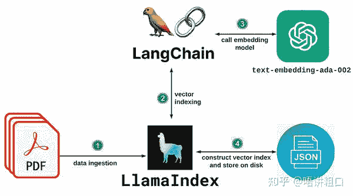

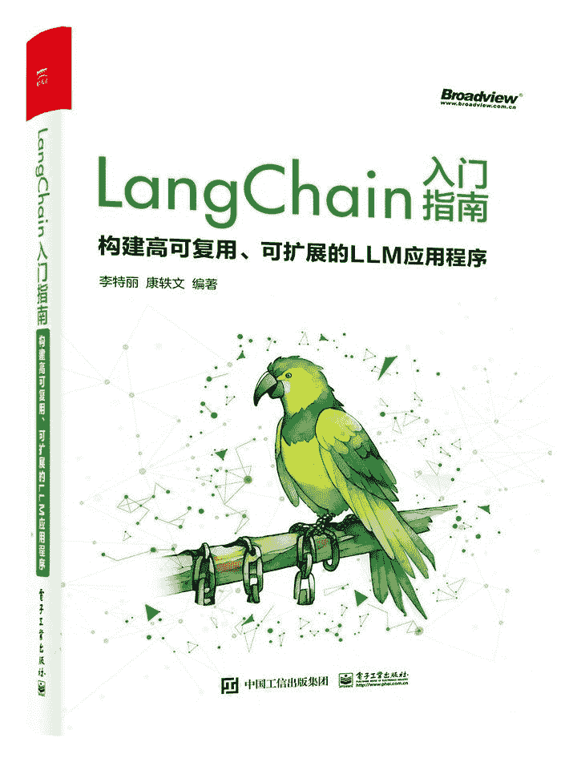

广告

LangChain入门指南：构建高可复用、可扩展的LLM应用程

京东

¥50.00

去购买

### 新兴 LLM 技术栈

大语言模型技术栈由四个主要部分组成：

+ 数据预处理流程（data preprocessing pipeline）
+ 嵌入端点（embeddings endpoint ）+向量存储（vector store）
+ LLM 终端（LLM endpoints）
+ LLM 编程框架（LLM programming framework）

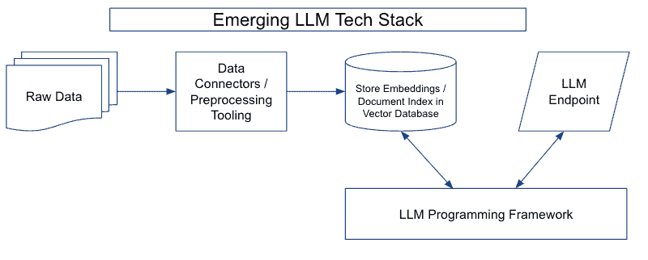

### 数据预处理流程

该步骤包括与数据源连接的连接器（例如S3存储桶或CRM）、数据转换层以及下游连接器（例如向矢量数据库）。通常，输入到LLM中的最有价值的信息也是最难处理的（如PDF、PPTX、HTML等），但同时，易于访问文本的文档（例如.DOCX）中也包含用户不希望发送到推理终端的信息（例如广告、法律条款等）。

因为涉及的数据源繁杂（数千个PDF、PPTX、聊天记录、抓取的HTML等），这步也存在大量的 dirty work，使用OCR模型、Python脚本和正则表达式等方式来自动提取、清理和转换关键文档元素（例如标题、正文、页眉/页脚、列表等），最终向外部以API的方式提供JSON数据，以便嵌入终端和存储在向量数据库中。

### 嵌入端点和向量存储

使用嵌入端点（用于生成和返回诸如词向量、文档向量等嵌入向量的 API 端点）和向量存储（用于存储和检索向量的数据库或数据存储系统）代表了数据存储和访问方式的重大演变。以前，嵌入主要用于诸如文档聚类之类的特定任务，在新的架构中，将文档及其嵌入存储在向量数据库中，可以通过LLM端点实现关键的交互模式。直接存储原始嵌入，意味着数据可以以其自然格式存储，从而实现更快的处理时间和更高效的数据检索。此外，这种方法可以更容易地处理大型数据集，因为它可以减少训练和推理过程中需要处理的数据量。

### LLM终端

LLM终端是接收输入数据并生成LLM输出的终端。LLM终端负责管理模型的资源，包括内存和计算资源，并提供可扩展和容错的接口，用于向下游应用程序提供LLM输出。

### LLM编程框架

LLM编程框架提供了一套工具和抽象，用于使用语言模型构建应用程序。在现代技术栈中出现了各种类型的组件，包括：LLM提供商、嵌入模型、向量存储、文档加载器、其他外部工具（谷歌搜索等），这些框架的一个重要功能是协调各种组件。

### 关键组件解释

`Prompts`

`Prompts`用来管理 LLM 输入的工具，在从 LLM 获得所需的输出之前需要对提示进行相当多的调整，最终的Promps可以是单个句子或多个句子的组合，它们可以包含变量和条件语句。

`Chains`

是一种将LLM和其他多个组件连接在一起的工具，以实现复杂的任务。

`Agents`

是一种使用LLM做出决策的工具，它们可以执行特定的任务并生成文本输出。`Agents`通常由三个部分组成：`Action`、`Observation`和`Decision`。`Action`是代理执行的操作，`Observation`是代理接收到的信息，`Decision`是代理基于`Action`和`Observation`做出的决策。

`Memory`

是一种用于存储数据的工具，由于LLM 没有任何长期记忆，它有助于在多次调用之间保持状态。

### 典型应用场景

+ [特定文档的问答 ](https://link.zhihu.com/?target=https%3A//python.langchain.com/docs/use_cases/question_answering.html)：从Notion数据库中提取信息并回答用户的问题。

+ [聊天机器人 ](https://link.zhihu.com/?target=https%3A//python.langchain.com/docs/use_cases/chatbots/)：使用`Chat-LangChain`模块创建一个与用户交流的机器人。

+ [代理 ](https://link.zhihu.com/?target=https%3A//python.langchain.com/docs/use_cases/agents/)：使用GPT和WolframAlpha结合，创建一个能够执行数学计算和其他任务的代理。

+ [文本摘要 ](https://link.zhihu.com/?target=https%3A//python.langchain.com/docs/use_cases/summarization)：使用外部数据源来生成特定文档的摘要。

### Langchain 竞品

（个人认为）在商业化上，基于大模型业务分为三个层次：

+ 基础设施层：通用的大模型底座
+ 垂直领域层：基于大模型底座+领域场景数据微调形成更强垂直能力
+ 应用层：基于前两者，瘦前端的方式提供多样化应用体验

类似 LangChain 这种工具框架可以做到整合各个层能力，具备加速应用开发和落地验证的优势，因此也出现了很多竞争者。

| 名称 | 语言 | 特点 |
| --- | --- | --- |
| LangChain | Python/JS | 优点：提供了标准的内存接口和内存实现，支持自定义大模型的封装。缺点：评估生成模型的性能比较困难。 |
| Dust.tt | Rust/TS | 优点：提供了简单易用的API，可以让开发者快速构建自己的LLM应用程序。缺点：文档不够完善。 |
| Semantic-kernel | TypeScript | 优点：轻量级SDK，可将AI大型语言模型（LLMs）与传统编程语言集成在一起。缺点：文档不够完善。 |
| Fixie.ai | Python | 优点：开放、免费、简单，多模态（images, audio, video...）缺点：PaaS平台，需要在平台部署 |
| Brancher AI | Python/JS | 优点：链接所有大模型，无代码快速生成应用, Langchain产品）缺点：- |

LangChain 主体分为 6 个模块，分别是对（大语言）模型输入输出的管理、外部数据接入、链的概念、（上下文记忆）存储管理、智能代理以及回调系统，通过文档的组织结构，你可以清晰了解到 LangChain的侧重点，以及在大语言模型开发生态中对自己的定位。

## 2、LLM输入输出管理

### [Model I/O](https://link.zhihu.com/?target=https%3A//python.langchain.com/docs/modules/model_io/)

这部分包括对大语言模型输入输出的管理，输入环节的提示词管理（包含模板化提示词和提示词动态选择等），处理环节的语言模型（包括所有LLMs的通用接口，以及常用的LLMs工具；Chat模型是一种与LLMs不同的API，用来处理消息），输出环节包括从模型输出中提取信息。

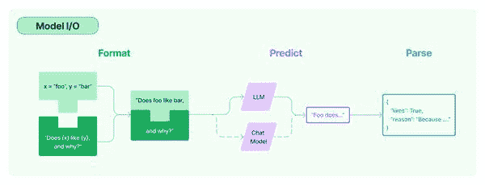

### 提示词管理

+ `提示模板` 动态提示词=提示模板+变量，通过引入给提示词引入变量的方式，一方面保证了灵活性，一方面又能保证Prompt内容结构达到最佳

```
系统设置了三种模板:固定模板不需要参数,单参数模板可以替换单个词,双参数模板可以替换两个词。

比如单参数模板可以提问"告诉一个形容词笑话"。运行时传入"有意思"作为参数,就变成"告诉一个有意思的笑话"。

双参数模板可以提问"某个形容词关于某内容的笑话"。运行时传入"有趣","鸡"作为参数,就变成"告诉一个有趣的关于鸡的笑话"。

通过设置不同模板和参数,一套系统就可以自动生成各种问题,实现智能对话与用户互动。
```

+ `聊天提示模板` 聊天场景中，消息可以与AI、人类或系统角色相关联，模型应该更加密切地遵循系统聊天消息的指示。这个是对 `OpenAI gpt-3.5-tubor API` 中 `role` 字段（`role` 的属性用于显式定义角色，其中 `system` 用于系统预设，比如"你是一个翻译家"、"你是一个写作助手"，`user` 表示用户的输入，`assistant` 表示模型的输出）的一种抽象，以便应用于其他大语言模型。`SystemMessage`对应系统预设，`HumanMessage`用户输入，`AIMessage`表示模型输出，使用 `ChatMessagePromptTemplate` 可以使用任意角色接收聊天消息。

```
系统会先提示“我是一个翻译助手,可以把英文翻译成中文”这样的系统预设消息。

然后用户输入需要翻译的内容,比如“我喜欢大语言模型”。

系统会根据预先定义的对话模板,自动接受翻译语种和用户输入作为参数,并生成对应的用户输入消息。

最后,系统回复翻译结果给用户。通过定制不同对话角色和动态输入参数,实现了模型自动回复用户需求的翻译对话。
```

+ `其他`

+ 基于 `StringPromptTemplate` 自定义提示模板`StringPromptTemplate`
+ 将Prompt输入与特征存储关联起来(`FeaturePromptTemplate`)
+ 少样本提示模板（`FewShotPromptTemplate`）
+ 从示例中动态提取提示词✍️

### LLMs

+ `LLMs` 将文本字符串作为输入并返回文本字符串的模型（纯文本补全模型），这里重点说下做项目尽量用异步的方式，体验会更好，下面的例子连续10个请求，时间相差接近5s。

```
该系统使用语言模型为用户提供文本输出功能。代码测试了串行和并行请求两个模式。

串行模式一个一个发起10个请求,响应时间总计需要5秒。

并行模式通过asyncio模块同时发起10个请求任务。 tasks列表存放每个请求,await等待它们都结束。

与串行只有1.4秒响应时间相比,并行模式大大提升了效率。
```

+ `缓存` 如果多次请求的返回一样，就可以考虑使用缓存，一方面可以减少对API调用次数节省token消耗，另一方面可以加快应用程序的速度。

```
首先定义一个内存缓存,用来临时保存请求结果。

然后对语言模型发送同一条"告诉我一个笑话"的请求两次。

第一次请求耗时2.18秒,结果和响应通过缓存保存起来。

第二次请求就直接从缓存中获取结果。
```

1. 流式传输功能,能即时逐字返回生成内容,还原聊天过程
1. 回调追踪token使用,了解模型耗费情况
1. `ChatModel`支持聊天消息作为输入,生成回应完成对话
1. 配置管理可以读取保存LLM设置,方便重复使用
1. 提供模拟工具代替真实模型,在测试中减少成本
1. 与其他AI基础设施无缝融合

### 输出解析器

输出解析器用于构造大语言模型的响应格式，具体通过格式化指令和自定义方法两种方式。

```
需要对机器人回复进行结构化处理。代码测试了两种输出解析方式。

一是使用内置的解析器,识别指定格式如逗号分隔列表的输出。

二是通过定义ResponseSchema来定制输出结构,比如需要包含答案和来源两个字段。

它会提示模型按照格式要求进行回复,比如“答案,来源”。

解析器可以分析模型输出,判断是否符合预期结构。

smallCoder明白了,输出解析器可以规范化模型响应,一个是使用内置规则,一个可以全自定义,都有助于结构化对话与后续处理。
```

### [Data Connection](https://link.zhihu.com/?target=https%3A//python.langchain.com/docs/modules/data_connection/)

打通外部数据的管道，包含文档加载，文档转换，文本嵌入，向量存储几个环节。


#### [文档加载](https://link.zhihu.com/?target=https%3A//python.langchain.com/docs/modules/data_connection/document_loaders/)

重点包括了`CSVLoader`、`UnstructuredHTMLLoader`、`JSONLoader`、`UnstructuredMarkdownLoader`以及`pdf`（因为pdf的格式比较复杂，提供了`PyPDFLoader`、`MathpixPDFLoader`、`UnstructuredPDFLoader`、`PyMuPDF`等多种形式的加载引擎）几种常用格式的内容解析，但是在实际的项目中，数据来源一般比较多样，格式也比较复杂，重点推荐按需去查看与各种 数据源 集成 的章节说明，Discord、Notion、Joplin，Word等数据源。

#### [文档拆分](https://link.zhihu.com/?target=https%3A//python.langchain.com/docs/modules/data_connection/document_transformers/)

重点关注按照字符递归拆分的方式 `RecursiveCharacterTextSplitter` ，这种方式会将语义最相关的文本片段放在一起。

#### [文本嵌入](https://link.zhihu.com/?target=https%3A//python.langchain.com/docs/modules/data_connection/text_embedding/)

嵌入包含两个方法，一个用于嵌入文档，接受多个文本作为输入；一个用于嵌入查询，接受单个文本。文档中示例使用了OpenAI的嵌入模型`text-embedding-ada-002`，但提供了很多第三方 嵌入模型 集成可以按需查看。

```
需要根据文本内容进行相似匹配查找。它利用了语言嵌入技术来实现。

首先定义好嵌入模型,这里使用OpenAI提供的文本嵌入模型。

然后有两种方法可以获取文本向量:

传入多篇文本,同时获取所有文本的嵌入向量表示。

仅传入单篇文本,获取其嵌入向量。

嵌入向量可以用于计算文本间的相似程度,从而实现内容查找。
```

#### [向量存储](https://link.zhihu.com/?target=https%3A//python.langchain.com/docs/modules/data_connection/vectorstores/)

这个就是对常用矢量数据库（`FAISS`，`Milvus`，`Pinecone`，`PGVector`等）封装接口的说明，详细的可以前往 嵌入专题 查看。大概流程都一样：初始化数据库连接信息——>建立索引——>存储矢量——>相似性查询，下面以 `Pinecone`为例：

```
文本搜索系统需要对大量文档进行索引,以实现相关性搜索。

它首先使用文本加载器读取文本内容,然后用分词器将长文本分割成短语。

接着调用嵌入模型为每段文本生成向量表示。

系统利用Pinecone这类向量数据库创建索引,并存入所有文本向量。

后续只需传入查询词语,调用相似性搜索接口,就可以快速找到与查询最相关的文本片段。
```

#### [数据查询](https://link.zhihu.com/?target=https%3A//python.langchain.com/docs/modules/data_connection/retrievers/)


这节重点关注数据压缩，目的是获得相关性最高的文本带入prompt上下文，这样既可以减少token消耗，也可以保证LLM的输出质量。

```
问答系统需要从大量文本快速检索与用户问题相关的内容。

它先采用向量检索技术获取初步文档,然后利用LLM迭代提取相关段落进行数据压缩。

另外,系统也可以在压缩结果上再进行向量相似度过滤,进一步优化结果。

同时,为提升效率,系统还实现了基于结构化`metadata`和概要进行主动查询,而不是索引所有文本内容。
```

针对基础检索得到的文档再做一次向量相似性搜索进行过滤，也可以取得不错的效果。

最后一点就是自查询（`SelfQueryRetriever`）的概念，其实就是结构化查询元数据，因为对文档的元信息查询和文档内容的概要描述部分查询效率肯定是高于全部文档的。

### [`Memory`](https://link.zhihu.com/?target=https%3A//python.langchain.com/docs/modules/memory/)

`Chain`和`Agent`是无状态的，只能独立地处理每个传入的查询，`Memory` 可以管理和操作历史消息。一个带存储的Agent例子如下：

```
一个基于问答历史记录的聊天agent。

它首先定义了搜索工具,并使用`ZeroShotAgent`生成 prompts。

然后创建一个`ConversationBufferMemory`对象保存历史消息。

将agent、搜索工具和内存对象封装成`AgentExecutor`。

每次处理用户问题时,都会查询内存中的历史记录,充当聊天上下文。

同时问题响应也会添加到内存,形成持续互动。
```

## 3、数据接入层

### [`Data Connection`](https://link.zhihu.com/?target=https%3A//python.langchain.com/docs/modules/data_connection/)

打通外部数据的管道，包含文档加载，文档转换，文本嵌入，向量存储几个环节。

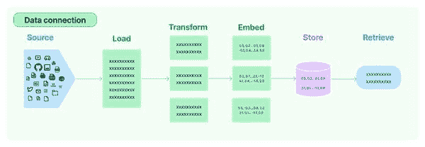

### [`文档加载`](https://link.zhihu.com/?target=https%3A//python.langchain.com/docs/modules/data_connection/document_loaders/)

重点包括了`CSVLoader`、`html`（`UnstructuredHTMLLoader`）、`json`（`JSONLoader`）、`markdown`（`UnstructuredMarkdownLoader`）以及`pdf`（因为`pdf`的格式比较复杂，提供了`PyPDFLoader`、`MathpixPDFLoader`、`UnstructuredPDFLoader`、`PyMuPDF`等多种形式的加载引擎）几种常用格式的内容解析，但是在实际的项目中，数据来源一般比较多样，格式也比较复杂，重点推荐按需去查看与各种数据源集成的章节说明，`Discord`、`Notion`、`Joplin`、`Word`等数据源。

### [`文档拆分`](https://link.zhihu.com/?target=https%3A//python.langchain.com/docs/modules/data_connection/document_transformers/)

重点关注按照字符递归拆分的方式 `RecursiveCharacterTextSplitter` ，这种方式会将语义最相关的文本片段放在一起。

### [`文本嵌入`](https://link.zhihu.com/?target=https%3A//python.langchain.com/docs/modules/data_connection/text_embedding/)

嵌入包含两个方法，一个用于嵌入文档，接受多个文本作为输入；一个用于嵌入查询，接受单个文本。文档中示例使用了`OpenAI`的嵌入模型`text-embedding-ada-002`，但提供了很多第三方嵌入模型集成可以按需查看。

```
需要根据文本内容进行相似匹配与提取。它利用多种NLP技术来实现。

首先使用递归字符拆分器将长文本根据语义语境分割成短段。

然后采用文本嵌入模型,为每个文本和查询获得其向量表示。

嵌入模型可以为系统提供多篇文本和单篇文本的向量,为后续匹配检索打下基础。

系统通过计算和比对这些向量,可以找到与查询最相似的文本片段。
```

### [`向量存储`](https://link.zhihu.com/?target=https%3A//python.langchain.com/docs/modules/data_connection/vectorstores/)

这个就是对常用矢量数据库（`FAISS`，`Milvus`，`Pinecone`，`PGVector`等）封装接口的说明，详细的可以前往嵌入专题查看。大概流程都一样：初始化数据库连接信息——>建立索引——>存储矢量——>相似性查询，下面以 `Pinecone`为例：

```
问答系统需要对大量文本进行索引,实现快速相关搜索。

它先用文本加载器读取文本,字符级分词器切分为短段。

然后调用嵌入模型为每段文本生成矢量表示。

利用`Pinecone`向量数据库创建索引,将所有文本向量存入。

只需传入查询,调用相似搜索接口,即可快速找到与查询最相关的文本段。
```

### [`数据查询`](https://link.zhihu.com/?target=https%3A//python.langchain.com/docs/modules/data_connection/retrievers/)

这节重点关注数据压缩，目的是获得相关性最高的文本带入prompt上下文，这样既可以减少token消耗，也可以保证LLM的输出质量。

```
问答系统需要从大量文档快速检索与询问相关内容。

它先通过向量检索获取初步文档,然后利用深度学习模型从中取出最相关文本进行数据压缩。

同时,系统还采用向量相似度过滤进一步优化检索结果。

此外,通过建立在结构化元数据和概要上的主动查询,而非全文匹配,也可以提升检索效率。
```

针对基础检索得到的文档再做一次向量相似性搜索进行过滤，也可以取得不错的效果。

最后一点就是自查询（`SelfQueryRetriever`）的概念，其实就是结构化查询元数据，因为对文档的元信息查询和文档内容的概要描述部分查询效率肯定是高于全部文档的。

## 4、Embedding专题

### 文本嵌入是什么

向量是一个有方向和长度的量，可以用数学中的坐标来表示。例如，可以用二维坐标系中的向量表示一个平面上的点，也可以用三维坐标系中的向量表示一个空间中的点。在机器学习中，向量通常用于表示数据的特征。

而文本嵌入是一种将文本这种离散数据映射到连续向量空间的方法，嵌入技术可以将高维的离散数据降维到低维的连续空间中，并保留数据之间的语义关系，从而方便进行机器学习和深度学习的任务。

例如：

> `"机器学习"`表示为 `[1,2,3]`

> `"深度学习"`表示为`[2,3,3]`

> `"英雄联盟"`表示为`[9,1,3]`

> 使用余弦相似度（`余弦相似度`是一种用于衡量向量之间相似度的指标，可以用于文本嵌入之间的相似度）在计算机中来判断文本之间的距离：

> 

> `"机器学习"`与`"深度学习"`的距离：

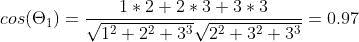

`"机器学习"`与`"英雄联盟"`的距离：

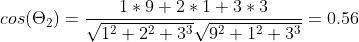

`"机器学习"`与`"深度学习"`两个文本之间的余弦相似度更高，表示它们在语义上更相似。

### 文本嵌入算法

文本嵌入算法是指将文本数据转化为向量表示的具体算法，通常包括以下几个步骤：

+   分词：将文本划分成一个个单词或短语。

+   构建词汇表：将分词后的单词或短语建立词汇表，并为每个单词或短语赋予一个唯一的编号。

+   计算词嵌入：使用预训练的模型或自行训练的模型，将每个单词或短语映射到向量空间中。

+   计算文本嵌入：将文本中每个单词或短语的向量表示取平均或加权平均，得到整个文本的向量表示。

常见的文本嵌入算法包括 `Word2Vec`、`GloVe`、`FastText` 等。这些算法通过预训练或自行训练的方式，将单词或短语映射到低维向量空间中，从而能够在计算机中方便地处理文本数据。

### 文本嵌入用途

文本嵌入用于测量文本字符串的相关性，通常用于：

+   搜索（结果按与查询字符串的相关性排序）

+   聚类（其中文本字符串按相似性分组）

+   推荐（推荐具有相关文本字符串的项目）

+   异常检测（识别出相关性很小的异常值）

+   多样性测量（分析相似性分布）

+   分类（其中文本字符串按其最相似的标签分类）

### 使用文本嵌入模型

+   可以使用 `HuggingFace`上能够处理文本嵌入的开源模型，例如： `uer/sbert-base-chinese-nli`

```
问答系统利用文本嵌入技术将输入内容转换为数字向量表示。

它使用了开源库`SentenceTransformer`,选择预训练模型`uer/sbert-base-chinese-nli`进行中文文本向量化。

这个模型可以高效对一批文本进行编码,输出每个文本的嵌入向量。

系统也可以使用`OpenAI`提供的文本嵌入API,选用`text-embedding-ada-002`模型进行处理。

`OpenAI`的API支持多种预训练模型,不同模型在处理效果和性能上会有差异。

通过文本向量化,系统可以实现内容的深层理解,比如对文本进行分类、相似度计算等,为后续问答提供技术支撑。
```

+   使用之前介绍的 [`OpenAI` 文本嵌入API](https://link.zhihu.com/?target=https%3A//aitutor.liduos.com/01-llm/01-3.html%23embeddings)[可以将文本](https://link.zhihu.com/?target=https%3A//openai.com/blog/new-and-improved-embedding-mode)转换为向量，`OpenAI` API提供了多个文本嵌入模型，这篇博客对它们的性能进行了比较，这里是性能最好的 `text-embedding-ada-002` 说明：

| 模型名称 | 价格 | 分词器 | 最大输入 `token` | 输出 |

| --- | --- | --- | --- | --- |

| `text-embedding-ada-002` | $0.000/1k tokens | `cl100k_base` | 8191 | 1536 |

### 支持文本嵌入的其他模型

+   `nghuyong/ernie-3.0-nano-zh`

+   `shibing624/text2vec-base-chinese`

+   `GanymedeNil/text2vec-large-chinese`

+   `moka-ai/m3e-base`

+   用于句子、文本和图像嵌入的Python库

### 矢量数据库

+   为了快速搜索多个矢量，建议使用矢量数据库，下面是一些可选的矢量数据库：

+   [`Pinecone`](https://link.zhihu.com/?target=https%3A//github.com/openai/openai-cookbook/tree/main/examples/vector_databases/pinecone)，一个完全托管的矢量数据库

+   [`Weaviate`](https://link.zhihu.com/?target=https%3A//github.com/openai/openai-cookbook/tree/main/examples/vector_databases/weaviate)，一个开源的矢量搜索引擎

+   [`Redis`](https://link.zhihu.com/?target=https%3A//github.com/openai/openai-cookbook/tree/main/examples/vector_databases/redis)作为矢量数据库

+   [`Qdrant`](https://link.zhihu.com/?target=https%3A//github.com/openai/openai-cookbook/tree/main/examples/vector_databases/qdrant)，一个矢量搜索引擎

+   [`Milvus`](https://link.zhihu.com/?target=https%3A//github.com/openai/openai-cookbook/blob/main/examples/vector_databases/Using_vector_databases_for_embeddings_search.ipynb)，一个为可扩展的相似性搜索而构建的矢量数据库

+   [`Chroma`](https://link.zhihu.com/?target=https%3A//github.com/chroma-core/chroma)，一个开源嵌入式商店

+   [`Typesense`](https://link.zhihu.com/?target=https%3A//typesense.org/docs/0.24.0/api/vector-search.html)，快速的开源矢量搜索引擎

+   [`Zilliz`](https://link.zhihu.com/?target=https%3A//github.com/openai/openai-cookbook/tree/main/examples/vector_databases/zilliz)，数据基础设施，由`Milvus`提供技术支持

+   [`FAISS`](https://link.zhihu.com/?target=https%3A//github.com/facebookresearch/faiss)是`Meta`开源的用于高效搜索大规模矢量数据集的库

### 性能优化：

和传统数据库一样，可以使用工程手段优化矢量数据库搜索性能，最直接的就是更新索引算法，对索引数据进行分区优化。

平面索引（`FLAT`）：将向量简单地存储在一个平面结构中，最基本的向量索引方法。

+   `欧式距离`（`Euclidean Distance`）

+   `余弦相似度`（`Cosine Similarity`）

分区索引（`IVF`）：将向量分配到不同的分区中，每个分区建立一个倒排索引结构，最终通过倒排索引实现相似度搜索。

+   `欧式距离`（`Euclidean Distance`）

+   `余弦相似度`（`Cosine Similarity`）

量化索引（`PQ`）：将高维向量划分成若干子向量，将每个子向量量化为一个编码，最终将编码存储在倒排索引中，利用倒排索引进行相似度搜索。

+   `欧式距离`（`Euclidean Distance`）

+   `汉明距离`（`Hamming Distance`）

`HNSW` (`Hierarchical Navigable Small World`)：通过构建一棵层次化的图结构，从而实现高效的相似度搜索。

+   `内积`（`Inner Product`）

+   `欧式距离`（`Euclidean Distance`）

`NSG` (`Navigating Spreading-out Graph`)：通过构建一个分层的无向图来实现快速的相似度搜索。

+   `欧式距离`（`Euclidean Distance`）

`Annoy` (`Approximate Nearest Neighbors Oh Yeah`)：通过将高维空间的向量映射到低维空间，并构建一棵二叉树来实现高效的近似最近邻搜索。

+   `欧式距离`（`Euclidean Distance`）

+   `曼哈顿距离`（`Manhattan Distance`）

`LSH` (`Locality-Sensitive Hashing`)：通过使用哈希函数将高维的向量映射到低维空间，并在低维空间中比较哈希桶之间的相似度，实现高效的相似度搜索。

+   `内积`（`Inner Product`）

+   `欧式距离`（`Euclidean Distance`）

## 5、Chain模块

### Chain链定义

链定义为对组件的一系列调用，也可以包括其他链，这种在链中将组件组合在一起的想法很简单但功能强大，极大地简化了复杂应用程序的实现并使其更加模块化，这反过来又使调试、维护和改进应用程序变得更加容易。 `Chain`基类是所有chain对象的基本入口，与用户程序交互，处理用户的输入，准备其他模块的输入，提供内存能力，`chain`的回调能力，其他所有的 `Chain` 类都继承自这个基类，并根据需要实现特定的功能。

```
Chain定义和自定义Chain的主要作用:

Chain定义了一系列组件的调用顺序,可以包含子Chain,实现复杂应用的模块化。

Chain基类是所有Chain对象的起点,处理输入、输出、内存和回调等功能。

自定义Chain需要继承Chain基类,实现`_call`/`_acall`方法定义调用逻辑。

例如,根据prompt生成文字会使用语言模型生成响应,同时支持回调处理。

Chain支持同步和异步调用,内部组件也可以通过回调进行交互。

这极大简化了应用开发,通过组合小组件构建复杂系统。

模块化设计也促进了代码维护、扩展和重用等。
```

继承`Chain`的子类主要有两种类型：


# 链（Chain）概述

通用工具 chain：控制 chain 的调用顺序，是否调用，它们可以用来合并构造其他的 chain。专门用途 chain：和通用 chain 相比，它们承担了具体的某项任务，可以和通用的 chain 组合起来使用，也可以直接使用。有些 `Chain` 类可能用于处理文本数据，有些可能用于处理图像数据，有些可能用于处理音频数据等。

## 从 LangChainHub 加载链

[`LangChainHub`](https://link.zhihu.com/?target=https%3A//github.com/hwchase17/langchain-hub) 托管了一些高质量 `Prompt`、`Agent` 和 `Chain`，可以直接在 `langchain` 中使用。

```
LangChainHub加载链主要作用:

LangChainHub提供了量大质精的Prompt、Agent和Chain模板,可以直接在langchain中使用。

例如加载"math"链,它是一个基于LLM实现的计算器链。
```

## 运行 LLM 链的五种方式

```
运行LLM链的主要作用:

LangChainHub提供了量大质精的Prompt、Agent和Chain模板,可以直接在langchain中使用。

例如加载"math"链,它是一个基于LLM实现的计算器链。

LLM链可以通过5种方式运行:

1. 调用对象 2. run方法 3. apply方法
generate方法 5. predict方法
它们接受格式不同的输入参数,但都可以输出响应结果。

这大大简化了开发流程 - 直接使用高质量模板,只需少量代码即可构建应用。

运行LLM链也提供便利的接口。
```

## 通用工具链

以下概述几种通用工具链的主要功能：

+ `MultiPromptChain` 通过 Embedding 匹配选择最相关提示回答问题。
+ `EmbeddingRouterChain` 使用嵌入判断选择下一链。
+ `LLMRouterChain` 使用 LLM 判断选择下一链。
+ `SimpleSequentialChain`/`SequentialChain` 将多个链组成流水线传递上下文。
+ `TransformChain` 通过自定义函数转换输入，动态改变数据流向。

它们提供了动态路由、数据转换、链串联等功能，大大提升了链的灵活性。

例如，通过 `TransformChain` 截取文本，`SequentialChain` 联合链对文本进行摘要。

这些通用工具链可以帮助开发者快速构建复杂应用，实现不同业务需求。

只需进行少量定制就可以满足个性需求，真正实现“取而代之”的开发模式。

## 合并文档的链（专门用途链）

`BaseCombineDocumentsChain` 有四种不同的模式。

```
以下概括合并文档链的主要功能:

该链专门用于问答场景下从多篇文档中提取答案。

它提供四种模式来合并多个文档:

1. stuff 模式: 直接将所有文档合成一段文字

2. map_reduce 模式: 每个文档提取答案候选, 最后整合答案

3. map_rerank 模式: 每个文档提取答案候选, 通过 LLM 进行重新排序

4. refine 模式: 首先用 LLM 优化每个文档, 然后进行上述处理

开发者只需选择合适模式, 便可以搭建出问答链。

四种模式分别注重不同因素, 如效率、质量等。

这大大简化了定制问答类应用的难度。
```

### StuffDocumentsChain

获取一个文档列表，带入提示上下文，传递给 `LLM`（适合小文档）。

```
StuffDocumentsChain 的主要功能是:

接受一个包含多个文档的列表作为输入

将所有文档使用特定分割符连接成一个长文本

将长文本通过 prompt 模板格式化, 传入到 LLM 生成响应

它适用于文档数量和大小比较小的场景。
```

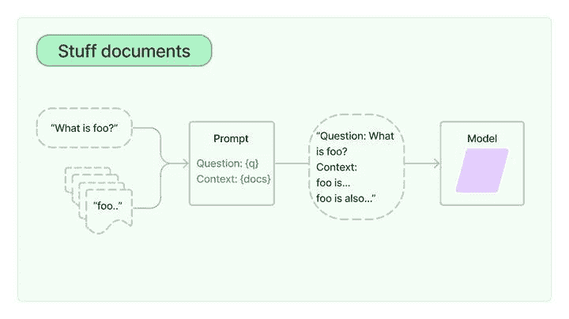

### RefineDocumentsChain

在 Stuff 方式上进一步优化，循环输入文档并迭代更新其答案，以获得最好的最终结果。具体做法是将所有非文档输入、当前文档和最新的中间答案组合传递给 `LLM`。（适合 LLM 上下文大小不能容纳的小文档）

```
系统需从多个文档中为用户提供准确答案。

它先采用修正链模式:

将问题和当前文档及初步答案输入语言模型校验

模型根据上下文回复更精准答案

系统循环每篇文档, 迭代优化答案质量

结束后获得最优答案输出给用户
```

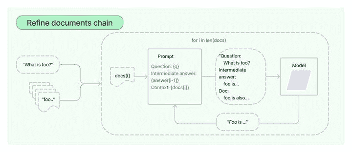

### MapReduceDocumentsChain

将 `LLM` 链应用于每个单独的文档（Map 步骤），将链的输出视为新文档。然后，将所有新文档传递给单独的合并文档链以获得单一输出（Reduce 步骤）。在执行 Map 步骤前也可以对每个单独文档进行压缩或合并映射，以确保它们适合合并文档链；可以将这个步骤递归执行直到满足要求。（适合大规模文档的情况）

```
为提升问答效率, 系统采取如下流程:

将问题输入每个文件, 语言模型给出初步答案

系统自动收集各文件答案, 形成新文件集

将答案文件集输入语言模型, 整合产出最终答案

如文件体积过大, 还可分批处理缩小文件体积

通过分布式“映射-规约”模式, 系统高效 parallel 地从海量文件中找到答案:

映射工作使每个文件独立处理, 提高效率;

规约环节再整合答案, 精度不损失。

这样既利用了分布技术, 又保证了答案质量, 帮助用户快速解决问题。
```

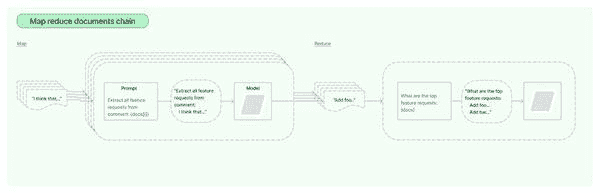

### MapRerankDocumentsChain

每个文档上运行一个初始提示，再给对应输出给一个分数，返回得分最高的回答。

```
为能从海量文件中快速给出最好答案, 系统采用“映射-重新排序”流程:

将问题输入每个文件, 语言模型给出多个答案候选

系统针对每个候选答案给出一个匹配分数

按分数从高到低重新排序所有文件答案

取排在前列的高分答案作为最优答案

这使系统从每个文件中高效挖掘答案, 并利用匹配度快速定位最好答案。
```

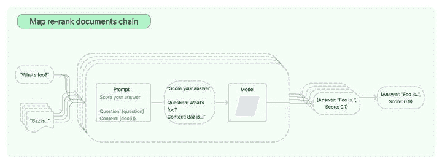

## 获取领域知识的链（专门用途链）

`APIChain` 使得可以使用 `LLM` 与 API 进行交互，以检索相关信息。通过提供与所提供的 API 文档相关的问题来构建链。下面是与播客查询相关的：

```
为帮助用户更全面解答问题, 系统利用外部 API 获取关联知识:

系统将问题输入到基于 API 文档构建的链中

链自动调用外部播客 API 搜索相关节目

根据用户需求筛选超 30 分钟的一条播客结果

系统返回相关节目信息, 丰富了解答内容

通过对接第三方 API, 系统解答能力得到极大扩展:

API 提供传输知识, 系统转化为答案;

用户只需简单问题, 即可获取相关外部资源。

这有效弥补了单一模型不足, 助用户全面解决问题需求。
```

## 合并文档链的高频使用场景举例

### 对话场景（最广泛）

`ConversationalRetrievalChain` 对话式检索链的工作原理：将聊天历史记录（显式传入或从提供的内存中检索）和问题合并到一个独立的问题中，然后从检索器查找相关文档，最后将这些文档和问题传递给问答链以返回响应。

```
用户在系统提问时, 往往与之前对话上下文相关。

为给出最合理答复, 系统采用以下对话式处理流程:

保存所有历史对话为内存

将新问题和历史对话合成一个问题

从大量文档中寻找相关段落

将答卷和问题输入语言模型

获得兼顾上下文的最佳答案

这样系统可以深入理解用户意图, 结合历史信息给出情境化的响应。
```

### 基于数据库问答场景

```
通过数据库链将结构化数据连接到语言模型, 实现问答功能。

此外, 它还支持:

实体链接 知识图谱问答

文档分类聚类

对象检测机器翻译等
```

### 总结场景

```
对输入文本进行总结, 比如提取关键信息并连接成简介。
```

### 问答场景

```
读取文件内容, 利用文档搜索及联合链从多个文档中给出最佳答案。
```

## 代理模块

某些应用程序需要基于用户输入的对 `LLM` 和其他工具的灵活调用链。`Agent` 为此类应用程序提供了灵活性。代理可以访问单一工具，并根据用户输入确定要使用的工具。代理可以使用多个工具，并使用一个工具的输出作为下一个工具的输入。

主要有两种类型的代理：`Plan-and-Execute Agents` 用于制定动作计划；`Action Agents` 决定实施何种动作。

`Agents` 模块还包含配合代理执行的工具（代理可以执行的操作。为代理提供哪些工具在很大程度上取决于希望代理做什么）和工具包（一套工具集合，这些工具可以与特定用例一起使用。例如，为了使代理与 SQL 数据库进行交互，它可能需要一个工具来执行查询，另一个工具来检查表）。

下面对不同的 `Agent` 类型进行说明。

### CONVERSATIONAL_REACT_DESCRIPTION

针对对话场景优化的代理。

```
为优化对话系统的智能化能力, `langchain` 采用代理模式:

系统定义了不同工具函数, 如搜索引擎查询接口

用户提问时, 代理首先检查是否需要调用工具函数

如果调用搜索查询, 就利用接口搜索答案

否则将问题通过语言模型进行自然对话

全过程与历史对话上下文保持一致

通过这种设计:

系统可以动态选择调用内外部功能

回答不仅限于语言模型, 更加智能

用户获得更全面更自动化的对话体验
```

Agent 执行过程

```
系统处理流程如下:

用户提问系统总人口数量时, 系统开始分析

系统判断是否需要调用外部工具寻找答案

系统决定调用搜索工具, 搜索“中国人口数量”

搜索结果告知中国 2020 人口数据及民族构成

系统分析搜索结果已得到需要答案

所以不需要调用其他工具, 直接据搜索结果回复用户

整个流程从问题理解到答案回复都是逻辑清晰的
```

### CHAT_CONVERSATIONAL_REACT_DESCRIPTION

针对聊天场景优化的代理。

### OpenAI Functions Agent

这个是 `LangChain` 对 `OpenAI Function Call` 的封装。关于 `Function Calling` 的能力，可以看我这篇文章：`OpenAI Function Calling 特性有什么用`。

```
OpenAI Functions Agent 的工作流程:

1. 用户提问, 语言模型判断是否需要调用功能函数

2. 如果需要, 调用定义好的 `Calculator` 函数

3. `Calculator` 函数通过 `LLM` 计算公式结果

4. 将公式执行结果返回给语言模型

5. 语言模型将结果翻译成自然语言给用户

通过这种模式:

- 语言模型可以调用外部函数完成更复杂任务

- 用户提问范围不限于纯对话, 可以求解数学等问题

- 整个流程是一体化的, 用户体验更好
```

### 计划和执行代理

计划和执行代理通过首先计划要做什么，然后执行子任务来实现目标。这个想法很大程度上受到 `BabyAGI` 的启发。

```
计划与执行代理通过分步实现:

1. 首先使用聊天规划器对问题进行解析分解, 得到执行计划

2. 计划内容可能包括调用不同工具函数获取子结果:

- `Search` 接口查询美国 GDP

- `Calculator` 计算日本 GDP

- `Calculator` 计算两国 GDP 差值

3. 然后执行器依次调用相关函数运行计划任务

4. 将子结果整合返回给用户

通过这种分层设计:

- 规划器可以针对不同类型问题制定个性化计划

- 执行器负责统一调用运行子任务

- 用户问题可以一步到位高效解决
```

### ZERO_SHOT_REACT_DESCRIPTION

给 `LLM` 提供一个工具名称列表，包括它们的效用描述以及有关预期输入/输出的详细信息。指示 `LLM` 在必要时使用提供的工具来回答用户给出的提示。指令建议模型遵循 `ReAct` 格式：思考、行动、行动输入、观察，下面是一个例子：

```
这个流程描述了系统利用外部工具高效解答用户问题的体验过程:

1. 系统提前定义好各种常用工具名称和功能

2. 当用户提问时, 系统会理解问题所需信息

3. 然后选择调用合适工具, 明确工具名称和预期输出

4. 通过工具搜索相关数据, 观察结果

5. 根据观察得出确切答案

6. 整个流程分步可追踪, 结果一目了然
```

### 其他

1. `AgentType.SELF_ASK_WITH_SEARCH`：自我进行对话迭代的代理
2. `REACT_DOCSTORE`：基于文档做 `ReAct` 的代理
3. `STRUCTURED_CHAT_ZERO_SHOT_REACT_DESCRIPTION`：在聊天过程中接入工具性代理，相当于 `OpenAI Plugin`

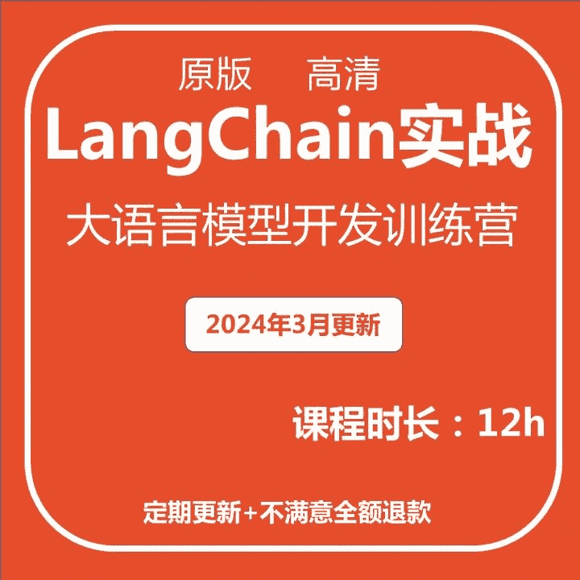

## Callback 模块

回调模块允许接到 `LLM` 应用程序的各个阶段，鉴于 `LLM` 的幻觉问题，这对于日志记录、监视、流式处理和其他任务非常有用，现在也有专用的工具 `Helicone`、`Arize AI` 等产品可用，下面我们开始看代码：

### 自定义回调对象

所有的回调对象都是基于这个基类来声明的。

```
系统定义了统一的回调处理基类:

基类定义了各种标准回调接口如开始/结束回调

这些回调适用于不同子模块如 `NLP` 模型/链/工具等

开发者只需扩展基类, 实现自己的回调处理逻辑

然后在运行过程中注册这些回调对象

系统就能在各个节点调用对应的回调方法

例如:

开发日志记录回调类 extend 基类

注册到 `chains`/`models`

日志就能自动记录运行细节

这样设计优点很明显:

统一标准化回调定义

高扩展性, 任何子模块均支持定制回调

开发维护成本低
```

### 使用回调的两种方式

+ 构造函数时定义回调：在构造函数中定义，例如 `LLMChain(callbacks=[handler], tags=['a-tag'])`，它将被用于对该对象的所有调用，并且将只针对该对象，例如，如果你向 `LLMChain` 构造函数传递一个 `handler`，它将不会被附属于该链的 `Model` 使用。
+ 请求函数时传入回调：定义在用于发出请求的 `call()`/`run()`/`apply()` 方法中，例如 `chain.call(inputs, callbacks=[handler])`，它将仅用于该特定请求，以及它所包含的所有子请求（例如，对 `LLMChain` 的调用会触发对 `Model` 的调用，`Model` 会使用 `call()` 方法中传递的相同 `handler`）。

下面这是采用构造函数定义回调的例子：

```
两种方式的区别在于:

- 构造函数回调作用于对象所有调用

- 请求函数回调只针对单次调用

两者都可以实现回调功能, 选择时就看追求统一还是 situational 了。
```

执行效果

```
LLM调用开始....
Hi! I just woke up. Your llm is starting
同步回调被调用: token: 
同步回调被调用: token: 好
同步回调被调用: token: 的
同步回调被调用: token: ，
同步回调被调用: token: 我
同步回调被调用: token: 来
同步回调被调用: token: 给
同步回调被调用: token: 你
同步回调被调用: token: 讲
同步回调被调用: token: 个
同步回调被调用: token: 笑
同步回调被调用: token: 话
：


同步回调被调用: token: 有
同步回调被调用: token: 一
同步回调被调用: token: 天
同步回调被调用: token: ，
同步回调被调用: token: 小
同步回调被调用: token: 明
同步回调被调用: token: 上
同步回调被调用: token: 学
同步回调被调用: token: 迟
同步回调被调用: token: 到
同步回调被调用: token: 了
同步回调被调用: token: 
LLM调用结束....
Hi! I just woke up. Your llm is ending
```


## 参考链接

- LangChain 指南：打造 LLM 的垂域 AI 框架
- 一文了解：打造垂域的大模型应用 ChatGPT
- 爱吃牛油果的璐璐：（万字长文）手把手教你认识学会 LangChain

## 更多细节内容参考官方文档

[Langchain](https://link.zhihu.com/?target=https%3A//python.langchain.com/docs/get_started/introduction.html)

编辑于 2024-07-12 15:06 ・IP 属地广东 ・信息来源于 官方网站
