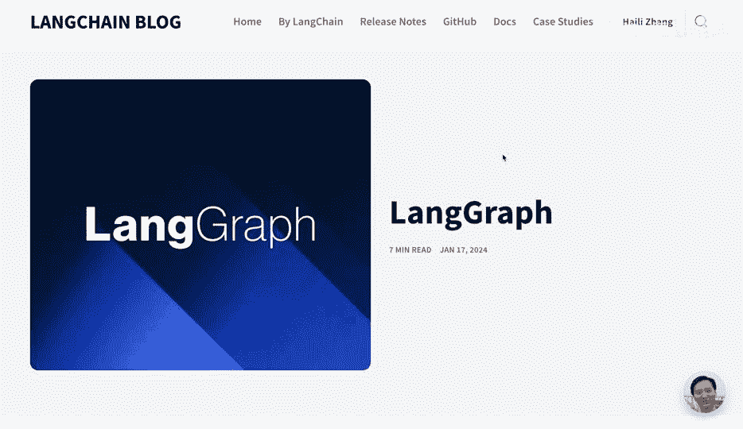

#  LangGraph：开启可定制的 Agent 新篇章

> 来源：[https://agijuejin.feishu.cn/docx/Wu9Sdwy6SohNv2xhVJicAM8cnVb](https://agijuejin.feishu.cn/docx/Wu9Sdwy6SohNv2xhVJicAM8cnVb)

# 👀快看👀

> **作者：**[**沧海九粟**](https://space.bilibili.com/28357052)

> **原文链接：**🦜🕸️ LangGraph：开启可定制的 Agent 新篇章

> 官博：https://blog.langchain.dev/langgraph/

---

# ⚡️摘要⚡️

> LangGraph 开启了可定制的 Agent 新篇章，标志着人工智能领域的一项创新。

---

# 🤖分集🤖

# 🦜🕸️ LangGraph 快速上手工具调用

LangGraph 项目是开源的 Agent 框架，用户可按需定制，其官方博客提供详细信息，该框架在自然语言处理、机器学习及人工智能领域可能有重要应用价值并推动相关研究与实践进展。

[🦜🕸️ LangGraph：开启可定制的 Agent 新篇章.mp4](https://internal-api-drive-stream.feishu.cn/space/api/box/stream/download/all/GSCzb8T8Xo5q8jxFhAscFgR7nVh)

---

# ✏️课代表✏️

+   LangGraph 提供了一个可定制的 Agent 框架，这可能意味着它支持模块化设计，允许研究人员和开发者根据具体任务和应用场景灵活地配置和扩展 Agent 的功能。

>

+   该项目可能具有开启新的研究和应用篇章的潜力，表明它可能包含了一些创新的特性或方法，这些可以帮助解决现有技术面临的挑战。