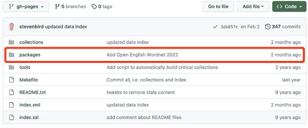
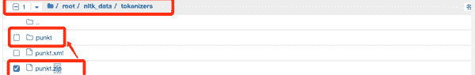
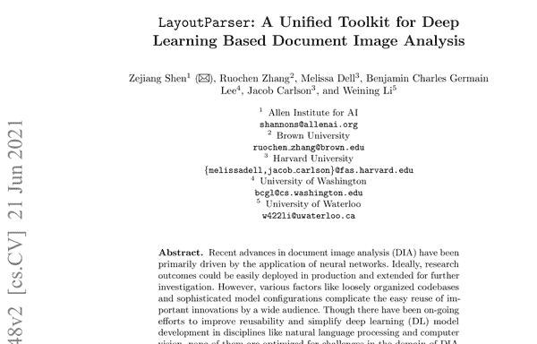

# LangChain:万能的非结构化文档载入详解（一）

> 来源：[https://agijuejin.feishu.cn/docx/S49qdB1JwoTMctxQiXDcJ82Bnfb](https://agijuejin.feishu.cn/docx/S49qdB1JwoTMctxQiXDcJ82Bnfb)

> 作者：悟乙己

> 原文：[https://zhuanlan.z](https://zhuanlan.zhihu.com/p/624812261)hihu.com/p/624812...

chatpdf等开源项目需要有非结构化文档载入，这边来看一下langchain自带的模块

[Unstructured File Loader  python.langchain.com/en/latest/modu](https://link.zhihu.com/?target=https%3A//python.langchain.com/en/latest/modules/indexes/document_loaders/examples/unstructured_file.html)les/indexes/document_loaders/examples/unstructured_file.html

## 1 最头疼的依赖安装

如果要使用需要安装：

```
# # Install package
!pip install &quot;unstructured[local-inference]&quot;
!pip install &quot;detectron2@git+https://github.com/facebookresearch/detectron2.git@v0.6#egg=detectron2&quot;
!pip install layoutparser[layoutmodels,tesseract]
```

Layout Detection模块主要是对文档图片进行目标检测识别，比如使用Faster R-CNN、Mask R-CNN。LayoutParser是基于Detectron2提供最小的接口,是一个版面分析工具包，它提供了布局检测、OCR识别、布局分析等接口

tesseract也是比较常见的OCR识别库

所以，以上在 **识别PDF **的时候会使用到

不过呢，最烦的是其中会使用nltk

```
# import nltk
# nltk.download(&#x27;punkt&#x27;)
```

笔者就是不能顺利下载，所以只能手动了。。

从

[  ](https://link.zhihu.com/?target=https%3A//github.com/nltk/nltk_data)



下载packages，当然可能连github也不能下载，那就百度云：

```
https://pan.baidu.com/s/1LWM3o7iRZMF8XaD91vx9Dw
cnpf
```

下载之后，需要把【packages】 文件夹名换成 ：【nltk_data】，放在【/root/nltk_data】

然后把【tokenizers】文件夹下的【 punkt.zip 】进行解压，才可能使用



## 2 TXT文档载入

[  ](https://link.zhihu.com/?target=https%3A//python.langchain.com/en/latest/modules/indexes/document_loaders/examples/unstructured_file.html)

```
from langchain.document_loaders import UnstructuredFileLoader
loader = UnstructuredFileLoader(&quot;./example_data/state_of_the_union.txt&quot;)
docs = loader.load()
docs[0].page_content[:400]Unstructured File Loaderfrom langchain.document_loaders import UnstructuredFileLoader
loader = UnstructuredFileLoader(&quot;./example_data/state_of_the_union.txt&quot;)
docs = loader.load()
docs[0].page_content[:400]Unstructured File Loaderfrom langchain.document_loaders import UnstructuredFileLoader
loader = UnstructuredFileLoader(&quot;./example_data/state_of_the_union.txt&quot;)
docs = loader.load()
docs[0].page_content[:400]Unstructured File Loaderfrom langchain.document_loaders import UnstructuredFileLoader
loader = UnstructuredFileLoader(&quot;./example_data/state_of_the_union.txt&quot;)
docs = loader.load()
docs[0].page_content[:400]
```

按分段读入txt数据

## 3 识别PDF

PDF文件就需要OCR的技术

### 3.1 unstructured 库

就是之前提到的：

```
# # Install package
!pip install &quot;unstructured[local-inference]&quot;
!pip install &quot;detectron2@git+https://github.com/facebookresearch/detectron2.git@v0.6#egg=detectron2&quot;
!pip install layoutparser[layoutmodels,tesseract]
```

参考：

[  ](https://link.zhihu.com/?target=https%3A//python.langchain.com/en/latest/modules/indexes/document_loaders/examples/unstructured_file.html)

```
!wget  https://raw.githubusercontent.com/Unstructured-IO/unstructured/main/example-docs/layout-parser-paper.pdf -P &quot;../../&quot;
loader = UnstructuredFileLoader(&quot;./example_data/layout-parser-paper.pdf&quot;, mode=&quot;elements&quot;)
docs = loader.load()
docs[:5]
```

原文是一个论文



后面识别出来是一个文档：

```
[Document(page_content=&#x27;LayoutParser : A Unified Toolkit for Deep Learning Based Document Image Analysis&#x27;, lookup_str=&#x27;&#x27;, metadata={&#x27;source&#x27;: &#x27;../../layout-parser-paper.pdf&#x27;}, lookup_index=0),
 Document(page_content=&#x27;Zejiang Shen 1 ( (ea)\n ), Ruochen Zhang 2 , Melissa Dell 3 , Benjamin Charles Germain Lee 4 , Jacob Carlson 3 , and Weining Li 5&#x27;, lookup_str=&#x27;&#x27;, metadata={&#x27;source&#x27;: &#x27;../../layout-parser-paper.pdf&#x27;}, lookup_index=0),
 Document(page_content=&#x27;Allen Institute for AI shannons@allenai.org&#x27;, lookup_str=&#x27;&#x27;, metadata={&#x27;source&#x27;: &#x27;../../layout-parser-paper.pdf&#x27;}, lookup_index=0),
 Document(page_content=&#x27;Brown University ruochen zhang@brown.edu&#x27;, lookup_str=&#x27;&#x27;, metadata={&#x27;source&#x27;: &#x27;../../layout-parser-paper.pdf&#x27;}, lookup_index=0),
 Document(page_content=&#x27;Harvard University { melissadell,jacob carlson } @fas.harvard.edu&#x27;, lookup_str=&#x27;&#x27;, metadata={&#x27;source&#x27;: &#x27;../../layout-parser-paper.pdf&#x27;}, lookup_index=0)]
```

### 3.2 PyPDF package

需要安装：

```
pip install pypdf
```

需要安装，然后使用方式：

```
from langchain.document_loaders import PyPDFLoader

loader = PyPDFLoader(&quot;example_data/layout-parser-paper.pdf&quot;)
pages = loader.load_and_split()
```

这种方法的一个优点是可以使用页码检索文档：

```
from langchain.vectorstores import FAISS
from langchain.embeddings.openai import OpenAIEmbeddings

faiss_index = FAISS.from_documents(pages, OpenAIEmbeddings())
docs = faiss_index.similarity_search(&quot;How will the community be engaged?&quot;, k=2)
for doc in docs:
    print(str(doc.metadata[&quot;page&quot;]) + &quot;:&quot;, doc.page_content)
```

### 3.3 在线读取PDF：OnlinePDFLoader

```
from langchain.document_loaders import OnlinePDFLoader
loader = OnlinePDFLoader(&quot;https://arxiv.org/pdf/2302.03803.pdf&quot;)
data = loader.load()
print(data)
```

### 3.4 PDFMiner 通过BeautifulSoup解析成HTML

PDFMiner的方式

```
from langchain.document_loaders import PDFMinerLoader
loader = PDFMinerLoader(&quot;example_data/layout-parser-paper.pdf&quot;)
data = loader.load()
```

由于输出的html内容可以通过BeautifulSoup进行解析，从而获得有关字体大小、页码、pdf页眉/页脚等更结构化和丰富的信息，因此这有助于将文本在语义上划分为几个部分。

```
from langchain.document_loaders import PDFMinerPDFasHTMLLoader
loader = PDFMinerPDFasHTMLLoader(&quot;example_data/layout-parser-paper.pdf&quot;)
data = loader.load()[0]   # entire pdf is loaded as a single Document

#
from bs4 import BeautifulSoup
soup = BeautifulSoup(data.page_content,&#x27;html.parser&#x27;)
content = soup.find_all(&#x27;div&#x27;)

import re
cur_fs = None
cur_text = &#x27;&#x27;
snippets = []   # first collect all snippets that have the same font size
for c in content:
    sp = c.find(&#x27;span&#x27;)
    if not sp:
        continue
    st = sp.get(&#x27;style&#x27;)
    if not st:
        continue
    fs = re.findall(&#x27;font-size:(\d+)px&#x27;,st)
    if not fs:
        continue
    fs = int(fs[0])
    if not cur_fs:
        cur_fs = fs
    if fs == cur_fs:
        cur_text += c.text
    else:
        snippets.append((cur_text,cur_fs))
        cur_fs = fs
        cur_text = c.text
snippets.append((cur_text,cur_fs))

from langchain.docstore.document import Document
cur_idx = -1
semantic_snippets = []
# Assumption: headings have higher font size than their respective content
for s in snippets:
    # if current snippet&#x27;s font size &gt; previous section&#x27;s heading =&gt; it is a new heading
    if not semantic_snippets or s[1] &gt; semantic_snippets[cur_idx].metadata[&#x27;heading_font&#x27;]:
        metadata={&#x27;heading&#x27;:s[0], &#x27;content_font&#x27;: 0, &#x27;heading_font&#x27;: s[1]}
        metadata.update(data.metadata)
        semantic_snippets.append(Document(page_content=&#x27;&#x27;,metadata=metadata))
        cur_idx += 1
        continue
    
    # if current snippet&#x27;s font size &lt;= previous section&#x27;s content =&gt; content belongs to the same section (one can also create
    # a tree like structure for sub sections if needed but that may require some more thinking and may be data specific)
    if not semantic_snippets[cur_idx].metadata[&#x27;content_font&#x27;] or s[1] &lt;= semantic_snippets[cur_idx].metadata[&#x27;content_font&#x27;]:
        semantic_snippets[cur_idx].page_content += s[0]
        semantic_snippets[cur_idx].metadata[&#x27;content_font&#x27;] = max(s[1], semantic_snippets[cur_idx].metadata[&#x27;content_font&#x27;])
        continue
    
    # if current snippet&#x27;s font size &gt; previous section&#x27;s content but less tha previous section&#x27;s heading than also make a new 
    # section (e.g. title of a pdf will have the highest font size but we don&#x27;t want it to subsume all sections)
    metadata={&#x27;heading&#x27;:s[0], &#x27;content_font&#x27;: 0, &#x27;heading_font&#x27;: s[1]}
    metadata.update(data.metadata)
    semantic_snippets.append(Document(page_content=&#x27;&#x27;,metadata=metadata))
    cur_idx += 1
```

## 4 读入word docx

[  ](https://link.zhihu.com/?target=https%3A//python.langchain.com/en/latest/modules/indexes/document_loaders/examples/word_document.html)

```
from langchain.document_loaders import UnstructuredWordDocumentLoader
loader = UnstructuredWordDocumentLoader(&quot;example_data/fake.docx&quot;)
data = loader.load()
data   LangChain 0.0.148from langchain.document_loaders import UnstructuredWordDocumentLoader
loader = UnstructuredWordDocumentLoader(&quot;example_data/fake.docx&quot;)
data = loader.load()
data
```

## 5 有意思的Bilibili API

[  ](https://link.zhihu.com/?target=https%3A//python.langchain.com/en/latest/modules/indexes/document_loaders/examples/bilibili.html)

使用bilibili-api获取视频文本信息:

```
from langchain.document_loaders.bilibili import BiliBiliLoader
#!pip install bilibili-api
loader = BiliBiliLoader(
    [&quot;https://www.bilibili.com/video/BV1xt411o7Xu/&quot;]
)
loader.load()
```

## 6 直接读取邮件Email

第一种方式：

[  ](https://link.zhihu.com/?target=https%3A//python.langchain.com/en/latest/modules/indexes/document_loaders/examples/email.html)

```
from langchain.document_loaders import UnstructuredEmailLoader
loader = UnstructuredEmailLoader(&#x27;example_data/fake-email.eml&#x27;)
data = loader.load()
```

第二种方式：

```
from langchain.document_loaders import OutlookMessageLoader
loader = OutlookMessageLoader(&#x27;example_data/fake-email.msg&#x27;)
data = loader.load()
```

输出：

```
Document(page_content=&#x27;This is a test email to experiment with the MS Outlook MSG Extractor\r\n\r\n\r\n-- \r\n\r\n\r\nKind regards\r\n\r\n\r\n\r\n\r\nBrian Zhou\r\n\r\n&#x27;, metadata={&#x27;subject&#x27;: &#x27;Test for TIF files&#x27;, &#x27;sender&#x27;: &#x27;Brian Zhou &lt;brizhou@gmail.com&gt;&#x27;, &#x27;date&#x27;: &#x27;Mon, 18 Nov 2013 16:26:24 +0800&#x27;})
```

## 7 神奇-印象笔记的格式

[  ](https://link.zhihu.com/?target=https%3A//python.langchain.com/en/latest/modules/indexes/document_loaders/examples/evernote.html)

```
# !pip install pypandoc
# import pypandoc

# pypandoc.download_pandoc()

from langchain.document_loaders import EverNoteLoader

loader = EverNoteLoader(&quot;example_data/testing.enex&quot;)
loader.load()
```

输出内容：

```
[Document(page_content=&#x27;testing this\n\nwhat happens?\n\nto the world?\n&#x27;, lookup_str=&#x27;&#x27;, metadata={&#x27;source&#x27;: &#x27;example_data/testing.enex&#x27;}, lookup_index=0)]
```

## 8 GitBook

[  ](https://link.zhihu.com/?target=https%3A//python.langchain.com/en/latest/modules/indexes/document_loaders/examples/gitbook.html)

GITBOOK也是可以输入：

```
from langchain.document_loaders import GitbookLoader
loader = GitbookLoader(&quot;https://docs.gitbook.com&quot;)
page_data = loader.load()
page_data
```

输出：

```
[Document(page_content=&#x27;Introduction to GitBook\nGitBook is a modern documentation platform where teams can document everything from products to internal knowledge bases and APIs.\nWe want to help \nteams to work more efficiently\n by creating a simple yet powerful platform for them to \nshare their knowledge\n.\nOur mission is to make a \nuser-friendly\n and \ncollaborative\n product for everyone to create, edit and share knowledge through documentation.\nPublish your documentation in 5 easy steps\nImport\n\nMove your existing content to GitBook with ease.\nGit Sync\n\nBenefit from our bi-directional synchronisation with GitHub and GitLab.\nOrganise your content\n\nCreate pages and spaces and organize them into collections\nCollaborate\n\nInvite other users and collaborate asynchronously with ease.\nPublish your docs\n\nShare your documentation with selected users or with everyone.\nNext\n - Getting started\nOverview\nLast modified \n3mo ago&#x27;, lookup_str=&#x27;&#x27;, metadata={&#x27;source&#x27;: &#x27;https://docs.gitbook.com&#x27;, &#x27;title&#x27;: &#x27;Introduction to GitBook&#x27;}, lookup_index=0)]
```

## 9 图片加载

[  ](https://link.zhihu.com/?target=https%3A//python.langchain.com/en/latest/modules/indexes/document_loaders/examples/image.html)

这涵盖了如何将jpg png等图片加载为我们可以在下游使用的文档格式。 LangChain 0.0.148 这涵盖了如何将jpg png等图片加载为我们可以在下游使用的文档格式。

主要是图片的OCR文字识别

```
from langchain.document_loaders.image import UnstructuredImageLoader
loader = UnstructuredImageLoader(&quot;layout-parser-paper-fast.jpg&quot;)
data = loader.load()
```

图片输出示例：

```
Document(page_content=&quot;LayoutParser: A Unified Toolkit for Deep\nLearning Based Document Image Analysis\n\n\n‘Zxjiang Shen&#x27; (F3}, Ruochen Zhang”, Melissa Dell*, Benjamin Charles Germain\nLeet, Jacob Carlson, and Weining LiF\n\n\nsugehen\n\nshangthrows, et\n\n“Abstract. Recent advanocs in document image analysis (DIA) have been\n‘pimarliy driven bythe application of neural networks dell roar\n{uteomer could be aly deployed in production and extended fo farther\n[nvetigtion. However, various factory ke lcely organize codebanee\nsnd sophisticated modal cnigurations compat the ey ree of\n‘erin! innovation by wide sence, Though there have been sng\n‘Hors to improve reuablty and simplify deep lees (DL) mode\n‘aon, sone of them ae optimized for challenge inthe demain of DIA,\nThis roprscte a major gap in the extng fol, sw DIA i eal to\nscademic research acon wie range of dpi in the social ssencee\n[rary for streamlining the sage of DL in DIA research and appicn\n‘tons The core LayoutFaraer brary comes with a sch of simple and\nIntative interfaee or applying and eutomiing DI. odel fr Inyo de\npltfom for sharing both protrined modes an fal document dist\n{ation pipeline We demonutate that LayootPareer shea fr both\nlightweight and lrgeseledgtieation pipelines in eal-word uae ces\nThe leary pblely smal at Btspe://layost-pareergsthab So\n\n\n\n‘Keywords: Document Image Analysis» Deep Learning Layout Analysis\n‘Character Renguition - Open Serres dary « Tol\n\n\nIntroduction\n\n\n‘Deep Learning(DL)-based approaches are the state-of-the-art for a wide range of\ndoctiment image analysis (DIA) tea including document image clasiffeation [I]\n&quot;, lookup_str=&#x27;&#x27;, metadata={&#x27;source&#x27;: &#x27;layout-parser-paper-fast.jpg&#x27;}, lookup_index=0)
```

## 10 Markdown

[  ](https://link.zhihu.com/?target=https%3A//python.langchain.com/en/latest/modules/indexes/document_loaders/examples/markdown.html)

```
from langchain.document_loaders import UnstructuredMarkdownLoader
loader = UnstructuredMarkdownLoader(&quot;../../../../README.md&quot;)
data = loader.load()
```

20231230更新：

补充一下，刚好把我之前写的代码当做反面教材，如果按照我之前代码的跑的话，markdown格式中的 ## 就会被忽略，

```
from langchain.document_loaders import UnstructuredMarkdownLoader
loader = UnstructuredMarkdownLoader(&quot;../../../../README.md&quot;)
data = loader.load()
&gt;&gt;&gt; 特色功能 ABC


# 正确的：
loader = document_loaders.UnstructuredFileLoader(filepath,mode=&quot;elements&quot;,autodetect_encoding=True)
docs = loader.load()
&gt;&gt;&gt; 特色功能 ABC
```

需要加上 mode

具体参考： [l](https://link.zhihu.com/?target=https%3A//api.python.langchain.com/en/v0.0.341/_modules/langchain/document_loaders/markdown.html%23)angchain.document_loaders.markdown - LangChain 0.0.341

这里我们区别一下 TextLoader

```
from langchain.document_loaders import TextLoader
from langchain.text_splitter import MarkdownHeaderTextSplitter

md_loader = TextLoader(filepath, encoding=&#x27;utf8&#x27;)
md_doc = md_loader.load()
&gt;&gt;&gt; ### 特色功能 ABC
```

是把md里面所有问题，带# 符号的都加载进来，然后后续进行分块。

另外

MarkdownHeaderTextSplitter 还有一个额外的参数 strip_headers = False (20240106补充，strip_headers过期了，需要设置：return_each_line = True)

```
markdown_splitter = MarkdownHeaderTextSplitter(
    headers_to_split_on=headers_to_split_on, strip_headers=False
)
md_header_splits = markdown_splitter.split_text(markdown_document)
md_header_splits

&gt;&gt;&gt;
[Document(page_content=&#x27;# Foo  \n## Bar  \nHi this is Jim  \nHi this is Joe&#x27;, metadata={&#x27;Header 1&#x27;: &#x27;Foo&#x27;, &#x27;Header 2&#x27;: &#x27;Bar&#x27;}),
 Document(page_content=&#x27;### Boo  \nHi this is Lance&#x27;, metadata={&#x27;Header 1&#x27;: &#x27;Foo&#x27;, &#x27;Header 2&#x27;: &#x27;Bar&#x27;, &#x27;Header 3&#x27;: &#x27;Boo&#x27;}),
 Document(page_content=&#x27;## Baz  \nHi this is Molly&#x27;, metadata={&#x27;Header 1&#x27;: &#x27;Foo&#x27;, &#x27;Header 2&#x27;: &#x27;Baz&#x27;})]
```

因为MarkdownHeaderTextSplitter 默认是把标题从正文中进行删除，放在metadata当中，

如果要恢复，需要设置该参数。

## 11 PowerPoint 幻灯片载入

[  ](https://link.zhihu.com/?target=https%3A//python.langchain.com/en/latest/modules/indexes/document_loaders/examples/powerpoint.html)

```
from langchain.document_loaders import UnstructuredPowerPointLoader
loader = UnstructuredPowerPointLoader(&quot;example_data/fake-power-point.pptx&quot;)
data = loader.load()
```

导出：

```
[Document(page_content=&#x27;Adding a Bullet Slide\n\nFind the bullet slide layout\n\nUse _TextFrame.text for first bullet\n\nUse _TextFrame.add_paragraph() for subsequent bullets\n\nHere is a lot of text!\n\nHere is some text in a text box!&#x27;, lookup_str=&#x27;&#x27;, metadata={&#x27;source&#x27;: &#x27;example_data/fake-power-point.pptx&#x27;}, lookup_index=0)]
```