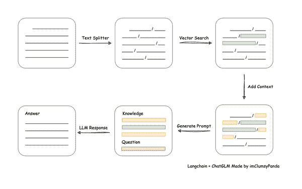
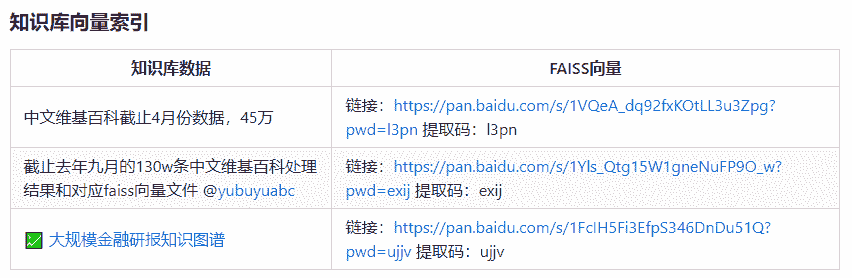

# LangChain:通过LLM实现QA问答中的一些细节笔记（二）

> 来源：[https://agijuejin.feishu.cn/docx/C3ardRKq7omDdax5wfyci5Ntnsg](https://agijuejin.feishu.cn/docx/C3ardRKq7omDdax5wfyci5Ntnsg)

> 作者：悟乙己

> 原文：[https://zhuanlan.z](https://zhuanlan.zhihu.com/p/627439522)hihu.com/p/627439...

上一篇【 悟乙己：LangChain:万能的非结构化文档载入详解（一） 】有说LangChain中非结构数据的导入，本篇从拆解两个开源项目入手：

+   [Git](https://link.zhihu.com/?target=https%3A//github.com/imClumsyPanda/langchain-ChatGLM/tree/master)Hub - imClumsyPanda/langchain-ChatGLM: langchain-ChatGLM, local knowledge based ChatGLM with langchain ｜ 基于本地知识的 ChatGLM 问答

+   [GitHub - yanqiangmiffy/Chinese-LangChai](https://link.zhihu.com/?target=https%3A//github.com/yanqiangmiffy/Chinese-LangChain)n: 中文langchain项目|小必应，Q.Talk，强聊，QiangTalk

简单看看通过LLM实现文档QA问答中的一些细节。



借一张图来说，本篇可能会简单看一下几个问题：

+   向量化：HuggingFaceEmbeddings

+   向量化存储+存储+查找：通过FAISS进行

+   LLM模型对文章进行汇总并给出最终Answer：ChatGLM

## 1 向量化：HuggingFaceEmbeddings

两个开源项目 Chinese-LangChain 和 langchain-ChatGLM 互相借鉴，都是使用HuggingFaceEmbeddings

我拆解出来：

```
# Embedding running device
EMBEDDING_DEVICE = &quot;cuda&quot; if torch.cuda.is_available() else &quot;mps&quot; if torch.backends.mps.is_available() else &quot;cpu&quot;

# 
embeddings = HuggingFaceEmbeddings(model_name=embedding_model_dict[embedding_model],
                                                model_kwargs={&#x27;device&#x27;: embedding_device})
```

langchain-ChatGLM 中可以使用GPU，进行加速

## 2 向量化存储+查找：通过FAISS进行

这个模块需要实现几个功能：

+   向量化存储与批量载入

+   向量化查询与返回topK

这里拆解 Chinese-LangChain 中的source_service.py：

文章变成embedding过程非常丝滑（初始化，init_source_vector）：

```
embeddings = HuggingFaceEmbeddings(model_name=self.config.embedding_model_name)
vector_store = FAISS.from_documents(docs, self.embeddings)
```

新增单个文档（add_document）：

```
vector_store.add_documents(doc)
vector_store.save_local(self.vector_store_path) # 在保存一下就可以了
```

批量直接导入embedding（函数：load_vector_store）：

```
FAISS.load_local(self.vector_store_path, self.embeddings)
```

从 langchain-ChatGLM 拆解如何对FAISS进行query向量相似性查询：

```
query = &quot;本项目使用的embedding模型是什么，消耗多少显存&quot;
related_docs_with_score = vector_store.similarity_search_with_score(query,
                                                                            k=self.top_k)
```

## 3 LLM模型给出最终Answer：ChatGLM

这里两个项目差别蛮大，其中， Chinese-LangChain 利用的是 RetrievalQA

```
from langchain.chains import RetrievalQA


def get_knowledge_based_answer(self, query,
                               history_len=5,
                               temperature=0.1,
                               top_p=0.9,
                               top_k=4,
                               web_content=&#x27;&#x27;,
                               chat_history=[]):
    if web_content:
        prompt_template = f&quot;&quot;&quot;基于以下已知信息，简洁和专业的来回答用户的问题。
                            如果无法从中得到答案，请说 &quot;根据已知信息无法回答该问题&quot; 或 &quot;没有提供足够的相关信息&quot;，不允许在答案中添加编造成分，答案请使用中文。
                            已知网络检索内容：{web_content}&quot;&quot;&quot; + &quot;&quot;&quot;
                            已知内容:
                            {context}
                            问题:
                            {question}&quot;&quot;&quot;
    else:
        prompt_template = &quot;&quot;&quot;基于以下已知信息，简洁和专业的来回答用户的问题。
                                        如果无法从中得到答案，请说 &quot;根据已知信息无法回答该问题&quot; 或 &quot;没有提供足够的相关信息&quot;，不允许在答案中添加编造成分，答案请使用中文。
                                        已知内容:
                                        {context}
                                        问题:
                                        {question}&quot;&quot;&quot;
    prompt = PromptTemplate(template=prompt_template,
                            input_variables=[&quot;context&quot;, &quot;question&quot;])
    self.llm_service.history = chat_history[-history_len:] if history_len &gt; 0 else []

    self.llm_service.temperature = temperature
    self.llm_service.top_p = top_p

    knowledge_chain = RetrievalQA.from_llm(
        llm=self.llm_service,
        retriever=self.source_service.vector_store.as_retriever(
            search_kwargs={&quot;k&quot;: top_k}),
        prompt=prompt)
    knowledge_chain.combine_documents_chain.document_prompt = PromptTemplate(
        input_variables=[&quot;page_content&quot;], template=&quot;{page_content}&quot;)

    knowledge_chain.return_source_documents = True

    result = knowledge_chain({&quot;query&quot;: query})
    return result
```

其中 RetrievalQA 貌似存在之前的langchain版本，笔者测试的是 0.0146 版本；现在的 0.0.27 是没有这个函数的，该函数把faiss的相似性涵盖在其中

```
RetrievalQA(
    *,
    memory: Optional[langchain.schema.BaseMemory] = None,
    callback_manager: langchain.callbacks.base.BaseCallbackManager = None,
    verbose: bool = None,
    combine_documents_chain: langchain.chains.combine_documents.base.BaseCombineDocumentsChain,
    input_key: str = &#x27;query&#x27;,
    output_key: str = &#x27;result&#x27;,
    return_source_documents: bool = False,
    retriever: langchain.schema.BaseRetriever,
) -&gt; None
Source:        
class RetrievalQA(BaseRetrievalQA):
    &quot;&quot;&quot;Chain for question-answering against an index.

    Example:
        .. code-block:: python

            from langchain.llms import OpenAI
            from langchain.chains import RetrievalQA
            from langchain.faiss import FAISS
            from langchain.vectorstores.base import VectorStoreRetriever
            retriever = VectorStoreRetriever(vectorstore=FAISS(...))
            retrievalQA = RetrievalQA.from_llm(llm=OpenAI(), retriever=retriever)

    &quot;&quot;&quot;

    retriever: BaseRetriever = Field(exclude=True)

    def _get_docs(self, question: str) -&gt; List[Document]:
        return self.retriever.get_relevant_documents(question)
```

但是从上述代码，可以看到 Chinese-LangChain 是没有history的，所以是单轮对话

langchain-ChatGLM 使用的是最新的langchain，而且可以实现多轮对话：

```
def get_docs_with_score(docs_with_score):
    docs = []
    for doc, score in docs_with_score:
        doc.metadata[&quot;score&quot;] = score
        docs.append(doc)
    return docs

def get_knowledge_based_answer(self,
                               query,
                               vs_path,
                               chat_history=[],
                               streaming: bool = STREAMING):
    # 模型载入
    vector_store = FAISS.load_local(vs_path, self.embeddings)
    FAISS.similarity_search_with_score_by_vector = similarity_search_with_score_by_vector
    vector_store.chunk_size = self.chunk_size
    # 利用faiss求相似
    related_docs_with_score = vector_store.similarity_search_with_score(query,
                                                                        k=self.top_k)
    # 单独抽取出文档
    related_docs = get_docs_with_score(related_docs_with_score)
    torch_gc()
    
    # 形成模板prompt
    prompt = generate_prompt(related_docs, query)

    # if streaming:
    #     for result, history in self.llm._stream_call(prompt=prompt,
    #                                                  history=chat_history):
    #         history[-1][0] = query
    #         response = {&quot;query&quot;: query,
    #                     &quot;result&quot;: result,
    #                     &quot;source_documents&quot;: related_docs}
    #         yield response, history
    # else:
        
    # 基于历史对话
    for result, history in self.llm._call(prompt=prompt,
                                          history=chat_history,
                                          streaming=streaming):
        torch_gc()
        history[-1][0] = query
        response = {&quot;query&quot;: query,
                    &quot;result&quot;: result,
                    &quot;source_documents&quot;: related_docs}
        yield response, history
        torch_gc()
```

其中重定义 FAISS.similarity_search_with_score_by_vector [= similarity_sea](https://link.zhihu.com/?target=https%3A//github.com/hwchase17/langchain/issues/3147)rch_with_score_by_vector 可能因为之前的会出现问题，见issue( FAISS similarity search issue #3147 )

## 4 读issue-有意思

### 4.1 内存溢出问题

如issue#229( [h](https://link.zhihu.com/?target=https%3A//github.com/imClumsyPanda/langchain-ChatGLM/issues/229)ttps:// github.com/imClumsyPand a/langchain-ChatGLM/issues/229  )

```
复现问题的步骤 / Steps to Reproduce

在原来的镜像中clone最新代码
python webui.py
打开页面，加载11kb的知识库
询问问题，大约3个问题后，内存溢出
预期的结果 / Expected Result
预期应该可以正常回答

实际结果 / Actual Result
实际发生的结果
torch.cuda.OutOfMemoryError: CUDA out of memory. Tried to allocate 1.12 GiB (GPU 0; 23.70 GiB total capacity; 20.99 GiB already allocated; 602.56 MiB free; 22.12 GiB reserved in total by PyTorch) If reserved memory is &gt;&gt; allocated memory try setting max_split_size_mb to avoid fragmentation. See documentation for Memory Management and PYTORCH_CUDA_ALLOC_CONF
```

可能受限chatglm，自然会占内存，貌似只能：

+   剪枝prompt / 控制token

+   加显存

### 4.2 超大容量文件处理

读这个issus: 本地txt文件有500M，加载的时候很慢，如何提高速度？ #251

大文件个人感觉还是要离线embedding好，然后再载入，这里可以参考： Chinese-LangChain

知识库向量索引:



| 知识库数据 | FAISS向量 |
| --- | --- |
| 中文维基百科截止4月份数据，45万 | 链接： [h](https://link.zhihu.com/?target=https%3A//pan.baidu.com/s/1VQeA_dq92fxKOtLL3u3Zpg%3Fpwd%3Dl3pn)ttps:// pan.baidu.com/s/1VQeA_d q92fxKOtLL3u3Zpg?pwd=l3pn  提取码：l3pn |
| 截止去年九月的130w条中文维基百科处理结果和对应faiss向量文件 @yubuyuabc | 链接： [h](https://link.zhihu.com/?target=https%3A//pan.baidu.com/s/1Yls_Qtg15W1gneNuFP9O_w%3Fpwd%3Dexij)ttps:// pan.baidu.com/s/1Yls_Qt g15W1gneNuFP9O_w?pwd=exij  提取码：exij |
| 大规模金融研报知识图谱 | 链接： [h](https://link.zhihu.com/?target=https%3A//pan.baidu.com/s/1FcIH5Fi3EfpS346DnDu51Q%3Fpwd%3Dujjv)ttps:// pan.baidu.com/s/1FcIH5F i3EfpS346DnDu51Q?pwd=ujjv  提取码：ujjv |