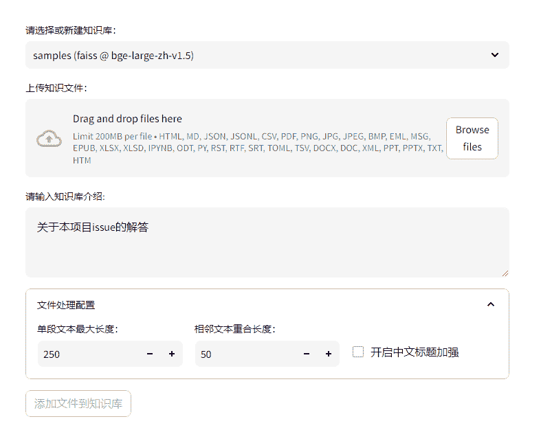
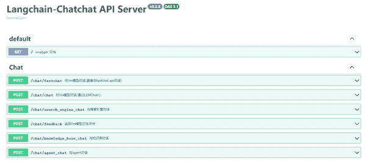

# Langchain-Chatchat开源库使用的随笔记（一）

> 来源：[https://agijuejin.feishu.cn/docx/RFmVdw03EoBTWJxglMVcTMRkn4b](https://agijuejin.feishu.cn/docx/RFmVdw03EoBTWJxglMVcTMRkn4b)

> 作者：悟乙己

> 原文链接： [https://zhuanlan.z](https://zhuanlan.zhihu.com/p/676061269)hihu.com/p/676061...

笔者最近在研究Langchain-Chatchat，所以本篇作为随笔记进行记录。

最近核心探索的是知识库的使用，其中关于文档如何进行分块的详细，可以参考笔者的另几篇文章：

大模型RAG 场景、数据、应用难点与解决（四）

RAG 分块Chunk技术优劣、技巧、方法汇总（五）

原项目地址：

+   Langchain-Chatchat

+   [WIKI教程（有点简单）](https://link.zhihu.com/?target=https%3A//github.com/chatchat-space/Langchain-Chatchat/wiki/)



---

## 1 Chatchat项目结构

整个结构是 server 启动API，然后项目内自行调用API。

API详情可见： http://xxx:7861/docs ，整个代码架构还是蛮适合深入学习



---

## 2 Chatchat一些代码学习

### 2.1 12个分块函数统一使用

截止 20231231 笔者看到chatchat一共有12个分chunk的函数 这12个函数如何使用、大致点评可以参考笔者的另外文章（ RAG 分块Chunk技术优劣、技巧、方法汇总（五） ）：

```
CharacterTextSplitter
LatexTextSplitter
MarkdownHeaderTextSplitter
MarkdownTextSplitter
NLTKTextSplitter
PythonCodeTextSplitter
RecursiveCharacterTextSplitter
SentenceTransformersTokenTextSplitter
SpacyTextSplitter

AliTextSplitter
ChineseRecursiveTextSplitter
ChineseTextSplitter
```

借用chatchat项目中的 test/custom_splitter/test_different_splitter.py 来看看一起调用 make_text_splitter 函数：

```
from langchain import document_loaders
from server.knowledge_base.utils import make_text_splitter

# 使用DocumentLoader读取文件
filepath = &quot;knowledge_base/samples/content/test_files/test.txt&quot;
loader = document_loaders.UnstructuredFileLoader(filepath, autodetect_encoding=True)
docs = loader.load()

CHUNK_SIZE = 250
OVERLAP_SIZE = 50

splitter_name = &#x27;AliTextSplitter&#x27;
text_splitter = make_text_splitter(splitter_name, CHUNK_SIZE, OVERLAP_SIZE)
if splitter_name == &quot;MarkdownHeaderTextSplitter&quot;:
    docs = text_splitter.split_text(docs[0].page_content)
    for doc in docs:
        if doc.metadata:
            doc.metadata[&quot;source&quot;] = os.path.basename(filepath)
else:
    docs = text_splitter.split_documents(docs)
for doc in docs:
    print(doc)
```

### 2.2 知识库问答Chat的使用

本节参考chatchat开源项目的 tests\api\test_stream_chat_api_thread.py 以及 tests\api\test_stream_chat_api.py 来探索一下知识库问答调用，包括：

+   流式调用

+   单次调用

+   多线程并发调用

### 2.2.1 流式调用

```
import requests
import json
import sys

api_base_url = &#x27;http://0.0.0.0:7861&#x27;

api=&quot;/chat/knowledge_base_chat&quot;
url = f&quot;{api_base_url}{api}&quot;


headers = {
    &#x27;accept&#x27;: &#x27;application/json&#x27;,
    &#x27;Content-Type&#x27;: &#x27;application/json&#x27;,
}


data = {
    &quot;query&quot;: &quot;如何提问以获得高质量答案&quot;,
    &quot;knowledge_base_name&quot;: &quot;ZWY_V2_m3e-large&quot;,
    &quot;history&quot;: [
        {
            &quot;role&quot;: &quot;user&quot;,
            &quot;content&quot;: &quot;你好&quot;
        },
        {
            &quot;role&quot;: &quot;assistant&quot;,
            &quot;content&quot;: &quot;你好，我是 ChatGLM&quot;
        }
    ],
    &quot;stream&quot;: True
}
# dump_input(data, api)
response = requests.post(url, headers=headers, json=data, stream=True)
print(&quot;\n&quot;)
print(&quot;=&quot; * 30 + api + &quot;  output&quot; + &quot;=&quot;*30)
for line in response.iter_content(None, decode_unicode=True):
    data = json.loads(line)
    if &quot;answer&quot; in data:
        print(data[&quot;answer&quot;], end=&quot;&quot;, flush=True)
pprint(data)
assert &quot;docs&quot; in data and len(data[&quot;docs&quot;]) &gt; 0
assert response.status_code == 200

&gt;&gt;&gt;==============================/chat/knowledge_base_chat  output==============================
 你好！提问以获得高质量答案，以下是一些建议：

1. 尽可能清晰明确地表达问题：确保你的问题表述清晰、简洁、明确，以便我能够准确理解你的问题并给出恰当的回答。
2. 提供足够的上下文信息：提供相关的背景信息和上下文，以便我能够更好地理解你的问题，并给出更准确的回答。
3. 使用简洁的语言：尽量使用简单、明了的语言，以便我能够快速理解你的问题。
4. 避免使用缩写和俚语：避免使用缩写和俚语，以便我能够准确理解你的问题。
5. 分步提问：如果问题比较复杂，可以分步提问，这样我可以逐步帮助你解决问题。
6. 检查你的问题：在提问之前，请检查你的问题是否完整、清晰且准确。
7. 提供反馈：如果你对我的回答不满意，请提供反馈，以便我改进我的回答。

希望这些建议能帮助你更好地提问，获得高质量的答案。
```

结构也比较简单，call 知识库问答的URL，然后返回，通过 response.iter_content 来进行流式反馈。

### 2.2.2 正常调用以及处理并发

```
import requests
import json
import sys

api_base_url = &#x27;http://0.0.0.0:7861&#x27;

api=&quot;/chat/knowledge_base_chat&quot;
url = f&quot;{api_base_url}{api}&quot;


headers = {
    &#x27;accept&#x27;: &#x27;application/json&#x27;,
    &#x27;Content-Type&#x27;: &#x27;application/json&#x27;,
}


data = {
    &quot;query&quot;: &quot;如何提问以获得高质量答案&quot;,
    &quot;knowledge_base_name&quot;: &quot;ZWY_V2_m3e-large&quot;,
    &quot;history&quot;: [
        {
            &quot;role&quot;: &quot;user&quot;,
            &quot;content&quot;: &quot;你好&quot;
        },
        {
            &quot;role&quot;: &quot;assistant&quot;,
            &quot;content&quot;: &quot;你好，我是 ChatGLM&quot;
        }
    ],
    &quot;stream&quot;: True
}

# 正常调用并存储结果
result = []
response = requests.post(url, headers=headers, json=data, stream=True)

for line in response.iter_content(None, decode_unicode=True):
    data = json.loads(line)
    result.append(data)

answer = &#x27;&#x27;.join([r[&#x27;answer&#x27;] for r in result[:-1]]) # 正常的结果
&gt;&gt;&gt; &#x27; 你好，很高兴为您提供帮助。以下是一些提问技巧，可以帮助您获得高质量的答案：\n\n1. 尽可能清晰明确地表达问题：确保您的问题准确、简洁、明确，以便我可以更好地理解您的问题并为您提供最佳答案。\n2. 提供足够的上下文信息：提供相关的背景信息和上下文，以便我更好地了解您的问题，并能够更准确地回答您的问题。\n3. 使用简洁的语言：尽量使用简单、明了的语言，以便我能够更好地理解您的问题。\n4. 避免使用缩写和俚语：尽量使用标准语言，以确保我能够正确理解您的问题。\n5. 分步提问：如果您有一个复杂的问题，可以将其拆分成几个简单的子问题，这样我可以更好地回答每个子问题。\n6. 检查您的拼写和语法：拼写错误和语法错误可能会使我难以理解您的问题，因此请检查您的提问，以确保它们是正确的。\n7. 指定问题类型：如果您需要特定类型的答案，请告诉我，例如数字、列表或步骤等。\n\n希望这些技巧能帮助您获得高质量的答案。如果您有其他问题，请随时问我。&#x27;

refer_doc = result[-1] # 参考文献
&gt;&gt;&gt; {&#x27;docs&#x27;: [&quot;&lt;span style=&#x27;color:red&#x27;&gt;未找到相关文档,该回答为大模型自身能力解答！&lt;/span&gt;&quot;]}
```

然后来看一下并发：

```
# 并发调用
def knowledge_chat(api=&quot;/chat/knowledge_base_chat&quot;):
    url = f&quot;{api_base_url}{api}&quot;
    data = {
        &quot;query&quot;: &quot;如何提问以获得高质量答案&quot;,
        &quot;knowledge_base_name&quot;: &quot;samples&quot;,
        &quot;history&quot;: [
            {
                &quot;role&quot;: &quot;user&quot;,
                &quot;content&quot;: &quot;你好&quot;
            },
            {
                &quot;role&quot;: &quot;assistant&quot;,
                &quot;content&quot;: &quot;你好，我是 ChatGLM&quot;
            }
        ],
        &quot;stream&quot;: True
    }
    result = []
    response = requests.post(url, headers=headers, json=data, stream=True)

    for line in response.iter_content(None, decode_unicode=True):
        data = json.loads(line)
        result.append(data)

    return result

from concurrent.futures import ThreadPoolExecutor, as_completed
import time

threads = []
times = []
pool = ThreadPoolExecutor()
start = time.time()
for i in range(10):
    t = pool.submit(knowledge_chat)
    threads.append(t)

for r in as_completed(threads):
    end = time.time()
    times.append(end - start)
    print(&quot;\nResult:\n&quot;)
    pprint(r.result())

print(&quot;\nTime used:\n&quot;)
for x in times:
    print(f&quot;{x}&quot;)
```

通过concurrent的 ThreadPoolExecutor , as_completed 进行反馈。

---

## 3 知识库相关实践问题

### 3.1 .md格式的文件 支持非常差

我们在 configs/kb_config.py 可以看到：

```
# TextSplitter配置项，如果你不明白其中的含义，就不要修改。
text_splitter_dict = {
    &quot;ChineseRecursiveTextSplitter&quot;: {
        &quot;source&quot;: &quot;huggingface&quot;,   # 选择tiktoken则使用openai的方法
        &quot;tokenizer_name_or_path&quot;: &quot;&quot;,
    },
    &quot;SpacyTextSplitter&quot;: {
        &quot;source&quot;: &quot;huggingface&quot;,
        &quot;tokenizer_name_or_path&quot;: &quot;gpt2&quot;,
    },
    &quot;RecursiveCharacterTextSplitter&quot;: {
        &quot;source&quot;: &quot;tiktoken&quot;,
        &quot;tokenizer_name_or_path&quot;: &quot;cl100k_base&quot;,
    },
    &quot;MarkdownHeaderTextSplitter&quot;: {
        &quot;headers_to_split_on&quot;:
            [
                (&quot;#&quot;, &quot;head1&quot;),
                (&quot;##&quot;, &quot;head2&quot;),
                (&quot;###&quot;, &quot;head3&quot;),
                (&quot;####&quot;, &quot;head4&quot;),
            ]
    },
}

# TEXT_SPLITTER 名称
TEXT_SPLITTER_NAME = &quot;ChineseRecursiveTextSplitter&quot;
```

chatchat看上去创建新知识库的时候，仅支持一个知识库一个 TEXT_SPLITTER_NAME 的方法，并不能做到不同的文件，使用不同的切块模型。 所以如果要一个知识库内，不同文件使用不同的切分方式，需要自己改整个结构代码；然后重启项目

同时，chatchat项目对markdown的源文件，支持非常差，我们来看看：

```
from langchain import document_loaders
from server.knowledge_base.utils import make_text_splitter

# 载入
filepath = &quot;matt/智能XXX.md&quot;
loader = document_loaders.UnstructuredFileLoader(filepath,autodetect_encoding=True)
docs = loader.load()

# 切分
splitter_name = &#x27;ChineseRecursiveTextSplitter&#x27;
text_splitter = make_text_splitter(splitter_name, CHUNK_SIZE, OVERLAP_SIZE)
if splitter_name == &quot;MarkdownHeaderTextSplitter&quot;:
    docs = text_splitter.split_text(docs[0].page_content)
    for doc in docs:
        if doc.metadata:
            doc.metadata[&quot;source&quot;] = os.path.basename(filepath)
else:
    docs = text_splitter.split_documents(docs)
for doc in docs:
    print(doc)
```

首先chatchat对.md文件读入使用的是 UnstructuredFileLoader ，

但是没有加 mode="elements" （参考： LangChain:万能的非结构化文档载入详解（一） ）

所以，你可以认为，读入后， # 会出现丢失，于是你即使选择了 MarkdownHeaderTextSplitter ，也还是无法使用。 目前来看，不建议上传 .md 格式的文档，比较好的方法是：

+   - 文件改成 doc，可以带 # / ## / ###

+   - 更改 configs/kb_config.py 当中的 TEXT_SPLITTER_NAME = "MarkdownHeaderTextSplitter"

### 3.2 PDF 文件读入 + MarkdownHeaderTextSplitter 分割的可行性

在chatchat项目中，PDF文件的读入是 RapidOCRPDFLoader

可能需要下载：

```
!pip install pyMuPDF  -i https://pypi.tuna.tsinghua.edu.cn/simple
!pip install rapidocr_onnxruntime  -i https://pypi.tuna.tsinghua.edu.cn/simple
!pip install unstructured==0.11.0  -i https://pypi.tuna.tsinghua.edu.cn/simple
!pip install opencv-python-headless  -i https://pypi.tuna.tsinghua.edu.cn/simple
```

其中，没有 opencv-python-headless ,可能会报错： ImportError: libGL.so.1: cannot open shared object file: No such file or directory

在 document_loaders.mypdfloader

```
from typing import List
from langchain.document_loaders.unstructured import UnstructuredFileLoader
import tqdm


class RapidOCRPDFLoader(UnstructuredFileLoader):
    def _get_elements(self) -&gt; List:
        def pdf2text(filepath):
            import fitz # pyMuPDF里面的fitz包，不要与pip install fitz混淆
            from rapidocr_onnxruntime import RapidOCR
            import numpy as np
            ocr = RapidOCR()
            doc = fitz.open(filepath)
            resp = &quot;&quot;

            b_unit = tqdm.tqdm(total=doc.page_count, desc=&quot;RapidOCRPDFLoader context page index: 0&quot;)
            for i, page in enumerate(doc):

                # 更新描述
                b_unit.set_description(&quot;RapidOCRPDFLoader context page index: {}&quot;.format(i))
                # 立即显示进度条更新结果
                b_unit.refresh()
                # TODO: 依据文本与图片顺序调整处理方式
                text = page.get_text(&quot;&quot;)
                resp += text + &quot;\n&quot;

                img_list = page.get_images()
                for img in img_list:
                    pix = fitz.Pixmap(doc, img[0])
                    img_array = np.frombuffer(pix.samples, dtype=np.uint8).reshape(pix.height, pix.width, -1)
                    result, _ = ocr(img_array)
                    if result:
                        ocr_result = [line[1] for line in result]
                        resp += &quot;\n&quot;.join(ocr_result)

                # 更新进度
                b_unit.update(1)
            return resp

        text = pdf2text(self.file_path)
        from unstructured.partition.text import partition_text
        return partition_text(text=text, **self.unstructured_kwargs)


if __name__ == &quot;__main__&quot;:
    loader = RapidOCRPDFLoader(file_path=&quot;tests/samples/ocr_test.pdf&quot;)
    docs = loader.load()
    print(docs)
```

本节笔者测试的是pdf文档中，带#，是否可以使用 MarkdownHeaderTextSplitter 进行分割。

测试的代码：

```
from langchain import document_loaders
from server.knowledge_base.utils import make_text_splitter
import os

CHUNK_SIZE = 250
OVERLAP_SIZE = 50
filepath = &quot;xxx.pdf&quot;

# 文档读入
loader = RapidOCRPDFLoader(file_path=filepath)
docs = loader.load()


import langchain
text_splitter_dict = {
    &quot;ChineseRecursiveTextSplitter&quot;: {
        &quot;source&quot;: &quot;huggingface&quot;,   # 选择tiktoken则使用openai的方法
        &quot;tokenizer_name_or_path&quot;: &quot;&quot;,
    },
    &quot;SpacyTextSplitter&quot;: {
        &quot;source&quot;: &quot;huggingface&quot;,
        &quot;tokenizer_name_or_path&quot;: &quot;gpt2&quot;,
    },
    &quot;RecursiveCharacterTextSplitter&quot;: {
        &quot;source&quot;: &quot;tiktoken&quot;,
        &quot;tokenizer_name_or_path&quot;: &quot;cl100k_base&quot;,
    },
    &quot;MarkdownHeaderTextSplitter&quot;: {
        &quot;headers_to_split_on&quot;:
            [
                (&quot;#&quot;, &quot;标题1&quot;),
                (&quot;##&quot;, &quot;标题2&quot;),
                (&quot;###&quot;, &quot;标题3&quot;),
                (&quot;####&quot;, &quot;标题4&quot;),
            ]
    },
}
splitter_name = &#x27;MarkdownHeaderTextSplitter&#x27;

headers_to_split_on = text_splitter_dict[splitter_name][&#x27;headers_to_split_on&#x27;]
text_splitter = langchain.text_splitter.MarkdownHeaderTextSplitter(
    headers_to_split_on=headers_to_split_on)

docs_2 = text_splitter.split_text(docs[0].page_content)
docs_2
```

首先结论是：

+   读入后，可以按照 # 进行分割，但是会出现某个块字数很多的情况

所以，一般情况下，如果使用MarkdownHeaderTextSplitter，可能后面要再接一个分块器，目前chatchat是不支持多个分块器同时使用的。

```
markdown_document = &quot;# Intro \n\n    ## History \n\n Markdown[9] is a lightweight markup language for creating formatted text using a plain-text editor. John Gruber created Markdown in 2004 as a markup language that is appealing to human readers in its source code form.[9] \n\n Markdown is widely used in blogging, instant messaging, online forums, collaborative software, documentation pages, and readme files. \n\n ## Rise and divergence \n\n As Markdown popularity grew rapidly, many Markdown implementations appeared, driven mostly by the need for \n\n additional features such as tables, footnotes, definition lists,[note 1] and Markdown inside HTML blocks. \n\n #### Standardization \n\n From 2012, a group of people, including Jeff Atwood and John MacFarlane, launched what Atwood characterised as a standardisation effort. \n\n ## Implementations \n\n Implementations of Markdown are available for over a dozen programming languages.&quot;

headers_to_split_on = [
    (&quot;#&quot;, &quot;Header 1&quot;),
    (&quot;##&quot;, &quot;Header 2&quot;),
]

# MD splits
markdown_splitter = MarkdownHeaderTextSplitter(
    headers_to_split_on=headers_to_split_on, strip_headers=False
)
md_header_splits = markdown_splitter.split_text(markdown_document)

# Char-level splits
from langchain.text_splitter import RecursiveCharacterTextSplitter

chunk_size = 250
chunk_overlap = 30
text_splitter = RecursiveCharacterTextSplitter(
    chunk_size=chunk_size, chunk_overlap=chunk_overlap
)

# Split
splits = text_splitter.split_documents(md_header_splits)
splits
```

## 4 [webui.py ](https://link.zhihu.com/?target=http%3A//webui.py/)跨域问题：尝试解决

chatchat整个架构是： [langchain ](https://link.zhihu.com/?target=https%3A//github.com/langchain-ai/langchain)框架支持通过基于 [FastAPI ](https://link.zhihu.com/?target=https%3A//github.com/tiangolo/fastapi)[提供的 API 调用](https://link.zhihu.com/?target=https%3A//github.com/streamlit/streamlit)服务，或使用基于 Streamlit 的 WebUI 进行操作。

所以由FastAPI提供所有server的服务，然后webUI这边是独立运行，同时调用FastAPI

如果有跨域问题可能会出现：

+   web端一直显示please wait

+   无法建立websocket链接

> 关于跨域问题，笔者其实不是特别懂，不过听一位前辈形象提过，

> 不同的服务调用就像两个品牌（比如：东北馆子，麦当劳），你在麦当劳要吃锅包肉，麦当劳员工问了旁边的东北馆子，人家不想卖你锅包肉

> 所以，如果要想满足客户需求，东北馆子就需要设置允许调货的命令

其中，FastAPI在文件 Langchain-Chatchat/startup.py 通过 app.add_middleware 设置了跨域：

```
def create_openai_api_app(
        controller_address: str,
        api_keys: List = [],
        log_level: str = &quot;INFO&quot;,
) -&gt; FastAPI:
    import fastchat.constants
    fastchat.constants.LOGDIR = LOG_PATH
    from fastchat.serve.openai_api_server import app, CORSMiddleware, app_settings
    from fastchat.utils import build_logger
    logger = build_logger(&quot;openai_api&quot;, &quot;openai_api.log&quot;)
    logger.setLevel(log_level)

    app.add_middleware(
        CORSMiddleware,
        allow_credentials=True,
        allow_origins=[&quot;*&quot;],
        allow_methods=[&quot;*&quot;],
        allow_headers=[&quot;*&quot;],
    )

    sys.modules[&quot;fastchat.serve.openai_api_server&quot;].logger = logger
    app_settings.controller_address = controller_address
    app_settings.api_keys = api_keys

    MakeFastAPIOffline(app)
    app.title = &quot;FastChat OpeanAI API Server&quot;
    return app
```

那么webui在 Langchain-Chatchat/startup.py 是通过 cmd 直接跑的，所以跟 FastAPI是独立结构。

```
def run_webui(started_event: mp.Event = None, run_mode: str = None):
    from server.utils import set_httpx_config
    set_httpx_config()

    host = WEBUI_SERVER[&quot;host&quot;]
    port = WEBUI_SERVER[&quot;port&quot;]

    cmd = [&quot;streamlit&quot;, &quot;run&quot;, &quot;webui.py&quot;,
            &quot;--server.address&quot;, host,
            &quot;--server.port&quot;, str(port),
            &quot;--theme.base&quot;, &quot;light&quot;,
            &quot;--theme.primaryColor&quot;, &quot;#165dff&quot;,
            &quot;--theme.secondaryBackgroundColor&quot;, &quot;#f5f5f5&quot;,
            &quot;--theme.textColor&quot;, &quot;#000000&quot;,
        ]
    if run_mode == &quot;lite&quot;:
        cmd += [
            &quot;--&quot;,
            &quot;lite&quot;,
        ]
    p = subprocess.Popen(cmd)
    started_event.set()
    p.wait()
```

[那](https://link.zhihu.com/?target=https%3A//github.com/chatchat-space/Langchain-Chatchat/issues/1397)么针对Streamlit的跨域，在issue提到了： https:// github.com/chatchat-spa ce/Langchain-Chatchat/issues/1397

```
跨域问题，已解决
在startup.py中进行修改
p = subprocess.Popen([&quot;streamlit&quot;, &quot;run&quot;, &quot;webui.py&quot;,
&quot;--server.enableCORS&quot;, &quot;false&quot;,
&quot;--server.address&quot;, host,
&quot;--server.port&quot;, str(port)])
```

但是在 [云托管docker部署streamlit后无法建立we](https://link.zhihu.com/?target=https%3A//developers.weixin.qq.com/community/develop/doc/0006607719cd80a92f60b38446b000%3FhighLine%3D%2525E5%2525BE%2525AE%2525E4%2525BF%2525A1%2525E5%25258C%2525BA%2525E5%2525A4%2525A9%2525E4%2525B9%25259D%2525E8%2525A6%252581%2525E5%2525BB%2525BA%2525E7%2525BE%2525A4%2525E8%2525B0%252581%2525E6%25259C%252589%2525E9%252593%2525BE%2525E6%25258E%2525A5%2525E3%252580%252590%2525E2%252595%252585%2525E8%252596%252587%2525EF%2525BC%25259B11511989)bsocket链接？ | 🛰️开放社区 也提到了，设置了也无法使用：

```
尝试过在streamlit run后面加--server.enableXsrfProtection=false --server.enableCORS=false --server.enableWebsocketCompression=false --browser.serverAddress=公网域名 --server.port=80 中的一个或几个都没用，当然改server.port也会对应修改EXPOSE端口号和流水线的端口号。

尝试把https改成http后访问也没用。
```

笔者自己尝试的时候，单独设置 "--server.enableCORS", "false", 会出现提示：

```
Warning: the config option &#x27;server.enableCORS=false&#x27; is not
 compatible with &#x27;server.enableXsrfProtection=true&#x27;.
As a result, &#x27;server.enableCORS&#x27; is being overridden to &#x27;true&#x27;.

More information:
In order to protect against CSRF attacks, we send a cookie with each request.
To do so, we must specify allowable origins, which places a restriction on
cross-origin resource sharing.

If cross origin resource sharing is required, please disable server.enableXsrfProtection.
     
```

**然后参考streamlit****官方的 c**onfiguration 信息， Configuration - Streamlit Docs ，其中有记录：

```
# Enables support for Cross-Origin Resource Sharing (CORS) protection, for
# added security.
# Due to conflicts between CORS and XSRF, if `server.enableXsrfProtection` is
# on and `server.enableCORS` is off at the same time, we will prioritize
# `server.enableXsrfProtection`.
# Default: true
enableCORS = true

# Enables support for Cross-Site Request Forgery (XSRF) protection, for added
# security.
# Due to conflicts between CORS and XSRF, if `server.enableXsrfProtection` is
# on and `server.enableCORS` is off at the same time, we will prioritize
# `server.enableXsrfProtection`.
# Default: true
enableXsrfProtection = true
```

所以笔者最终的使用是在 Langchain-Chatchat/startup.py 中加了 server.enableCORS 和 erver.enableXsrfProtection 的 false 选项：

```
def run_webui(started_event: mp.Event = None, run_mode: str = None):
    from server.utils import set_httpx_config
    set_httpx_config()

    host = WEBUI_SERVER[&quot;host&quot;]
    port = WEBUI_SERVER[&quot;port&quot;]

    cmd = [&quot;streamlit&quot;, &quot;run&quot;, &quot;webui.py&quot;,
            &quot;--server.address&quot;, host,
            &quot;--server.port&quot;, str(port),
            &quot;--theme.base&quot;, &quot;light&quot;,
            &quot;--server.enableCORS&quot;, &quot;false&quot;,
            &quot;--server.enableXsrfProtection&quot;, &quot;false&quot;,
            &quot;--theme.primaryColor&quot;, &quot;#165dff&quot;,
            &quot;--theme.secondaryBackgroundColor&quot;, &quot;#f5f5f5&quot;,
            &quot;--theme.textColor&quot;, &quot;#000000&quot;,
        ]
    if run_mode == &quot;lite&quot;:
        cmd += [
            &quot;--&quot;,
            &quot;lite&quot;,
        ]
    p = subprocess.Popen(cmd)
    started_event.set()
    p.wait()
```