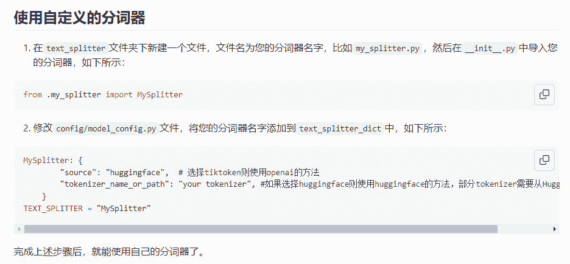

# Langchain-Chatchat如何自定义分词器（二）

> 来源：[https://agijuejin.feishu.cn/docx/TEiGdea7soX3inxBwsKcausTnwc](https://agijuejin.feishu.cn/docx/TEiGdea7soX3inxBwsKcausTnwc)

> 作者：悟乙己

> 原文： [https://zhuanlan.z](https://zhuanlan.zhihu.com/p/676531775)hihu.com/p/676531...

对于 Langchain-Chatchat 这个开源项目，了解越多越让我纠结，结构很不错，可惜瑕疵也极多，虽然运维不易，但是很多文档或细节压根没写明白，或者他们的收费版写明白了，开源版就糊弄下？

[对于这个开](https://link.zhihu.com/?target=https%3A//github.com/chatchat-space/Langchain-Chatchat/wiki/%25E8%2587%25AA%25E5%25AE%259A%25E4%25B9%2589%23%25E4%25BD%25BF%25E7%2594%25A8%25E8%2587%25AA%25E5%25AE%259A%25E4%25B9%2589%25E7%259A%2584%25E5%2588%2586%25E8%25AF%258D%25E5%2599%25A8)源项目如何使用自定义分词器，官方 wiki ，写的好像 有手就行 ， 就一个小豆腐块篇幅；

可是细节全无，笔者看着chatchat封装的仨（ali_text_splitter、chinese_recursive_text_splitter），仍是一头雾水...



不卖关子了，笔者想要将 MarkdownHeaderTextSplitter 和 chatchat自己封装的 ChineseRecursiveTextSplitter 联合使用，markdown切分文档大框架，ChineseRecursiveText 再对大框架下的内容细致切分。

但是，chatchat对.md非常不友好（可参考： 悟乙己：Langchain-Chatchat开源库使用的随笔记（一） ），所以笔者下面自定义的函数会对原始文档进行一定更改。

如果你看明白如何写自定义，自己DIY，都是极好，在之前笔者的文章里【 悟乙己：RAG 分块Chunk技术优劣、技巧、方法汇总（五） 】和【 悟乙己：大模型RAG 场景、数据、应用难点与解决（四） 】不同的文档应该需要不同的分块器，目前chatchat还无法实现，不确定他们后续项目的更新节奏。

---

## 1 剖析chatchat自己的写的分块器

因为笔者比较关注 ChineseRecursiveTextSplitter ，所以单独拿这个来举例，贴一部分代码：

```
class ChineseRecursiveTextSplitter(RecursiveCharacterTextSplitter):
    def __init__(
            self,
            separators: Optional[List[str]] = None,
            keep_separator: bool = True,
            is_separator_regex: bool = True,
            **kwargs: Any,
    ) -&gt; None:
        &quot;&quot;&quot;Create a new TextSplitter.&quot;&quot;&quot;
        super().__init__(keep_separator=keep_separator, **kwargs)
        self._separators = separators or [
            &quot;\n\n&quot;,
            &quot;\n&quot;,
            &quot;。|！|？&quot;,
            &quot;\.\s|\!\s|\?\s&quot;,
            &quot;；|;\s&quot;,
            &quot;，|,\s&quot;
        ]
        self._is_separator_regex = is_separator_regex

    def _split_text(self, text: str, separators: List[str]) -&gt; List[str]:
        &quot;&quot;&quot;Split incoming text and return chunks.&quot;&quot;&quot;
        final_chunks = []
        # Get appropriate separator to use
        separator = separators[-1]
        new_separators = []
        for i, _s in enumerate(separators):
            _separator = _s if self._is_separator_regex else re.escape(_s)
            if _s == &quot;&quot;:
                separator = _s
                break
            if re.search(_separator, text):
                separator = _s
                new_separators = separators[i + 1:]
                break

        _separator = separator if self._is_separator_regex else re.escape(separator)
        splits = _split_text_with_regex_from_end(text, _separator, self._keep_separator)

        # Now go merging things, recursively splitting longer texts.
        _good_splits = []
        _separator = &quot;&quot; if self._keep_separator else separator
        for s in splits:
            if self._length_function(s) &lt; self._chunk_size:
                _good_splits.append(s)
            else:
                if _good_splits:
                    merged_text = self._merge_splits(_good_splits, _separator)
                    final_chunks.extend(merged_text)
                    _good_splits = []
                if not new_separators:
                    final_chunks.append(s)
                else:
                    other_info = self._split_text(s, new_separators)
                    final_chunks.extend(other_info)
        if _good_splits:
            merged_text = self._merge_splits(_good_splits, _separator)
            final_chunks.extend(merged_text)
        return [re.sub(r&quot;\n{2,}&quot;, &quot;\n&quot;, chunk.strip()) for chunk in final_chunks if chunk.strip()!=&quot;&quot;]


if __name__ == &quot;__main__&quot;:
    text_splitter = ChineseRecursiveTextSplitter(
        keep_separator=True,
        is_separator_regex=True,
        chunk_size=50,
        chunk_overlap=0
    )
    ls = [
        &quot;&quot;&quot;中国对外贸易形势报告（75页）。前 10 个月，一般贸易进出口 19.5 万亿元，增长 25.1%， 比整体进出口增速高出 2.9 个百分点，占进出口总额的 61.7%，较去年同期提升 1.6 个百分点。其中，一般贸易出口 10.6 万亿元，增长 25.3%，占出口总额的 60.9%，提升 1.5 个百分点；进口8.9万亿元，增长24.9%，占进口总额的62.7%， 提升 1.8 个百分点。加工贸易进出口 6.8 万亿元，增长 11.8%， 占进出口总额的 21.5%，减少 2.0 个百分点。其中，出口增 长 10.4%，占出口总额的 24.3%，减少 2.6 个百分点；进口增 长 14.2%，占进口总额的 18.0%，减少 1.2 个百分点。此外， 以保税物流方式进出口 3.96 万亿元，增长 27.9%。其中，出 口 1.47 万亿元，增长 38.9%；进口 2.49 万亿元，增长 22.2%。前三季度，中国服务贸易继续保持快速增长态势。服务 进出口总额 37834.3 亿元，增长 11.6%；其中服务出口 17820.9 亿元，增长 27.3%；进口 20013.4 亿元，增长 0.5%，进口增 速实现了疫情以来的首次转正。服务出口增幅大于进口 26.8 个百分点，带动服务贸易逆差下降 62.9%至 2192.5 亿元。服 务贸易结构持续优化，知识密集型服务进出口 16917.7 亿元， 增长 13.3%，占服务进出口总额的比重达到 44.7%，提升 0.7 个百分点。 二、中国对外贸易发展环境分析和展望 全球疫情起伏反复，经济复苏分化加剧，大宗商品价格 上涨、能源紧缺、运力紧张及发达经济体政策调整外溢等风 险交织叠加。同时也要看到，我国经济长期向好的趋势没有 改变，外贸企业韧性和活力不断增强，新业态新模式加快发 展，创新转型步伐提速。产业链供应链面临挑战。美欧等加快出台制造业回迁计 划，加速产业链供应链本土布局，跨国公司调整产业链供应 链，全球双链面临新一轮重构，区域化、近岸化、本土化、 短链化趋势凸显。疫苗供应不足，制造业“缺芯”、物流受限、 运价高企，全球产业链供应链面临压力。 全球通胀持续高位运行。能源价格上涨加大主要经济体 的通胀压力，增加全球经济复苏的不确定性。世界银行今年 10 月发布《大宗商品市场展望》指出，能源价格在 2021 年 大涨逾 80%，并且仍将在 2022 年小幅上涨。IMF 指出，全 球通胀上行风险加剧，通胀前景存在巨大不确定性。&quot;&quot;&quot;,
        ]
    # text = &quot;&quot;&quot;&quot;&quot;&quot;
    for inum, text in enumerate(ls):
        print(inum)
        chunks = text_splitter.split_text(text)
        for chunk in chunks:
            print(chunk)
```

首先 ChineseRecursiveTextSplitter 是继承langchian的 RecursiveCharacterTextSplitter ，所以， super().__init__(keep_separator=keep_separator, **kwargs) ，一部分参数都是 RecursiveCharacterTextSplitter 所需的；

ChineseRecursiveTextSplitter 在 RecursiveCharacterTextSplitter 基础上进行两点更新：

+   keep_separator的改动，如果没有自定义就会使用 [ "\n\n","\n","。|！|？", "\.\s|\!\s|\?\s","；|;\s", "，|,\s"]

+   重新定义了 RecursiveCharacterTextSplitter 里面的 _split_text 函数

这里注意，在langchain-ch[at](https://link.zhihu.com/?target=https%3A//github.com/chatchat-space/Langchain-Chatchat/blob/master/server/knowledge_base/utils.py)chat中，最终并不是使用 _split_text ，而是在( https:// github.com/chatchat-spa ce/Langchain-Chatchat/blob/master/server/knowledge_base/utils.py  )中，使用的是 split_documents ：

```
    def docs2texts(
            self,
            docs: List[Document] = None,
            zh_title_enhance: bool = ZH_TITLE_ENHANCE,
            refresh: bool = False,
            chunk_size: int = CHUNK_SIZE,
            chunk_overlap: int = OVERLAP_SIZE,
            text_splitter: TextSplitter = None,
    ):
        docs = docs or self.file2docs(refresh=refresh)
        if not docs:
            return []
        if self.ext not in [&quot;.csv&quot;]:
            if text_splitter is None:
                text_splitter = make_text_splitter(splitter_name=self.text_splitter_name, chunk_size=chunk_size,
                                                   chunk_overlap=chunk_overlap)
            if self.text_splitter_name == &quot;MarkdownHeaderTextSplitter&quot;:
                docs = text_splitter.split_text(docs[0].page_content)
            else:
                docs = text_splitter.split_documents(docs)  # 插眼：注意这里

        if not docs:
            return []
```

## 2 自定义分词器

### 2.1自定义分词器的函数

直接上代码：

```
from langchain.text_splitter import MarkdownHeaderTextSplitter
from text_splitter.chinese_recursive_text_splitter import ChineseRecursiveTextSplitter
from typing import List, Any,Iterable
from langchain_core.documents import Document


class md_cr_TextSplitter(ChineseRecursiveTextSplitter):
    def __init__(
            self,
            keep_separator: bool = True,
            is_separator_regex: bool = True,
            chunk_size :int = 250,
            chunk_overlap:int = 50,
            **kwargs: Any,
    ) -&gt; None:

        super().__init__( **kwargs)
        self.keep_separator = keep_separator
        self.is_separator_regex = is_separator_regex
        self.chunk_size = chunk_size
        self.chunk_overlap = chunk_overlap

        self.md_text_splitter = self.init_TextSplitter(mode = &#x27;markdown&#x27;)
        self.cr_text_splitter = self.init_TextSplitter(mode = &#x27;ChineseRecursive&#x27;)

    def init_TextSplitter(self,mode = &#x27;markdown&#x27;):
        
        if mode == &#x27;markdown&#x27;:
            headers_to_split = [
                            (&quot;#&quot;, &quot;标题1&quot;),
                            (&quot;##&quot;, &quot;标题2&quot;),
                            (&quot;###&quot;, &quot;标题3&quot;),
                            (&quot;####&quot;, &quot;标题4&quot;),
                        ]
            text_splitter = MarkdownHeaderTextSplitter(
                headers_to_split_on=headers_to_split)
        else:
        
            text_splitter = ChineseRecursiveTextSplitter(
                keep_separator=self.keep_separator,
                is_separator_regex=self.is_separator_regex,
                chunk_size=self.chunk_size,
                chunk_overlap=self.chunk_overlap
            )

        return text_splitter


    # def _split_text(self, text: str) -&gt; List[str]:
    #     text_md_split = self.md_text_splitter.split_text(text)
    #     result = [self.cr_text_splitter.split_text(txt.page_content) for txt in text_md_split]
    #     return sum(result,[])
    
    
    # def split_documents(self, documents: Iterable[Document]) -&gt; List[Document]:
    #     &quot;&quot;&quot;Split documents.&quot;&quot;&quot;
    #     texts, metadatas = [], []
    #     for doc in documents:
    #         texts.append(doc.page_content)
    #         metadatas.append(doc.metadata)
    #     return self.create_documents(texts, metadatas=metadatas)
    
    def split_documents(self,documents: Iterable[Document]) -&gt; List[Document]:
        # texts, metadatas = [], []
        documents_res = []
        for doc in documents:
            source = doc.metadata[&#x27;source&#x27;]
            docs_md = self.md_text_splitter.split_text(doc.page_content)
            
            # metadata附上,不然知识库问答的时候链接无法显示
            for dm in docs_md:
                dm.metadata[&#x27;source&#x27;] = source
                # dm.metadata = dict(dm.metadata,**doc.metadata)
            
            docs_md_cd = self.cr_text_splitter.split_documents(docs_md)
            documents_res.extend(docs_md_cd)
        return documents_res

if __name__ == &quot;__main__&quot;:
    

    from langchain import document_loaders
    from server.knowledge_base.utils import make_text_splitter
    import os
    from document_loaders.mypdfloader import RapidOCRPDFLoader
    
    CHUNK_SIZE = 250
    OVERLAP_SIZE = 50

    # 数据加载方式1：使用DocumentLoader读取文件
    filepath = &quot;knowledge_base/samples/content/test_files/test.txt&quot;
    loader = document_loaders.UnstructuredFileLoader(filepath, autodetect_encoding=True)
    docs = loader.load()

    # 数据加载方式2：使用chatchat官方的数据加载KnowledgeFile
    from server.knowledge_base.utils import *
    kb_file = KnowledgeFile(
        filename=filepath,
        knowledge_base_name=&quot;samples&quot;)
    # kb_file.text_splitter_name = &quot;RecursiveCharacterTextSplitter&quot;
    docs = kb_file.file2docs()


    # 模型调用方式1：类加载
    s_text_splitter = md_cr_TextSplitter(
        keep_separator=True,
        is_separator_regex=True,
        chunk_size=250,
        chunk_overlap=50
    )
    docs = s_text_splitter.split_documents(docs)

    # 模型调用方式2：使用chatchat官方的make_text_splitter加载
    splitter_name = &#x27;md_cr_TextSplitter&#x27;
    text_splitter = make_text_splitter(splitter_name, CHUNK_SIZE, OVERLAP_SIZE)
    docs = text_splitter.split_documents(docs)
```

核心是在 split_documents 的定义，先调用 MarkdownHeaderTextSplitter ，在使用 ChineseRecursiveTextSplitter ，充分分割文档。

走过的坑不赘述，这段代码的强调点：

+   如我这种组合不用调整 _split_text ，而只要调整 split_documents 就可以，所以不跟chatchat官方给出的几个样例调整 _split_text 不一样，这个比较坑了，笔者回看 RecursiveCharacterTextSplitter 源代码才意识到直接调整 split_documents 即可

+   [tests/custom_splitter/test_di](https://link.zhihu.com/?target=https%3A//github.com/chatchat-space/Langchain-Chatchat/blob/master/tests/custom_splitter/test_different_splitter.py)fferent_splitter.py 中的 make_text_splitter 函数是chatchat源码中使用的，可以作为测试函数

+   metadata['source'] 其中source是文件地址，后续会在知识库查询中，呈现每段chunk的来源，这个一定记得在每个chunk的 Document.metadata 属性中加上

+   目前 .md 格式不太友好，还是建议改成txt,pdf,docx等其他格式，举个例子，

```
ChatGPT是OpenAI开发的一个大型语言模型，可以提供各种主题的信息，

# 如何向 ChatGPT 提问以获得高质量答案：提示技巧工程完全指南

## 介绍

我很高兴欢迎您阅读我的最新书籍《The Art of Asking ChatGPT for High-Quality Answers: A complete Guide to Prompt Engineering Techniques》。本书是一本全面指南，介绍了各种提示技术，用于从ChatGPT中生成高质量的答案。

## 第一章：Prompt 工程技术简介

什么是 Prompt 工程？ 

Prompt 工程是创建提示或指导像 ChatGPT 这样的语言模型输出的过程。它允许用户控制模型的输出并生成符合其特定需求的文本。 
```

上述文档，我自定义的会根据 ## 先切分三段（MarkdownHeaderTextSplitter），然后三段中再根据ChineseRecursiveTextSplitter继续切分

### 2.2 修改一些配置文件

需要有几步的修改：

+   text_splitter文件夹下面要放入你自定义函数的.py文件

+   然后修改 __init__.py （ [ht](https://link.zhihu.com/?target=https%3A//github.com/chatchat-space/Langchain-Chatchat/blob/master/text_splitter/__init__.py)tps:// github.com/chatchat-spa ce/Langchain-Chatchat/blob/master/text_splitter/__init__.py  ）

```
from .md_text_splitter import md_cr_TextSplitter
```

+   修改 kb_config.py 文件中的配置项目， text_splitter_dict 和 TEXT_SPLITTER_NAME ：

```
# TextSplitter配置项，如果你不明白其中的含义，就不要修改。
text_splitter_dict = {
    &quot;ChineseRecursiveTextSplitter&quot;: {
        &quot;source&quot;: &quot;huggingface&quot;,   # 选择tiktoken则使用openai的方法
        &quot;tokenizer_name_or_path&quot;: &quot;&quot;,
    },
    &quot;SpacyTextSplitter&quot;: {
        &quot;source&quot;: &quot;huggingface&quot;,
        &quot;tokenizer_name_or_path&quot;: &quot;gpt2&quot;,
    },
    &quot;RecursiveCharacterTextSplitter&quot;: {
        &quot;source&quot;: &quot;tiktoken&quot;,
        &quot;tokenizer_name_or_path&quot;: &quot;cl100k_base&quot;,
    },
    &quot;MarkdownHeaderTextSplitter&quot;: {
        &quot;headers_to_split_on&quot;:
            [
                (&quot;#&quot;, &quot;head1&quot;),
                (&quot;##&quot;, &quot;head2&quot;),
                (&quot;###&quot;, &quot;head3&quot;),
                (&quot;####&quot;, &quot;head4&quot;),
            ]
    },
    &quot;md_cr_TextSplitter&quot;: {
        &quot;source&quot;: &quot;官方wiki乱标记别信&quot;, 
        &quot;tokenizer_name_or_path&quot;: &quot;md_cr_TextSplitter&quot;,
    },
    
}

# TEXT_SPLITTER 名称
TEXT_SPLITTER_NAME = &quot;md_cr_TextSplitter&quot;
```

改完就可以开始测试。

这里留意修改 TEXT_SPLITTER_NAME 的作用方式，比如你之前用其他分词器已经加载过一些文档了，

此时调整成 自定义的 md_cr_TextSplitter 并重启后，之前加载的文档还是之前的分词器分块的，之后 才是md_cr_TextSplitter，所以如果你需要用自定义的批量刷文档，最好新建一个知识库。

同时删除知识库内的文档，好像faiss还会保留原先的，所以有可能会有重复内容chunk；

所以更换新的分词器，还是新建一个知识库比较好。

### 2.3 快速测试

[如何更快测试自己的分块器，直接看这个 tests/cust](https://link.zhihu.com/?target=https%3A//github.com/chatchat-space/Langchain-Chatchat/blob/master/tests/custom_splitter/test_different_splitter.py)om_splitter/test_different_splitter.py ，使用 make_text_splitter 进行加载，如何能够成功使用，那就代表你的分块器已经可以使用了

之前代码里的小片段：

```
    splitter_name = &#x27;md_cr_TextSplitter&#x27;
    text_splitter = make_text_splitter(splitter_name, CHUNK_SIZE, OVERLAP_SIZE)
    docs = text_splitter.split_documents(docs)
```