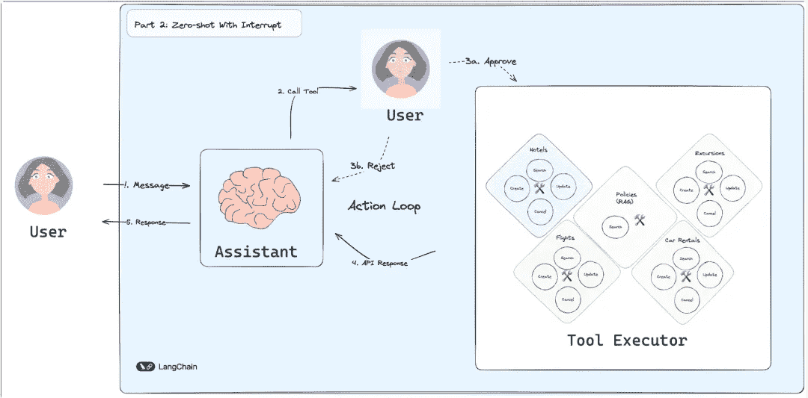
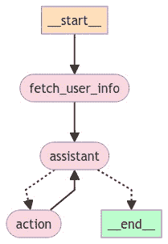

# LangGraph实战：可控的AI航空客服助手

> 来源：[https://agijuejin.feishu.cn/docx/IwcCdShYlolDxLxvs4rcFqoTnae](https://agijuejin.feishu.cn/docx/IwcCdShYlolDxLxvs4rcFqoTnae)

> 作者：AI小智

> 原文：[https://mp.weixin.](https://mp.weixin.qq.com/s/hFigmqVqaF0K-rcYyZgHGQ)qq.com/s/hFigmqVq...

> 上节课，我们定义了AI航空客服助手需要使用**的一系**列API接口工具，并定义了一个简单的零样本代理作为用户的助手。没看过的同学可以点击链接 LangGraph实战：从零分阶打造人工智能航空客服助手 查阅。这次我们将讲述，如何通过LangGraph的特性，使得客服助手的行为更加 可控 。

当智能助手代表用户执行操作时，用户几乎总是应该对是否执行这些操作拥有最终决定权。否则，即使是智能助手的一点小失误，或是它未能抵御的任何指令注入，都可能对用户造成实际损害。

在这部分，我们将利用 **LangGraph **的 interrupt_before 功能，在执行任何工具之前，暂停流程并把控制权交还给用户。

您的流程图可能看起来像这样：



流程图示例

和之前一样，我们首先定义状态：

###  **状态与智能助手 **

我们的流程图状态和LLM调用与第一部分基本相同，除了：

+   我们新增了一个 user_info 字段，它将由我们的流程图主动填充

+   我们可以在 Assistant 对象中直接使用状态，而不是使用可配置的参数

```
from typing import Annotated

from langchain_anthropic import ChatAnthropic
from langchain_community.tools.tavily_search import TavilySearchResults
from langchain_core.prompts import ChatPromptTemplate
from langchain_core.runnables import Runnable, RunnableConfig
from typing_extensions import TypedDict

from langgraph.graph.message import AnyMessage, add_messages

class State(TypedDict):
    messages: Annotated[list[AnyMessage], add_messages]
    user_info: str

class Assistant:
    def __init__(self, runnable: Runnable):
        self.runnable = runnable

    def __call__(self, state: State, config: RunnableConfig):
        while True:
            passenger_id = config.get(&quot;passenger_id&quot;, None)
            result = self.runnable.invoke(state)
            # 如果大型语言模型恰好返回了一个空响应，我们将重新请求一个实际的响应。
            if not result.tool_calls and (
                not result.content
                or isinstance(result.content, list)
                and not result.content[0].get(&quot;text&quot;)
            ):
                messages = state[&quot;messages&quot;] + [(&quot;user&quot;, &quot;请给出真实的输出。&quot;)]
                state = {**state, &quot;messages&quot;: messages}
            else:
                break
        return {&quot;messages&quot;: result}

# Haiku模型更快更经济，但准确性较低
# llm = ChatAnthropic(model=&quot;claude-3-haiku-20240307&quot;)
llm = ChatAnthropic(model=&quot;claude-3-sonnet-20240229&quot;, temperature=1)
# 你也可以使用OpenAI或其他模型，尽管你可能需要调整提示
# from langchain_openai import ChatOpenAI

# llm = ChatOpenAI(model=&quot;gpt-4-turbo-preview&quot;)

assistant_prompt = ChatPromptTemplate.from_messages(
    [
        (
            &quot;system&quot;,
            &quot;你是一个乐于助人的瑞士航空客户支持智能助手。&quot;
            &quot;利用提供的工具搜索航班、公司政策和其他信息，以帮助解答用户的疑问。&quot;
            &quot;在搜索时，要持之以恒。如果首次搜索没有结果，就扩大你的搜索范围。&quot;
            &quot;如果搜索依然一无所获，继续扩大搜索范围，不要轻言放弃。&quot;
            &quot;\n\n当前用户：\n&lt;User&gt;\n{user_info}\n&lt;/User&gt;&quot;
            &quot;\n当前时间：{time}。&quot;,
        ),
        (&quot;placeholder&quot;, &quot;{messages}&quot;),
    ]
).partial(time=datetime.now())

part_2_tools = [
    TavilySearchResults(max_results=1),
    fetch_user_flight_information,
    search_flights,
    lookup_policy,
    update_ticket_to_new_flight,
    cancel_ticket,
    search_car_rentals,
    book_car_rental,
    update_car_rental,
    cancel_car_rental,
    search_hotels,
    book_hotel,
    update_hotel,
    cancel_hotel,
    search_trip_recommendations,
    book_excursion,
    update_excursion,
    cancel_excursion,
]
part_2_assistant_runnable = assistant_prompt | llm.bind_tools(part_2_tools)
```

###  **定义流程图 **

现在，创建流程图。根据第一部分的反馈，我们做出两个改变：

1.  在使用工具之前加入一个中断点。

1.  在第一个节点中明确填充用户状态，这样智能助手就不必通过使用工具来了解用户信息。

```
from langgraph.checkpoint.sqlite import SqliteSaver
from langgraph.graph import END, StateGraph
from langgraph.prebuilt import ToolNode, tools_condition

builder = StateGraph(State)

def user_info(state: State):
    return {&quot;user_info&quot;: fetch_user_flight_information.invoke({})}

# 新增：fetch_user_info节点首先执行，这意味着我们的智能助手可以在
# 不采取任何行动的情况下查看用户的航班信息
builder.add_node(&quot;fetch_user_info&quot;, user_info)
builder.set_entry_point(&quot;fetch_user_info&quot;)
builder.add_node(&quot;assistant&quot;, Assistant(part_2_assistant_runnable))
builder.add_node(&quot;action&quot;, create_tool_node_with_fallback(part_2_tools))
builder.add_edge(&quot;fetch_user_info&quot;, &quot;assistant&quot;)
builder.add_conditional_edges(
    &quot;assistant&quot;, tools_condition, {&quot;action&quot;: &quot;action&quot;, END: END}
)
builder.add_edge(&quot;action&quot;, &quot;assistant&quot;)

memory = SqliteSaver.from_conn_string(&quot;:memory:&quot;)
part_2_graph = builder.compile(
    checkpointer=memory,
    # 新增：流程图在执行“action”节点之前总是暂停。
    # 用户可以在智能助手继续之前批准或拒绝（甚至修改请求）
    interrupt_before=[&quot;action&quot;],
)
```

```
from IPython.display import Image, display

try:
    display(Image(part_2_graph.get_graph(xray=True).draw_mermaid_png()))
except:
    # 这需要一些额外的依赖项，并且是可选的
    pass
```



流程图示例2

###  **示例对话 **

现在，让我们通过以下对话示例来测试我们新修订的聊天机器人。

```
import shutil
import uuid

# 使用备份文件更新，以便我们可以从每个部分的起始点重新启动
shutil.copy(backup_file, db)
thread_id = str(uuid.uuid4())

config = {
    &quot;configurable&quot;: {
        # passenger_id在我们的航班工具中使用，以获取用户的航班信息
        &quot;passenger_id&quot;: &quot;3442 587242&quot;,
        # 通过thread_id访问检查点
        &quot;thread_id&quot;: thread_id,
    }
}

_printed = set()
# 我们可以重复使用第一部分的教程问题，以观察聊天机器人的表现。
for question in tutorial_questions:
    events = part_2_graph.stream(
        {&quot;messages&quot;: (&quot;user&quot;, question)}, config, stream_mode=&quot;values&quot;
    )
    for event in events:
        _print_event(event, _printed)
    snapshot = part_2_graph.get_state(config)
    while snapshot.next:
        # 我们遇到了一个中断！代理正试图使用一个工具，而用户可以批准或拒绝它
        # 注意：这段代码位于你的流程图之外。通常，你会将输出流式传输到用户界面。
        # 然后，你会在用户输入时，通过API调用触发一个新的运行。
        user_input = input(
            &quot;你同意上述操作吗？输入&#x27;y&#x27;以继续；&quot;
            &quot;否则，请说明你请求的更改。\n\n&quot;
        )
        if user_input.strip() == &quot;y&quot;:
            # 继续执行
            result = part_2_graph.invoke(
                None,
                config,
            )
        else:
            # 通过提供关于请求更改/改变主意的说明，满足工具调用
            result = part_2_graph.invoke(
                {
                    &quot;messages&quot;: [
                        ToolMessage(
                            tool_call_id=event[&quot;messages&quot;][-1].tool_calls[0][&quot;id&quot;],
                            content=f&quot;API调用被用户拒绝。理由：&#x27;{user_input}&#x27;. 继续协助，考虑用户的输入。&quot;,
                        )
                    ]
                },
                config,
            )
        snapshot = part_2_graph.get_state(config)
```

###  **第二部分回顾 **

现在，我们的智能助手能够节省一步来响应我们的航班详情。我们还完全控制了执行的操作。这一切都是通过LangGraph的 interrupts 和 checkpointers 实现的。中断暂停了流程图的执行，其状态使用配置的检查点器安全地持久化。用户随后可以在任何时候通过使用正确的配置运行它来启动它。

查看一个LangSmith示例跟踪，以更好地理解流程图是如何运行的。注意从这个跟踪中，你通常通过使用 (N**one**, config) 调用流程图来 恢复 流程。状态从检查点加载，就像它从未被中断过一样。

**这个流程**图工作得很好！但当需要我们参与 每一个 智能助手的行动的要求，十分影响使用体验，并且助手在执行查询等动作时并不会影响实际业务。

在下一节中，我们将重新组织我们的流程图，以便我们只在实际写入数据库的“敏感”操作时才中断。

今天的内容就到这里，如果老铁觉得还行，可以来一波三连，感谢！