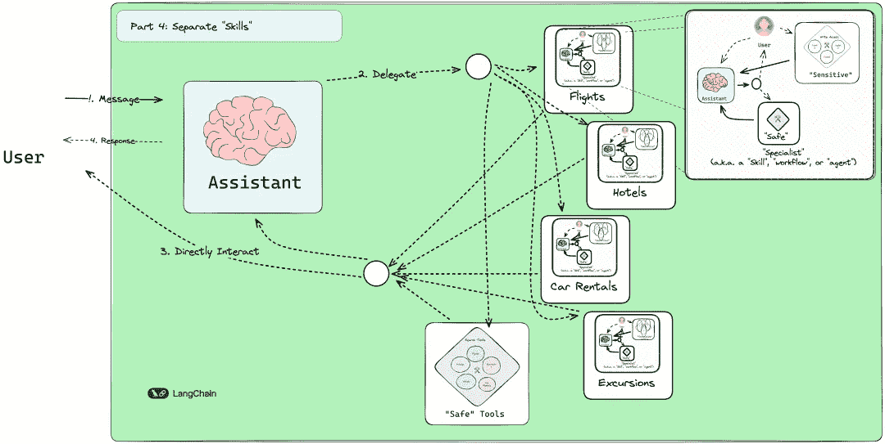
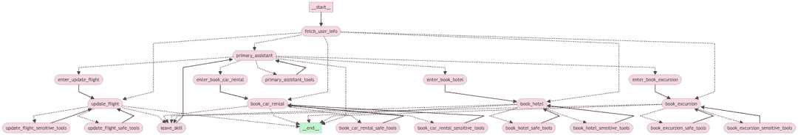

# 探索LangGraph：构建多专家协作模型

> 来源：[https://agijuejin.feishu.cn/docx/ZzYLdLiVGoXywBxNwk6cwlEgnib](https://agijuejin.feishu.cn/docx/ZzYLdLiVGoXywBxNwk6cwlEgnib)

> 作者：AI小智

> 原文：<https://mp.weixin.qq.com/s/6PWhOWUpT-ySJU7UjgVavg>

在之前的部分，我们探讨了如何利用单一提示和大型语言模型（`LLM`）来处理多样化的用户需求，没看过的同学可以点击链接 探索`LangGraph`：如何创建一个既智能又可控的航空客服AI 查阅。

探索`LangGraph`：如何创建一个既智能又可控的航空客服AI 利用单一提示的方法确实能覆盖很广的应用场景。但是，如果想要为特定的用户需求提供稳定且出色的体验，仅靠这种方法就显得有些力不从心了。

取而代之的是，我们可以通过 识别用户的意图，并将其引导至相应的定制化流程或“技能”，来满足用户的具体需求。每个流程都可以专注于特定的领域，这样不仅可以实现各自领域的优化提升，还不会影响到整体助手的性能。

在本节中，我们将用户交互体验划分为多个子图，形成一个类似下面的结构：



在上图中，每个方框都代表一个具有特定功能的独立工作流程。主要助手负责接收用户的初步询问，然后根据询问内容将任务分配给相应的专家。

## 状态管理

我们需要跟踪在任何特定时刻哪个子图正在控制交互过程。虽然我们可以通过消息列表上的一些计算来实现这一点，但更简单的方法是使用一个专门的堆栈来跟踪。

在下面的 `State` 中添加一个 `dialog_state` 列表。每当一个 `node` 运行并返回 `dialog_state` 的值时，就会调用 `update_dialog_stack` 函数来决定如何更新堆栈。

```
from typing import Annotated, Literal, Optional

from typing_extensions import TypedDict

from langgraph.graph.message import AnyMessage, add_messages


def update_dialog_stack(left: list[str], right: Optional[str]) -> list[str]:
    """推入或弹出状态。"""
    if right is None:
        return left
    if right == "pop":
        return left[:-1]
    return left + [right]


class State(TypedDict):
    messages: Annotated[list[AnyMessage], add_messages]
    user_info: str
    dialog_state: Annotated[
        list[
            Literal[
                "assistant",
                "update_flight",
                "book_car_rental",
                "book_hotel",
                "book_excursion",
            ]
        ],
        update_dialog_stack,
    ]
```

## 助手

这次我们将为每个工作流程创建一个助手。这意味着：

1. 航班预订助手
1. 酒店预订助手
1. 汽车租赁助手
1. 旅行助手
1. 最后，一个“主要助手”来在这些助手之间进行切换

如果你仔细观察，你会发现这实际上是我们在多代理示例中提到的 监督者 设计模式的一个实例。

下面，定义每个助手的 `Runnable` 对象。每个 `Runnable` 都有一个提示、`LLM`以及针对该助手的工具集。每个专门的助手还可以调用 `CompleteOrEscalate` 工具，以指示控制权应该交回给主要助手。这可能发生在助手成功完成任务，或者用户改变主意或需要该特定工作流程范围之外的帮助时。

```
from langchain_anthropic import ChatAnthropic
from langchain_community.tools.tavily_search import TavilySearchResults
from langchain_core.prompts import ChatPromptTemplate
from langchain_core.pydantic_v1 import BaseModel, Field
from langchain_core.runnables import Runnable, RunnableConfig


class Assistant:
    def __init__(self, runnable: Runnable):
        self.runnable = runnable

    def __call__(self, state: State, config: RunnableConfig):
        while True:
            result = self.runnable.invoke(state)

            if not result.tool_calls and (
                not result.content
                or isinstance(result.content, list)
                and not result.content[0].get("text")
            ):
                messages = state["messages"] + [("user", "用真实的输出回应。")]
                state = {**state, "messages": messages}
                messages = state["messages"] + [("user", "用真实的输出回应。")]
                state = {**state, "messages": messages}
            else:
                break
        return {"messages": result}


class CompleteOrEscalate(BaseModel):
    """一个工具，标记当前任务为已完成和/或将对话控制权升级到主助手，
    主助手可以根据用户的需求重新路由对话。"""

    cancel: bool = True
    reason: str

    class Config:
        schema_extra = {
            "example": {
                "cancel": True,
                "reason": "用户改变了他们对当前任务的想法。",
            },
            "example 2": {
                "cancel": True,
                "reason": "我已经完全完成了任务。",
            },
            "example 3": {
                "cancel": False,
                "reason": "我需要搜索用户的电子邮件或日历以获取更多信息。",
            },
        }

```

### 航班预订助手

创建一个专门的助手来处理航班更新和取消预订的任务。

```
# 航班预订助手

flight_booking_prompt = ChatPromptTemplate.from_messages(
    [
        (
            "system",
            "您是专门处理航班更新的助手。"
            "每当用户需要帮助更新他们的预订时，主要助手就会委派工作给您。"
            "与客户确认更新的航班详情，并告知他们任何额外费用。"
            "搜索时，要坚持不懈。如果第一次搜索没有结果，就扩大您的查询范围。"
            "如果您需要更多信息或客户改变了主意，将任务升级回主助手。"
            "记住，只有在相关工具成功使用后，预订才算完成。"
            "\n\n当前用户航班信息：\n<Flights>\n{user_info}\n</Flights>"
            "\n当前时间：{time}。"
            "\n\n如果用户需要帮助，而且您的工具都不适合，那么"
            "'CompleteOrEscalate' 对话到主机助手。不要浪费用户的时间。不要编造无效的工具或功能。",
        ),
        ("placeholder", "{messages}"),
    ]
).partial(time=datetime.now())

update_flight_safe_tools = [search_flights]
update_flight_sensitive_tools = [update_ticket_to_new_flight, cancel_ticket]
update_flight_tools = update_flight_safe_tools + update_flight_sensitive_tools
update_flight_runnable = flight_booking_prompt | llm.bind_tools(
    update_flight_tools + [CompleteOrEscalate]
)
```

### 汽车租赁助手

接下来，创建一个 汽车租赁助手，以满足所有租车需求。

```
# 汽车租赁助手
book_car_rental_prompt = ChatPromptTemplate.from_messages(
    [
        (
            "system",
            "您是专门处理汽车租赁预订的助手。"
            "每当用户需要帮助预订汽车租赁时，主要助手就会委派工作给您。"
            "根据用户的偏好搜索可用的汽车租赁，并与客户确认预订详情。"
            "搜索时，要坚持不懈。如果第一次搜索没有结果，就扩大您的查询范围。"
            "如果您需要更多信息或客户改变了主意，将任务升级回主助手。"
            "记住，只有在相关工具成功使用后，预订才算完成。"
            "\n当前时间：{time}。"
            "\n\n如果用户需要帮助，而且您的工具都不适合，那么 "
            "'CompleteOrEscalate' 对话到主机助手。不要浪费用户的时间。不要编造无效的工具或功能。"
            "\n\n一些您应该 CompleteOrEscalate 的示例："
            " - '今年这个时候的天气怎么样？'"
            " - '有哪些航班可用？'"
            " - '没关系，我想我会单独预订'"
            " - '哦等等，我还没有预订我的航班，我会先做这件事'"
            " - '汽车租赁预订确认'",
        ),
        ("placeholder", "{messages}"),
    ]
).partial(time=datetime.now())

book_car_rental_safe_tools = [search_car_rentals]
book_car_rental_sensitive_tools = [
    book_car_rental,
    update_car_rental,
    cancel_car_rental,
]
book_car_rental_tools = book_car_rental_safe_tools + book_car_rental_sensitive_tools
book_car_rental_runnable = book_car_rental_prompt | llm.bind_tools(
    book_car_rental_tools + [CompleteOrEscalate]
)
```

### 酒店预订助手

然后定义 酒店预订 的工作流程。

```
# 酒店预订助手
book_hotel_prompt = ChatPromptTemplate.from_messages(
    [
        (
            "system",
            "您是专门处理酒店预订的助手。"
            "每当用户需要帮助预订酒店时，主要助手就会委派工作给您。"
            "根据用户的偏好搜索可用的酒店，并与客户确认预订详情。"
            "搜索时，要坚持不懈。如果第一次搜索没有结果，就扩大您的查询范围。"
            "如果您需要更多信息或客户改变了主意，将任务升级回主助手。"
            "记住，只有在相关工具成功使用后，预订才算完成。"
            "\n当前时间：{time}。"
            "'\n\n如果用户需要帮助，而且您的工具都不适合，那么 "CompleteOrEscalate" 对话到主机助手。'"
            "不要浪费用户的时间。不要编造无效的工具或功能。"
            "\n\n一些您应该 CompleteOrEscalate 的示例："
            " - '今年这个时候的天气怎么样？'"
            " - '没关系，我想我会单独预订'"
            " - '我需要弄清楚我在那里的时候的交通'"
            " - '哦等等，我还没有预订我的航班，我会先做这件事'"
            " - '酒店预订确认'",
        ),
        ("placeholder", "{messages}"),
    ]
).partial(time=datetime.now())

book_hotel_safe_tools = [search_hotels]
book_hotel_sensitive_tools = [book_hotel, update_hotel, cancel_hotel]
book_hotel_tools = book_hotel_safe_tools + book_hotel_sensitive_tools
book_hotel_runnable = book_hotel_prompt | llm.bind_tools(
    book_hotel_tools + [CompleteOrEscalate]
)
```

### 旅行助手

之后，定义 旅行助手。


# 旅行助手

```python
book_excursion_prompt = ChatPromptTemplate.from_messages(
    [
        (
            "system",
            "您是专门处理旅行建议的助手。"
            "每当用户需要帮助预订推荐的旅行时，主要助手就会委派工作给您。"
            "根据用户的偏好搜索可用的旅行建议，并与客户确认预订详情。"
            "如果您需要更多信息或客户改变了主意，将任务升级回主助手。"
            "搜索时，要坚持不懈。如果第一次搜索没有结果，就扩大您的查询范围。"
            "记住，只有在相关工具成功使用后，预订才算完成。"
            "\n当前时间：{time}。"
            '\n\n如果用户需要帮助，而且您的工具都不适合，那么 "CompleteOrEscalate" 对话到主机助手。不要浪费用户的时间。不要编造无效的工具或功能。'
            "\n\n一些您应该 CompleteOrEscalate 的示例："
            " - '没关系，我想我会单独预订'"
            " - '我需要在那里的时候弄清楚交通'"
            " - '哦等等，我还没有预订我的航班，我会先做这件事'"
            " - '旅行预订确认！'",
        ),
        ("placeholder", "{messages}"),
    ]
).partial(time=datetime.now())

book_excursion_safe_tools = [search_trip_recommendations]
book_excursion_sensitive_tools = [book_excursion, update_excursion, cancel_excursion]
book_excursion_tools = book_excursion_safe_tools + book_excursion_sensitive_tools
book_excursion_runnable = book_excursion_prompt | llm.bind_tools(
    book_excursion_tools + [CompleteOrEscalate]
)
```

## 主要助手

最后，创建 `主要助手`。

```python
# 主要助手
class ToFlightBookingAssistant(BaseModel):
    """将工作转交给专门助手来处理航班更新和取消。"""

    request: str = Field(
        description="更新航班助手在继续操作之前需要澄清的任何必要的后续问题。"
    )


class ToBookCarRental(BaseModel):
    """将工作转交给专门助手来处理汽车租赁预订。"""

    location: str = Field(
        description="用户想要租车的地点。"
    )
    start_date: str = Field(description="汽车租赁的开始日期。")
    end_date: str = Field(description="汽车租赁的结束日期。")
    request: str = Field(
        description="用户关于汽车租赁的任何额外信息或请求。"
    )

    class Config:
        schema_extra = {
            "example": {
                "location": "巴塞尔",
                "start_date": "2023-07-01",
                "end_date": "2023-07-05",
                "request": "我需要一辆自动变速箱的紧凑型汽车。",
            }
        }


class ToHotelBookingAssistant(BaseModel):
    """将工作转交给专门助手来处理酒店预订。"""

    location: str = Field(
        description="用户想要预订酒店的地点。"
    )
    checkin_date: str = Field(description="酒店的入住日期。")
    checkout_date: str = Field(description="酒店的退房日期。")
    request: str = Field(
        description="用户关于酒店预订的任何额外信息或请求。"
    )

    class Config:
        schema_extra = {
            "example": {
                "location": "苏黎世",
                "checkin_date": "2023-08-15",
                "checkout_date": "2023-08-20",
                "request": "我更喜欢靠近市中心的酒店，有风景的房间。",
            }
        }


class ToBookExcursion(BaseModel):
    """将工作转交给专门助手来处理旅行推荐和其他旅行预订。"""

    location: str = Field(
        description="用户想要预订推荐旅行的地点。"
    )
    request: str = Field(
        description="用户关于旅行建议的任何额外信息或请求。"
    )

    class Config:
        schema_extra = {
            "example": {
                "location": "卢塞恩",
                "request": "用户对户外活动和风景感兴趣。",
            }
        }


# 最高级助手执行一般问答，并将专业任务委派给其他助手。
# 任务委派是一种简单的语义路由/简单的意图检测
# llm = ChatAnthropic(model="claude-3-haiku-20240307")
llm = ChatAnthropic(model="claude-3-sonnet-20240229", temperature=1)

primary_assistant_prompt = ChatPromptTemplate.from_messages(
    [
        (
            "system",
            "您是瑞士航空的乐于助人的客服助手。"
            "您的主要角色是搜索航班信息和公司政策，以回答客户查询。"
            "如果客户请求更新或取消预订、租车、预订酒店或获取旅行建议，"
            "通过调用相应的工具，将任务委派给适当的专业助手。您自己无法进行这些类型的更改。"
            "只有专业助手才有权为用户执行此操作。"
            "用户不知道不同的专业助手，所以不要提及他们；只需通过功能调用来静静地委派。"
            "向客户提供详细信息，并在得出信息不可用的结论之前，始终再次检查数据库。"
            "当搜索时，要坚持不懈。如果第一次搜索没有结果，就扩大您的查询范围。"
            "\n\n当前用户航班信息：\n<Flights>\n{user_info}\n</Flights>"
            "\n当前时间：{time}。",
        ),
        ("placeholder", "{messages}"),
    ]
).partial(time=datetime.now())
primary_assistant_tools = [
    TavilySearchResults(max_results=1),
    search_flights,
    lookup_policy,
]
assistant_runnable = primary_assistant_prompt | llm.bind_tools(
    primary_assistant_tools
    + [
        ToFlightBookingAssistant,
        ToBookCarRental,
        ToHotelBookingAssistant,
        ToBookExcursion,
    ]
)
```

### 创建助手

我们即将创建图。在前一节中，我们做出了设计决策，让所有节点之间共享 `messages` 状态。这在每个委派助手都可以看到整个用户旅程并拥有共享上下文方面非常强大。然而，这意味着较弱的 LLMs 很容易对它们特定的范围感到困惑。为了标记主助手和委派工作流程之一之间的“交接”（并完成路由器的工具调用），我们将向状态中添加一个 `ToolMessage` 。

### 实用工具

创建一个函数，为每个工作流程制作一个“入口”节点，声明“当前助手是 `assistant_name` ”。

```python
from typing import Callable

from langchain_core.messages import ToolMessage


def create_entry_node(assistant_name: str, new_dialog_state: str) -> Callable:
    def entry_node(state: State) -> dict:
        tool_call_id = state["messages"][-1].tool_calls[0]["id"]
        return {
            "messages": [
                ToolMessage(
                    content=f"现在助手是 {assistant_name}。回想一下主机助手和用户之间的上述对话。"
                    f" 用户的意图尚未得到满足。使用提供的工具来帮助用户。记住，你是 {assistant_name}，"
                    " 预订、更新、其他操作或其他动作只有在您成功调用适当的工具后才完成。"
                    " 如果用户改变主意或需要其他任务的帮助，请调用 CompleteOrEscalate 函数，让主机助手接管控制权。"
                    " 不要提及你是谁 - 只作为助手的代理行事。",
                    tool_call_id=tool_call_id,
                )
            ],
            "dialog_state": new_dialog_state,
        }

    return entry_node
```

### 定义图

现在是我们开始构建图的时候了。和以前一样，我们将从一个节点开始，用用户的当前信息预填充状态。

```python
from typing import Literal

from langgraph.checkpoint.sqlite import SqliteSaver
from langgraph.graph import END, StateGraph
from langgraph.prebuilt import tools_condition

builder = StateGraph(State)


def user_info(state: State):
    return {"user_info": fetch_user_flight_information.invoke({})}


builder.add_node("fetch_user_info", user_info)
builder.set_entry_point("fetch_user_info")
```

现在，让我们开始构建我们定制的工作流程。每个小工作流程的结构都和我们在第3部分中展示的完整工作流程图非常相似，它们都包含5个节点：

1. `enter_*` : 使用你之前定义的 `create_entry_node` 工具来创建一个 `ToolMessage`，这个 `ToolMessage` 表明新的专业助手已经接管了工作。
2. `助手` : 这个由提示和大型语言模型（LLM）组成的模块会根据当前状态来决定是使用一个工具、向用户提问还是结束整个工作流程（返回到主助手）。
3. `*_safe_tools` : 这些是助手可以在不需要用户确认的情况下使用的“只读”工具。
4. `*_sensitive_tools` : 这些具有“写入”权限的工具需要用户的确认，并且在我们编译工作流程图时，它们会被设置一个 `interrupt_before` 。
5. `leave_skill` : 通过 弹出 `dialog_state` 来表示 主助手 重新掌握了控制权。

由于这些工作流程的相似性，我们本可以定义一个工厂函数来生成它们。但因为这是一个教程，我们会逐一明确地定义它们。

首先，我们来创建一个 `航班预订助手`，它专门负责管理用户更新和取消预订航班的流程。


# 航班预订助手 / Flight booking assistant

```
# 航班预订助手
# Flight booking assistant
builder.add_node(
    "enter_update_flight",
    create_entry_node("Flight Updates & Booking Assistant", "update_flight"),
)
builder.add_node("update_flight", Assistant(update_flight_runnable))
builder.add_edge("enter_update_flight", "update_flight")
builder.add_node(
    "update_flight_sensitive_tools",
    create_tool_node_with_fallback(update_flight_sensitive_tools),
)
builder.add_node(
    "update_flight_safe_tools",
    create_tool_node_with_fallback(update_flight_safe_tools),
)


def route_update_flight(
    state: State,
) -> Literal[
    "update_flight_sensitive_tools",
    "update_flight_safe_tools",
    "leave_skill",
    "__end__",
]:
    route = tools_condition(state)
    if route == END:
        return END
    tool_calls = state["messages"][-1].tool_calls
    did_cancel = any(tc["name"] == CompleteOrEscalate.__name__ for tc in tool_calls)
    if did_cancel:
        return "leave_skill"
    safe_toolnames = [t.name for t in update_flight_safe_tools]
    if all(tc["name"] in safe_toolnames for tc in tool_calls):
        return "update_flight_safe_tools"
    return "update_flight_sensitive_tools"


builder.add_edge("update_flight_sensitive_tools", "update_flight")
builder.add_edge("update_flight_safe_tools", "update_flight")
builder.add_conditional_edges("update_flight", route_update_flight)


# This node will be shared for exiting all specialized assistants
def pop_dialog_state(state: State) -> dict:
    """Pop the dialog stack and return to the main assistant.

    This lets the full graph explicitly track the dialog flow and delegate control
    to specific sub-graphs.
    """
    messages = []
    if state["messages"][-1].tool_calls:
        # Note: Doesn't currently handle the edge case where the llm performs parallel tool calls
        messages.append(
            ToolMessage(
                content="Resuming dialog with the host assistant. Please reflect on the past conversation and assist the user as needed.",
                tool_call_id=state["messages"][-1].tool_calls[0]["id"],
            )
        )
    return {
        "dialog_state": "pop",
        "messages": messages,
    }


builder.add_node("leave_skill", pop_dialog_state)
builder.add_edge("leave_skill", "primary_assistant")
```

接下来，创建一个租车助手的工作流程图，它将负责处理所有的租车需求。

## 租车助手 / Car rental assistant

```
# 租车助手
# Car rental assistant

builder.add_node(
    "enter_book_car_rental",
    create_entry_node("Car Rental Assistant", "book_car_rental"),
)
builder.add_node("book_car_rental", Assistant(book_car_rental_runnable))
builder.add_edge("enter_book_car_rental", "book_car_rental")
builder.add_node(
    "book_car_rental_safe_tools",
    create_tool_node_with_fallback(book_car_rental_safe_tools),
)
builder.add_node(
    "book_car_rental_sensitive_tools",
    create_tool_node_with_fallback(book_car_rental_sensitive_tools),
)


def route_book_car_rental(
    state: State,
) -> Literal[
    "book_car_rental_safe_tools",
    "book_car_rental_sensitive_tools",
    "leave_skill",
    "__end__",
]:
    route = tools_condition(state)
    if route == END:
        return END
    tool_calls = state["messages"][-1].tool_calls
    did_cancel = any(tc["name"] == CompleteOrEscalate.__name__ for tc in tool_calls)
    if did_cancel:
        return "leave_skill"
    safe_toolnames = [t.name for t in book_car_rental_safe_tools]
    if all(tc["name"] in safe_toolnames for tc in tool_calls):
        return "book_car_rental_safe_tools"
    return "book_car_rental_sensitive_tools"


builder.add_edge("book_car_rental_sensitive_tools", "book_car_rental")
builder.add_edge("book_car_rental_safe_tools", "book_car_rental")
builder.add_conditional_edges("book_car_rental", route_book_car_rental)
```

然后，创建一个酒店预订的工作流程。

## 酒店预订助手 / Hotel booking assistant

```
# 酒店预订助手
# Hotel booking assistant
builder.add_node(
    "enter_book_hotel", create_entry_node("Hotel Booking Assistant", "book_hotel")
)
builder.add_node("book_hotel", Assistant(book_hotel_runnable))
builder.add_edge("enter_book_hotel", "book_hotel")
builder.add_node(
    "book_hotel_safe_tools",
    create_tool_node_with_fallback(book_hotel_safe_tools),
)
builder.add_node(
    "book_hotel_sensitive_tools",
    create_tool_node_with_fallback(book_hotel_sensitive_tools),
)


def route_book_hotel(
    state: State,
) -> Literal[
    "leave_skill", "book_hotel_safe_tools", "book_hotel_sensitive_tools", "__end__"
]:
    route = tools_condition(state)
    if route == END:
        return END
    tool_calls = state["messages"][-1].tool_calls
    did_cancel = any(tc["name"] == CompleteOrEscalate.__name__ for tc in tool_calls)
    if did_cancel:
        return "leave_skill"
    tool_names = [t.name for t in book_hotel_safe_tools]
    if all(tc["name"] in tool_names for tc in tool_calls):
        return "book_hotel_safe_tools"
    return "book_hotel_sensitive_tools"


builder.add_edge("book_hotel_sensitive_tools", "book_hotel")
builder.add_edge("book_hotel_safe_tools", "book_hotel")
builder.add_conditional_edges("book_hotel", route_book_hotel)
```

之后，定义一个旅行预订助手。

## 旅行预订助手 / Excursion assistant

```
# 旅行预订助手
# Excursion assistant
builder.add_node(
    "enter_book_excursion",
    create_entry_node("Trip Recommendation Assistant", "book_excursion"),
)
builder.add_node("book_excursion", Assistant(book_excursion_runnable))
builder.add_edge("enter_book_excursion", "book_excursion")
builder.add_node(
    "book_excursion_safe_tools",
    create_tool_node_with_fallback(book_excursion_safe_tools),
)
builder.add_node(
    "book_excursion_sensitive_tools",
    create_tool_node_with_fallback(book_excursion_sensitive_tools),
)


def route_book_excursion(
    state: State,
) -> Literal[
    "book_excursion_safe_tools",
    "book_excursion_sensitive_tools",
    "leave_skill",
    "__end__",
]:
    route = tools_condition(state)
    if route == END:
        return END
    tool_calls = state["messages"][-1].tool_calls
    did_cancel = any(tc["name"] == CompleteOrEscalate.__name__ for tc in tool_calls)
    if did_cancel:
        return "leave_skill"
    tool_names = [t.name for t in book_excursion_safe_tools]
    if all(tc["name"] in tool_names for tc in tool_calls):
        return "book_excursion_safe_tools"
    return "book_excursion_sensitive_tools"


builder.add_edge("book_excursion_sensitive_tools", "book_excursion")
builder.add_edge("book_excursion_safe_tools", "book_excursion")
builder.add_conditional_edges("book_excursion", route_book_excursion)
```

最后，创建一个主助手。


```python
# Primary assistant
builder.add_node("primary_assistant", Assistant(assistant_runnable))
builder.add_node(
    "primary_assistant_tools", create_tool_node_with_fallback(primary_assistant_tools)
)


def route_primary_assistant(
    state: State,
) -> Literal[
    "primary_assistant_tools",
    "enter_update_flight",
    "enter_book_hotel",
    "enter_book_excursion",
    "__end__",
]:
    route = tools_condition(state)
    if route == END:
        return END
    tool_calls = state["messages"][-1].tool_calls
    if tool_calls:
        if tool_calls[0]["name"] == ToFlightBookingAssistant.__name__:
            return "enter_update_flight"
        elif tool_calls[0]["name"] == ToBookCarRental.__name__:
            return "enter_book_car_rental"
        elif tool_calls[0]["name"] == ToHotelBookingAssistant.__name__:
            return "enter_book_hotel"
        elif tool_calls[0]["name"] == ToBookExcursion.__name__:
            return "enter_book_excursion"
        return "primary_assistant_tools"
    raise ValueError("Invalid route")


# The assistant can route to one of the delegated assistants,
# directly use a tool, or directly respond to the user
builder.add_conditional_edges(
    "primary_assistant",
    route_primary_assistant,
    {
        "enter_update_flight": "enter_update_flight",
        "enter_book_car_rental": "enter_book_car_rental",
        "enter_book_hotel": "enter_book_hotel",
        "enter_book_excursion": "enter_book_excursion",
        "primary_assistant_tools": "primary_assistant_tools",
        END: END,
    },
)
builder.add_edge("primary_assistant_tools", "primary_assistant")


# Each delegated workflow can directly respond to the user
# When the user responds, we want to return to the currently active workflow
def route_to_workflow(
    state: State,
) -> Literal[
    "primary_assistant",
    "update_flight",
    "book_car_rental",
    "book_hotel",
    "book_excursion",
]:
    """If we are in a delegated state, route directly to the appropriate assistant."""
    dialog_state = state.get("dialog_state")
    if not dialog_state:
        return "primary_assistant"
    return dialog_state[-1]


builder.add_conditional_edges("fetch_user_info", route_to_workflow)

# Compile graph
memory = SqliteSaver.from_conn_string(":memory:")
part_4_graph = builder.compile(
    checkpointer=memory,
    # Let the user approve or deny the use of sensitive tools
    interrupt_before=[
        "update_flight_sensitive_tools",
        "book_car_rental_sensitive_tools",
        "book_hotel_sensitive_tools",
        "book_excursion_sensitive_tools",
    ],
)
```



这里是一个图片链接

### 对话

那真是很多内容！让我们在下面的对话轮次列表上运行它。这次，我们将有更少的确认。

```python
import shutil
import uuid

# Update with the backup file so we can restart from the original place in each section
shutil.copy(backup_file, db)
thread_id = str(uuid.uuid4())

config = {
    "configurable": {
        # The passenger_id is used in our flight tools to
        # fetch the user's flight information
        "passenger_id": "3442 587242",
        # Checkpoints are accessed by thread_id
        "thread_id": thread_id,
    }
}

_printed = set()
# We can reuse the tutorial questions from part 1 to see how it does.
for question in tutorial_questions:
    events = part_4_graph.stream(
        {"messages": ("user", question)}, config, stream_mode="values"
    )
    for event in events:
        _print_event(event, _printed)
    snapshot = part_4_graph.get_state(config)
    while snapshot.next:
        # We have an interrupt! The agent is trying to use a tool, and the user can approve or deny it
        # Note: This code is all outside of your graph. Typically, you would stream the output to a UI.
        # Then, you would have the frontend trigger a new run via an API call when the user has provided input.
        user_input = input(
            "Do you approve of the above actions? Type 'y' to continue;"
            " otherwise, explain your requested changed.\n\n"
        )
        if user_input.strip() == "y":
            # Just continue
            result = part_4_graph.invoke(
                None,
                config,
            )
        else:
            # Satisfy the tool invocation by
            # providing instructions on the requested changes / change of mind
            result = part_4_graph.invoke(
                {
                    "messages": [
                        ToolMessage(
                            tool_call_id=event["messages"][-1].tool_calls[0]["id"],
                            content=f"API call denied by user. Reasoning: '{user_input}'. Continue assisting, accounting for the user's input.",
                        )
                    ]
                },
                config,
            )
        snapshot = part_4_graph.get_state(config)
```

### 结论

您现在开发了一个能够处理多种任务的客户支持机器人，它使用了专注的工作流程。更重要的是，您已经学会了如何使用`LangGraph`的核心功能来设计和根据产品需求重构应用程序。

上述示例并不是针对您的特定需求进行优化的 - 大型语言模型（LLMs）可能会出错，每个流程都可以通过更好的提示和实验来提高可靠性。一旦您创建了初始支持机器人，下一步就是开始添加评估，这样您就可以自信地改进您的系统。查看那些文档和我们的其他教程，了解更多！

今天的内容就到这里，如果老铁觉得还行，可以来一波三连，感谢！

**PS：** AI小智技术交流群（技术交流、摸鱼、白嫖课程为主）又不定时开放了，感兴趣的朋友，可以在下方公号内回复： 666 ，即可进入。

**老规矩**，道友们还记得么，**右下角的 “在看” 点一下**，如果感觉文章内容不错的话，记得分享朋友圈让更多的人知道！
