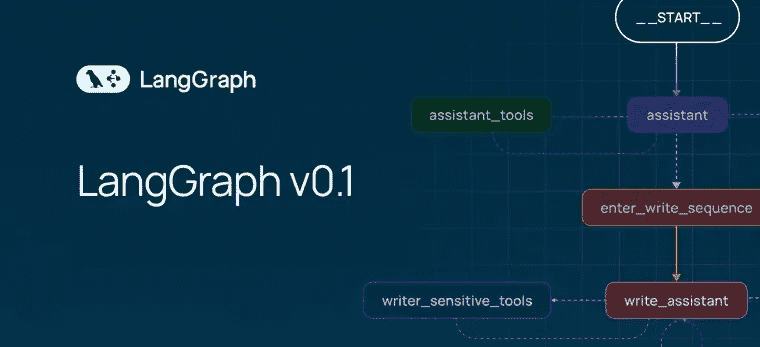
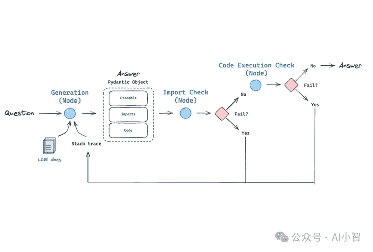
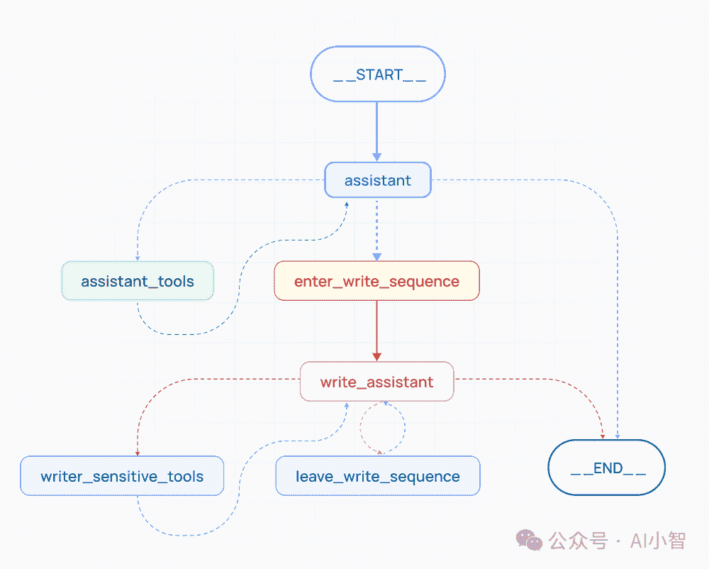
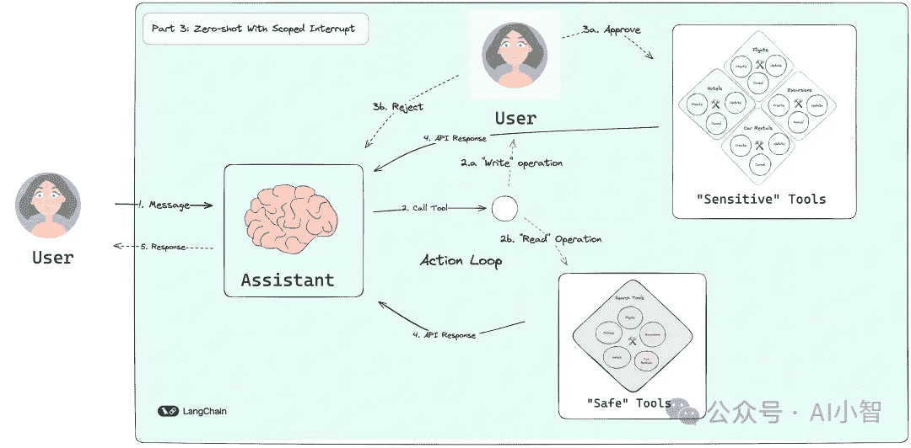

# 全新发布：LangGraph开启认知架构新纪元

> 来源：[https://agijuejin.feishu.cn/docx/JssBdGe2RokurKxmdI3cFEGWnfb](https://agijuejin.feishu.cn/docx/JssBdGe2RokurKxmdI3cFEGWnfb)

> 作者：AI小智

> 原文：[https://mp.weixin.](https://mp.weixin.qq.com/s/BysD8rJN8BorZkyJhxXPHg)qq.com/s/BysD8rJN...

> **❝**

> La[**ngChain于近日正式**](https://mp.weixin.qq.com/mp/appmsgalbum?__biz=Mzg2ODA5NTM1OA==&action=getalbum&album_id=3115055723522015235&token=162966106&lang=zh_CN#wechat_redirect)发布了LangGraph v0.1 的稳定版本。这一版本为开发者提供了强大的工具，能够设计和运行自定义的认知架构，将 AI 智能体的构建推向了一个新的阶段。 本系列合集，点击链接查看

##  LangGraph：自定义认知架构的革新

LangGraph 是什么？它是一个用于构建和管理复杂Agent的框架，允许开发者通过直观的编程接口控制Agent的行为。LangGraph 的核心设计理念是帮助开发者在Agent工作流中增加更好的精度和控制，以适用于现实世界系统的复杂性。

LangGraph 的核心优势在于：

+   **可控性： **LangGraph 提供了对代码流、提示词以及大型语言模型（LLM）调用的低级控制，赋予开发者对认知架构的精细控制能力。

+   **可靠性： **通过添加审核和质量检查机制，LangGraph 确保代理在执行任务过程中满足预设条件，从而提高任务完成的质量并降低错误率。

+   **灵活性： **LangGraph 支持人机协作，允许人类介入复杂的或敏感的任务，为任务的成功完成提供双重保障。

##  深入解析 LangGraph 的核心特点

###  可控性：超强的 Flow 控制流

LangGraph 的灵活 API 允许开发者设计自定义的认知架构，这意味着开发者可以完全掌控代码流、提示词以及 LLM 调用，这些调用接受用户输入并执行操作或生成响应。

+   **条件分支与循环： **LangGraph 支持条件分支和循环，使用户能够构建具有分层或顺序决策模式的单代理或多代理设置，从而实现更复杂的逻辑和工作流程。

+   **自定义提示词工程： **开发者可以根据特定领域或任务需求，对 LLM 提示词进行精细化设计，以引导模型生成更准确、更符合预期的输出。

Flow 控制流示例

> **❝**

> “LangGraph 对我们的 AI 开发至关重要。其用于构建有状态、多角色应用程序的强大框架已经改变了我们评估和优化 AI 面向客户解决方案性能的方式。LangGraph 使我们能够对代理的思维过程进行细粒度控制，这使我们能够做出数据驱动和深思熟虑的决策，以满足客户的多样化需求。” —— Andres Torres（挪威邮轮公司高级解决方案架构师）

###  **可靠性：完备的审核与中断 **

LangGraph 简化了在代理工作流中添加审核和质量检查的流程，确保代理在继续任务之前满足特定条件。

+   **质量控制关卡： **开发者可以设置质量控制关卡，例如检查 LLM 输出的格式、内容或情感倾向，确保代理的行动符合预期标准。

+   **错误处理机制： **LangGraph 允许开发者定义错误处理机制，例如在代理遇到问题时触发警报、记录日志或请求人工干预，从而提高系统的稳定性和可靠性。

审核与中断

> **❝**

> “构建编码代理的原型很容易，但提高其可靠性却非常困难。Replit 希望将编码代理提供给数百万用户——可靠性是我们的首要任务，并将长期保持如此。LangGraph 为我们提供了构建和发布强大编码代理所需的控制和人体工学。” —— Michele Catasta（Replit AI 副总裁）

###  **灵活性：开箱即用的人机协作 **

LangGraph 通过内置的持久层实现了人机协作，使得人类能够参与到代理的自动化流程中。

+   **人工审核与批准： **对于敏感任务，LangGraph 允许开发者设计代理在执行任务之前明确等待人类批准，例如在金融交易或医疗诊断等场景中。

+   **实时干预与调整： **人类专家可以实时监控代理的行动，并在必要时进行干预或调整，例如修改代理的目标、策略或参数，以应对突发情况或优化性能。

审核与中断

> **❝**

> “LangChain 在 LangGraph 上的投入遥遥领先。LangGraph 为我们构建和扩展 AI 工作负载奠定了基础——从对话代理、复杂任务自动化，到“即插即用”的自定义 LLM 支持体验。构建复杂的生产就绪功能的下一章是代理化的，使用 LangGraph 和 LangSmith，LangChain 提供了一种开箱即用的解决方案，可以快速迭代、立即调试和轻松扩展。” —— Garrett Spong（Elastic 首席软件工程师）

##  **结语 **

LangGraph 的发布开启了自定义认知架构的新纪元，为构建更强大、更可靠、更智能的 AI 代理铺平了道路。相信在不久的将来，我们将看到更多基于 LangGraph 的创新应用，共同推动人工智能技术向前发展。

