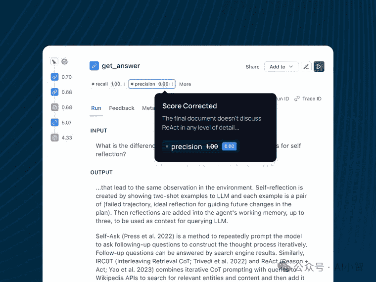
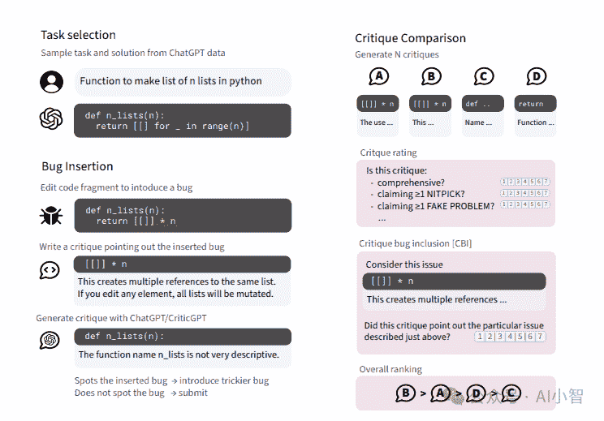

# 难倒吴恩达的LLM评估，有解吗？

> 来源：[https://agijuejin.feishu.cn/docx/XZqcdPBTboqmdxxxMSWcxwtcnlf](https://agijuejin.feishu.cn/docx/XZqcdPBTboqmdxxxMSWcxwtcnlf)

> 作者：AI小智

> 原文： [https://mp.weixin.](https://mp.weixin.qq.com/s/k28Rf2lcYE_p_Ps-Ly8GsA)qq.com/s/k28Rf2lc...

吴恩达

> 在人工智能领域， **评估模型性能和输出质量 **一**直是一个重要**且复杂的问**题。随着大规模语言模型（LLM**）的广泛应用，如**何有效评估这些模型的**输出**变得尤为关键。**本文将探讨 吴恩达来信 中提出的 LLM-as-a-Judge 的困境，并介绍 LangSmith 和 OpenAI 在这一领域的前沿研究和解决方案。

## 吴恩达提出LLM-as-a-Judge的几点困境

吴恩达老师提出了大语言模型评估的两种主要类型

+   是非性评估（具备明确的非对即错的响应）

+   质量性评估（结果只存在好坏程度的标准）

基于以上两类的评估类型，吴恩达提出了使用如下几点困境。

#### 创建用于测量LLM的有标记的测试集成本高昂

在评估LLM性能时，创建一个 **有标记的测试集 **是非常必要的。然而，手动标记数据集不仅耗时，而且成本高昂。这对资源有限的团队来说是一个巨大的挑战。

#### 人类专家来评估改进不切实际，高级的LLM评估改进可靠性不够

虽然**人类专家**可以提供高质量的评估，但在实际操作中，这种方法并不可行。主要原因是专家资源稀缺且昂贵。另一方面，使用高级的LLM进行评估虽然可以降低成本，但其评估结果存在噪声，导致其 可靠性 仍然存在问题。

#### 实施评估产生的额外token成本及时间成本

每次评估都需要额外消耗大量的计算资源，特别是在处理大规模数据时。这不仅增加了时间成本，还带来了额外的token成本。这对需要频繁评估的团队来说是一个不小的负担。

## **LangSmith的工程化解法**

LangSmith以 **few-shot **和 **持续于人类对齐 **作为其理论根基提出了一个新颖的工程化解决方案。即将人类对 LLM-as-a-Judge 输出的纠正存储为 few-shot 示例，然后在未来的迭代中将其反馈到提示中。

其实现的的具体逻辑如下：

#### 基于few-shot提升评估正确率

首先，LangSmith提出了一种基于few-shot学习的方法来提升LLM评估的正确率。通过将少量示例作为输入，模型可以更好地理解评估标准，从而提高评估的准确性。

Aligning LLM-as-a-Judge with Human Preferences

#### 使用反馈收集作为一种程序化地将LLM评估与人类偏好对齐

其次，LangSmith还引入了反馈收集机制，通过程序化地将LLM评估与人类偏好对齐。具体来说，用户可以对LLM的评估进行修正，这些修正将作为示例反馈给模型，以便在未来的评估中参考。

#### LangSmith自动化反馈收集流程，并自动化实现持续改进

为了简化操作，LangSmith实现了自动化反馈收集流程。用户在应用中对评估结果进行修正后，这些修正将自动存储并用于未来的评估。这种持续改进的机制使得评估过程更加高效和准确。

## OpenAI的前沿研究-CriticGPT

**OpenAI也一直在**探索LLM评估的新方法。他们开发了一种名为 CriticGPT 的模型，旨在让AI成为更严苛的评判者，其思路是训练一个专门挑错的模型：

#### **训练模型识别错误**

1.  OpenAI让人类标注员在ChatGPT生成的代码里故意植入一些微妙的bug。

1.  标注员扮演代码审查员的角色，写下他们对这些bug的评论。

1.  用这些数据来训练CriticGPT，让它学会如何发现和指出代码中的问题。

#### **对抗训练提升模型能力**

在训练过程中，标注员会插入一些隐蔽的bug，并验证这些bug是否能够骗过当前版本的CriticGPT。通过这种方法，CriticGPT被迫不断进化，以便发现越来越隐蔽的问题。

#### **强制采样束搜索（FSBS）**

CriticGPT使用了一种称为 强制采样束搜索（FSBS）的技术 ，这种技术可以在生成评论时保持全面性，同时减少“幻觉”和“鸡蛋里挑骨头”现象。这使得CriticGPT能够生成更为准确和有用的评论。

具体来说，FSBS会强制模型生成多个不同的评论片段，用奖励模型对这些片段进行评分，最后根据评分和一个长度修正因子来选择最佳的评论组合。

通过调整长度修正因子，可以在评论的全面性和准确性之间找到最佳平衡点，既不会错过重要问题，又不会过度挑剔。

## **结论**

评估大规模语言模型的输出质量是一个复杂且重要的任务。LLM-as-a-Judge概念虽然有其困境，但通过LangSmith和OpenAI的前沿研究，我们看到了有效解决这些问题的希望。

+   LangSmith通过few-shot学习和自动化反馈收集机制，显著提升了评估的准确性和效率。

+   OpenAI的CriticGPT则通过不断进化和创新技术，帮助人类标注员更好地识别和纠正错误。

这些进展不仅推动了AI评估技术的发展，也为未来的AI应用提供了坚实的基础。

今天的 内容就到这里，如果老铁觉得还行，可以来一波三连，感谢！

论文地址：

[1]https://cdn.openai.com/llm-critics-help-catch-llm-bugs-paper.pdf [2]https://arxiv.org/abs/2005.14165 [3]https://arxiv.org/pdf/2404.12272

参考链接：

[1]https://openai.com/index/finding-gpt4s-mistakes-with-gpt-4/ [2]https://zhuanlan.zhihu.com/p/700783346 [3]https://blog.langchain.dev/aligning-llm-as-a-judge-with-human-preferences/