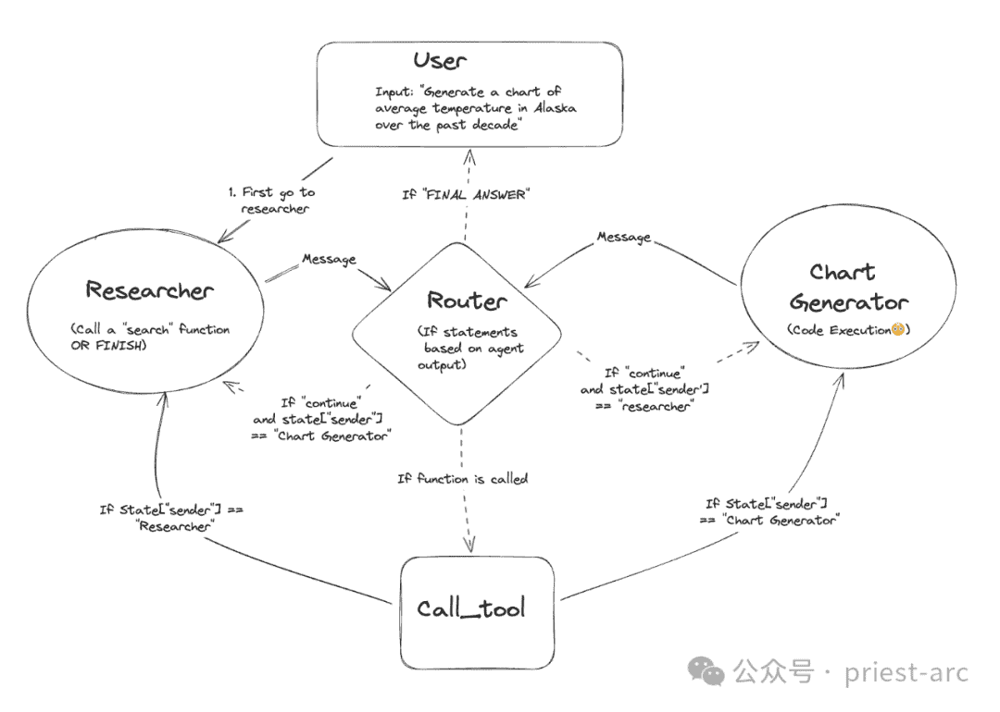
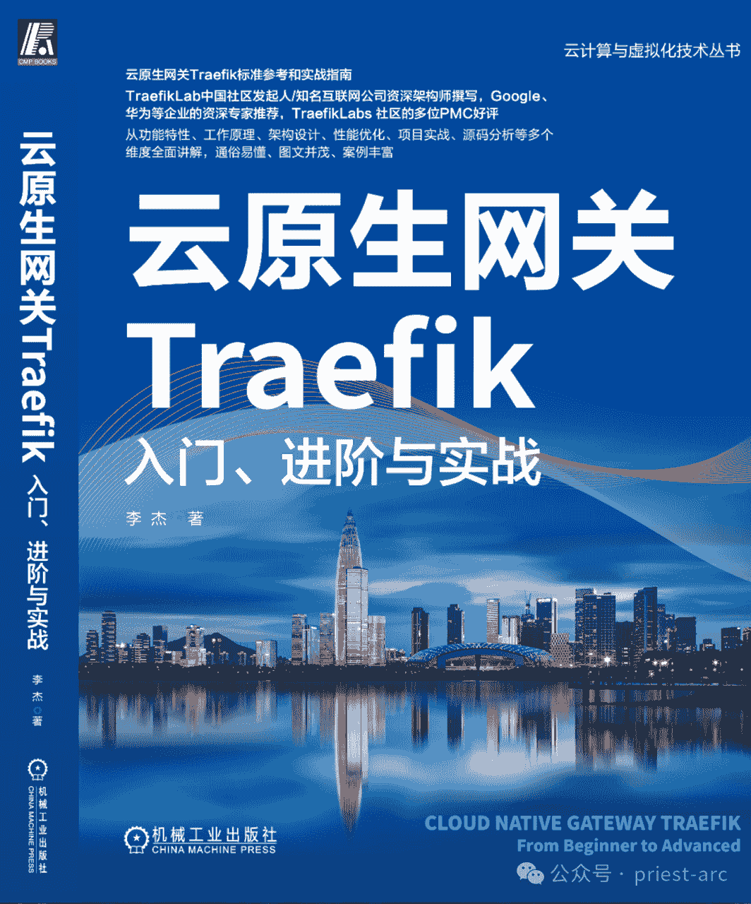

# LangGraph，知多少？

> 来源：[https://agijuejin.feishu.cn/docx/NXKDdjVNjo68QGxm9wMcHLFfnPh](https://agijuejin.feishu.cn/docx/NXKDdjVNjo68QGxm9wMcHLFfnPh)

> 作者： Luga Lee | 架构驿站

> 原文： [https://mp.weixin.](https://mp.weixin.qq.com/s/g1tZD7G75bcEKMA9ZDZLkQ)qq.com/s/g1tZD7G7...

Hello folks，我是 Luga，今天我们来聊一下人工智能最新框架 - 用于构建循环状态多行为体代理系统的高效框架 - LangGraph

LangGraph 作为 LangChain 的自然延伸，完美地填补了后者在构建复杂、动态的 AI 应用方面的空白。它为我们提供了一种全新的视角，让我们能够更轻松地创建智能代理，并将其应用于各种复杂的业务场景。

— **0 1 **—

何为 LangGraph ？以及 核心优势分析

LangGraph 是 LangChain 生态系统中一颗崭新的创新之星，为构建基于 LLM （大语言模型）的有状态、多代理应用程序提供了一个全新的范式和强大的框架支持。作为一个专注于 AI 辅助开发的库，LangGraph 凭借其独特的设计理念和卓越的性能优势，在同类框架中脱颖而出，为技术开发者带来了前所未有的灵活性和可控性。

与其他 LLM 框架相相比，LangGraph 最显著的特点在于其对循环（Cycles）流程的天然支持。在现实世界中，许多复杂的编程任务往往需要反复迭代、多次尝试才能完成，因此，代理的行为通常呈现出循环的特征。而传统的基于有向无环图（DAG）的解决方案无法很好地捕捉和表达这种循环性，从而限制了它们在建模复杂任务时的灵活性。相比之下，LangGraph 从一开始就将循环作为核心设计理念，允许开发者在图形结构中自由定义循环边和循环节点，从而更加贴合实际编程场景的需求。

除了对循环的支持，LangGraph 还以其卓越的可控性（Controllability）而备受推崇。作为一个非常 Low-Level 的框架，LangGraph 为开发者提供了对应用程序流程和状态的细粒度控制能力。开发者可以精确地定义每个节点的行为逻辑、边的属性约束，甚至可以动态地修改图形结构，实现自适应的任务调度和管理。这种精细化的控制能力对于创建可靠、高性能的 AI 辅助开发工具至关重要，使得开发者能够充分发挥自身的创造力，打造出完全契合特定场景需求的定制化解决方案。

此外，LangGraph 还具有出色的持久性（Persistence）特性。框架内置了对持久化状态对象的支持，确保了任务执行过程中的中间结果和上下文信息不会因为意外中断而丢失。借助这一特性，开发者可以轻松实现高级的"人在环"（Human-in-the-Loop）和内存（Memory）功能，使 AI 代理能够在长时间的任务执行过程中保持一致的上下文理解和决策能力，极大地提升了人机协作的流畅性和连贯性。

LangGraph 的设计灵感来自于著名的图形计算模型 Pregel 和大数据处理引擎 Apache Beam，这使得其在处理大规模、复杂的数据流方面具有天然的优势。同时，LangGraph的公共接口也借鉴了 NetworkX 等知名图形库的精华，为开发者提供了熟悉且易于上手的API设计。

值得一提的是，作为 LangChain 生态系统中的重要一员，LangGraph 与 LangChain 和 LangSmith 等其他框架和库无缝集成，从而使开发者能够充分利用这些工具的强大功能，构建出更加智能、高效的辅助开发解决方案。然而，LangGraph 本身也是一个独立的开源库，可以在不依赖LangChain的情况下单独使用，这为开发者提供了更大的灵活性和选择空间。

总的来说，LangGraph凭借其独特的设计理念和卓越的技术实力，为开发者提供了一个强大而灵活的框架，支持构建复杂、智能且高度交互的系统。无论是循环与分支、持久性、流支持，还是与 LangChain 生态系统的无缝集成，LangGraph 都展现出了其在推动人工智能辅助开发革新方面的巨大潜力。

— **0 2 **—

为什么需要 LangGraph ？

作为一款强大的开源框架， L angGraph 能够显著改进许多现有的解决方案，为复杂的多代理系统提供 了灵活、高效的支持。以下是使用 LangGraph 的几个关键原因，具体可参考：

1、改进 RAG 管道

LangGraph 可以通过其独特的循环图结构增强 RAG（Retrieval-Augmented Generation）管道。传统的 RAG 管道在处理复杂查询时可能会遇到瓶颈，而 LangGraph 的循环图结构允许引入反馈循环来评估检索对象的质量。如果初始检索的结果不够理想，系统可以改进查询并重复检索过程，直到获得满意的结果。这样可以大幅提高检索和生成的准确性和质量。

2、多代理工作流程支持

LangGraph 设计旨在支持多代理工作流程，对于解决需要拆分为多个子任务的复杂任务尤为重要。在这种架构中，不同的代理可以拥有共享状态，并利用不同的 LLM 和工具协同工作。每个代理负责处理特定的子任务，然后通过共享的状态和信息相互协作，最终完成整个任务。这种方式不仅提高了任务的执行效率，还增强了系统的灵活性和可扩展性。

3、环中人支持

LangGraph 内置了对“环中人”（Human-in-the-Loop）工作流程的支持。这意味着在执行复杂任务时，人类可以在系统移动到下一个节点之前查看和审核当前状态。这种功能非常适合需要人类专家进行干预和决策的应用场景，如医疗诊断、金融分析等。通过结合人类智慧和自动化处理，系统能够提供更高质量和更可靠的结果。

4、规划代理构建

LangGraph 非常适合构建规划代理。在这种代理系统中，LLM 规划师负责制定计划并分解用户请求，而执行者则调用工具和函数来完成具体任务。LLM 根据先前的输出合成最终答案。这种结构可以有效地处理复杂和动态的任务需求，确保系统能够灵活应对各种挑战。

5、构建多模态代理

LangGraph 还可以用于构建多模态代理，如支持视觉输入的网络导航器。通过整合不同类型的数据和输入方式，LangGraph 可以创建更智能、更全面的代理系统。例如，在网络导航器中，系统不仅可以处理文本指令，还可以通过视觉识别和分析网页内容，从而提供更丰富和直观的导航体验。

总的来说，LangGraph 通过其循环图结构、多代理支持、环中人工作流程、规划代理构建和多模态代理的能力，提供了一个强大且灵活的框架，能够显著提升复杂系统的性能和可靠性。无论是在研发前沿的人工智能系统还是在实际应用中，LangGraph 都展示了其独特的优势和潜力。

— **0 3 **—

LangGraph 到底能够做什么 ？

在人工智能技术日新月异的当下，复杂的人工智能编码代理无疑正成为推动各行各业创新发展的重要力量。作为智能化的代表，LangGraph 通过与人类无缝协作，不仅极大地提高了工作效率，更为我们打开了一扇全新的体验大门。其应用场景较为广泛，具体可参考如下：

1、个人助手

首先，LangGraph 有望成为我们日常生活中不可或缺的个人助理。想象一下，在外面的电子设备上有一个智能助手，时刻准备着为我们提供帮助。无论是通过文字交流、语音对话,还是手势操作，这个助理都能洞悉需求，高效地完成各种任务。这不仅将极大地提高我们的工作效率，更有望彻底改变我们的生活方式，让我们拥有更多自主支配时间的自由。

2、AI 讲师

在教育领域，LangGraph 也有着广阔的应用前景。目前虽然已经有不少基于自然语言处理的聊天机器人问世，但它们毕竟存在一定的局限性。而配备了强大工具的人工智能教师代理则能够突破对话式教学的界限，根据学生的反馈动态调整教学方法，实现真正个性化的教育。这种智能化的虚拟讲师不仅能够改变传统教学模式，更有望促进教育公平,让每一个学生都能获得高质量的教育资源。

3、软件用户体验

再者，LangGraph 在提升软件用户体验方面也大有可为。传统软件界面往往需要用户手动操作和导航，这不仅效率低下，也增加了用户的学习成本。而融合了LangGraph 的软件则可以接受语音或手势指令，由代理直接执行相应的操作，极大地简化了用户的操作流程。这种智能化的人机交互不仅能够提高软件的可用性，更有望推动无障碍体验的普及，让所有用户都能轻松获取软件带来的价值。

4、空间计算

随着 AR/VR 技术的不断发展，LangGraph 在空间计算领域的应用也日益受到关注。这些代理能够感知和处理周围的环境信息，并根据具体需求执行相应的任务，例如导航、信息查询等。可以预见，在不久的将来，LangGraph 将成为我们在虚拟现实世界中的得力助手，为我们带来全新的体验和可能性。

5、AI 系统

最后，构建一个以 LangGraph 为核心的操作系统（LLM OS）无疑是人工智能代理发展的最高境界。在这种系统中，代理将被赋予"一等公民"的地位，负责处理日常的复杂任务。通过与人类的紧密协作，LangGraph 将能够高效地规划和执行工作流程，释放人类的创造力，从而推动整个社会的智能化进程。这种人工智能优先的操作系统不仅代表了技术发展的最高水平，更象征着人类与智能体之间新型关系的建立。

总的来说，复杂的人工智能编码代理无疑正在为各行各业带来前所未有的机遇和变革。无论是个人助理、教育辅助、软件优化，还是空间计算和智能操作系统，LangGraph 都将成为推动创新发展的重要力量。

Reference ：

[1] https://langchain-ai.github.io/langgraph/tutorials/rag/langgraph_adaptive_rag/

[2] https://blog.langchain.dev/langgraph-multi-agent-workflows/

Adiós !

··································

**对云原生网关 Traefik 技术感兴趣的**朋友们，可以了解一下我的新书，感谢支持！

Hello folks，我是 Luga，Traefik Ambassador，Jakarta EE Ambassador， 一个 15 年+ 技术老司机，从 IT 屌丝折腾到码畜，最后到“酱油“架构师。如果你喜欢技术，不喜欢呻吟，那么恭喜你，来对地方了，关注我，共同学习、进步、超越～