# 想自己利用OpenAI做一个文档问答的话......

> 来源：[https://agijuejin.feishu.cn/docx/Cy4OdLUgbowJhRxWsxTcMLzMnUf](https://agijuejin.feishu.cn/docx/Cy4OdLUgbowJhRxWsxTcMLzMnUf)

> 作者：悟乙己

> 原文：[https://zhuanlan.z](https://zhuanlan.zhihu.com/p/614334596)hihu.com/p/614334...

本篇举几个例子来说明如何利用OpenAI Embedding做文档问答，如何进行工程化，工程化的难点与步骤有些什么。了解类似ChatPDF这样应用的实现原理。为后续自己搞一个做预调研！

---

## 0 文档问答的几种历史方法

来自亚马逊云与JinaAI联合举办的Tech Talk 主题活动的讲座：

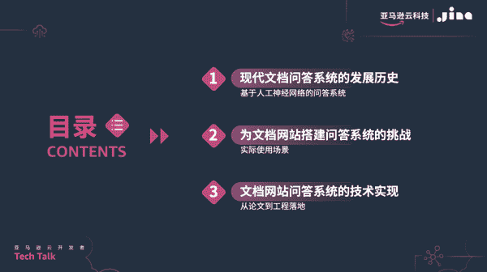

[大规模语言训练模型应用，如何让文档问答系统快速拥有“高智](https://link.zhihu.com/?target=https%3A//www.infoq.cn/article/dnwzeft5uhclwywamfuq)商”？_AI_张雅文_InfoQ精选文章

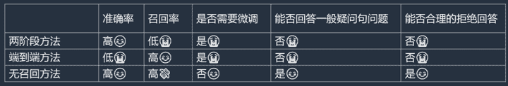

+   **两阶段方法： **将问答过程分为两个阶段。 **第一个阶段称为召回阶段 **，**系统会根据用户的提问从文本库或**知识库中检索相关的文本片段或知识点，利用传统的检索技术去召回可能的文档候选。 第二个阶段称之为阅读理解阶段 ，会利用深度学习的机器阅读理解模型，从对应的候选文档里将答案抽取出来。

+   **端到端方法： **依旧是分为召回和阅读理解两个阶段，区别在于，它使用了向量检索的方式来替代传统的检索技术用于召回。

+   **无**召回的方法：这类方法的代表是 GPT 模型，它通过训练大规模的语言模型来记忆知识，不需要外部的存储机制来存储索引， 为了回答一般疑问句和解决拒绝回答的问题

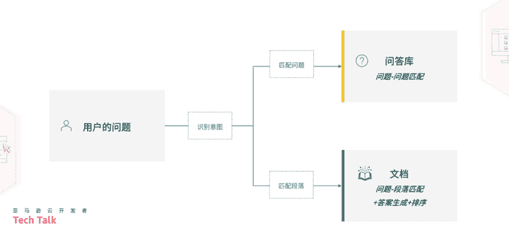

从算法设计和工程实践的角度提出了一系列解决方案

具体来说，当问题输入后，首先使用意图识别来判断用户是否真的在询问问题。

接着，分为两条路径解答问题：

+   一条是针对问答库的，将用户的问题与问答库中的问题进行匹配；

+   另一种则是采用传统的问答系统方法

第一种路径的优劣：

DocsQA 使用了 Sentence Transformer 提供的 paraphrase-mpnet-base-v2 模型。将问答库中的所有问题转换为向量，同样地，用户的问题也被转换为向量，然后在向量空间中寻找相似的问题。如果找到了匹配的问题，则将相应的答案返回给用户。这条路径的最大优点是准确率非常高，缺点在于严重依赖于问答库。因此，这条路径非常适合处理高频出现的重复性问题。

第二条路径的优劣：

第二种方式本质是在整个文档中查找答案，然后使用 GPT-3 模型生成答案

---

检索增强生成（RAG）：

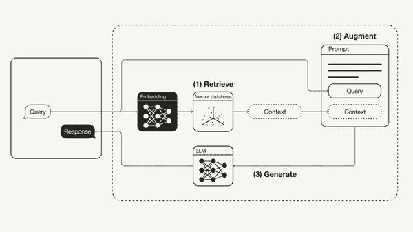

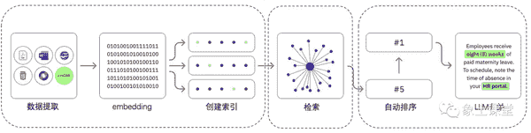

RAG调用模式（来自： [大模型行业问答知识总结：数据向量化、RA](https://link.zhihu.com/?target=https%3A//mp.weixin.qq.com/s/PnHO0cwDQfitbF4oF_2YhQ)G、langchain、Agent技术 ）：

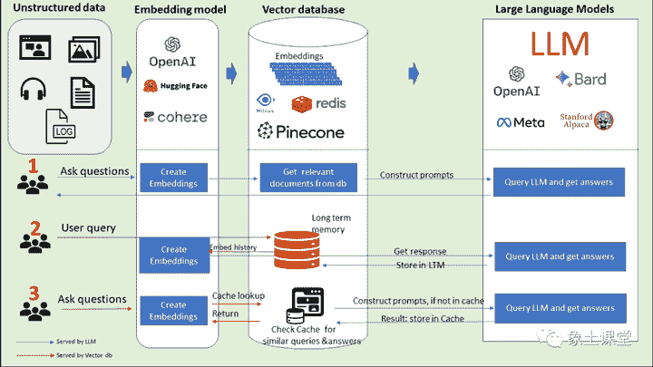

---

## 1 document.ai

### 1.1 ChatGPT Embedding使用框架

基于向量数据库与GPT3.5的通用本地知识库方案(A universal local knowledge base solution based on vector database and GPT3.5)

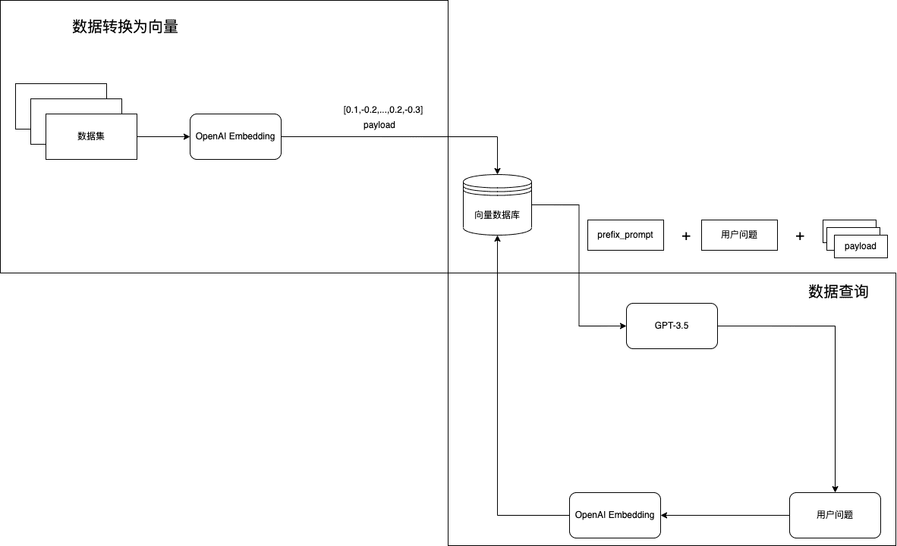

流程：

+   将本地答案数据集，转为向量存储到向量数据

+   当用户输入查询的问题时，把问题转为向量然后从向量数据库中查询相近的答案topK 这个时候其实就是我们最普遍的问答查询方案，在没有GPT的时候就直接返回相关的答案整个流程就结束了

+   现在有GPT了可以优化回答内容的整体结构，在单纯的搜索场景下其实这个优化没什么意义。但如果在客服等的聊天场景下，引用相关领域内容回复时，这样就会显得不那么的突兀。

### 1.2 工程化中的一些优化点

> 问答拆分查询

在上面的例子中，我们直接将问题和答案做匹配，有些时候因为问题的模糊性会导致匹配不相关的答案。

如果在已经有大量的问答映射数据的情况下，问题直接搜索问题集，然后基于已有映射返回当前问题匹配的问题集的答案，这样可以提升一定的问题准确性。

> 抽取主题词生成向量数据

因为答案中有大量非答案的内容，可以通过抽取答案主题然后组合生成向量数据，也可以在一定程度上提升相似度，主题算法有LDA、LSA等。

> 自训练的Embedding模型

openAI 的Embedding模型数据更多是基于普遍性数据训练，如果你要做问答的领域太过于专业有可能就会出现查询数据不准确的情况。

[解决方案是自训练](https://link.zhihu.com/?target=https%3A//github.com/shibing624/text2vec) Embedding 模型，推荐一个项目 text2vec

> 基于 Fine-tune

目前自身测试下来，使用问答数据集对GPT模型进行Fine-tune后，问答准确性会大幅提高。你可以理解为GPT通过大量的专业领域数据的学习后成为了该领域专家，然后配合调小接口中 temperature 参数，可以得到更准确的结果。

但 现在 Fine-tune 训练和使用成本还是太高，每天都会有新的数据，不可能高频的进行 Fine-tune。一个想法是每隔一个长周期对数据进行 Fine-tune ，然后配合外置的向量数据库的相似查询来补足 Fine-tune 模型本身的数据落后问题。

[  ](https://link.zhihu.com/?target=https%3A//github.com/GanymedeNil/document.ai)

---

## 2 利用ChatGPT 和Milvus快速搭建智能问答机器人

### 2.1 ChatGPT API简述

ChatGPT以文字方式互动，除了可以透过人类自然对话方式进行交互，还可以用于相对复杂的语言工作，包括自动文本生成、自动问答、自动摘要等在内的多种任务。

ChatGPT 是由 OpenAI 最先进的语言模型 gpt-3.5-turbo 提供支持， GPT-3.5-turbo 模型是以一系列消息作为输入，并将模型生成的消息作为输出。

```
# Note: you need to be using OpenAI Python v0.27.0 for the code below to work
import openai

openai.ChatCompletion.create(
  model=&quot;gpt-3.5-turbo&quot;,
  messages=[
        {&quot;role&quot;: &quot;system&quot;, &quot;content&quot;: &quot;You are a helpful assistant.&quot;},
        {&quot;role&quot;: &quot;user&quot;, &quot;content&quot;: &quot;Who won the world series in 2020?&quot;},
        {&quot;role&quot;: &quot;assistant&quot;, &quot;content&quot;: &quot;The Los Angeles Dodgers won the World Series in 2020.&quot;},
        {&quot;role&quot;: &quot;user&quot;, &quot;content&quot;: &quot;Where was it played?&quot;}
    ]
)
```

消息是一个对象数组，其中每个对象都有一个角色，一共有三种角色。

+   **系统 **消息有助于设置助手的行为。在上面的例子中，助手被指示 “你是一个得力的助手”。

+   **用户 **消息有助于指导助手。 就是用户说的话，向助手提的问题。

+   **助手 **消息有助于存储先前的回复。这是为了持续对话，提供会话的上下文。

我们调用的ChatGPT的API是无状态的，意味着你需要自己去维持会话状态，保存上下文，每次请求的时候将之前的历史消息全部发过去，但是这里面有两个问题：

+   1. 为了建立持续会话，请求内容会越来越大，这些内容前后的关联关系并不是很大；

+   2. 语言模型以称为 tokens 的块读取文本，需要为为每个 token 支付费用，这样Token 费用很高。

+   3. 为了保证API调用的有效性，令牌总数必须是 低于模型的最大限制（gpt-3.5-turbo-0301 为 4096 个令牌）

我们借助OpenAI的embedding模型和自己的数据库，先在本地搜索数据获得上下文，然后在调用ChatGPT的API的时候，加上本地数据库中的相关内容，这样就可以让ChatGPT从你自己的数据集获得了上下文 ，再结合ChatGPT自己庞大的数据集给出一个更相关的理想结果。

### 2.2 **整体架构**

本文通过语义相似度匹配来实现一个问答系统，大致的构建过程：

1.  获取某一特定领域里大量的带有答案的中文或者英文问题（本文将之称为标准问题集），把它变成CSV或者Json这样易于处理的格式，并且分成小块（chunks），每块不要超过8191个Tokens，因为这是OpenAI embeddings模型的输入长度限制。

1.  使用OpenAI的embedding模型将这些问题转化为特征向量，需要将转换后的结果保存到本地数据库。 注意一般的关系型数据库是不支持这种向量数据的，需要使用向量数据库，这里使用Milvus，同时Milvus将给这些特征向量分配一个向量ID。

1.  当然你保存的时候，可以把原始的文本块和数字向量一起存储，这样可以根据数字向量反向获得原始文本。也可以将这些代表问题的ID和其对应的答案存储在关系数据库SQL Server/Postgresql中, 这一步有点类似于全文索引中给数据建索引。

当用户提出一个问题时：

1.  通过OpenAI的embedding模型将之转化为特征向量

1.  在Milvus中对特征向量做相似度检索，得到与该问题最相似的标准问题的id, 拿到这个数字向量后，再去自己的数据库进行检索，那么就可以得到一个结果集，这个结果集会根据匹配的相似度有个打分，分越高说明越匹配， 这样就可以按照匹配度倒序返回一个相关结果。

1.  在PostgreSQL得出对应的结果集。然后根据拿到的结果集，将结果集加入到请求ChatGPT的prompt中。

系统交互图来自宝玉的微博（ [https:// m.weibo.cn/status](https://link.zhihu.com/?target=https%3A//m.weibo.cn/status/4875446737175262)/48754 46737175262  ）如下：

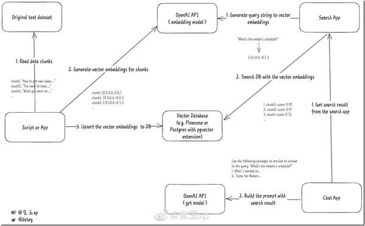

[  ](https://link.zhihu.com/?target=https%3A//github.com/mckaywrigley/paul-graham-gpt)

[Gi](https://link.zhihu.com/?target=https%3A//github.com/mckaywrigley/paul-graham-gpt)tHub - mckaywrigley/paul-graham-gpt: AI search & chat for all of Paul Graham’s essays.

[  ](https://link.zhihu.com/?target=https%3A//github.com/mckaywrigley/paul-graham-gpt)

[  ](https://link.zhihu.com/?target=https%3A//www.cnblogs.com/shanyou/p/17179348.html)

---

## 3 llama-index(gpt-index)对话式文档问答解决方案

本篇介绍了类似CHATPDF这类应用的背后大致运作原理。

### 3.1 任务描述和问题分析

对话式文档问答，字面意思就是基于文档建立的问答系统。使用这项技术，开发者无需梳理意图、词槽，无需进行问题和答案的整理，只需准备文本格式的业务文档（例如洗碗机的使用手册），就可以得到一个问答系统，回答用户的各种问题（例如“洗碗机排水管堵塞了怎么办“）。

如果使用openai api来实现对话式文档问答，最朴素的想法把这个当成一个阅读理解问题，构建如下的prompt：

+   现有一个问题：“洗碗机排水管堵塞了怎么办”，请根据下面的文章来回答，文章内容如下："......"

这种方法在文档较长时存在两个问题：

+   第一，openai api存在最大长度的限制，例如chatgpt的最大token数为4096，此时直接对文档截断，存在上下文丢失的问题

+   第二，api的调用费用和token长度成正比，tokens数太大，则每次调用的成本都会很高

### 3.2 解决思路

可以参考搜索引擎中“先检索再重排”的思路，针对文档问答设计“先检索再整合“的方案，整体思路如下：

+   首先准备好文档，并整理为纯文本的格式。把每个文档切成若干个小的chunks

+   调用文本转向量的接口，将每个chunk转为一个向量，并存入向量数据库

+   [文本转向量可以使用openai embedding（ https:/](https://link.zhihu.com/?target=https%3A//platform.openai.com/docs/guides/embeddings/what-are-embeddings)/ platform.openai.com/doc s/guides/embeddings/what-are-embeddings  ）

+   也可以使用其他方案，如fasttext/simbert等

+   当用户发来一个问题的时候，将问题同样转为向量，并检索向量数据库，得到相关性最高的一个或几个chunk

+   将问题和chunk合并重写为一个新的请求发给openai api，可能的请求格式如下：

```
结合下面的段落来回答问题：“ 如何使用预约功能”

* 段落1: 您可以按照以下步骤使用预约功能....
* 段落2: 在使用预约功能之前，请确保您已正确地设置了洗涤程序....
* 段落3: .......
```

上述“先检索再整合的逻辑”已经封装在llama-index库中

### 3.3 代码案例

llama-index的前身是gpt-index项目，最近才刚改名为'llama-index'。下面给出一个基于llama-index实现文档问答的具体demo，代码已上传至github:

[  ](https://link.zhihu.com/?target=https%3A//github.com/xinsblog/try-llama-index)

一些教程案例：

[  ](https://link.zhihu.com/?target=https%3A//uxdesign.cc/i-built-an-ai-that-answers-questions-based-on-my-user-research-data-7207b052e21c)

参考材料：

[  ](https://link.zhihu.com/?target=https%3A//gpt-index.readthedocs.io/en/latest/index.html)

[  ](https://zhuanlan.zhihu.com/p/613155165)

---

## 4 loli.xing 基于 ChatGPT 的客服系统

在 OpenAI 放出 gpt-3.5-turbo 模型之后,我们决定使用 AI 来加速目前我们重复率最高的工作:客服

按照以下方法来实现:

+   使用 [语雀的 API ](https://link.zhihu.com/?target=https%3A//www.yuque.com/yuque/developer)获取我们的帮助手册及FAQ

+   获得到每篇文章后,按照 markdown 的标题进行分割,每个小标题对应一块语料.并在数据库中记录对应的网址和锚点,方便后续输出时同步给出参考文档.

+   使用 openai embeddings 获取每块语料的向量表示.

+   对用户的提问也使用 openai embeddings 提取向量.

+   使用 余弦相似度 计算用户提问和每块语料的相似度,并返回相似度最高10块的语料.

+   对每块语料按照相似度从高到低的顺序 对 token 进行求和,获取小于 2000 时的语料列表.

+   按照以下格式给与 gpt-3.5-turbo 的 system role 输入

```
你是 $$$ 系统的客服,请按照后续给予的使用手册回答用户的问题.
 使用手册内容如下:
```

+   获取 gpt-3.5-turbo 的输出.

目前处于安全考虑, gpt-3.5-turbo 的输出仅发送到客服汇总群,并由客服人员进行回复.同时给与客服相关语料的标题及链接,方便客服人员进行回复.

[  ](https://link.zhihu.com/?target=https%3A//loli.xing.moe/ChatGPT_as_customer_service/)

---

## 5 Document_QA

[  ](https://link.zhihu.com/?target=https%3A//github.com/fierceX/Document_QA)

根据传入的文本文件，回答你的问题。

读取文件，并进行分割

+   对于每段文本，使用text-embedding-ada-002生成特征向量

+   将向量和文本对应关系存入本地pkl文件

+   对于用户输入，生成向量

+   使用向量数据库进行最近邻搜索，返回最相似的文本列表

+   使用gpt3.5的chatAPI，设计prompt，使其基于最相似的文本列表进行回答

就是先把大量文本中提取相关内容，再进行回答，最终可以达到类似突破token限制的效果

后续可以考虑将openai的文本向量改成自定义的向量生成工具

---

## 6 ChatWeb

> ChatWeb可以爬取任意网页并提取正文，生成概要，然后根据正文内容回答你的问题。 目前是个原理展示的Demo，还没有细分逻辑。 基于gpt3.5的chatAPI和embeddingAPI，配合向量数据库。

[  ](https://link.zhihu.com/?target=https%3A//github.com/SkywalkerDarren/chatWeb)

基本类似于现有的chatPDF，自动化客服AI等项目的原理。

+   爬取网页

+   提取正文

+   对于每一段落，使用gpt3.5的embeddingAPI生成向量

+   每一段落的向量和全文向量做计算，生成概要

+   将向量和文本对应关系存入向量数据库

+   对于用户输入，生成向量

+   使用向量数据库进行最近邻搜索，返回最相似的文本列表

+   使用gpt3.5的chatAPI，设计prompt，使其基于最相似的文本列表进行回答

就是先把大量文本中提取相关内容，再进行回答，最终可以达到类似突破token限制的效果

## 7 chatpdf-minimal-demo

[  ](https://link.zhihu.com/?target=https%3A//github.com/postor/chatpdf-minimal-demo)

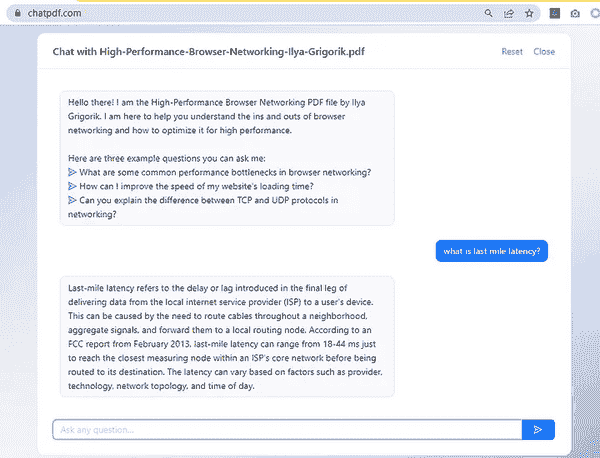

实现原理 | process flow

+   文章切片到段落 | split articles into pieces

+   通过 OpenAI 的 embedding 接口将每个段落转换为 embedding | convert each piece into embedding with OpenAI

+   将提问的问题转换为 embedding | convert user question into embedding

+   把问题的 embedding 比较所有段落 embedding 得到近似程度并排序 | compare question embedding with all the embeddings of pieces and sort the result

+   把和提问(语义)最接近的一个或几个段落作为上下文，通过 OpenAI 的对话接口得到最终的答案 | use the nearest (meaning) piece(s) as context and ask ChatGPT for the final answer

几个核心代码片段：

获取embedding：

```
import openai

def get_embedding(text: str, model: str=EMBEDDING_MODEL) -&gt; list[float]:
    result = openai.Embedding.create(
      model=model,
      input=text
    )
    return result[&quot;data&quot;][0][&quot;embedding&quot;]
```

用户问题排序：

```
def order_document_sections_by_query_similarity(query: str, embeddings) -&gt; list[(float, (str, str))]:
    #pprint.pprint(&quot;embeddings&quot;)
    #pprint.pprint(embeddings)
    &quot;&quot;&quot;
    Find the query embedding for the supplied query, and compare it against all of the pre-calculated document embeddings
    to find the most relevant sections. 
    
    Return the list of document sections, sorted by relevance in descending order.
    &quot;&quot;&quot;
    query_embedding = get_embedding(query)
    
    document_similarities = sorted([
        (vector_similarity(query_embedding, doc_embedding), doc_index) for doc_index, doc_embedding in enumerate(embeddings)
    ], reverse=True, key=lambda x: x[0])
    
    return document_similarities
```

当问题被问到时，获取最近的信息作为上下文并询问 ChatGPT:

```
def ask(question:str,embeddings,sources):
    ordered_candidates = order_document_sections_by_query_similarity(question,embeddings)
    ctx = &quot;&quot;
    for candi in ordered_candidates:
        next = ctx + &quot; &quot; + sources[candi[1]]
        if len(next)&gt;CONTEXT_TOKEN_LIMIT:
            break
        ctx = next
    if len(ctx) == 0:
      return &quot;&quot;    
    
    prompt = &quot;&quot;.join([
        u&quot;Answer the question based on the following context:\n\n&quot;
        u&quot;context:&quot;+ ctx +u&quot;\n\n&quot;
        u&quot;Q:&quot;+question+u&quot;\n\n&quot;
        u&quot;A:&quot;
                        ])

    completion = openai.ChatCompletion.create(model=&quot;gpt-3.5-turbo&quot;, messages=[{&quot;role&quot;: &quot;user&quot;, &quot;content&quot;:prompt}])
    return [prompt, completion.choices[0].message.content]
```

一个网页版图例：

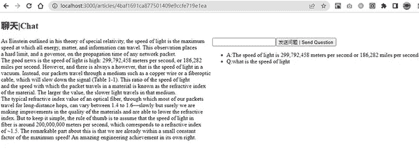

[  ](https://link.zhihu.com/?target=https%3A//postor.medium.com/how-to-code-a-project-like-chatpdf-e40441cb4168)

---

## 8 llama_index建立个人知识库的GPT问答

[  ](https://zhuanlan.zhihu.com/p/615293313)

[  ](https://zhuanlan.zhihu.com/p/617229222)

[  ](https://zhuanlan.zhihu.com/p/624453714)

l[lama](https://link.zhihu.com/?target=https%3A//github.com/jerryjliu/llama_index)_index库是一个项目，它提供了一个中心接口，可以将您的语[言模型（](https://link.zhihu.com/?target=https%3A//zhijingeu.medium.com/building-a-python-script-for-natural-language-q-a-using-llamaindex-45e2ee60e2f3)LLM）与外部数据连接起来 [2] 。它提供了一组数据结构，可以为各种LLM任务索引大量数据，并消除了关于提示大小限制和数据摄入的问题 [1] 。它还支持与LangChain和LlamaHub等其他工具或库的集成

langchain的向量搜索

尽管 llama_index 是基于 langchain 开发的，但向量搜索这件事本来也被OpenAI官方吸收了，向量数据库也成熟了那么多年。 langchain 有什么理由不整合呢？毕竟 langchain 是拿了高额的投资的，自然不会放弃扩张自己版图的机会。

所以， langchain 也有自己的 index 模块和 vectorstore 对象。其设计和retrieval-plugin的思路比较像 ———— 接入第三方的向量数据库。而且这俩模块专注于完成向量搜索，你输入一个问句，它只会将相关的参考文档返回给你。并不急于做后续的GPT请求。这样你就可以在发GPT请求之前添加许多自己的逻辑了。

---

## 9 [ChatGLM-6B ](https://link.zhihu.com/?target=https%3A//github.com/THUDM/ChatGLM-6B)+ [langchain ](https://link.zhihu.com/?target=https%3A//github.com/hwchase17/langchain)实现的基于本地知识的 ChatGLM 应用

[  ](https://link.zhihu.com/?target=https%3A//github.com/imClumsyPanda/langchain-ChatGLM)

受 [GanymedeNil ](https://link.zhihu.com/?target=https%3A//github.com/GanymedeNil)的项目 [document.ai ](https://link.zhihu.com/?target=https%3A//github.com/GanymedeNil/document.ai)和 [AlexZhangji ](https://link.zhihu.com/?target=https%3A//github.com/AlexZhangji)创建的 ChatGLM-6B Pull Request 启发，建立了全部基于开源模型实现的本地知识问答应用。

✅ 本项目中 Embed[ding 默认选用的是](https://link.zhihu.com/?target=https%3A//github.com/THUDM/ChatGLM-6B)** Ga**nym**edeNil/**text2vec-large-chinese ，LLM 默认选用的是 ChatGLM-6B 。依托上述模型，本项目可实现全部使用 开源 模型 离线私有部署 。

⛓️ 本项目实现原理如下图所示，过程包括加载文件 -> 读取文本 -> 文本分割 -> 文本向量化 -> 问句向量化 -> 在文本向量中匹配出与问句向量最相似的 top k 个 -> 匹配出的文本作为上下文和问题一起添加到 prompt 中 -> 提交给 LLM 生成回答。

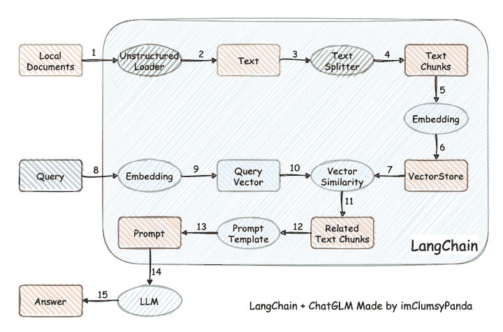

## 10 基于ChatGLM-6b+langchain实现本地化知识库检索与智能答案生成

[  ](https://link.zhihu.com/?target=https%3A//github.com/yanqiangmiffy/Chinese-LangChain)

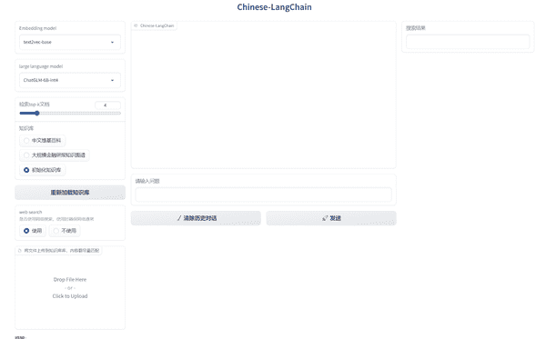

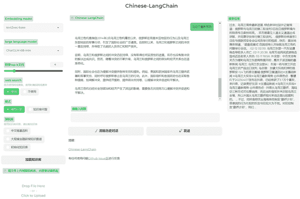

已经有很多更新：

+   2023/04/22 支持模型多机多卡推理

+   2023/04/20 支持模型问答与检索问答模式切换

+   2023/04/20 感谢HF官方提供免费算力，添加Hugg[ingF](https://link.zhihu.com/?target=https%3A//huggingface.co/spaces/ChallengeHub/Chinese-LangChain)ace Spaces在线体验[ DEMO

+   2023/04/19 发布45万Wikipedia的文本预处理语料以及FAISS索引向量

+   2023/04/19 引入ChuanhuChatGPT皮肤

+   2023/04/19 增加web se[arch功能，需要确保网络畅](https://link.zhihu.com/?target=https%3A//github.com/wanghao07456)通！(感谢 @wanghao07456 ,提供的idea)

+   2023/04/18 webui增加知识库选择功能

+   2023/04/18 修复推理预测超时5s报错问题

+   2023/04/17 支持多种文档上传与内容解析：pdf、docx，ppt等

+   2023/04/17 支持知识增量更新

## 11 快速小程序搭一个问答机器人

[  ](https://zhuanlan.zhihu.com/p/620596591)

目前的预训练方式主要如下几种：

+   **基于OpenAI的官方LL**M模型，进行 fine-tune[1] （费用高，耗时长）

+   基于开源的 **Alpaca.cpp[2] **本地模型（目前可在本地消费级显卡跑起来，对自己硬件有信心也可以试试）

+   通过向量数据库上下文关联（轻量级，费用可控，速度快，包括昨天OPENAI官方昨天刚放出来的示例插件 chatgpt-retrieval-plugin[3] ，也采用的这种方式）

低代码实现的AI问答机器人效果如下：

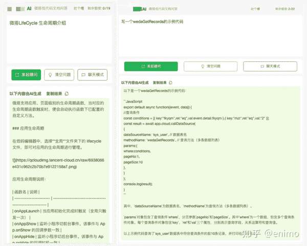

在开始搭建垂直知识库的问答机器人前，你需要做以下准备：

+   微信小程序账号：如果您还没有微信小程序账号，可以在微信公众平台注册（如果没有小程序，也可以发布为移动端H5应用）

+   开通腾讯云微搭低代码：微搭低代码是腾讯云官方**推出的一款低代码开发工**具，可以直接访问 腾讯云微搭官网[4] 免费开通注册

+   O**penAI账号：**OpenAI账号注册也是免费的，不过OpenAI有地域限制，网上方法很多在此不赘述。注册成功后，可以登录OpenAI的 个人中心[5] 来获取 API KEY

+   一个支持向量匹配的数据库（本文以开源的 PostgreSQL 为例，你也可以使用 Redis ，或者NPM的 HNSWlib 包）

关于向量数据库，目前可选择的方式有好几种，可以使用PostgreSQL安装vector向量扩展，也可以使用Redis的 Vector Similarity Search[6] ，还可以直接云函数使用HNSWLib库，甚至自行diy一个简单的基于文件系统的余弦相似度向量数据库，文末的 github/lowcode.ai 也有简单示例代码，仅做参考交流不建议在生产环境使用。

本教程适用人群和应用类型：

+   适用人群：有前后端基础的开发者（有一定技术背景的非开发者也可以体验）

+   应**用类型：小程序 或 H5**应用（基于微搭一码多端特性，可以发布为Web应用，点击原文链接可体验作者基于微搭搭建的 文档GPT机器人[7] ）

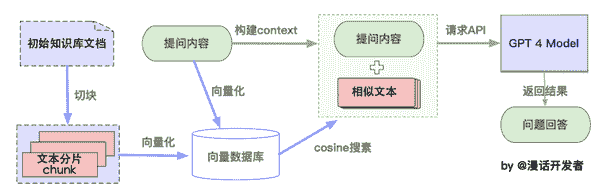

## 12 三种基于ChatGPT搭建问答系统的方法对比

[  ](https://zhuanlan.zhihu.com/p/627655485)

### 12.1 几种常规做法

基于 LLM 搭建问答系统的解决方案有以下几种：

+   Fine-Tuning，使用下游特定领域的知识对基础模型进行微调，改变神经网络中参数的权重。业界已经不少 chatgpt 的平替方案都支持微调

+   弊端：没有解决事实性问答可靠性的问题

+   基于 Prompt Engineering ，比如 Few-Shot方式

+   类似于短期记忆，容量有限但是清晰，优势。正确性和精度高

+   劣势。一次可以处理的文本量有限制，如果知识库较大，无论从可行性还是效率而言都是不合适的

+   与普通搜索结合，使用基础模型对搜索结果加工

+   问答可控性更高一些

+   无论是数据规模、查询效率、更新方式都可以满足常见知识库应用场景的需要

+   技术栈成熟，探索风险低

大概技术图：

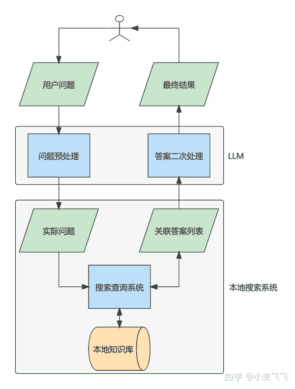

### 12.2 检索匹配的方式

+   [本](https://link.zhihu.com/?target=https%3A//eugeneyan.com/writing/search-query-matching/)地搜索系统。解决查询匹配的问题，在 Search: Query Matching via Lexical, Graph, and Embedding Methods 一文中介绍了三种基本方式：

+   Lexical-based search。通过归一化、拼写纠错、扩展、翻译等方式对查询请求中的词进行替换。性能好、可控性强，尽管存在一些语义鸿沟问题，但仍被广泛的应用在现有的搜索引擎架构中。

+   Graph-based search。以图的形式描述知识点以及相互间的关系，然后通过图搜索算法寻找与查询请求匹配的结果。

+   E[mbe](https://link.zhihu.com/?target=https%3A//medium.com/intelligentmachines/word-embedding-and-one-hot-encoding-ad17b4bbe111)dding-based search。将文字形式的查询请求，编码为数值向量的形式，体现潜在的关系。 该文 介绍了 Word Embedding 的一些技术实现。

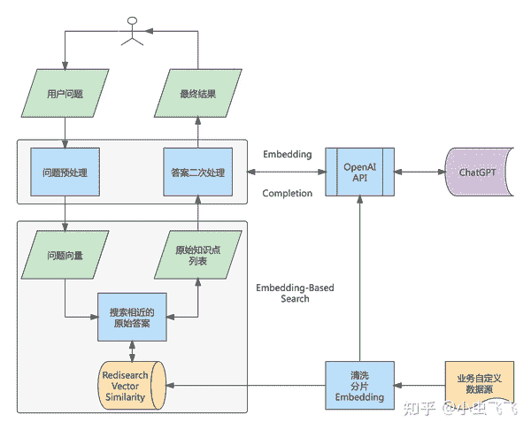

### 12.3 搜索

搜索的核心流程包含两步：

1.  将用户的问题通过 OpenAI API openai.Embedding.create 进行 embedding 得到向量。

1.  向 redis 发起查询获得与之最匹配（距离最近、相似度最高）的若干答案。

除此外，也可以利用 LLM对用户的问题进行预处理，常见的方式有：

+   简化概括用户的问题

+   利用思维链(Chain-Of-Thought, COT)提示的能力，提供范本，让 LLM按样例和用户进行交互，将问题逐步完善，直到获取足够的信息为止。

### 12.4 结果整合

结果整合的主要作用是将本地搜索系统返回的结果进行二次加工，比如发挥 LLM 的：

+   总结、概括

+   格式整理

+   去重、翻译

+   从会话历史中，提取上下文，进行分析处理等能力

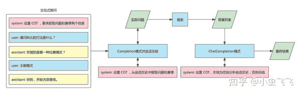

---

## 13 通过ModelScope平台和开源LLM打造个人知识库 QA

[  ](https://zhuanlan.zhihu.com/p/627698200)

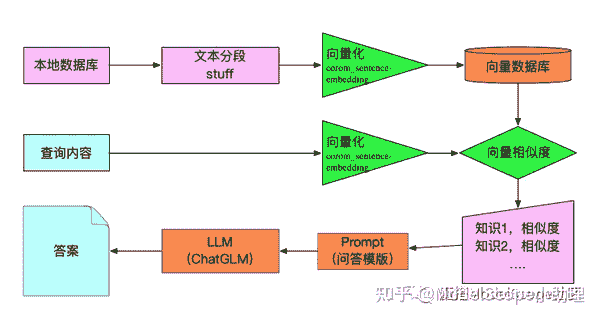

由于我们希望在后期可以进行自定义定制，并且架构相对简单，因此本文决定不使用Langchain，而是准备自己实现整个流程。

**Prompt编写**

根据吴恩达在《ChatGPT中的Prompt技巧与设计》课程中介绍的范式，我们经过多次尝试后，决定采用该模板来构建的问答的Prompt。

```
请根据上下文来回答问题，
如果上下文的信息无法回答问题，请回答&quot;我不知道&quot;。

上下文：
&quot;&quot;&quot;
{根据用户输入的问题，从向量数据库查询的结果。一行一个}
&quot;&quot;&quot;

问题：&quot;&quot;&quot;{用户输入的问题}&quot;&quot;&quot;

回答：
```

为了让LLM认为从向量数据库查询的结果是一句完整的话，我在每个结果的末尾添加一个了句号。当然，这个模板仍然无法完全约束模型的生成结果，仍可能会存在编造结果的情况。

我尝试了调整模型的 **top_p** 和 **temperature** 这两个参数，但是并没有消除这种情况的出现。要达到更好的效果，还是需要进行微调，并限制模型的思考范围和输出结果的格式。

**向量数据库的选型**

在众多的向量库类型中，我选择了Chroma向量库，原因如下：

1.  可以本地部署，不需要连接到外部服务，保证了数据的隐私性。

1.  结构简单，易于理解和魔改。

1.  可以自定义实现量化算法，从而优化检索速度和准确度。

1.  数据可以持久化，便于长期存储和管理。

**向量算法的选型**

完成了文本导入后，可以尝试测试一下效果了。

Chroma向量库中原生的embeddings效果不理想，使用的是 all-MiniLM-L6-v2 算法来进行向量嵌入。这个算法来自于 Sentence Transformers 库。Sentence Transformers 的还有其他算法：

| Model | Performance Semantic Search (6 Datasets) | Queries (GPU / CPU) per sec. |
| --- | --- | --- |
| multi-qa-MiniLM-L6-dot-v1 | 49.19 | 18,000 / 750 |
| multi-qa-distilbert-dot-v1 | 52.51 | 7,000 / 350 |
| multi-qa-mpnet-base-dot-v1 | 57.60 | 4,000 / 170 |

langchain，这种方法具有以下优点：

+   可以通过SaaS服务对每个部分进行加速，

+   每个部分都可以轻松地进行自定义修改。通过简单修改modelid可以使用modelscope的社区的模型，更加适合中文场景。

+   在满足硬件条件的情况下，可以轻松地将其改为分布式架构，以处理高频访问。

然而，我们可以看到回答的效果仍然不是很好， 文本分割和向量化的过程会直接影响结果，但是对比直接使用langchain，灵活性和中文的相关性好了很多

---

## 14 阿里云

### 14.1 AnalyticDB(ADB) + LLM：构建AIGC时代下企业专属Chatbot

[  ](https://zhuanlan.zhihu.com/p/629821758)

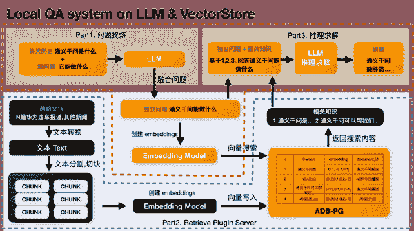

处理的过程有：

+   **Step1： **先将原始文档中的文本内容全部提取出来。然后根据语义切块，切成多个chunk，可以理解为可以完整表达一段意思的文本段落。在这个过程中还可以额外做一些元数据抽取，敏感信息检测等行为。

+   **Step2： **将这些Chunk都丢给embedding模型，来求取这些chunk的embedding。

+   **Step3： **将embedding和原始chunk一起存入到向量数据库中。

问题提炼：这个部分是可选的，之所以存在是因为有些问题是需要依赖于上下文的。因为用户问的新问题可能没办法让LLM理解这个用户的意图。

向量检索：独立问题求取embedding这个功能会在text2vec模型中进行。在获得embedding之后就可以通过这个embedding来搜索已经事先存储在向量数据库中的数据了。

推理求解：在获得最相关的知识之后，我们就可以就可以让LLM基于最相关的知识和独立问题来进行求解推理，得到最终的答案了。

之后又出了一篇服务器实战：

[  ](https://link.zhihu.com/?target=https%3A//developer.aliyun.com/article/1240791%3Fspm%3D5176.24779694.0.0.3b974d22wVW7dX%26groupCode%3Danalyticdb4postgresql)

包括了详细的服务器开通步骤，而且已经有专属界面：

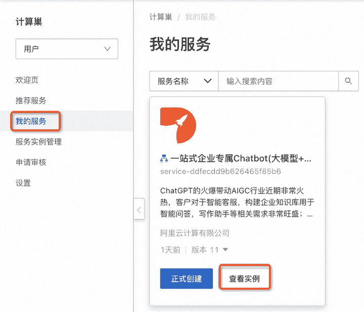

### 14.2 阿里云OpenSearch重磅推出LLM问答式搜索产品

[  ](https://link.zhihu.com/?target=https%3A//developer.aliyun.com/article/1239380%3Fspm%3Da2c6h.14164896.0.0.56386d10t4BOpR)

技术实现路径：

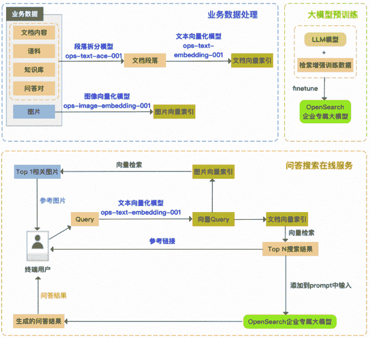

### 14.2.1 非结构化数据处理能力

相比传统的搜索引擎，OpenSearch智能问答版离线数据处理流程最大的变化点在于对业务数据的处理：

1.  传统搜索引擎的数据源是结构化文本，而这里需要处理的往往是非结构化文本，并且数据的格式会更加多样（HTML、Markdown、纯文本、PDF等）

1.  传统搜索引擎构建索引是基于文档的唯一主键，而这里由于数据源的差异，需要先对文档进行段落拆分，对拆分后的段落生成新的段落主键

1.  传统搜索引擎基于文本索引进行内容匹配，而这里采用向量索引，更加容易适配丰富的数据格式和长文本搜索

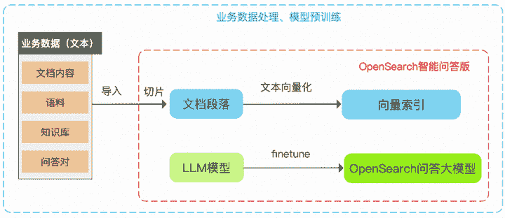

### 14.2.2 段落拆分模型

检索增强式LLM则需要给出具体与Query相关的段落，并且这里的段落不宜出现语义信息缺失或者输入超长，最好可以包含一段完整的语义信息。

权衡效率与效果，OpenSearch智能问答版的段落拆分模型特点如下：

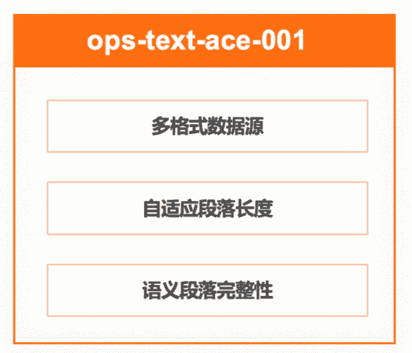

### 14.2.3 多样化的文本向量化模型

自研的一套模型，，整体性能优于openai的text-embedding-ada-002

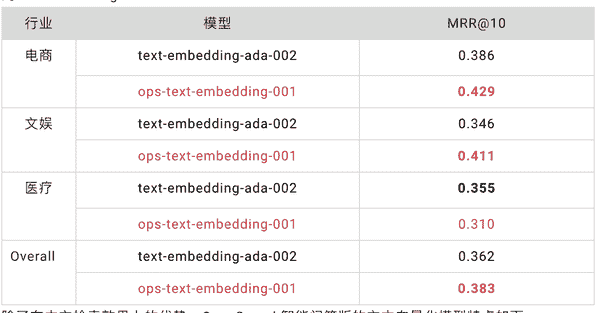

### 14.2.4 图像向量化模型

对于内容行业而言，尤其是产品文档和文章等内容，大量关键信息以图片的形式呈现，图文结合的多模态展现可以让企业专属智能问答搜索效果大幅提升。

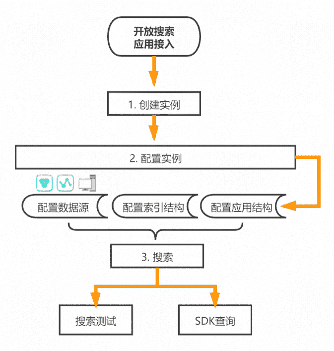

---

## 15 chatglm-qabot-v2: 从q-d匹配到q-q匹配

[  ](https://zhuanlan.zhihu.com/p/630857325)

将用户请求的query和document做匹配，也就是所谓的q-d匹配。q-d匹配的问题在于query和document在表达方式存在较大差异，通常query是以疑问句为主，而document则以称述说明为主，这种差异可能会影响最终匹配的效果。一种改进的方法是，不直接做q-d匹配，而是先通过document生成一批候选的question，当用户发来请求的时候，首先是把query和候选的question做匹配，进而找到相关的document片段，这种方法就是'q-q匹配'

+   首先准备好文档，并整理为纯文本的格式。把每个文档切成若干个小的chunks

+   调用chatglm的api，根据每个chunk生成5个候选的question，使用的prompt格式为'请根据下面的文本生成5个问题: ...'，生成效果见下图：

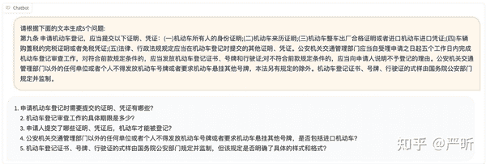

测试的问题为 行驶证的式样由谁来监制 ，v1和v2的效果对比如下：

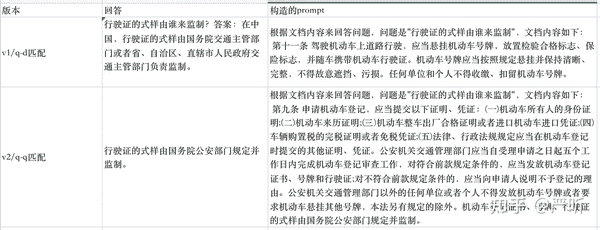

---

## 16 基于LangChain+CHATGPT构建增强QA

[  ](https://link.zhihu.com/?target=https%3A//developer.aliyun.com/article/1246744%3Fspm%3Da2c6h.14164896.0.0.56386d10t4BOpR)

本文基于LangChain构建了针对自有领域数据的增强QA，支持以下数据源：

+   针对领域内需要精确回答的问题，从自有DB中查询；

+   针对领域内其他自然语言QA，从自有知识的embedded向量数据库查询；

+   针对领域内其他较为宽泛的问题，从开放搜索引擎返回。

略过一些配置环节，直接来看一下几个功能：

> 功能1 通过SQLDatabaseChain 直接从csv查询并回答

LangChain提供了基于LLM的SQLDatabaseChain，可以利用LLM的能力将自然语言的query转化为SQL，连接DB进行查询，并利用LLM来组装润色结果，返回最终answer。

```
db_chain.run(&quot;When is the CVE-2008-7273 published?&quot;)
```

返回结果：

```
&gt; Entering new SQLDatabaseChain chain... When is the CVE-2008-7273 published? SQLQuery:SELECT &quot;pub_date&quot; FROM &quot;CVE&quot; WHERE &quot;id&quot; = &#x27;CVE-2008-7273&#x27;; SQLResult: [(&#x27;2019-11-18 22:15:00&#x27;,)] Answer:The CVE-2008-7273 is published on 2019-11-18 22:15:00. &gt; Finished chain. 

&#x27;The CVE-2008-7273 is published on 2019-11-18 22:15:00.
```

这里LLM成功地理解了published对应的列名是pub_date，且最终成功返回了人类易于理解的包含答案的语言。

由此可见，我们可以借助LangChain提供的SQLDatabaseChain，轻松地连接LLM与Database，自然语言的方式输入，自然语言的方式输出，借助LLM的强大能力来释放数据。

> 非结构化数据，通过向量化搜索

非结构化数据，如summary等，最好的方式是embedding后存入到向量数据库中

其中向量数据库选择了开源且免费的FAISS (Facebook AI Similarity Search)。通过创建好的向量数据库索引，可以轻松地进行相似性语义查询：

```
query = &quot;What is the vulnerability in Jenkins Google Compute Engine Plugin?&quot;
docs = vector_db.similarity_search(query)
print(docs)
```

返回：

```
[Document(page_content=&#x27;CVE-2019-16547,2019-11-21 15:15:00,2019-11-21 15:15:00,4.0,732, Incorrect Permission Assignment for Critical Resource,Missing permission checks in various API endpoints in Jenkins Google Compute Engine Plugin 4.1.1 and earlier allow attackers with Overall/Read permission to obtain limited information about the plugin configuration and environment.,,,,,,&#x27;, metadata={}), Document(page_content=&#x27;,mod_date,pub_date,cvss,cwe_code,cwe_name,summary,access_authentication,access_complexity,access_vector,impact_availability,impact_confidentiality,impact_integrity\nCVE-2019-16548,2019-11-21 15:15:00,2019-11-21 15:15:00,6.8,352, Cross-Site Request Forgery (CSRF),A cross-site request forgery vulnerability in Jenkins Google Compute Engine Plugin 4.1.1 and earlier in ComputeEngineCloud#doProvision could be used to provision new agents.,,,,,,&#x27;, metadata={}), Document(page_content=&#x27;CVE-2019-16546,2019-11-21 15:15:00,2019-11-21 15:15:00,4.3,639, Authorization Bypass Through User-Controlled Key,&quot;Jenkins Google Compute Engine Plugin 4.1.1 and earlier does not verify SSH host keys when connecting agents created by the plugin, enabling man-in-the-middle attacks.&quot;,,,,,,&#x27;, metadata={}), Document(page_content=&quot;CVE-2012-4441,2019-11-18 22:15:00,2019-11-18 22:15:00,4.3,79, Improper Neutralization of Input During Web Page Generation (&#x27;Cross-site Scripting&#x27;),Cross-site Scripting (XSS) in Jenkins main before 1.482 and LTS before 1.466.2 allows remote attackers to inject arbitrary web script or HTML in the CI game plugin.,,,,,,&quot;, metadata={})] 
```

可见，成功返回了与Jenkins Google Compute Engine相关的4个document。

> 功能3:通过SERP（Search Engine Result Page）API进行开放搜索

```
# initialize the SERP API
!pip install google-search-results
os.environ[&quot;SERPAPI_API_KEY&quot;] = &quot;Your Serp API key goes here&quot;

from langchain import SerpAPIWrapper

# create the Search Engine Result Page API wrapper
search = SerpAPIWrapper()
search.run(&#x27;What Is Cyber Risk?&#x27;)
```

返回：

```
Definition(s): The risk of depending on cyber resources (i.e., the risk of depending on a system or system elements that exist in or intermittently have a presence in cyberspace).
```

---

## 17 大模型(LLM) 应用：通过上下文注入构建一个聊天机器人

> 讲解的图例比较好看

原文：

[  ](https://link.zhihu.com/?target=https%3A//medium.com/m/global-identity-2%3FredirectUrl%3Dhttps%253A%252F%252Ftowardsdatascience.com%252Fall-you-need-to-know-to-build-your-first-llm-app-eb982c78ffac)

译文：

时光穿梭机：构建一个大模型(LLM) 应用所需了解的一切

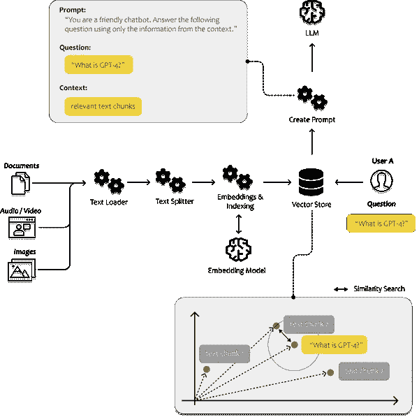

分步：

+   1. 使用 LangChain 加载文档

+   2. 将文档拆分为文本块

+   3. 从文本块到嵌入 向量

+   4. 定义要使用的 LLM

+   5. 定义提示模板

+   6. 构建向量存储

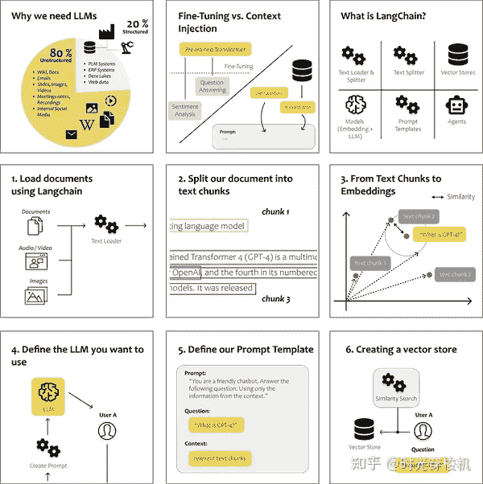

---

## 18 pdf解析关键的一些实践经验之谈

[  ](https://link.zhihu.com/?target=https%3A//mp.weixin.qq.com/s/Gsi4E2YjKsAL7-0NW3uwig)

pdf的解析大体上有两条路，一条是基于规则，一条是基于AI。所谓基于规则就是根据文档的组织特点去“算”每部分的样式和内容。笔者认为这种方式很不通用，因为pdf的类型、排版实在太多了，没办法穷举。因此笔者采用AI的方式来解决：目标检测 和 OCR文字识别

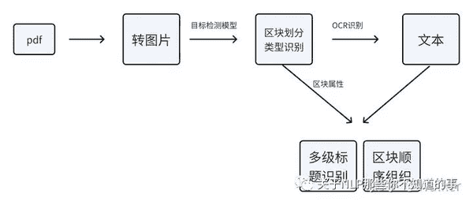

第一步是用一些工具将pdf转换为图片，这里有很多开源工具可以选，笔者采用fitz，一个python库。速度很快，时间在毫秒之间。接下来就是如何在图片中识别出 标题、文本、表格、图片、列表等元素。如下图效果：

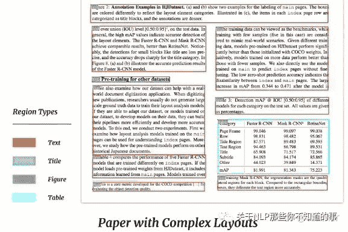

这一步就要采用目标检测模型，笔者做了很多探索，发现有几款开源工具可以选择，一是Layout-parser，二是PaddlePaddle-ppstructure，三是unstructured。

### 如何提取表格和图片中的数据？

思路仍然是目标检测和OCR。无论是layoutparser还是PaddleOCR都有识别表格和图片的目标检测模型，而表格的数据可以直接OCR导出为excel形式数据，非常方便。以下是layoutparser demo的示例：

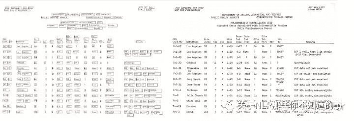