# 大模型+知识库/数据库问答实践过程的经验汇总

> 来源：[https://agijuejin.feishu.cn/docx/P9oRdu6choV0d2xt83DcRvJjnwc](https://agijuejin.feishu.cn/docx/P9oRdu6choV0d2xt83DcRvJjnwc)

> 作者：悟乙己

> 原文： [https://zhuanlan.z](https://zhuanlan.zhihu.com/p/642125832)hihu.com/p/642125...

本篇是沿着 【 悟乙己：想自己利用OpenAI做一个文档问答的话...... 】 知识库往后，目前很多大模型会用在知识库问答上，同时借助`Text-to-SQL` 也可以检索数据库进行回复（ 悟乙己：大模型与数据科学：从`Text-to-SQL` 开始（一） ）。知识库检索与数据库检索，会是之后大模型应用的标配，所以相应的实践过程中会遇到不一样的问题。

笔者随便画一个草图，在这个过程中，有几个环节可以应用到大模型：

+ `query`意图识别+意图补充+意图修复

+ `Text-to-SQL`

+ 文本总结

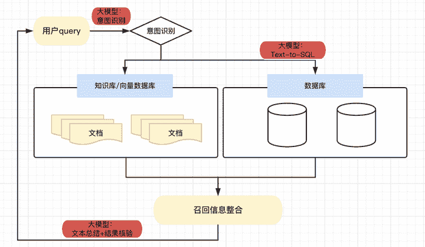

那么这三个环节前面两个应该问题多

最后一个环节通过召回的文本，大模型可以用来做`summary`以及结果的核验。

---

## 1 `query` 意图识别+意图补充+意图修复 环节

在之前【 悟乙己：想自己利用OpenAI做一个文档问答的话...... 】的一些文档问答里面，非常粗暴，`query`直接通过一些句向量去查询，实际应用中对精准度要求高的话，基本不奏效。

所以，这个环节就需要跟chatbot一样进行意图识别。

### 1.1 意图识别方式一：多关键词/主题词提取与检索

本篇【 小虫飞飞：LLM+`Embedding`构建问答系统的局限性及优化方案 】的方案是

【关键词/主题词提取 + 基于多个关键词向量搜索】

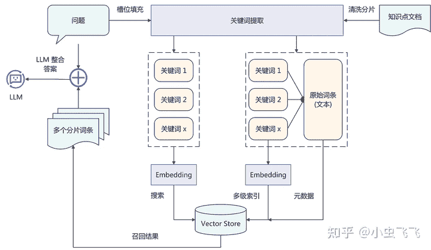

关键词/主题词提取：传统的 [成分句法分析 ](https://zhuanlan.zhihu.com/p/45527481)模型，具体方案如下：

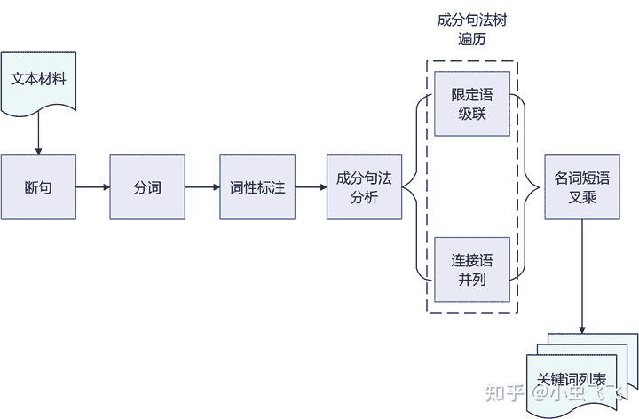

大致方案罗列：

+ 基于传统 NLP 的成分句法分析，提取名词短语；再通过短语间的依存关系，生成关键词列表

+ 从完整语句的`Embedding`，切换为关键词`Embedding`：

+ 知识库构建时。基于单知识点入库，入库时提取关键词列表进行`Embedding`，用于检索。

+ 查询时。对用户的问题提取关键词列表进行`Embedding` 后，从本地知识库命中多条记录。

+ 将单问句中的多知识点拆解后检索，将召回的多条记录交付给 LLM 整合。

该方法的优势在于：

+ 相比传统`Embedding`，大幅提升召回精准度。

+ 支持单次交互，对多知识点进行聚合处理。而不必让用户，手动分别查询单个知识点，然后让 LLM 对会话历史中的单个知识点进行汇总。

+ 使用传统 NLP 在专项问题处理上，相比 LLM 提供更好的精度和性能。

+ 减少了对 LLM 的交互频次；提升了交付给 LLM 的有效信息密度；大大提升问答系统的交互速度。

> ----------- 20230711更新 -----------

在北大团队发布法律大模型`ChatLaw`中用到了以下

（参考： [北大团队发布法律大模型 ChatLaw，为大众提供普惠法律服务，将带来哪些影响？ ](https://www.zhihu.com/question/610072848/answer/3101957500)）：

```
`ChatLaw`=`ChatLaw` LLM + keyword LLM + laws LLM 
```

`keyword` LLM是一个微调的模型，来单独完成关键词抽取这个任务；

当然这里`keyword` LLM 从文章作者的说法来看，其实并不是大模型，是仿`CLIP`对比学习下的`BERT`模型，使用了94W全国判决文书而来。

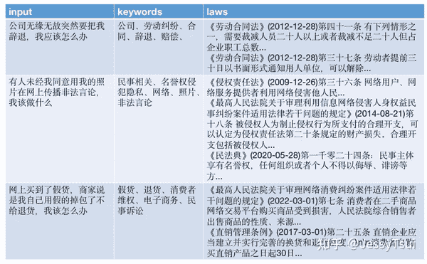

### 1.2 意图识别方式二：中心化大模型做语义识别

【 小虫飞飞：LLM+`Embedding`构建问答系统的局限性及优化方案 】与【 小虫飞飞：基于大语言模型构建知识问答系统 】

通过深度学习、统计学习，甚至 LLM ，理解用户问题提取语义槽中需要的内容。

在 基于大语言模型构建知识问答系统 一文中给过例子：通过 System Role 告知LLM 需要提取槽位信息，让 LLM通过多轮对话引导用户给出所有槽位信息。

还是以游戏攻略为例，玩家咨询球员的打法，那么必须提供：球员姓名，年代（比如2020/2022 年），比赛模式。对应的语义槽可以定义为：

```
"球员打法" : {
        "球员名称" : ____,
        "年代" : ____,
        "比赛模式": ____,
    }
```

### 1.3 意图补充、修复、改写

从【 [【text2sql】基于ChatGPT打造中文自动转SQL产品（第一部分） 】贴一些，从聊天机器人侧,`query`还需要做的一些功能点：

+ 引导能力，槽位补充能力

+ 用户：我想查一下电量；Bot: 好的，请问您想查的时间范围、空间范围，和分项是？用户：查上个月的整个园区的吧；Bot:好的，那请问是要查照明、空调、动力的还是其他类型的耗电量？用户：就查询各个分项的，和总体的都查询。Bot:好的，那我复述一下，您希望查询，"照明、空调、动力的还是其他类型的耗电量，以及总体耗电量，时间范围是上个月，空间范围是整体园区"，请问是吗？用户：是的/没问题/对。

+ 引导用户表述完整，查询要素，指标、维度、范围

+ 槽位修复能力

+ 比如：“好的，查询目标设置为查询温度，请问查询哪个空间的温度？”

+ 指代消除，解析能力

+ 澄清，它、这等指代词的具体含义

+ 改写

+ 改写模块其实非常关键，数据库的存储有特定的形式，但是用户不会按照你的底层数据结构去写，例如，用户不见得会输入和平精英，而是吃鸡，数据库里可不见得会存吃鸡对吧

从【 小虫飞飞：基于大语言模型构建知识问答系统 】类似与将chatgpt变成一个NPC进行对话，用来回收+修复槽位

改写模块包括（来自【 R&S[21] | 搜索中涉及的算法问题 】）：

+ 同义词改写。上面的吃鸡就要改写为和平精英，这个需要通过同义词挖掘等方式去构造词典实现。

+ 拼音改写。数据库是罗密欧与朱丽叶，但是用户输入的是罗密欧与朱莉业，拼音改写其实颇为常见，用户经常由于找不到需要的结果或者不知道应该需要哪个，于是直接输入后开始搜索。

+ 前缀补全。非常常见，用户输入射雕，射雕英雄传就要出了，这个一般的方法也是构造词典，另外有一个很重要的需要了解的就是前缀树，这个能让你查询的时间非常低的水平（只和`query`长度本身有关）。

+ 丢词和留词。结合上述关键词提取和命名实体识别完成，有些不必要的词汇需要被删除，例如“李小璐到底怎么了”，整个句子只有李小璐是关键词，其他词如果也通过and逻辑召回，就没有信息召回了，这时候其实可以直接删除或者将降级到or逻辑。留词和丢词相反，丢词如果是做减法，留词就是做加法。

+ 近义词召回。这个召回不是从数据库中召回，而是召回近义词，具体的方法是通过`embedding`方法转化词汇，然后通过ball tree、`simhash`的方式召回与之意思相近的词汇，该模式虽然比较激进，但是能一定程度增加召回，有一定效果。

### 1.4 多轮对话意图继承能力

+ 意图继承能力

+ 多轮对话之间的意图继承

而多轮的根本难题在于，如何把关键信息保留并在合适的时间取出并使用。目前的大家可能用的比较多的是直接拼接历史对话，这点并非不好，凭借大模型的能力确实能做到很高程度的多轮对话，但实际上，我们还是可以用很多思路（来自： 提升大模型系统体验的一些思路 ）：

+ 简单的，可能并不需要考虑模型回复的内容，只需要拼接用户`query`。

+ 单独构造DM模块，结合NER做槽位继承。

+ 参考科研界的一些做法，做更加抽象的矩阵DM，然后配合大模型计算。

### 1.5 过长提问的总结

+ 过长提问的总结

+ 比较长的提问可以通过LLM进行归纳与总结

### 1.6 拒绝回复

来自【 [提升大模型系统体验的一些思路 ](https://link.zhihu.com/?target=https%3A//mp.weixin.qq.com/s/F192bvkGf9hlrfBLFGNnww)】

拒绝回复其实很多场景会应用到，例如在面对用户提问的内容并不是目前我们预期支持的领域（客服场景问天气），或者用户所问出现观点类（如何看待俄乌问题）、黄反类问题（这个就不用我举例了吧）、大模型安全（`query`中带有诱导性错误）时，再就是知识库为空的情况，我们就需要进行拒绝，并给用户一些回复，让用户不至于那么不舒服。常见的策略一般有这些：

+ 一句写死的回复：“哎呀，这方面的问题我还不太懂，需要学习下”。

+ 用大模型生成，例如借助`prompt`引导生成一些安抚性的回复，“对不起，你问的[]问题，我好像还不太懂。你可以试试问问别的”。

+ 使用推荐问或者追问的策略。（你是否在找以下几个问题XX；你描述的我好像不太懂，能再补充补充吗）

其实也可以看到，也不见得非得用大模型，有时候写死或者做一些推荐问疑似问（ 前沿重器[12] | 美团搜索引导技术启示 ），好像也可以。

---

## 2 Text-to-SQL 环节

### 2.1 通过优质大模型解决`Text-to-SQL`的精准度问题

具体的任务如下：

> 有一个BI分析的任务，需要关联6张表来进行数据分析，当前的数据库中有1000+表。

当前LLM处理这个任务时，有两个大的难点：

+ 1. LLM当前不具备6张表关联如此复杂的`SQL`编写能力。

+ 2. 受限与`Token`长度，我们无法直接将所有的表信息提供给模型来生成正确的`SQL`语句。 基于大模型当前的能力，我们通过系统架构优化的方式，对此问题进行了解决， 首先我们看看整体的架构图。

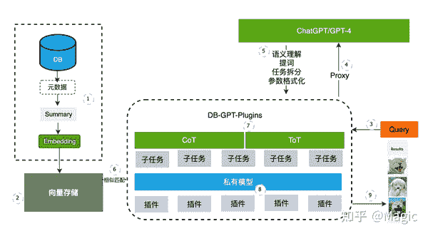

`Text-to-SQL` 的一个解法：【大模型帮助小模型】

大帮小其实指的是大模型帮小模型，更具体一点。就是通过ChatGPT/GPT-4、通义千文，文心一言这样更大的模型，来辅助私有化部署的百亿级模型来完成任务。 在我们写`SQL`这个案例当中，一个关联6张表的查询小模型是非常难理解的，因此我们会根据`Query` + `Summary`的内容让大模型先完成语义提取。 将复杂问题的理解，格式化输出一个固定的ToT的模版内容，将复杂的任务拆解为几个独立的简单步骤。

在**此之后，我们将每个小步的任务丢给小模型去处理。 当然在这个环节，我们为了更稳**定的效果，还需要跟大模型完成一些交互。 比如在`DB-GPT`当中，我们发现Vicuna-13b在格式化输出`Json`时，准确率跟稳定性都比较差，正确率不到70%，这需要我们编写大量的代码来处理格式。 以如下格式为例，但当我们调用GPT-4来格式化时，准确率跟稳定性能达到95%以上。

```
RESPONSE_FORMAT = {
  "thoughts": {
    "reasoning": "reasoning",
    "speak": "thoughts summary to say to user",
  },
  "sql": "SQL Query to run",
}
```

因为是一个多步拆分任务，所以模型执行的中间结果，我们会暂存在一个中间态。 最后在通过链式计算来返回最终正确的结果。

> [再来举一个直接通过GPT来实现`Text-to-SQL`的案例，来自【 鹅厂架构师：GPT X LowCode-GPT 提示工程与低代码开发实战 】

> 可以从产品形态来了解一下

构造 `prompt`：

+ 指令 —— 希望模型输出 `SQL`

+ 上下文 —— 当前在哪个库，哪个表

+ 输入数据 —— 表结构 - `DDL`

+ 输出指示符 —— 我希望输出纯正 `sql`，不想解析一堆内容

于是我们就有如下构造方式

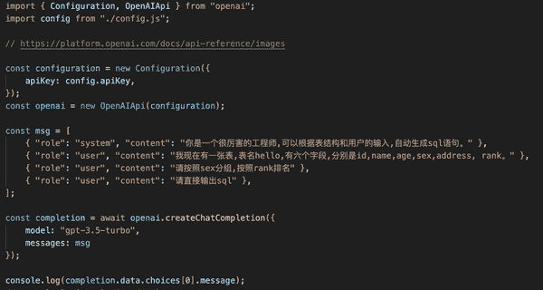

其思路就是把表结构和用户输入传给 GPT 由 GPT 去编写。我们目前的可能产品形态如下：

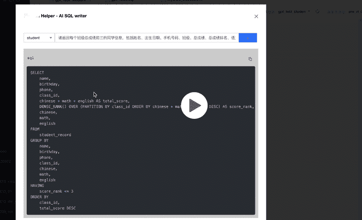

用户输入复杂的描述，其中甚至带有很多对 `SQL` 语法的要求，GPT 也能快速准确的返回。

### 2.2 对`Text-to-SQL` 任务拆解

源自： 平凡的程序猿：LLM在中文Text2SQL任务上的优化V1.0 以及 平凡的程序猿：LLM在中文Text2SQL的实践

Text2SQL的子任务拆成3个子任务：

+ Schema Link ：第一是利用LLM对用户的输入进行语义理解，然后结合数据库中表的结构信息，抽取出相关的字段信息

+ Task Classification：任务分类

+ `Sql` Generation：利用抽取的字段信息生成结构化的`SQL`语句

此时设定的`prompt`结构是：

```
Output = LLM(Instruction + Context + Input Data + Data Indicator)
```

`Instruction`表示大模型需要执行的指令，`Context`表示的是上下文信息，Input Data 表示的是需要处理的数据，Data Indicator表示输出信息格式的指引。

其中：

`prompt` 的case可参考：【 平凡的程序猿：LLM在中文Text2SQL的实践 】 以及【 京东云：LLM 在 text2sql 上的应用 | 京东云技术团队 】

其中在做Schema Link 时候，可能会因为项目大，完成`prompt`比较麻烦，也可以使用COT Prompt，可参考： 平凡的程序猿：LLM在中文Text2SQL任务上的优化V1.0 ，包括：

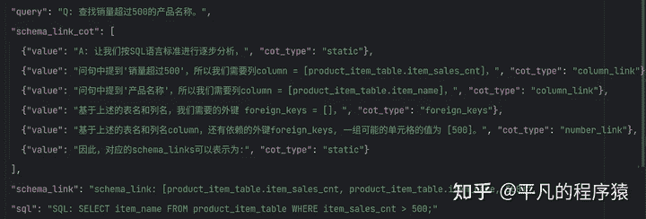

其中：

数据表的 `schema` 设计非常重要，需要描述清楚这个表它的主体信息以及表中重要字段和字段含义。

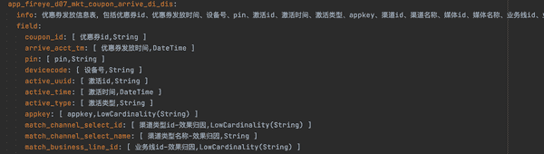

### 2.3 `SQL` 修复

同时，类似AI2SQL的产品【 SQL query builder - SQL query builder AI bot 】，也有`SQL`的修复模块

功能包括：

+ 格式`SQL`代码

+ `SQL`语法检查和修复程序

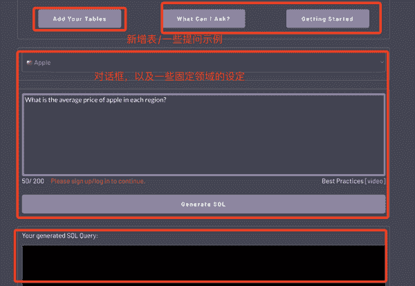

---

## 3 知识库的向量搜索

本篇不做过多累述，详情看：

悟乙己：想自己利用OpenAI做一个文档问答的话......

---

## 4 结果核验与总结

在【 如何用大语言模型构建一个知识问答系统 】结果整合的主要作用是将本地搜索系统返回的结果进行二次加工，比如发挥 LLM 的：

+ 结果检验

+ 总结、概括

+ 格式整理

+ 去重、翻译

+ 从会话历史中，提取上下文，进行分析处理等能力

### 4.1 结果总结

召回的信息可以通过大模型可以用来做`summary`以及结果的核验。在【 唔讲粗口：一文了解：打造垂域的大模型应用ChatGPT 】使用了思维链进行反复推理，来生成最终正确的结果。

在私有化模型下，反复推理的成本跟模型稳定性，目前表现还不那么令人满意，为了节约成本增加稳定性，我们在ToT环节里面，加入了ChatGPT/GPT-4来做正确性论证的能力。

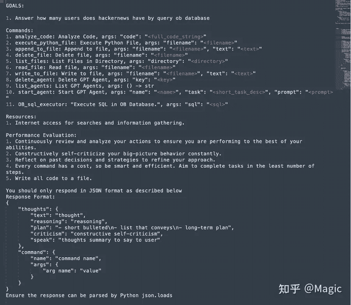

以上即为我们综合考虑成本、隐私、效果制定的一个折中方案。 核心数据资产通过本地化`Embedding`模型，`Summary`之后存储在私有向量数据中。 用户复杂的问题通过`DB-GPT Proxy`转接给中心化大模型做语义识别与任务拆解。 拆解完成的小任务，通过`DB-GPT`中的私有化大模型完成具体的任务执行。 最后结果通过思维链/思维树的路径进行多轮验证来确保得到准确的结果。 在这个过程中，用户数据与跟用户环境交互的模型都是本地化的。但是在任务拆解、格式化输出等方面，我们为了提供准确率同时降低推理成本，将这部分任务拆解给了ChatGPT/GPT-4这样的`API`来完成。

### 4.2 毒性检验

李粒：用 LLM 构建企业专属的用户助手

LLM 会努力让其回答符合人类的价值观，这一工作在模型训练中叫做“对齐”（`Align`），让 LLM 拒绝回答仇恨、暴力相关的问题。如果 LLM 未按照设定回答了仇恨、暴力相关问题，我们就称之为检测出了毒性（`Toxicity`）。

对于我们即将创造的机器人，其毒性的范围实际上增加了，即，所有回答了非公司业务的内容都可以称之为存在毒性。

需要使用 `Few-Shot` 的方法去构建毒性检测的提示词，让 LLM 在拥有多个示例的情况下，判断用户的提问是否符合企业服务的范围。

### 4.3 输出结构对齐

来自： LLM在中文Text2SQL任务上的优化V1.0


这种情况非常多，而且不论是什么大模型都会遇到这种情况：

```
&#x27;&#x27;&#x27;SQL: SELECT item_name FROM product_item_sales_table WHERE item_sales_cnt_1_days &gt; 500; &#x27;&#x27;&#x27;
```

此时多了一个 SQL ，需要做修剪

此时解决方式：

+ 优化prompt查询，更加专业的instruction，给出具体范例让LLM做参考
+ 输出的内容做一些正则

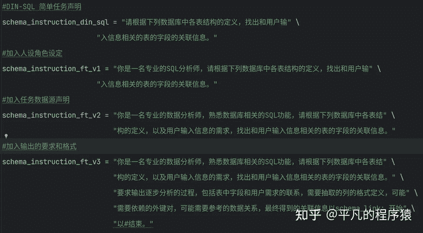

### 4.4 Text2SQL 数字幻觉

有可能出现数字幻觉，比如输入是： 点击率大于8% ，最后生成的SQL语句则是： 8 ，来自： 平凡的程序猿：LLM在中文Text2SQL任务上的优化V1.0

此时可在prompt中提及：

```
{
   &quot;value&quot;: &quot;问句中提到&#x27;5%&#x27;，它代表的浮点型数值为 [0.05]&quot;, 
   &quot;cot_type&quot;: &quot;column_infer&quot;
}
```

---

## 5 产品/数据的持续运营

李粒：用 LLM 构建企业专属的用户助手

为了让 TiDB Bot 的优化能够持续进行，我们搭建了一个内部运营平台，该平台能够较为便利的实现本文介绍的几种优化方法。该平台的核心能力有：

+ 反馈信息展示：展示用户对回复的点赞或点踩。针对点踩的信息，展示信息流上每一个节点的处理日志，方便进行问题排查。
+ 示例快速补充：针对每一个与 LLM 交互的节点，都支持提供示例的能力，包括修订问题，毒性检测，领域知识，等所有环节，都能够快速补充示例。
+ [领域知识自动更新](https://link.zhihu.com/?target=https%3A//github.com/pingcap/docs)：对于有固定来源的领域知识，如 官方文档 ，支持定时自动更新向量数据库中的文档内容，保持领域知识始终最新。
+ 模型迭代数据整理：自动整理 Embedding 模型微调所需的训练数据，包含用户的点赞信息和运营时补充的示例信息等。

持续人工运营的优缺点：

+ 优点：
+ 相对稳定的正向优化。本文采用了系统的方法去优化准确率，而不依赖模型训练产出的随机性。
+ 快速。示例部分的优化可以达到分钟级别的迭代速度，如果用户在使用过程中遇到问题，可以尽快修复。
+ 便宜。仅需要复用已有的语义搜索能力，不需要额外的组件，不额外支出成本。
+ 迁移成本低。本文的方法在任何 Chat 类型的 LLM 模型都可用，因此可以快速迁移到其他模型上。如果开源或商业模型中有更好的模型，我们可以尽快接入。
+ 冷启动友好。遇到问题解决问题，不需要事先准备庞大的训练数据。
+ 缺点：
+ 需要更高频的人工介入。因为示例的方法需要更多的人工审核和补充过程，在产品运营过程中需要比模型微调更高频的人工介入频率。
+ 内容数量过多。在运营一段时间后，补充的内容可能过多，导致难以维护，和搜索准确性的下降。

---

## 6 云厂商的集成方案

### 6.1 基于Azure OpenAI模型服务的知识库问答系统

在文章【 唔讲粗口：一文了解：打造垂域的大模型应用ChatGPT 】提及到的Azure

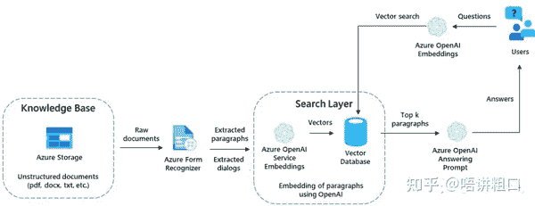

这个demo搭建了一个简单的基于OpenAI的知识库问答系统，企业可以将内部的各类文档、表格、图片等转化为方便模型计算的语义向量，存入向量数据库中。当用户提出问题时，它从知识库（向量库）中检索匹配出最相关的文档，然后使用GPT来生成问题的最终答案。

不过具体实践中应该还是会有很多问题

### 6.2 阿里云的 `Tair向量检索`

阿里云数据库：如何让聊天机器人更懂你？Tair向量检索给你答案

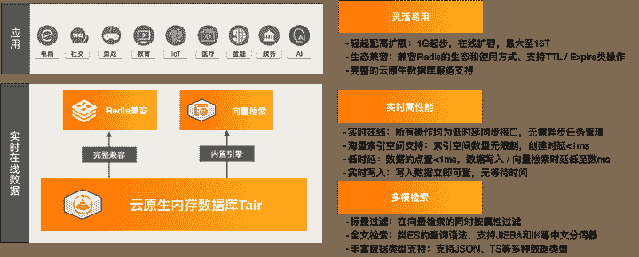

具体没有测试过

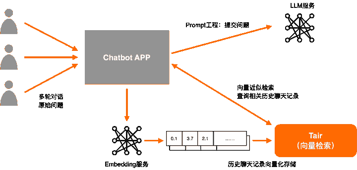

以ChatGLM为例，将用户的历史记录作为请求的一部分持续追加，当超过`Token`数限制的时候就需要丢弃老的聊天记录，因此LLM方案无法实现太长的多轮对话能力。而基于`Tair`，可以将用户的历史聊天记录存在`Session`中，这些信息可以设置TTL等过期机制，并且`Tair`也支持海量的索引空间(`Session`)。在请求LLM的时候，通过向量检索技术，将相关的历史信息检索出来，通过`Prompt`润色后，一并发送给大模型，可实现基于多轮对话下，长期的上下文感知能力。

### 6.3 AquilaSQL-7B 文本-代码”生成模型

[  ](https://link.zhihu.com/?target=https%3A//github.com/FlagAI-Open/FlagAI/blob/master/examples/Aquila/Aquila-sql/readme.md)

AquilaSQL在代码基础模型`AquilaCode`上进行继续预训练和sft微调，为模型设计了指标评估体系，目前在cspider榜单上达到了sota，可以通过更改数据的方式适配不同领域的sql查询场景。

训练示例：

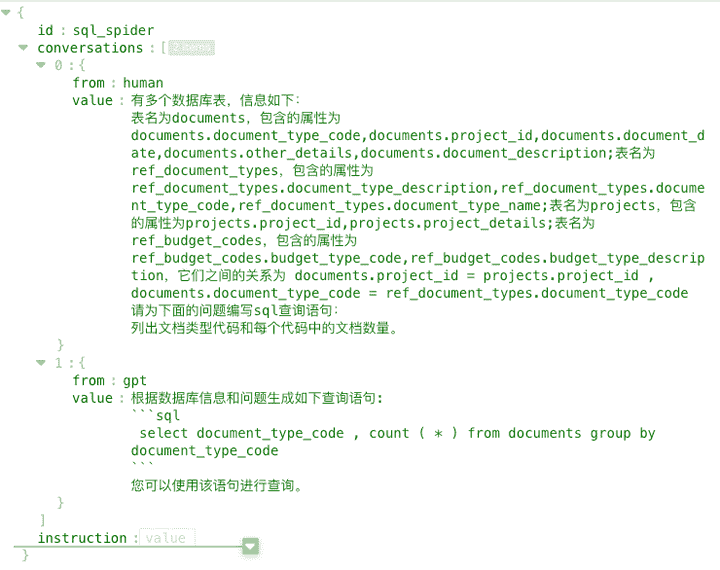

### 6.4 我在调研了十几个知识库对话产品后整理出来的功能清单

我在调研了十几个知识库对话产品后整理出来的功能清单

RAG+LLM 的 AI 应用是目前为止对于独立开发者来说最易实现的 AI Native 应用，毕竟市场上已经有很多的榜样去学习了，比如：

+ Perplexity: 将搜索结果中的内容作为 RAG 资料库生成答案。
+ OpenAI 的 GPTs：将用户上传的资料作为 RAG 资料库生成答案。
+ 各种 PDF 读论文工具：将论文作为 RAG 资料库生成答案。
+ 垂直领域诸如法律中的合同审查：将合同作为 RAG 资料库来核实合同

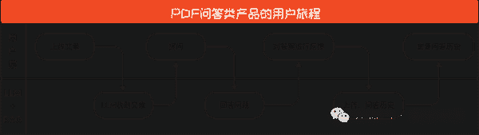
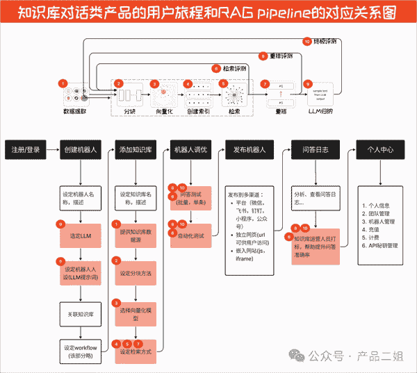
