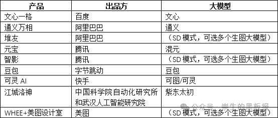
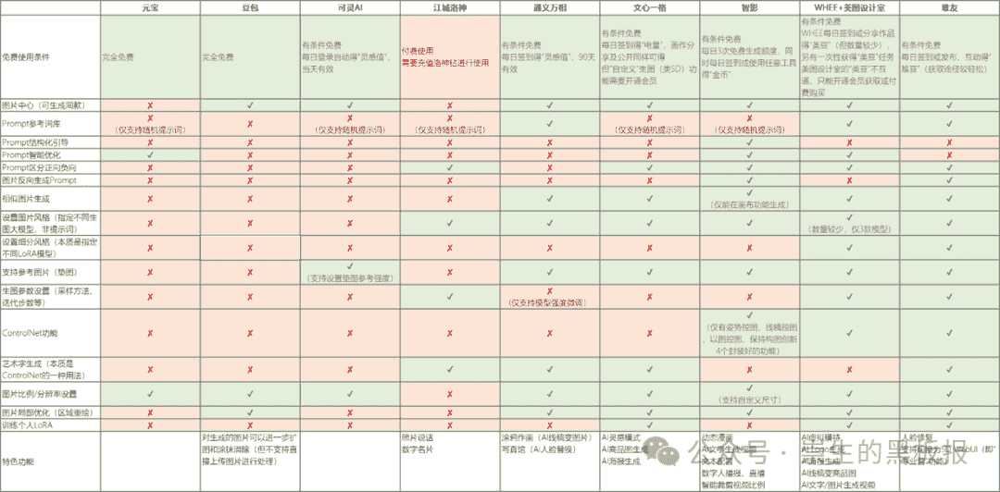
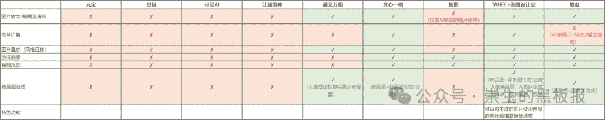
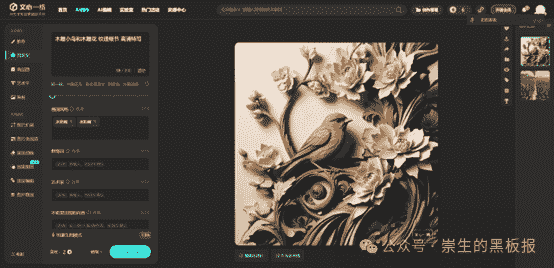
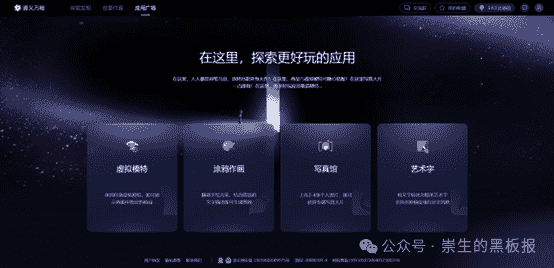
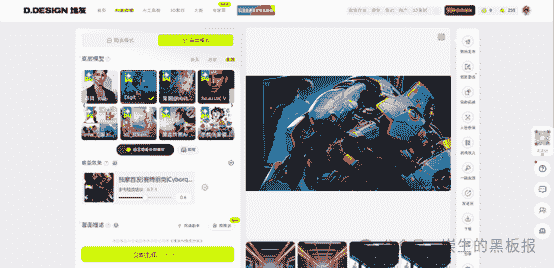

# 国内各大AI产品功能横向对比及使用建议（2/3）：图片生成 & 图片处理篇

> 来源：[https://agijuejin.feishu.cn/docx/T6H9doAa7o0YVMxDkiAcjiBfnbb](https://agijuejin.feishu.cn/docx/T6H9doAa7o0YVMxDkiAcjiBfnbb)

> 作者：Yugiwong | 崇生的黑板报

> 原文： [https://mp.weixin.](https://mp.weixin.qq.com/s/orsp92mbCDuJX6RFZCHrqA)qq.com/s/orsp92mb...

这是产品经理崇生的第 18 篇作品，全文约 2600 字，阅读预计 7 分钟。

**【写在前面】**

2022年OpenAI发布了ChatGPT3.5，标志着以AI大模型为主体的人工智能时代到来。自此之后，国内各个传统大厂、AI独角兽纷纷下场，各类AI大模型及其对应的产品纷纷如雨后春笋般问世。在带来行业繁荣的同时，也为普通用户带来了不少选择的困惑。究竟国内各大AI产品有什么差异？我们应该如何选择？

要对比各大AI产品，我们可以粗略分为内、外两层，内在是其内核的大模型智能程度，外在是各团队研发的产品功能。对于大模型，市面上已有不少报告进行测评。但对于外在产品功能的梳理对比，似尚未有过多关注。有感于此，我计划从对“文本生成”、“图片生成 & 图片处理” 、“智能体” 三个当下AI最为热门的领域入手，梳理目前国内各大AI产品功能的横向对比。

当然，我的主要关注点是“有无”，而非“优劣”，即我主要着眼在某一项功能在各大AI产品上是“有”还是“没有”，而不会具体比对该功能的具体表现“好”还是“不好”，因此也不会涉及到功能的具体评分。我的目标是通过对国内各大AI产品功能横向对比，为不同使用场景、使用诉求的人群提供产品选择上的建议。

横向对比采集时间：2024年8月（目前设想可能每3个月更新对比一轮，并视情况是否更新使用建议）。如果有朋友们感兴趣但我没有涵盖的AI产品，或者对于本文的任何批评建议，欢迎在评论区里留言。

本篇是这个系列的第二篇—— “ 图片生成 & 图片处理 ”篇

第一篇——文本生成篇见： 国内各大AI产品功能横向对比及使用建议（1/3）：文本生成篇

**【对比产品及项目】**

严格来说，“图片生成”和“图片处理”是两个独立的领域。前者是通过给AI输入文字或图片，让AI生成新的图片（即俗称“文生图”、“图生图”）；后者是对已有的图片，通过AI能力进行各类调整处理。但从产品视角来看，二者又有明确的联系，毕竟，AI生成图片后进行处理，是一个很流畅的操作。并且，从用户视角来看，如果有涉及“图片”的相关工作，那大概率是“图片生成”和“图片处理”都有所涉及。因此，我们会将二者放在一起进行对比。

关于“图片生成 & 图片处理”领域的产品对比，入围标准是：

+   必须是通用的图片产品，意味着只针对某个特定图片领域（如：海报、漫画、二维码、头像）的产品不在此列。

+   必须是有独立的AI大模型部署，意味着市面上那些包壳类的AI产品不在此列（比如通过封装Midjourney来提供服务的产品）。

+   图片生成：有可以设置生成图片具体参数的能力，意味着仅仅是通过对话就能简单生成图片的产品（在前面“文本生成”领域中，我们就有“生成图片”的功能项梳理）不在此列。

+   图片处理：必须是可以单独上传图片进行处理，意味着仅仅是对生成图片进行处理的产品，只会归入“图片生成”的一部分功能（这一条实际是针对“豆包”进行区分，它的图片处理功能就是只能对其生成的图片进行操作，说实在的有点迷）。

基于以上标准，在“图片生成 & 图片处理”领域的入围产品有：

（注：SD即Stable Diffusion，是一套开源的AI图片生成工具，支持安装多个的生图大模型。）

对比的项目主要由以下类别组成：

+   免费使用条件：AI生成图片的计算成本远高于生成文本，因此各家提供的AI生成图片服务都是“有条件免费”，我们会将各家的具体使用条件梳理出来。

+   使用引导：包括功能引导、Prompt库等内容，反映的是产品的“易上手”程度。

+   详细参数设置：与“文本生成”不同，“图片生成”的效果受具体的参数设置影响较大。因此，详细的参数设置能力反映了产品的“可调整性”。

+   高级功能：如ControlNet、LoRA训练等，反映的是产品在高级功能上的丰富度和深度。

+   图片处理主流功能：主要包括图片放大、扩展、叠加、抠图等主流的AI图片处理功能。

**【完整对比结果】**

基于上述产品和项目，完整横向对比结果如下：

（完整对比表请关注👸号【崇生的黑板报】，发送“AI对比”关键词获取。）

图片生成：

图片处理

**【结果解析】**

简易使用型：元宝、豆包、可灵AI

+   类型特点：通过输入Prompt进行图片生成，但不具备“设置图片风格（并非提示词，而是指定不同生图大模型）”及其他更高级功能。

+   适用人群：对于“生成图片”诉求接近“有图即可”的人群。

类MJ型：江城洛神、通义万相、文心一格

+   类型特点：具备更多的生成图片设置能力，但不支持诸如ControlNet的高级功能。

+   适用人群：对于“生成图片”有一定的质量要求，希望控制其大体风格走向，但又没有🪜条件的人群。

类SD型：智影、WHEE+美图设计室、堆友

+   类型特点： 具备更多高级功能（如ControlNet、LoRA模型训练），能力及交互界面接近SD WebUI。

+   适用人群：对“生成图片”有精细化调整的诉求，或有意在“生成图片”领域进行深耕的人群。

**【整体使用建议】**

对于“图片生成 & 图片处理”领域，因此其学习广度、深度和 难 度，都 要比“文本生成”要更高。因此，我会统一推荐使用顺序是：先使用“文心一格”，如果有进一步想深入研究，则再切换至“堆友”。

首先不建议使用“简易使用型”的产品。倒不是说他们能力不行，主要是考虑到入门和使用，他们都并非最好选择。最典型的体现就是关于“风格”的设置。众所周知，画面“风格”是一张图片最基本的属性。虽然“简易使用型”的产品也是可以通过在Prompt里面进行风格描述来实现，但是进阶后还是要切换到“选择生图模型”。因此从一开始上手就应该建立“选择生图模型”来控制风格的认知。此外，从易用性来看，也不及可以直接选择风格的产品。

然后就是“类MJ型”的产品，它们在最基础的“文生图”领域都较易上手，既能满足日常需要，又能低门槛上手。而具体到哪一款产品，则首推“文心一格”，原因无他，就是因为它无论是图片生成还是图片处理，功能都相对齐全。

最后就是想进一步深入研究AI生成图片，那必须会走到“学习Stable Diffusion”的阶段，此时推荐产品更多则是要考虑其功能是否足够全面。以此为标准，那么综合功能最齐全且免费使用条件简单的“堆友”就成为不二之选了。

**【附：部分产品特色功能截图】**

文心一格将提示词中的部分内容结构化（画面风格、修饰词、艺术家）

通义万相围绕电商场景打造了相关的特色功能

腾讯智影围绕“视频+图片”打造了一系列功能

WHEE全面的AI生图能力

堆友友好且接近SD WebUI的操作界面

---

关于崇生

+   15年互联网产品经理 | 腾讯产品组长，P11 | 字节跳动产品组长，3-2

+   曾任兴趣部落、腾讯文档、飞书文档、飞书知识库负责人

+   腾讯产品通道评委、认证面试官 | 腾讯学堂讲师 | 起点学院讲师

+   如今走在探索个人品牌的路上， 笃信“输出推动输入，助人亦是助己”，持续输出：互联网产品方法论 | AI 研究 | 职业发展 | 读书学习心得

+   提供企业课程培训、1v1咨询服务，包括：AI办公提效 | 互联网产品发展规划 | 产品经理职业生涯发展 | 简历优化指导 | 面试指导

+