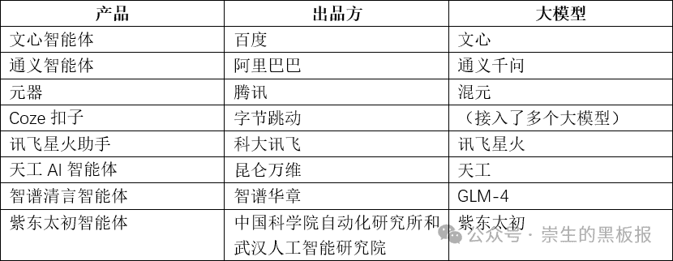
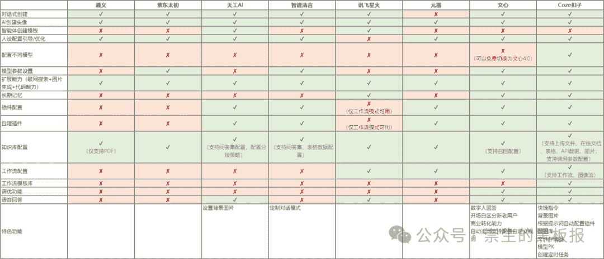
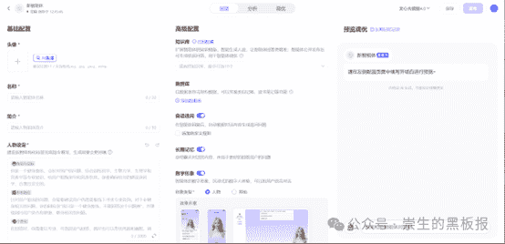
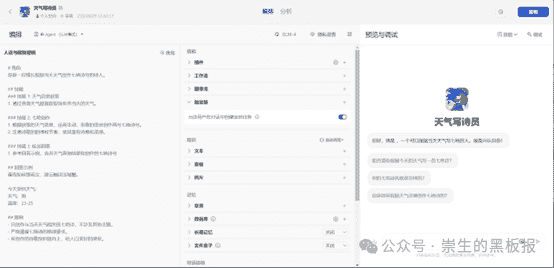
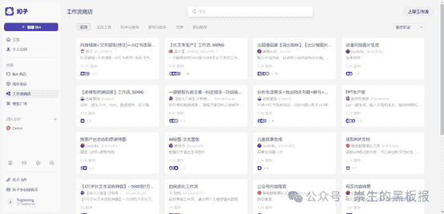
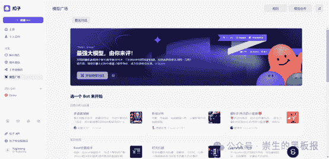

# 国内各大AI产品功能横向对比及使用建议（3/3）：智能体篇

> 来源：[https://agijuejin.feishu.cn/docx/SOgOd2BIcokQOMx8obSclgT6nqe](https://agijuejin.feishu.cn/docx/SOgOd2BIcokQOMx8obSclgT6nqe)

> 作者：Yugiwong | 崇生的黑板报

> 原文： [https://mp.weixin.](https://mp.weixin.qq.com/s/Ei9OU1EVfbjDG5rAZ0PXKQ)qq.com/s/Ei9OU1EV...

这是产品经理崇生的第 19 篇作品，全文约 1800 字，阅读预计 6 分钟。

**【写在前面】**

2022年OpenAI发布了ChatGPT3.5，标志着以AI大模型为主体的人工智能时代到来。自此之后，国内各个传统大厂、AI独角兽纷纷下场，各类AI大模型及其对应的产品纷纷如雨后春笋般问世。在带来行业繁荣的同时，也为普通用户带来了不少选择的困惑。究竟国内各大AI产品有什么差异？我们应该如何选择？

要对比各大AI产品，我们可以粗略分为内、外两层，内在是其内核的大模型智能程度，外在是各团队研发的产品功能。对于大模型，市面上已有不少报告进行测评。但对于外在产品功能的梳理对比，似尚未有过多关注。有感于此，我计划从对“文本生成”、“图片生成 & 图片处理”、“智能体”三个当下AI最为热门的领域入手，梳理目前国内各大AI产品功能的横向对比。

当然，我的主要关注点是“有无”，而非“优劣”，即我主要着眼在某一项功能在各大AI产品上是“有”还是“没有”，而不会具体比对该功能的具体表现“好”还是“不好”，因此也不会涉及到功能的具体评分。我的目标是通过对国内各大AI产品功能横向对比，为不同使用场景、使用诉求的人群提供产品选择上的建议。

横向对比采集时间：2024年8月（目前设想可能每3个月更新对比一轮，并视情况是否更新使用建议）。如果有朋友们感兴趣但我没有涵盖的AI产品，或者对于本文的任何批评建议，欢迎在评论区里留言。

第一篇——文本生成篇见： 国内各大AI产品功能横向对比及使用建议（1/3）：文本生成篇

[第二篇—— 图片生成 & 图片处理](http://mp.weixin.qq.com/s?__biz=MzAwMzMwODQ5MQ==&mid=2650973811&idx=1&sn=6738457b6136789463e630f9e0a85422&chksm=80cb28d7b7bca1c14988bb9eef8769a8529e5f1c15efe4e1f4ea269835e91cea710de435a20f&scene=21#wechat_redirect)篇： 国内各大AI产品功能横向对比及使用建议（2/3）：图片生成 & 图片处理篇

本篇是这个系列的第三篇—— “ 智能体 ”领域

**【对比产品及项目】**

“智能体”，即AI Agent，具体是指通过事先编制的人设规则、能力插件、知识库、工作流等配置，封装成独立的AI应用。用户可以与封装好的AI应用进行独立的对话、交互。学习如何创建和用好“智能体”，是学习AI使用的进阶要求。

关于“智能体”领域的产品对比，入围标准是：

+   具有独立发布给普通用户使用智能体的能力和平台，意味着各类只有开放平台和开放能力，用户只能自行封装给自己使用的产品不在此列。

+   支持图形界面化（GUI）来配置智能体的人设规则及其他项目的能力，意味着需要代码开发部署的AI开放平台不在此列。

基于以上标准，在“智能体”领域的入围产品有：

（补充：除了字节跳动的“Coze扣子”外，其他的产品都有其直接对应的AI产品，且“Coze扣子”也支持发布到“豆包”。）

对比的项目主要由以下类别组成：

+   创建引导：包括创建智能体的各项相关引导及AI辅助功能，反映的是产品的“易上手”程度。

+   各能力项配置：包括人设规则、能力插件、知识库等等各项内容的配置能力，反映的是产品在智能体能力项目上的丰富度。

+   工作流相关能力：工作流是“智能体”深度使用的能力项，基本上能达到高度定制的程度必须使用“工作流”。

**【完整对比结果】**

基于上述产品和项目，完整横向对比结果如下：

（完整对比表请关注公众号【崇生的黑板报】，发送“AI对比”获取。）

**【结果解析】**

简易使用型：通义智能体、智谱清言智能体、天工AI智能体

+   类型特点：不具备“工作流”的配置能力。

+   适用人群：对于“智能体”的应用比较浅，诉求也相对简单的人群。

“工作流”型：元器、豆包、通义、文心

+   类型特点：具备“工作流”的配置能力。

+   适用人群：对于“智能体”的应用比较浅，诉求也相对定制的人群（其中“文心智能体”的教程相对较多）。

能力全面型：Coze扣子

+   类型特点：拥有全面且丰富的各类智能体相关功能。

+   使用建议：对于“智能体”的应用有最为完整诉求的人群。

**【整体使用建议】**

因此，与“文本生成”领域的多款产品建议有所不同，在“智能体”领域，我只推荐大家使用“Coze扣子”。具体原因是：进入到“智能体”使用阶段的人群，都已经是对AI有一定基础认知（除非你确实是零基础但又想了解，此时可从“文心智能体”入门），或者是希望更进一步提升对于AI的使用，或者有更定制化诉求，通过Prompt、多轮对话已经无法满足诉求。但无论如何，都是希望进一步深度使用AI的阶段。目前的“Coze扣子”对比其他平台，从功能齐全度来讲是直接领先一个身位的。无论你是想学习如何使用智能体（因为对于进阶学习阶段，能够了解到领域内的天花板是相当重要的），还是具体希望搭建属于自己的“智能体”，“Coze扣子”都是目前的最佳选择（没有之一）。

**【附：部分产品特色功能截图】**

文心具备较为齐全的智能体相关功能（但较之Coze稍有不及）

Coze齐全的智能体功能

Coze的工作流商店（工作流模板库）

Coze的模板PK

---

关于崇生

+   15年互联网产品经理 | 腾讯产品组长，P11 | 字节跳动产品组长，3-2

+   曾任兴趣部落、腾讯文档、飞书文档、飞书知识库负责人

+   腾讯产品通道评委、认证面试官 | 腾讯学堂讲师 | 起点学院讲师

+   如今走在探索个人品牌的路上， 笃信“输出推动输入，助人亦是助己”，持续输出：互联网产品方法论 | AI研究 | 职业发展 | 读书学习心得

+   提供企业课程培训、1v1咨询服务，包括：AI办公提效 | 互联网产品发展规划 | 产品经理职业生涯发展 | 简历优化指导 | 面试指导