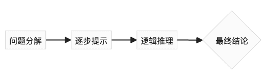

# 【颠覆传统】CoT思维链：让你的AI从数据处理员变成智能顾问

> 来源：[https://agijuejin.feishu.cn/docx/WB0MdC1Qxo25XxxSc6bcRjTinGe](https://agijuejin.feishu.cn/docx/WB0MdC1Qxo25XxxSc6bcRjTinGe)
>
> 原文地址：https://www.iaiuse.com/posts/6ee2e0da

## 写在前面

+ 听说提示词写不好是因为不会 CoT
+ 啥是 CoT 啊？思维链？
+ 听说只要告诉 AI 一步步来就会好很多
+ 这是啥武功秘籍，这么朴实无华的吗？

## 一、引言：AI 时代，企业决策的新挑战

想象一下，您是一位企业的 CEO，桌上摆放着一份最新的市场调研报告，涵盖了海量的数据、图表和分析。您需要快速了解市场趋势、竞争对手的策略、用户的反馈，并据此做出关键的商业决策。然而，面对如此庞杂的信息，您是否感到力不从心？传统的商业分析工具只能提供数据和图表，缺乏深入的分析和推理能力，难以帮助您洞察数据背后的深层逻辑，更无法提供清晰的决策建议。

面对 AI 时代的新挑战，企业决策者们迫切需要更智能的工具来应对复杂多变的商业环境。如何才能让 AI 不仅仅是“数据处理员”，更能成为“智能顾问”，帮助我们更好地理解问题，并提供更精准、更可解释的决策方案？

近年来，人工智能领域取得了突破性的进展，大型语言模型 (Large Language Models, LLMs) 如 GPT-3、GPT-4 以及 PaLM 等展现出惊人的语言理解和生成能力。然而，早期的 LLM 常常被诟病为“统计鹦鹉”，只能进行简单的模仿和重复，缺乏真正的推理能力。例如，在论文《Chain-of-Thought Prompting Elicits Reasoning in Large Language Models》(2201.11903 v 6) 中，作者指出，即使是像 GPT-3 这样强大的模型，在面对需要多步骤推理的数学问题时，准确率也相当低。

为了解决这个问题，研究人员提出了一种全新的技术：思维链 (Chain-of-Thought, CoT)。 CoT 技术能够引导 AI 模型像经验丰富的专家一样，逐步分析问题，提供清晰的推理路径和结论，从而显著提升 LLM 的推理能力和结果的准确性。 CoT 的出现，标志着 LLM 正从“鹦鹉学舌”走向“深度思考”，为企业决策带来了新的希望。

## 二、CoT 技术：AI 决策的“智能导师”

为了更好地理解 CoT 技术如何帮助您做出更明智的决策，我们可以将 CoT 比喻成一位经验丰富的“导师”。这位导师拥有丰富的知识和经验，能够引导 AI 模型像人类专家一样思考问题。当您向这位“CoT 导师”提出一个复杂问题时，它不会直接给出一个简单的答案，而是会引导 AI 模型进行以下步骤：

1. **问题分解**：就像一位经验丰富的老师会将复杂的问题分解成多个简单的步骤，引导学生逐步学习一样，“CoT 导师”也会将您的问题分解成多个更小、更易于理解的子问题。例如，在分析智能跑鞋市场潜力时，“CoT 导师”会将问题分解为目标用户分析、竞争对手分析、市场风险评估等多个子问题。

2. **逐步提示**：对于每一个子问题，“CoT 导师”都会提供清晰、具体的提示，引导 AI 模型进行推理。例如，在分析目标用户时，它会提示模型考虑用户的年龄、收入、职业、消费习惯、对智能跑鞋功能的需求等等。这些提示就像路标一样，指引模型沿着正确的方向逐步思考。

3. **逻辑推理**：在 AI 模型分析每一个子问题时，“CoT 导师”会确保其推理过程符合逻辑，并且步骤之间相互关联，最终整合所有子问题的分析结果，得出一个清晰、完整、有逻辑的最终结论。这就像一位严谨的科学家，会仔细验证每一步实验结果，确保结论的可靠性。



这段代码会生成一个简单的流程图，展示 CoT 的三个关键步骤：问题分解、逐步提示、逻辑推理，最终得出最终结论。您可以在支持 mermaid 的平台上使用这段代码，例如 Markdown 编辑器或在线流程图绘制工具。

以下是用更详细的描述和符号来表示的 CoT 流程图：

```
graph LR
A[复杂问题] --&gt; B{问题分解}
B{问题分解} --&gt; C1[子问题 1]
B{问题分解} --&gt; C2[子问题 2]
B{问题分解} --&gt; C3[子问题 3]
C1[子问题 1] --&gt; D1[逐步提示]
C2[子问题 2] --&gt; D2[逐步提示]
C3[子问题 3] --&gt; D3[逐步提示]
D1[逐步提示] --&gt; E1[逻辑推理]
D2[逐步提示] --&gt; E2[逻辑推理]
D3[逐步提示] --&gt; E3[逻辑推理]
E1[逻辑推理] --&gt; F{整合结果}
E2[逻辑推理] --&gt; F{整合结果}
E3[逻辑推理] --&gt; F{整合结果}
F{整合结果} --&gt; G[最终结论]
```

这个流程图更清晰地展示了 CoT 的工作流程，包括问题分解成多个子问题，每个子问题都经过逐步提示和逻辑推理，最后将所有子问题的推理结果整合起来，得出最终结论。

通过这三个步骤，“CoT 导师”能够帮助 AI 模型像人类专家一样，对复杂问题进行深入分析和推理，并提供清晰的推理路径和结论。

例如，在分析智能跑鞋市场潜力时，CoT 技术可以引导模型分析以下问题：

+ **目标用户分析**：模型会分析目标用户的年龄、收入、职业、生活方式、运动习惯等信息，以及他们对智能跑鞋的功能、价格、品牌等方面的偏好，从而更精准地定位目标用户群体。

+ **竞争对手分析**：模型会分析竞争对手的产品功能、定价策略、目标用户、市场份额、品牌影响力等，帮助您了解竞争格局，制定差异化竞争策略。

+ **市场风险评估**：模型会分析智能穿戴设备市场的发展趋势、政策法规、技术挑战、用户隐私安全等风险因素，帮助您预判潜在风险，制定风险应对策略。

最终，CoT 技术会将各个子问题的分析结果整合起来，并根据您的需求，生成一份逻辑清晰、内容完整、结论明确的分析报告，帮助您做出更明智的决策。

多项研究已经证明了 CoT 技术的有效性。例如，研究表明，通过使用 CoT 提示，大型语言模型在解决复杂推理问题时的准确性显著提高（“思维链提示激发大型语言模型的推理能力”）。

## 三、CoT 技术的应用案例：赋能企业，创造价值

CoT 技术已经在多个商业领域展现出强大的应用价值，帮助企业解决各种复杂的商业问题，提高效率、降低成本、提升用户体验，最终创造更大的商业价值。以下我们将通过具体的案例，为您展示 CoT 技术如何赋能企业，并带来实实在在的效益。

### 案例 1：市场竞争分析

#### 案例背景

假设您是一家新兴电动汽车公司的市场总监，正计划将公司的新款电动 SUV 推向市场。为了制定有效的市场策略，您需要深入了解目标用户群体、竞争对手情况以及市场趋势，才能制定出更精准的市场定位和营销策略。

#### CoT 解决方案

传统的市场调研报告往往只能提供数据和图表，难以帮助您进行深入的分析和推理。借助 CoT 技术，您可以引导 AI 模型像经验丰富的市场分析师一样，逐步分析市场情况，并提供清晰的推理路径和结论。

#### 提示示例

```
问题：分析新款电动 SUV 的目标用户群体、主要竞争对手以及未来市场趋势。

逐步分析：
1. 目标用户群体：
    * 分析潜在用户的年龄、收入、职业、生活方式、购车预算、对电动汽车的认知和态度等信息。
    * 研究用户对电动 SUV 的功能需求，例如续航里程、充电便利性、智能化配置、安全性能等。
    * 分析用户对不同品牌的偏好，以及对价格的敏感度。

2. 竞争对手分析：
    * 识别主要的竞争对手，例如特斯拉、比亚迪、蔚来等，以及他们的主打产品和市场定位。
    * 分析竞争对手的产品性能、价格、销售渠道、营销策略等，以及他们的优势和劣势。
    * 研究竞争对手的技术路线和未来发展方向，例如他们在自动驾驶、电池技术、智能座舱等方面的投入和布局。

3. 市场趋势预测：
    * 分析电动汽车市场的整体发展趋势，例如政策法规、技术发展、充电基础设施建设等。
    * 预测用户需求的变化趋势，例如对续航里程、智能化、安全性等方面的需求会如何演变。
    * 评估未来市场竞争格局，例如新进入者、替代产品等。

最终，请整合以上分析结果，给出关于新款电动 SUV 市场前景的综合评估。
```

#### 商业价值

通过 CoT 引导的逐步分析，AI 模型能够帮助您：

+ 更精准地定位目标用户群体，制定更有效的营销策略，提高市场推广的精准度和转化率。

+ 更全面地了解竞争对手的情况，制定差异化的产品策略和定价策略，提升产品的竞争力。

+ 更准确地预测市场趋势，把握市场机遇，规避潜在风险，制定更稳健的市场发展战略。

### 案例 2：风险评估

#### 案例背景

您是一家金融科技公司的首席风险官，负责评估一项新的贷款产品的风险。这项产品面向信用记录较少的年轻用户，利用大数据和人工智能技术进行信用评估和风险定价。

#### CoT 解决方案

传统的风险评估模型通常基于历史数据和统计方法，难以准确评估新用户群体的信用风险。CoT 技术可以帮助您构建更智能的风险评估模型，引导模型分析各种潜在的风险因素，并提供更全面、更精准的风险评估结果。

#### 提示示例

```
问题：评估面向信用记录较少用户的贷款产品风险。

逐步分析：
1. 用户群体分析：
    * 分析目标用户的年龄、收入、职业、消费习惯、信用记录等信息。
    * 研究用户的还款能力和还款意愿，例如收入稳定性、负债情况、消费观念等。
    * 分析用户的风险偏好，例如是否愿意承担高风险高收益的投资。

2. 产品设计分析：
    * 评估贷款产品的额度、期限、利率、还款方式等设计是否合理。
    * 分析信用评估模型的准确性和稳定性，例如模型使用的特征、算法、训练数据等。
    * 研究风控策略的有效性，例如贷前审核、贷中监控、贷后催收等措施。

3. 市场环境分析：
    * 分析宏观经济环境对贷款产品的影响，例如经济增长、利率水平、就业情况等。
    * 评估相关政策法规对贷款产品的影响，例如监管政策、行业规范等。
    * 分析竞争对手的风险管理策略，例如他们的目标用户、信用评估模型、风控措施等。

最终，请整合以上分析结果，给出该贷款产品的综合风险评估报告，并提出风险控制建议。
```

#### 商业价值

通过 CoT 技术，您可以：

+ 构建更精准的风险评估模型，降低贷款产品的坏账率，提高盈利能力。

+ 优化风控策略，降低运营成本，提升风险管理效率。

+ 更有效地识别和管理新用户群体的信用风险，开拓新的市场和业务领域。

### 案例 3：投资决策

#### 案例背景

您是一家投资公司的合伙人，正在考虑投资一家处于早期阶段的科技公司。这家公司拥有创新的技术和产品，但也面临着市场竞争激烈、商业模式尚不成熟等挑战。

#### CoT 解决方案

传统的投资决策往往依赖于财务数据和市场分析，难以准确评估早期科技公司的未来发展潜力。CoT 技术可以帮助您构建更智能的投资决策模型，引导模型分析公司的核心竞争力、技术壁垒、市场前景、团队能力等关键因素，并提供更全面、更精准的投资建议。

#### 提示示例

```
问题：评估投资一家早期科技公司的可行性。

逐步分析：
1. 公司业务分析：
    * 这家公司的主营业务是什么？他们的产品或服务有哪些创新之处？
    * 分析他们的目标用户群体，以及市场需求的规模和增长潜力。
    * 评估他们的商业模式，例如盈利模式、收入来源、成本结构等。

2. 技术分析：
    * 分析这家公司的核心技术，例如专利技术、算法优势、技术壁垒等。
    * 评估他们的技术团队，例如团队成员的经验、能力、创新能力等。
    * 研究他们的技术发展路线和未来规划，例如他们在哪些领域进行研发投入，未来的技术发展方向是什么。

3. 市场分析：
    * 分析这家公司所在的行业发展趋势，例如市场规模、增长速度、竞争格局等。
    * 评估他们的市场竞争力，例如与竞争对手相比，他们的优势和劣势是什么。
    * 预测他们未来的市场份额和盈利能力。

4. 团队分析：
    * 评估这家公司的管理团队，例如创始人背景、团队成员的经验、能力、凝聚力等。
    * 分析他们的企业文化和价值观，例如他们是否重视创新、用户体验、社会责任等。

最终，请整合以上分析结果，给出关于投资这家公司的可行性评估报告，并提出投资建议。
```

#### 商业价值

通过 CoT 技术，您可以：

+ 构建更智能的投资决策模型，提高投资的成功率，获得更高的投资回报。

+ 更准确地评估早期科技公司的未来发展潜力，发现更有价值的投资机会。

+ 降低投资决策的风险，避免投资失误。

### 总结

以上案例只是 CoT 技术在商业领域中应用的冰山一角。CoT 技术可以应用于各种需要复杂推理的场景，例如市场分析、风险评估、投资决策、客户服务、产品开发等等。它能够帮助企业更好地利用数据和知识，提高运营效率、优化决策流程、创造更大的商业价值。

## 四、CoT 技术的优化策略：精益求精，追求卓越

虽然 CoT 技术已经展现出强大的推理能力，但精益求精是技术发展永恒的主题。为了进一步提升 CoT 的效果，研究人员开发了多种优化策略，这些策略能够让 CoT 更好地模拟人类的专家思维，使 AI 模型的推理过程更精准、更高效、更可靠。

### 1. 自我一致性 (Self-Consistency)：多角度验证，确保结论可靠

自我一致性就像一个“专家会诊”机制。它会引导模型从多个不同的角度分析问题，并检查不同角度得出的结论是否一致。如果结论不一致，模型会进行调整和修正，直到所有角度的分析都指向相同的结论，从而最大程度地降低误判的风险。

#### 案例：市场分析

假设您要评估新产品的市场潜力，传统的 CoT 提示可能会让模型仅仅从市场规模、用户需求等单一角度进行分析，从而忽略其他重要因素，例如竞争对手的动向、政策法规的变化等。

通过应用自我一致性技术，您可以引导模型从多个角度进行分析，例如：

+ **用户需求**：目标用户的年龄、收入、职业、消费习惯是什么？他们对产品的需求和期望是什么？

+ **竞争环境**：市场上有哪些同类产品？竞争对手的优势和劣势是什么？他们的定价策略和营销策略是什么？

+ **市场趋势**：未来几年该行业的市场规模会如何变化？新技术和新趋势会如何影响市场格局？

+ **政策法规**：国家政策和行业法规对产品开发和市场推广有哪些影响？

模型会分别从以上四个角度进行分析，并评估新产品的市场潜力。自我一致性机制会确保这四个角度的分析结果趋于一致，如果出现不一致的情况，模型会重新评估相关因素，并调整分析模型，直到得出可靠的结论。

### 2. 迭代引导 (Iterative Bootstrapping)：循序渐进，逐步逼近最优解

迭代引导就像一位“经验丰富的教练”，它会引导模型进行多轮“训练”，并在每一轮“训练”结束后，根据结果评估模型的表现，并针对不足之处进行改进，最终帮助模型达到最佳状态。

#### 案例：风险评估

假设您要评估一项新投资项目的风险，传统的 CoT 提示可能只考虑了一些显而易见的风险因素，例如市场风险、技术风险等。而迭代引导技术可以帮助您更全面地识别和评估风险。

在第一轮风险评估中，模型会分析一些主要的风险因素，并给出初步的风险评估结果。然后，根据评估结果，模型会进行第二轮分析，进一步识别一些潜在的风险，例如政策风险、法律风险、运营风险等，并对风险评估模型进行调整。模型会不断进行迭代，直到风险评估结果足够全面和准确。

### 3. 进化算法 (Evolutionary Algorithm)：模拟进化，优胜劣汰，找到最优解

进化算法的灵感来自于自然界的进化过程。它会生成多个不同的 CoT 提示，并将这些提示视为“物种”。然后，通过模拟自然选择、交叉和变异等过程，逐步淘汰“适应性”较差的提示，保留和优化“适应性”较强的提示，最终找到最优的 CoT 提示。

#### 案例：投资决策

假设您需要从多个投资项目中选择最佳方案。传统的 CoT 提示可能只考虑了项目的收益和风险，而忽略了其他重要因素，例如投资周期、资金流动性、政策扶持等。

进化算法可以帮助您构建更全面的投资决策模型。首先，它会生成多个不同的 CoT 提示，每个提示代表一种投资分析策略。例如，一个提示侧重于分析项目的财务指标，另一个提示侧重于分析行业发展前景，还有一个提示侧重于分析政策环境。然后，模型会根据这些提示对不同的投资项目进行评估，并根据评估结果不断优化 CoT 提示，最终筛选出最佳的投资方案。

### 优化策略比较

下表总结了三种 CoT 优化策略的优缺点和适用场景：

| 策略 | 优点 | 缺点 | 适用场景 |

| --- | --- | --- | --- |

| 自我一致性 | 结论可靠，降低误判风险 | 计算成本较高 | 需要高度准确的结果，例如风险评估、投资决策、医疗诊断 |

| 迭代引导 | 过程细致，逐步优化 | 迭代次数多，时间成本高 | 需要反复验证和调整，例如产品设计、方案制定 |

| 进化算法 | 优化效果好，找到最优解 | 算法复杂，实施难度大 | 需要长期优化和预测，例如市场预测、战略规划 |

### 总结

CoT 技术的优化策略可以进一步提升模型的推理能力，使 AI 模型更精准、更高效、更可靠地解决复杂问题。在实际应用中，您可以根据具体任务的需求和资源情况，选择合适的优化策略，让 CoT 技术更好地服务于您的企业。

## 五、CoT 技术的常见问题：洞悉风险，防患未然

尽管 CoT 技术为大型语言模型带来了前所未有的推理能力，但在实际应用中，我们也需要关注一些潜在的风险和挑战。本节将列举 CoT 技术应用中常见的五个问题，并针对每个问题提供具体的解决方案和优化建议，帮助您更好地驾驭这一强大的工具，使其为您的企业创造真正的价值。

### 1. 不实解释：看似合理，实则荒谬

#### 问题描述

模型有时会生成看似合理的推理步骤，但最终结论却与推理过程相矛盾，或者缺乏逻辑支撑，这种现象被称为“不实解释”。

#### 案例


# 五、CoT 技术常见问题与解决方案

## 1. 不实解释：逻辑自洽，方可信赖

例如，在进行公司财务报表分析时，模型可能会给出“公司财务状况良好”的结论，但其推理步骤却显示公司存在较高的负债率和现金流压力。这样的解释显然是矛盾的，不可信赖。

**解决方案：**

1. **多角度验证，确保一致性**：就像专家会诊一样，可以让模型从多个不同的角度分析问题，并检查不同角度得出的结论是否一致。例如，在财务报表分析中，可以要求模型分别从盈利能力、偿债能力、运营能力和发展能力等多个角度进行分析，并检查各个角度的分析结果是否一致。

2. **追溯推理链，识别逻辑漏洞**：当模型给出不实解释时，需要仔细检查其推理链，识别其中的逻辑漏洞或错误假设。例如，在上述案例中，模型可能忽略了某些重要的财务指标，或者对某些指标的解读存在偏差。

3. **引入外部知识，增强模型判断力**：可以将外部知识库或专家经验融入到 CoT 提示中，帮助模型更准确地理解问题，避免错误的推理和判断。例如，在财务报表分析中，可以将财务准则、行业标准等外部知识融入到提示中，帮助模型更准确地解读财务指标。

## 2. 提示设计不当：差之毫厘，谬以千里

**问题描述：**

提示设计是 CoT 技术应用的关键环节。如果提示设计不合理，模型就无法正确理解您的意图，从而导致推理错误或无法得出有效结论。

**案例：**

例如，您想了解消费者对新产品的反馈，但 CoT 提示只要求模型分析“正面评价”，而忽略了“负面评价”，就会导致模型的分析结果片面，无法反映真实的市场情况。

**解决方案：**

1. **明确目标，细化问题**：在设计 CoT 提示之前，要明确您的分析目标，并将复杂问题分解为清晰、具体的多个小问题。例如，在分析消费者反馈时，可以将问题分解为：分析正面评价、分析负面评价、识别用户关注的重点、总结用户建议等。

2. **提供充分信息，避免歧义**：提示要包含足够的信息，并使用清晰、简洁的语言，避免使用模糊或容易产生歧义的词汇。例如，在分析用户评论时，可以提供具体的评价维度，例如产品功能、设计、价格、服务等。

3. **参考案例，借鉴经验**：可以参考其他成功应用 CoT 技术的案例，借鉴他们的提示设计经验，并根据您的实际情况进行调整。

## 3. 推理步骤冗长：言简意赅，直击要害

**问题描述：**

有时模型生成的推理步骤过于冗长，包含大量无关信息，导致分析结果难以理解和应用。

**案例：**

例如，您想了解某个项目的投资回报率，但模型却生成了几十页的分析报告，包含了大量的市场分析、行业调研、风险评估等信息，让您难以快速找到关键结论。

**解决方案：**

1. **设定目标，控制输出**：在 CoT 提示中明确您的目标，并限制模型的输出长度，例如要求模型用一句话概括结论，或者只输出关键的推理步骤。

2. **优化提示，引导模型**：可以使用更简洁、更直接的语言设计提示，引导模型生成更精炼的推理步骤。例如，可以使用“直接给出结论”或“简要说明理由”等指令。

3. **人工干预，精简内容**：可以人工介入，对模型生成的推理步骤进行筛选和精简，去除无关信息，突出关键内容。

## 4. 上下文信息不足：巧妇难为无米之炊

**问题描述：**

如果模型缺乏足够的背景信息，例如相关数据、历史记录、行业知识等，就无法进行有效的推理，导致分析结果出现偏差。

**案例：**

例如，您想预测未来一年的市场趋势，但只提供了过去一年的数据，没有提供更早的历史数据和行业发展趋势，模型就难以做出准确的预测。

**解决方案：**

1. **提供充足的背景信息**：在 CoT 提示中提供尽可能多的背景信息，例如相关数据、历史记录、行业知识、专家经验等，帮助模型更好地理解问题。

2. **使用外部知识库**：可以将外部知识库与 CoT 技术结合使用，例如将公司的知识图谱、行业数据库等与 CoT 提示连接起来，为模型提供更丰富的背景信息。

3. **多轮对话，逐步补充**：可以使用多轮对话的方式，逐步补充上下文信息，引导模型进行更深入的推理。例如，在进行市场预测时，可以先让模型分析历史数据，然后逐步提供行业趋势、政策法规等信息，引导模型进行更全面的预测。

## 5. 推理偏差：警惕偏见，确保公平

**问题描述：**

模型的推理结果可能存在偏差，例如对特定群体存在偏见，或者受限于训练数据的局限性，导致结果不公平或不准确。

**案例：**

例如，您使用 CoT 模型来筛选简历，但由于训练数据中女性工程师的比例较低，模型可能会对女性求职者存在偏见，导致最终的筛选结果不公平。

**解决方案：**

1. **使用多样化的训练数据**：使用多样化的数据训练模型，避免数据中存在的偏见被模型学习。例如，在训练招聘模型时，要确保训练数据中不同性别、种族、年龄等群体的比例均衡。

2. **改进提示设计，避免引导性**：确保提示设计公平、公正，避免使用带有歧视性的词汇或引导模型产生偏见。例如，在设计 CoT 提示时，要避免使用“男性更适合这份工作”或“女性更细心”等带有性别刻板印象的表达。

3. **验证和修正模型**：对模型的推理结果进行验证，识别和分析潜在的偏差，并进行修正。例如，可以使用人工评估或其他模型对招聘模型的筛选结果进行复核，确保结果的公平性。

## 总结

| 常见问题 | 解决方案 |
| --- | --- |
| 不实解释 | 多角度验证，确保一致性；追溯推理链，识别逻辑漏洞；引入外部知识，增强模型判断力 |
| 提示设计不当 | 明确目标，细化问题；提供充分信息，避免歧义；参考案例，借鉴经验 |
| 推理步骤冗长 | 设定目标，控制输出；优化提示，引导模型；人工干预，精简内容 |
| 上下文信息不足 | 提供充足的背景信息；使用外部知识库；多轮对话，逐步补充 |
| 推理偏差 | 使用多样化的训练数据；改进提示设计，避免引导性；验证和修正模型 |

了解并解决这些问题，能够帮助您更好地应用 CoT 技术，使大型语言模型成为您企业中可靠的“智能助手”，助力企业发展。

# 六、CoT 技术与企业信息化：智能融合，驱动转型

CoT 技术不仅是学术研究的热点，更拥有巨大的商业应用潜力。它可以与现有的企业信息化系统深度融合，并为企业的数字化转型注入强大的动力。

## 1. CoT 技术赋能企业信息化系统

CoT 技术可以与各种企业信息化系统相结合，释放数据潜能，提升系统智能化水平，为企业创造更大的价值。

+ **企业资源计划 (ERP) 系统**：传统的 ERP 系统主要用于记录和管理企业各个部门的数据，例如财务、库存、生产、销售等。通过整合 CoT 技术，ERP 系统可以实现更智能化的数据分析和预测。例如，CoT 可以分析销售数据，识别产品销售趋势，预测未来销量，帮助企业优化库存管理和生产计划。

+ **客户关系管理 (CRM) 系统**：CRM 系统用于管理企业与客户之间的互动，例如客户信息、沟通记录、服务请求等。通过引入 CoT 技术，CRM 系统可以实现更精准的客户洞察和个性化服务。例如，CoT 可以分析客户的购买历史、浏览记录、咨询内容等，预测客户需求，提供个性化的产品推荐和服务方案，提升客户满意度。

+ **商业智能 (BI) 系统**：BI 系统用于分析企业数据，生成报表和可视化图表，帮助企业管理者了解业务现状，做出决策。CoT 技术可以增强 BI 系统的分析能力，例如自动识别数据趋势、解释数据异常、预测未来发展等，帮助企业管理者洞察数据背后的规律，做出更明智的决策。

+ **知识管理系统**：知识管理系统用于存储、管理和分享企业的知识资产，例如文档、案例、经验等。CoT 技术可以帮助构建更智能的知识管理系统，例如自动提取文档中的关键信息，构建知识图谱，回答员工的问题，促进知识的共享和应用。

## 2. CoT 技术助力企业数字化转型

CoT 技术可以从多个方面推动企业的数字化转型，帮助企业实现降本增效、提升竞争力。

+ **自动化业务流程**：CoT 技术可以将一些需要复杂推理的业务流程自动化，例如合同审核、风险评估、财务分析等，从而提高效率、降低成本，解放人力资源，使其专注于更具创造性的工作。

+ **提升决策智能化水平**：CoT 技术可以帮助企业管理者从海量数据中提取有价值的信息，并生成可解释的推理步骤，从而提高决策的准确性和效率，降低决策风险，增强企业的竞争力。

+ **创造新的产品和服务**：CoT 技术可以用于开发新的智能化产品和服务，例如智能客服机器人、智能投资顾问、智能法律助手等，为客户提供更便捷、更智能的服务，创造新的市场和收入来源。

## 总结

CoT 技术与企业信息化建设和数字化转型密不可分。它可以与现有的信息化系统深度融合，提升系统的智能化水平，并为企业带来新的发展机遇。相信在不久的将来，CoT 技术将成为企业不可或缺的“智能引擎”，驱动企业不断创新，走向更加智能化的未来。

# 七、CoT 技术的未来展望：探索未知，引领未来

CoT 技术作为一项具有革命性的技术，正引领着人工智能领域的新浪潮。它赋予了大型语言模型前所未有的推理能力，并为解决复杂问题提供了全新的思路。

## 1. CoT 技术的优势与价值

CoT 技术的优势在于：

+ **提升推理能力**：CoT prompting 可以引导大型语言模型进行更深入的推理，从而显著提高模型在复杂问题上的表现。

+ **增强可解释性**：CoT 推理过程是透明、可解释的，人们可以理解模型是如何得出结论的，这有助于建立对 AI 系统的信任。

+ **扩展应用领域**：CoT 技术可以应用于各种需要逐步推理的场景，例如数学推理、逻辑推理、常识推理、情感分析、代码生成等。

CoT 技术的价值在于：

+ **提高效率**：CoT 可以自动化处理一些需要复杂推理的业务流程，例如合同审核、风险评估、财务分析等，从而提高效率、降低成本。

+ **优化决策**：CoT 可以帮助企业管理者从海量数据中提取有价值的信息，并生成可解释的推理步骤，从而提高决策的准确性和效率。

+ **创造价值**：CoT 技术可以用于开发新的智能化产品和服务，例如智能客服机器人、智能投资顾问、智能法律助手等，为企业创造新的市场和收入来源。

## 2. CoT 技术面临的挑战

尽管 CoT 技术已经取得了显著的进步，但它仍然面临着一些挑战：

+ **可解释性和透明度**：现有的 CoT 技术在推理过程的可解释性和透明度方面还有提升空间。我们需要更强大的工具来帮助我们理解模型的推理过程，并确保推理过程的可靠性和可控性。

+ **泛化能力**：目前的 CoT prompting 方法通常需要针对特定任务进行设计，其泛化能力还有待提高。未来的研究需要探索更通用的 CoT prompting 方法，使其能够适应更广泛的应用场景。

+ **鲁棒性**：CoT prompting 容易受到输入中无关信息的干扰，导致生成错误或不合理的推理。未来的研究需要探索更鲁棒的 CoT prompting 方法，使其能够抵抗噪声和干扰，生成更可靠的推理结果。

## 3. CoT 技术的未来展望

CoT 技术的未来充满希望，以下是一些重要的发展趋势：

+ **与知识图谱的融合**：将 CoT 技术与知识图谱结合，可以为模型提供更丰富的背景知识，提高模型的推理能力和泛化能力。例如，在进行市场分析时，可以将 CoT 提示与行业知识图谱连接起来，帮助模型更准确地分析市场趋势和竞争格局。

+ **与机器学习的融合**：CoT 技术可以与其他机器学习技术相结合，例如强化学习、元学习等，进一步提升模型的学习和推理能力。例如，可以使用强化学习来优化 CoT 提示，使其能够引导模型生成更优的推理路径。

+ **应用于更复杂的商业场景**：随着 CoT 技术的不断发展，它将被应用于更复杂、更具挑战性的商业场景，例如战略规划、风险预测、市场营销等。例如，CoT 可以帮助企业制定更有效的市场营销策略，预测市场趋势，并根据市场变化及时调整营销方案。

## 总结

CoT 技术为大型语言模型的应用开辟了新的道路，它将推动人工智能技术在各个领域的快速发展，并为企业带来前所未有的机遇和价值。随着技术的不断进步和应用的不断深入，CoT 技术将会在未来发挥越来越重要的作用，成为企业数字化转型和智能化升级的核心驱动力。

# 八、结语：拥抱 CoT，开启智能决策新时代

CoT 技术的出现，为企业插上了智能化腾飞的翅膀。它不仅赋予了机器像人类一样思考的能力，更重要的是，它将深刻地改变企业的运营模式和决策方式。

## 1. 拥抱 CoT，释放商业潜能

我们鼓励企业高管积极拥抱 CoT 技术，将这一强大的工具融入到企业信息化建设和数字化转型中。CoT 技术能够帮助企业：

+ **挖掘数据价值，洞察商业本质**：通过引导 AI 模型进行深度推理，CoT 可以帮助企业从海量数据中提取有价值的信息，并揭示数据背后的规律，为企业决策提供更可靠的依据。

+ **优化业务流程，提升运营效率**：CoT 可以自动化处理一些需要复杂推理的业务流程，例如合同审核、风险评估、财务分析等，释放人力资源，提高运营效率，降低运营成本。

+ **增强决策能力，把握市场先机**：CoT 可以帮助企业管理者更全面地分析问题，预测市场趋势，制定更有效的策略，从而提高决策的准确性和效率，把握市场先机，提升企业的竞争力。

## 2. 展望未来，CoT 引领智能决策新时代

CoT 技术的未来发展充满无限可能。随着技术的不断进步，CoT 将与其他技术深度融合，例如知识图谱、机器学习等，并应用于更复杂、更具挑战性的商业场景，例如战略规划、风险预测、市场营销等。CoT 将成为推动企业智能化发展的重要力量，引领企业进入智能决策新时代，一个充满智慧和创造力的时代。

## 行动起来，开启智能决策新征程

不要等待，现在就行动起来，拥抱 CoT 技术，让它成为您企业腾飞的助推器，开启智能决策新征程，引领您的企业走向更加辉煌的未来！

作者: Richardson

链接: https://www.iaiuse.com/posts/6ee2e0da

来源: AIMeticulously

著作权归作者所有。商业转载请联系作者获得授权，非商业转载请注明出处。
