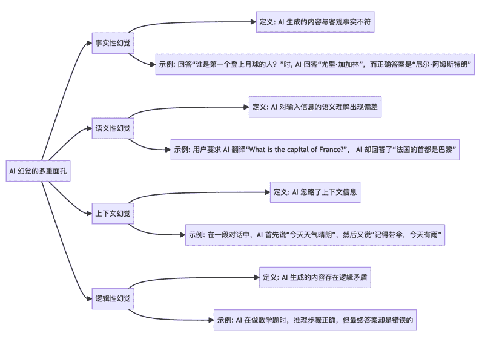
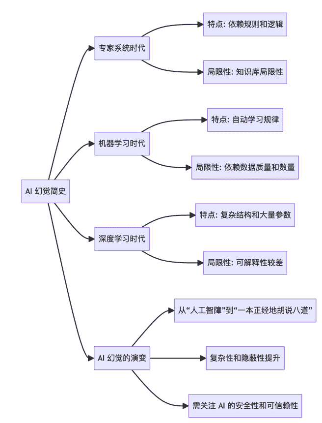
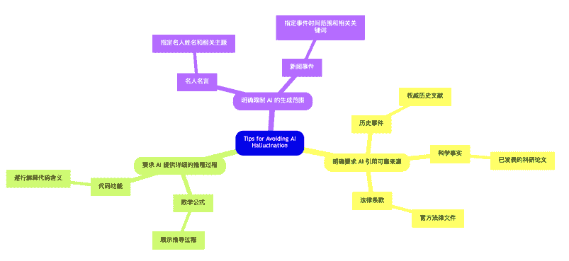

# 【深度揭秘】AI 幻觉背后的技术真相与应对策略，探索人工智能的未来

> 来源：`https://agijuejin.feishu.cn/docx/ADFvdA1nborDj9x6LRpclouLn1t`
> 原文地址：`https://www.iaiuse.com/posts/a9461a48`

## 写在前面

- AI 真的能分辨真实与虚构吗？
- 如果你的 AI 助手在关键会议中搬出了一个虚构的法律先例，你会不会想钻地洞？
- 我们准备好为 AI 的错误买单了吗？
- 当 AI 的“诊断”可能让医生瞬间变成“杀手”，你还敢信它的建议吗？
- 能完全消除 AI 的幻觉吗？
- 技术真的能发展到不需要人类监督的程度吗？
- 还是说我们永远需要在 AI 身后打补丁？
- 如何在使用 AI 的同时保持对其输出的控制？
- 企业该怎么在 AI 和人工审查间找到平衡？
- 毕竟，AI 也是会“走神”的！
- AI 幻觉有风险也有机遇，我们该如何取舍？
- 能不能把 AI 幻觉当成创新的跳板，而不是坑爹的障碍？
- 对于普通人而言，AI 幻觉在未知领域难以评判其结论
- 应该慎重对待，大胆假设，小心求证。

> AI 幻觉是劝退很多人深度使用 AI 的原因之一，AI 胡说八道又一本正经。曾经也有提示词技巧通过让 AI 基于训练数据回答，一定程度上可以规避日期类的幻觉，但是并不能完全杜绝，这和生成式 AI 的机制有关系。

> 本文试图从 AI 幻觉和人类认知偏差，已经 AI 幻觉的产生背景以及当前的努力方向，最后从正面角度观察 AI 幻觉，引出和 AI 的相处之道。

## AI 也会“白日梦”？——细思极恐的 AI 幻觉案例

### "当律师开始胡说"——AI 编造虚假法律判例

想象一下，一位律师在法庭上自信地引用 AI 提供的判例，却在关键时刻被法官指出该判例纯属虚构，会是怎样尴尬的场面？ 这可不是电影情节，而是真实发生在我们身边的 AI 幻觉案例。

AI 尽管拥有海量法律知识，却常常在回答问题时捏造根本不存在的判例，从案件名称到法官姓名，甚至判决日期都编造得天衣无缝。这不禁让人担忧。

### “心脏糖尿病”？！—AI 医生，你认真的吗？

AI 医疗诊断的出现，为解决医疗资源短缺和提高诊断效率带来了希望。然而，AI 医生也可能犯下令人啼笑皆非，甚至危及生命的错误。

一些医学领域的 AI 在回答问题时，会编造出闻所未闻的医学术语。例如，它可能会将“心脏衰竭”和“糖尿病”这两个常见病症生硬地拼凑成一个全新的诊断——“心脏糖尿病”！这种荒谬的“创造力”不仅暴露了 AI 对医学知识理解的不足，更可能误导医生，延误患者的治疗，甚至造成无法挽回的后果。 AI 医生，你确定不是在开玩笑吗？

看起来，AI 的幻觉问题简直要人神共愤了，简直无法直视，真的是这样吗？我们再来看个案例。

### AI 的“脑洞大开”——通往科学新发现的捷径？

`AlphaFold3` 是一种可以用于研究生物分子结构的蛋白质结构预测方法。它可以预测不同分子之间的相互作用方式，这可以帮助科学家了解疾病的运作机制并开发新药。

例如，`AlphaFold3` 可用于研究抗体如何与病毒结合。这些信息可用于设计新的疫苗。

以下是该方法的一些潜在应用：

- 研究蛋白质如何与其他分子相互作用，例如药物或靶标分子。
- 预测蛋白质的结构和功能，这可以帮助科学家设计新的药物和治疗方法。
- 研究疾病的机制，这可以导致新的诊断和治疗方法的开发。

`AlphaFold3` 是一项强大的新工具，有望彻底改变我们对生物分子的理解和治疗疾病的方式。

> `AlphaGo` 战胜李世石的 37 手，几乎所有人类看来，都是相当令人迷惑的，然而，人类输了！很难说这不是傲慢的人类想象出来的“幻觉”，在这类所谓幻觉之下，人类逐渐会被自己打脸。

### AI 幻觉：为何令人迷惑？与错误有何区别？

老实说，说得这么信誓旦旦，要不是查询一下，确实是拿不准。

人们之所以将 AI 模型的某些错误输出称为“幻觉”，主要有以下几个原因：

#### 输出内容的“合理性”

AI 幻觉不同于一般的语法错误或拼写错误，它指的是模型生成了语法正确、语义流畅，甚至看似合理的句子，但这些句子却与事实不符，或者与用户的预期不符。这种“合理性”让人难以第一时间察觉其中的错误，从而产生了“被欺骗”的感觉。

#### 输出语气的“自信”

AI 通常会以非常自信的语气给出答案，即使这些答案是错误的。这种“自信”很容易让人误以为模型真的“知道”答案，从而放松了警惕，更容易相信其输出的内容。

#### 与人类幻觉的类比

“幻觉”一词原本是指人类在没有外部刺激的情况下产生的感知体验，例如看到或听到并不存在的事物。人们将 AI 的错误输出称为“幻觉”，也是将其与人类的这种认知现象进行类比，暗示 AI 模型也可能像人一样产生“虚假感知”。

### 幻觉和错误的区别和示例

| | 错误 | 幻觉 |
| --- | --- | --- |
| 性质 | 语法、拼写、计算等方面的错误，这些错误比较容易被识别和纠正 | 模型在知识理解、推理、以及与人类期望对齐方面出现的错误，这些错误更深层次、更难以察觉，也更难以纠正 |
| 表现形式 | 导致输出内容不完整、不流畅，或者明显不合理 | 导致输出内容看似合理、流畅，甚至带有强烈的自信，但仔细推敲就会发现其中存在逻辑漏洞或事实性错误 |
| 原因 | 由于模型在训练或解码过程中出现了随机性误差 | 由于模型本身的知识局限性、训练数据偏差、或者推理能力不足 |

#### 一般的错误

- **问题：** “请将这句话翻译成法语：’今天天气真好。’”
- **模型输出：** “Aujourd'hui est un beau temps.” (语法错误，正确翻译是 “Il fait beau aujourd'hui.”）

#### AI 幻觉

- **问题：** “请将这句话翻译成法语：’今天天气真好。’”
- **模型输出：** “巴黎是法国的首都。” (看似合理，但与用户的指令不符)

#### AI 幻觉

- **问题：** “如果把珠穆朗玛峰的高度降低 500 米，哪座山会成为世界最高峰？”
- **模型输出：** “如果把珠穆朗玛峰的高度降低 500 米，它仍然是世界最高峰。” (看似合理，但推理错误)

> 如同一声警钟，敲响了人们对 AI 幻觉的担忧。难道 AI 真的会产生类似人类的“幻觉”？ AI 幻觉与人类的认知偏差之间，究竟有什么区别和联系？ 为了更好地理解这一问题，我们需要将两者进行深入的对比分析。

## AI 也会犯错？——与人类认知偏差的“镜像”

### 人潮人海中，有你有我，人类的错觉

很多年前，在大学宿舍的走道里，常常响起黑豹的怒吼

茫茫人海中，有你有我，相遇相识相互琢磨

没有人提醒，也没人觉得为违和，每次唱都只有这两句，后来认真看了看词，发现唱错了，知道错了以后，就再也没唱过了。我想，当时听到的同学们，心理大概也是默认了这句词，这么热情奔放的怒吼，哪里会有唱错的道理呢？

我们会笃定一些事，然后它却和事实有偏差，生活中不乏此类状况，互联网的谣言，听到了，并对这件事了有最初的认知，辟谣的时候却因为各种原因没有看到。

我们都曾经历过“看花眼”、“听岔了”的尴尬时刻，这些都是人类认知偏差的表现。那么，AI 也会犯类似的错误吗？ AI 幻觉，是否就是 AI 世界的“认知偏差”？ 为了解开这个谜团，我们需要将两者进行深入的对比分析。

### 定义和产生机制 ： “表亲”而非“孪生兄弟”

AI 幻觉和人类认知偏差都指向 对信息的扭曲或误解 。然而，两者在 产生机制 上却有着根本区别

- 人类认知偏差：根源于人类的心理和生理机制。
  - 例如注意力不集中、记忆偏差、情绪波动，以及固有的认知偏见等。人类的感知系统并非完美无缺，我们的大脑会根据已有经验和预期对信息进行解读，这导致我们容易受到各种认知偏差的影响。
- AI 幻觉： 源于 AI 系统的技术局限性，包括：
  - 数据缺陷： 训练数据不足、数据偏差、数据噪声等问题，会导致 AI 模型无法准确学习现实世界的规律。
  - 模型缺陷： 模型结构过于简单、参数设置不合理、训练方法不完善等，也会导致 AI 模型的泛化能力不足，容易产生幻觉。
  - 推理缺陷： 即使 AI 模型拥有足够的知识储备，也可能因为推理能力不足，在面对复杂问题时出现逻辑错误或推断失误。

因此，AI 幻觉与人类认知偏差更像是“表亲”，而非“孪生兄弟”。它们有着相似的表现形式，但背后的原因却截然不同。

### 表现形式和影响范围：从“个体迷思”到“群体幻象”

> 学霸觉得这次考试考砸了，学渣觉得这次稳了。打螺丝的时候还在想，明明答对了呀！

AI 幻觉和人类认知偏差在表现形式上有很多相似之处，例如：

- 信息偏差： 都可能导致对信息的扭曲或误解，例如错误地记忆事件、曲解他人的意图、对数字或统计数据产生错误认知等。
- 逻辑错误： 都可能导致推理过程出现错误，例如做出错误的判断、得出错误的结论、提出不合理的建议等。

然而，两者的 影响范围 却有着天壤之别：

- 人类认知偏差： 通常只影响个体的判断和行为，是一种“个体迷思”。例如，某人因为确认偏误而对某个投资项目过度乐观，最终导致投资失败，损失的只是他自己的金钱。
- AI 幻觉： 由于 AI 系统的广泛应用，其产生的幻觉可能会影响成千上万的用户，甚至波及整个社会，是一种“群体幻象”。例如，如果新闻推荐算法存在偏差，就可能导致虚假信息的大规模传播，引发社会恐慌或舆论操控。

| | 人类认知偏差 | AI 幻觉 |
| --- | --- | --- |
| 本质 | 对信息的扭曲 | 大脑在处理信息时，为了节省认知资源而采取的“捷径”，这些捷径虽然可以提高效率，但也容易导致对信息的扭曲和误判 | 模型对训练数据中统计模式的过度依赖，导致其在面对新情况时，无法准确地理解和生成信息，最终输出与现实世界不符的内容 |
| 表现形式 | 多种多样且难以察觉 | 确认偏误（只关注支持自己观点的信息）、可得性偏差（更容易回忆起最近或印象深刻的信息）、锚定效应（过分依赖最初获得的信息） | 生成不存在的人物、地点、事件，或者对已知事实进行错误的描述。 |
| 产生原因 | 都与经验和知识有关 | 与个人的成长经历、文化背景、知识结构等等有关。不同的经验和知识会塑造不同的认知模式，导致人们对相同的信息做出不同的解读 | 与训练数据的质量、模型的结构和训练策略有关。如果训练数据存在偏差或错误，模型就会学习到这些偏差和错误，并将其体现在生成的内容中 |
| 影响 | 可能导致错误的决策 | 可能导致我们在生活中做出错误的判断和选择。例如，一个投资者如果受到可得性偏差的影响，可能会高估近期股市上涨的趋势，从而做出错误的投资决策 | 可能会误导用户、传播虚假信息、甚至引发安全事故。例如，一个用于医疗诊断的 AI 系统，如果出现幻觉，可能会给出错误的诊断结果，从而延误患者的治疗 |

### AI 幻觉：技术缺陷的“放大镜”

虽然 AI 幻觉与人类认知偏差有着诸多相似之处，但我们必须认识到 AI 幻觉的特殊性。 AI 幻觉并非 AI 产生了意识或主观意图，而是 AI 系统 技术缺陷 的一种表现。

AI 幻觉的出现，提醒我们 AI 技术仍然处于发展阶段，其可靠性和安全性需要持续关注和改进。我们不能将 AI 系统等同于人类，更不能将 AI 幻觉简单地归咎于 AI 本身。只有深入理解 AI 幻觉的本质，才能更好地应对其带来的挑战，让人工智能真正成为人类的伙伴，而非潜在的威胁。

> 由此可见，AI 幻觉并非 AI 的主观臆造，而是其技术局限性的一种体现，与人类认知偏差有着本质区别。 然而，面对这些认知上的“陷阱”，人类在漫长的进化过程中已经发展出一套应对策略。 那么，人类是如何对抗认知偏差，避免掉入思维误区？ 这些方法，又能为我们应对 AI 幻觉提供哪些启示？

### 认知训练：让大脑保持清醒

> 通俗点说：就是多学习！

大脑就像精密仪器，需要不断学习和训练才能高效运转。为了避免“想当然”的错误，我们要不断提升认知能力，就像给大脑定期升级系统、打补丁。

- 认清“思维陷阱”： 就像学习识别网络钓鱼邮件一样，我们也需要了解常见的认知偏差，例如：
  - 确认偏误： 我们会倾向于寻找支持自己已有观点的信息，而忽略反面的证据。例如，相信星座的人更容易关注符合自己星座描述的内容，而忽视不符合的部分。
  - 锚定效应： 我们容易受第一印象的影响，即使这个印象是错误的。例如，商家先标一个高价，再打折促销，我们会觉得很划算，即使这个折扣后的价格仍然高于市场价。
  - 锻炼逻辑思维： 就像学习数学一样，我们需要学习如何进行逻辑推理，识别错误的论证。例如，如果有人说“所有天鹅都是白的，因为我见过的天鹅都是白的”，这就是一种不严谨的逻辑，因为存在黑天鹅。
  - 掌握数据分析能力： 在信息爆炸的时代，我们每天都会接触到大量的数字和统计数据。学习一些基本的统计学知识，可以帮助我们更好地理解和分析数据，避免被误导。例如，一则广告声称某种保健品有效率高达 90%，但却没有说明样本量和实验方法，我们就需要保持警惕，不能盲目相信。

> 就像不谈剂量就是耍流氓一样，除了自我精进，还有很多工具可以改善认知偏差。

### 结构化思考：用工具辅助判断

> 思维工具，拓展了我们的大脑的计算能力和存储容量

即使我们努力保持清醒，大脑偶尔还是会“偷懒”，犯下“想当然”的错误。这时，结构化思考工具能帮我们减少失误。

- 决策矩阵： 面对多个选择时，我们可以用表格列出每个选择的优缺点，量化评分，帮助我们做出更理性的决策。
  - 例如，选择旅游目的地时，我们可以列出风景、交通、费用等方面的评分，而不是凭感觉选择。
- 检查清单： 执行复杂任务时，我们可以用检查清单确保每个步骤都按计划完成，避免遗漏或错误。
  - 例如，飞行员在起飞前会严格执行检查清单，确保飞机各个系统正常运作。
- 风险评估模型： 做重要决策时，我们可以用风险评估模型分析不同方案的风险，并制定应对措施。
  - 例如，投资前进行风险评估，可以帮助我们更好地管理资金，避免损失。iaiuse.

比如，医生使用标准化检查清单来减少误诊。这些结构化思考工具就像给我们的思维装上“辅助轮”，让我们在面对复杂问题时，能更稳妥地做出判断。

### 群策群力： 发挥集体的智慧

> 更重要的是，我们是社会动物，在不断的信息交换中，产生新的认知和理解

俗话说，“三个臭皮匠，顶个诸葛亮”。面对复杂难题，单凭个人力量难以找到最佳解决方案。这时，我们需要集思广益，借助群体智慧弥补个体认知的局限。

- 头脑风暴： 通过集思广益，我们可以从不同的角度思考问题，激发更多创意，并找到更全面的解决方案。
  - 例如，在产品设计会议上，团队成员可以畅所欲言，提出各种想法，而不是局限于个人的思路。
- 辩论和讨论： 通过辩论和讨论，我们可以对不同的观点进行碰撞和交锋，帮助我们更好地理解问题的本质，找到更合理的解决方案。
  - 例如，法庭上的辩论过程，正是双方律师通过逻辑论证和证据展示，试图说服法官和陪审团的过程。
- 投票和协商： 在需要做出集体决策时，我们可以通过投票和协商，来整合大家的意见，找到一个大多数人能够接受的方案。
  - 例如，小区业主大会可以通过投票决定小区的管理方案。

群体智慧就像是将多个“处理器”连接在一起，形成一个强大的“计算网络”，能够处理更加复杂的问题。

### 从人类到 AI：让 AI 更聪明的秘方

人类应对认知偏差的方法，为解决 AI 幻觉问题提供了宝贵的思路。借鉴这些方法，开发相应技术手段，能帮助 AI 更好地理解世界，做出更准确的判断。

- 数据“大扫除”： 就像人类需要认知训练一样，我们需要对 AI 模型的训练数据进行“大扫除”，去除错误、补充缺失、平衡偏差，让 AI 模型学习到更真实、全面的知识。
- 打开 AI 的“黑箱”： 就像人类使用结构化工具辅助思考一样，我们需要让 AI 的“思考过程”更透明，便于人类理解和监督。
  - 例如，可解释性 AI 技术可以帮助我们理解 AI 模型如何做出判断，避免因错误逻辑或数据导致错误结论。（Anthropic 团队2024 年的研究有助于解决“黑盒”问题，目前还处于探索阶段）

+ **打造 AI “智囊团”：** 就像人类通过群体决策来集思广益一样，我们可以让多个 AI 模型协同工作，共同解决问题，避免单个模型的局限性导致的错误。（吴恩达最近提到的多种 `Agent` 模式等有益探索）

AI 幻觉治理是一段充满挑战的旅程，需要不断学习人类的智慧，将对抗认知偏差的经验转化为 AI 技术进步的动力。

> 人类在与认知偏差的长期斗争中积累了宝贵经验。这些经验告诉我们，提升认知能力、借助工具辅助判断、发挥群体智慧，能帮助我们减少错误，做出更理性的决策。那么，对于 AI 系统来说，是否也存在类似的“认知偏差”？AI 幻觉究竟是什么？有哪些表现形式和类别？

# AI 幻觉：当人工智能“一本正经地说胡说八道”

我们已经了解了人类如何巧妙应对认知偏差，那么对于 AI 系统，是否也存在类似的“认知陷阱”？答案是肯定的，这就是“AI 幻觉”。

## AI 幻觉：真实与想象的“迷宫”

简单来说，AI 幻觉是指 AI 系统生成的信息与事实不符，或者与预期不符，就像人工智能在“一本正经地说胡说八道”。这些“胡说八道”不是 AI 故意的，而是技术局限性造成的错误。

AI 幻觉的定义可以概括为：AI 系统生成的输出内容看似合理流畅，但实际上与输入信息、上下文环境或客观事实相矛盾，缺乏逻辑或经验支撑。

## AI 幻觉：“多重面孔”

AI 幻觉的表现形式多种多样，如下图所示：

## AI 幻觉：潜藏的风险

! <https://cdn.iaiuse.com/img/2024/06/19/e0c94e15b28e40017ee3e7be9f98a8c1.png>

AI 幻觉看似“小错误”，但在实际应用中可能带来巨大风险。

+ 误导用户：AI 幻觉会导致用户获取错误信息，从而做出错误判断。例如，医疗 AI 助手给出错误诊断建议，可能延误患者治疗。

+ 传播虚假信息：AI 幻觉可能被用于制造和传播虚假信息，误导公众，影响社会稳定。例如，AI 可以生成虚假新闻报道或社交媒体帖子，用于政治宣传或商业炒作。

+ 损害 AI 系统的可信度：AI 幻觉会降低用户对 AI 系统的信任度，阻碍 AI 技术推广和应用。例如，如果用户发现 AI 经常“胡说八道”，他们可能不再信任 AI 的判断，甚至拒绝使用 AI 产品。

## AI 幻觉：机遇与挑战并存

! <https://cdn.iaiuse.com/img/2024/06/19/a0c78b17bb631088b17a4aa6b40ce95c.png>

AI 幻觉的出现，为我们敲响了警钟，提醒我们在发展 AI 技术的同时，也要重视其安全性和可靠性。然而，我们不能因此否定 AI 幻觉的积极意义。

+ 推动技术进步：AI 幻觉的出现，暴露现有 AI 技术的局限性，促使研究人员不断探索新方法和技术，提高 AI 系统的性能和可靠性。

+ 激发人类创造力：AI 幻觉有时会产生一些意想不到、新奇的输出，为人类艺术创作和科学研究提供灵感，帮助我们突破思维定式，探索未知领域。

AI 幻觉就像是一把双刃剑，既是挑战，也是机遇。我们需要正视 AI 幻觉带来的风险，同时积极探索其潜在价值，让人工智能更好地服务于人类社会。

> AI 幻觉，就像潜藏在人工智能系统中的“幽灵”，它披着真实的外衣，却可能将我们引入歧途。那么，是什么原因导致了这些“一本正经地说胡说八道”的现象？ 只有深入探究 AI 幻觉的根源，才能找到有效的应对之策，让人工智能真正成为人类可信赖的伙伴。

# AI 也会“学坏”？——探究 AI 幻觉的幕后推手

我们已经见识了 AI 幻觉的种种“迷惑行为”，不禁要问，究竟是什么原因让 AI 走上了“一本正经地说胡说八道”的道路？ 只有揭开 AI 幻觉背后的神秘面纱，才能找到有效的“解药”，避免 AI 在错误的道路上越走越远。

## “不良教材”的误导：数据质量的“陷阱”

! <https://cdn.iaiuse.com/img/2024/06/19/10dfe17bca1d5e4957e45d93ba8f669e.png>

> 早期信息化建设有个段子，“输入的是垃圾数据，输出的也是垃圾数据”（Garbage in, garbage out）。这也是很多信息化项目失败的重要原因，AI 的学习过程也是一样。

如果 AI 模型的训练数据存在问题，那么 AI 就可能“学坏”，产生各种幻觉。

+ 信息污染：AI 的学习资料如果包含虚假信息，它就可能将这些错误信息当作“真理”来记忆和输出。AI 模型很容易受到训练数据中错误信息的影响，产生“模仿性错误”。例如，如果训练数据中充斥着“地球是平的”的错误信息，那么 AI 模型就可能在回答相关问题时，自信地宣称地球是平的。

+ 偏见陷阱：AI 的训练数据如果存在偏见，它就可能将这些偏见“内化”，并在输出内容时表现出来。例如，如果训练数据中大部分程序员都是男性，那么 AI 就可能在生成文本时，默认程序员是男性，而忽略女性程序员的存在。这种偏见会导致 AI 的输出缺乏客观性和公平性，甚至可能加剧社会现有的偏见和歧视。

+ 知识断层：AI 的知识储备来自于训练数据，如果训练数据缺乏某个领域的知识，或者知识更新不及时，那么 AI 在回答相关问题时就可能“抓瞎”，只能靠“编造”来应付。例如，如果一个医疗 AI 模型没有学习过某种罕见疾病的知识，那么它在面对相关病例时，就可能给出错误的诊断，甚至编造出不存在的医学术语。

## “脑子不够用”——模型自身的能力缺陷

! <https://cdn.iaiuse.com/img/2024/06/19/a84e523c74867b25ebe0727343f72bc8.png>

即使训练数据完美无缺， AI 模型也可能因为自身的能力缺陷而产生幻觉。

+ 结构简单，理解力不足：AI 模型就像一个学生，如果它的“脑子”不够复杂，理解能力就会有限，在面对复杂的文本或图像时，容易出现误解或曲解。例如，一个简单的图像识别模型，可能无法区分一只猫和一只老虎，因为它们在某些特征上比较相似。

+ 注意力不集中，抓不住重点：AI 模型在处理信息时，也需要集中注意力。如果它“注意力不集中”，就可能忽略重要的信息，而过度关注无关的信息，导致输出内容“文不对题”。例如，在翻译一篇新闻报道时， AI 可能过度关注某个细节，而忽略了文章的主题，导致翻译出来的内容与原文意思相去甚远。

+ 推理能力不足，逻辑混乱：AI 模型需要具备一定的推理能力，才能理解文本或图像背后的逻辑关系。如果它缺乏推理能力，就可能生成逻辑混乱的文本，甚至自相矛盾。例如，一个 AI 聊天机器人在回答问题时，可能会先说“今天天气晴朗”，然后又说“记得带伞，今天有雨”。

## “训练不到位”——训练方法的缺陷

AI 模型的训练过程，就像学生的学习过程一样，需要科学的方法和充足的时间才能取得良好的效果。如果训练方法存在缺陷， AI 模型也可能“学艺不精”，容易产生幻觉。

+ 学习模式单一，缺乏灵活性：传统的 AI 训练方法，通常是让模型反复学习大量的样本数据，直到模型能够准确地识别或生成这些样本。然而，这种方法缺乏灵活性，导致模型在面对新的、未见过的样本时，容易“不知所措”，只能根据已有的知识进行猜测，从而产生幻觉。例如，一个只学习过猫的图片的 AI 模型，在看到一只狗的图片时，可能会把它误认为是猫，或者根据猫的特征“想象”出一只狗的样子。

+ 过度依赖“标准答案”，缺乏创造力：在训练过程中， AI 模型通常会得到一个“标准答案”，它需要不断调整自己的参数，直到生成的答案与“标准答案”一致。然而，这种过度依赖“标准答案”的做法，会限制 AI 模型的创造力，导致它在面对开放性问题时，无法生成新颖的、有创意的答案，只能重复已有的知识，或者根据已有知识进行“拼凑”。

## AI 也会“口误”——推理过程的随机性

AI 模型在生成文本或图像时，通常会根据概率分布来选择最有可能出现的词语或像素。这种 随机性 虽然可以增加 AI 模型的创造力和多样性，但也可能导致 AI 产生“口误”，生成一些不符合逻辑或事实的语句。

例如，一个 AI 写作模型在生成故事时，可能会根据概率分布选择“他”或“她”来指代一个角色。如果模型没有正确地理解角色的性别，就可能出现“性别错乱”的现象，例如，在一个描述女性角色的故事中， AI 突然用“他”来指代这个角色，让人感到困惑。

AI 幻觉的产生是一个复杂的过程，它可能是多种因素共同作用的结果。只有深入理解 AI 幻觉背后的原因，才能找到更有效的应对措施，让 AI 系统更加可靠、更加安全。

> 从数据质量到模型结构，再到训练方法和推理机制， AI 幻觉的产生如同一个多米诺骨牌效应，环环相扣，错综复杂。为了更好地理解这一问题，我们需要回顾 AI 幻觉的历史，探寻 AI 幻觉是如何随着 AI 技术的发展而演变的。

# AI 幻觉简史：从“人工智障”到“一本正经地说胡说八道”

我们已经了解了 AI 幻觉的多因素交织，那么这个“顽固”的问题，是如何伴随 AI 技术发展而演变的？让我们一起回顾 AI 幻觉的简史，或许能从中找到一些治理的线索。

## 专家系统时代：规则的“牢笼”

早期的 AI 系统主要依靠人类专家制定的规则和逻辑进行推理和决策，就像一个只会按“剧本”演出的演员。这些系统被称为“专家系统”，它们在处理特定领域的问题时表现出色，例如诊断某些疾病或进行简单的数学运算。

然而，专家系统的致命弱点在于其知识库的局限性。一旦遇到超出预设规则范围的情况，它们就会“不知所措”，犯下低级错误，就像一个只会背诵课本的学生，一遇到课本上没有的题目就束手无策。

例如，早期的医疗专家系统，遇到一种从未见过的疾病，就可能给出错误诊断，甚至建议错误治疗方法。这种情况在今天看来，就像“人工智障”一样，但在当时却是 AI 技术发展水平的真实写照。

## 机器学习时代：从“死记硬背”到“举一反三”

随着计算机技术进步和数据量爆炸式增长，AI 迎来了“机器学习”时代。机器学习算法能够从大量数据中自动学习规律，并根据这些规律进行预测和决策，就像一个能从大量习题中总结解题技巧的学生。

相比于专家系统，机器学习模型的泛化能力更强，能处理更加复杂和多变的任务。然而，机器学习模型仍依赖于数据的质量和数量。如果训练数据存在偏差或不足，AI 模型仍可能“学偏”，产生各种幻觉。

例如，一个机器翻译模型，如果只学习了有限的语言样本，那么它在翻译一些复杂句子时，就可能出现语义错误或逻辑混乱，就像一个只会“死记硬背”单词的学生，无法理解句子的深层含义。

## 深度学习时代：“黑箱”里的秘密

近年来，深度学习技术取得了突破性进展，成为 AI 领域的“当红炸子鸡”。深度学习模型拥有更加复杂的结构和更多的参数，能从海量数据中学习到更精细的特征，从而实现更加精准的预测和决策。

然而，深度学习模型的可解释性较差，其内部决策过程就像一个“黑箱”，人类难以理解。这使我们难以判断 AI 模型究竟是“真懂”了，还是仅仅“记住了”大量数据，一旦遇到新情况就可能出现幻觉，而这种幻觉往往更加难以察觉，因为它可能隐藏在看似合理的表象之下。

随着 AI 模型的复杂度不断提升，AI 幻觉的种类也更加多样化，其表现形式也更加隐蔽，更难以被人类识别和纠正。例如，一个 AI 写作模型，可能生成一篇语法流畅、逻辑通顺的文章，但文章内容却完全是虚构的，甚至编造出一些不存在的人物、事件或理论。

## AI 幻觉：技术进步的“伴生品”

回顾 AI 幻觉的历史，我们可以看到，AI 幻觉并不是一个新问题，而是伴随着 AI 技术的发展而不断演变的。从早期的“人工智障”，到如今“一本正经地说胡说八道”，AI 幻觉的复杂性和隐蔽性都在不断提升。

AI 幻觉的演变过程也反映了 AI 技术发展水平的不断提升。从依赖人工规则，到依靠数据驱动，再到如今的深度学习，AI 系统正在变得越来越“聪明”，但也面临着更加复杂和难以预料的挑战。AI 幻觉正是技术进步的“伴生品”，它提醒我们在追求 AI 能力提升的同时，也要时刻关注其安全性和可信赖性。

> AI 幻觉问题如同幽灵般伴随着 AI 技术一路走来，从早期专家系统的“人工智障”，到如今深度学习模型的一本正经地说瞎话，其复杂性和隐蔽性都在不断升级。AI 的能力日益强大，但其“脑补”和“一本正经说瞎话”的倾向也愈发令人担忧。那么，面对这个与 AI 发展如影随形的难题，人类有哪些应对措施？研究者们又做了哪些努力来“驯服”AI 幻觉，让 AI 更加安全可靠呢？

# AI 幻觉：并非无药可医

AI 幻觉的历史告诉我们，这个难题一直伴随着 AI 的发展，如同一个甩不掉的“影子”。那么，面对 AI 幻觉，我们是否只能束手无策？当然不是！近年来，研究人员们已经开发出多种技术手段，试图“驯服”这个难以捉摸的“幽灵”，让 AI 变得更加可靠和值得信赖。

## 数据“体检”：为 AI 打好基础

正如我们在前文中提到的，低质量的训练数据是导致 AI 幻觉的重要原因。因此，为 AI 模型提供“干净”、“健康”的训练数据，就如同给 AI 做一次全面的“体检”，是预防 AI 幻觉的根本措施。

+ 数据清洗：就像医生为病人清除体内的毒素一样，数据科学家们会利用各种技术手段，对 AI 的训练数据进行“清洗”，去除错误信息、补充缺失数据、修正不一致的内容，并尽可能消除数据中的偏见。

+ 数据增强：为了让 AI 模型学习到更全面的知识，我们需要为它提供更多、更丰富的训练数据，就像给学生补充各种类型的练习题，帮助他们掌握不同的知识点和解题技巧。例如，在训练一个图像识别模型时，我们可以对已有的图像进行旋转、缩放、裁剪等操作，生成更多新的样本，从而提高模型的泛化能力。

## “改造大脑”：优化 AI 模型

除了提供高质量的数据，我们还可以通过优化 AI 模型本身，来降低 AI 幻觉的风险。

+ 模型编辑：如果我们发现 AI 模型在某些方面存在缺陷，例如容易产生特定类型的幻觉，我们可以通过“模型编辑”技术，对模型的结构或参数进行调整，就像医生为病人做手术，修复身体的缺陷。

+ 提示工程：AI 模型就像一个需要指令才能行动的机器人，而“提示”就是我们给 AI 模型的指令。通过精心设计提示，我们可以引导 AI 模型更好地理解我们的意图，并生成更符合我们预期的内容，从而减少幻觉的产生。例如，在使用 AI 写作模型时，我们可以通过设定写作风格、主题、关键词等参数，来引导模型生成符合要求的文本。

## “知识外挂”：RAG 技术

为了弥补 AI 模型自身知识的不足，我们可以为它提供外部知识的支持，就像给学生提供参考书和工具书一样，帮助他们更好地理解和解决问题。检索增强生成 (RAG) 技术就是一种为 AI 模型提供“知识外挂”的方法。

我们可以将 RAG 技术的工作原理概括为以下几个步骤：

1. 理解问题：AI 模型首先需要理解用户的提问或指令。

2. 检索相关知识：AI 模型根据对问题的理解，从外部知识库中检索相关的信息。例如，如果用户问“埃菲尔铁塔有多高？”，AI 模型就会从知识库中检索关于埃菲尔铁塔的信息。

3. 整合知识与推理：AI 模型将检索到的知识与自身的推理能力相结合，生成最终的答案或内容。

RAG 技术的优势在于能够将 AI 模型与外部知识库连接起来，从而扩展 AI 模型的知识范围，提高其回答问题和生成内容的准确性。例如，在医疗领域，RAG 技术可以帮助医疗 AI 助手获取最新的医学知识和临床案例，从而提高其诊断和治疗建议的准确性。

### RAG 技术具有以下优势：

+ 提高准确性：通过检索相关信息，生成内容更具事实依据，减少了凭空编造和幻觉的可能性。

+ 增强一致性：结合检索信息和生成模型，可以确保生成内容在上下文和逻辑上的一致性。

+ 适应性强：RAG 技术可以应用于各种生成任务，包括文本生成、问答系统、翻译等，具有广泛的应用前景。

### RAG 技术的局限性

尽管 RAG 技术在减少 AI 幻觉方面表现出色，但它也存在一些局限性：

+ 依赖检索质量：RAG 技术的表现高度依赖于检索到的信息质量。如果知识库中的信息存在错误或偏差，生成内容也可能受其影响。

+ 计算资源需求高：RAG 技术结合了检索和生成两部分，计算资源需求较高，可能限制其在资源有限的场景中的应用。

+ 处理速度慢：由于需要先进行信息检索，再进行内容生成，RAG 技术的处理速度相对较慢，可能不适合实时性要求高的应用。

## “对抗训练”：让 AI 更“皮实”

AI 模型在训练过程中，可能会遇到一些“恶意”的样本数据，例如故意设置的错误信息或噪声数据。这些“恶意”样本可能会误导 AI 模型，导致其产生幻觉。为了提高 AI 模型的鲁棒性，我们可以使用对抗训练技术，让 AI 模型在训练过程中就接触到这些“恶意”样本，并学会如何识别和抵抗它们。

对抗训练就像给 AI 模型进行“实战演练”，让它在面对各种“攻击”时，能够保持冷静，做出正确的判断。

## 精准“操控”：用提示词驯服 AI 幻觉

想要避免 AI 掉入“幻觉”的陷阱，我们除了优化数据和模型，还可以巧妙地利用“提示词工程”，就像一位经验丰富的驯兽师，用精准指令来引导 AI 生成更可靠的内容。

AI 对提示词的理解能力与幻觉的产生密切相关。清晰、具体的提示词能够帮助 AI 更好地理解我们的意图，从而减少“想当然”的错误。

例如，当我们询问 AI “第二次世界大战的关键日期”时，如果只是简单地抛出问题， AI 可能会根据其记忆中的信息，给出一些似是而非的答案。但如果我们在提示词中明确要求 AI “根据可信的历史文献”来回答，并限定时间范围， AI 就更有可能给出准确的答案。

以下是一些避免 AI 幻觉的提示词技巧：

+ 明确要求 AI 引用可靠来源：例如，在询问历史事件时，可以要求 AI 引用权威的历史文献；

* 在询问科学事实时，可以要求 AI 引用已发表的科研论文；

* 在询问法律条款时，可以要求 AI 引用官方的法律文件。

+   要求 AI 提供详细的推理过程：
    * 这可以帮助我们理解 AI 是如何得出结论的，并判断其结论是否合理。

* 例如，在询问数学公式时，可以要求 AI 展示推导过程；

* 在询问代码功能时，可以要求 AI 逐行解释代码的含义。

+   **明确限制 AI 的生成范围：**
    * 例如，在询问名人名言时，可以指定名人的姓名和相关主题；

* 在询问新闻事件时，可以指定事件的时间范围和相关关键词。

通过这些技巧，我们可以将提示词变得更加清晰、具体、有针对性，从而引导 AI 生成更加准确和可靠的内容。当然，提示词工程只是一种辅助手段，要想从根本上解决 AI 幻觉问题，还需要从数据、模型、训练方法等多个方面进行努力。

> AI 幻觉的治理是一个复杂而长期的任务，目前的技术手段还无法完全解决这个问题。我们需要不断探索新的方法和技术，并加强对 AI 系统的监管和评估，才能让 AI 更加安全、可靠、值得信赖。

# AI 幻觉：一个无法回避的现实

我们已经了解了多种应对 AI 幻觉的技术手段，它们就像“魔法武器”，帮助我们对抗 AI 幻觉这个“顽固”的敌人。然而，一个残酷的现实是： AI 幻觉无法从根本上避免。

## 理论的“枷锁”：AI 的能力边界

"Hallucination is Inevitable: An Innate Limitation of Large Language Models" (Xu et al., 2024) 这篇论文，为我们揭示了 AI 幻觉无法被完全消除的根本原因： AI 模型的能力存在边界。

+   **AI 的知识来源于数据：** AI 的知识来自于它的训练数据，无法超越这些数据的范围，就像学生不能回答课本之外的问题一样。

+   **AI 的推理能力有限：** AI 的推理能力有限，即使拥有足够的知识，它也无法像人类一样进行无限的推理和联想。

因此，即使我们不断改进数据质量、优化模型结构，AI 仍然无法掌握所有知识并具备无限的推理能力。

## 案例的“佐证”：AI 幻觉的“顽固性”

我们前面提到的多个 AI 幻觉案例，也从侧面印证了 AI 幻觉的“顽固性”。无论是 ChatGPT 编造的虚假法律判例，还是医疗 AI 误诊的案例，都表明即使是最先进的 AI 模型，也无法完全避免错误的发生。

## AI 幻觉：客观存在的局限性

AI 幻觉的不可避免性，是一个客观的现实，它源于 AI 技术本身的局限性，而非人为的疏忽或错误。我们需要正视这一现实，并采取更加谨慎的态度来对待 AI 技术。

+   **AI 并非万能：** 我们不能期望 AI 系统能够解决所有问题，更不能将 AI 的判断视为绝对的真理。

+   **谨慎应用 AI 技术：** 在将 AI 技术应用于关键领域时，例如医疗、金融、法律等，需要格外谨慎，并采取必要的措施来降低 AI 幻觉带来的风险。

+   **持续改进 AI 技术：** AI 幻觉的不可避免性，并不意味着我们应该放弃对 AI 技术的追求。相反，我们需要更加努力地改进 AI 技术，提高其可靠性和安全性，让 AI 更好地服务于人类社会。

# AI 幻觉的另一面： 意外的惊喜

尽管 AI 幻觉存在着种种风险，但我们也不能将其一棒子打死。 AI 幻觉，就像是一枚硬币的另一面，也蕴藏着一些意想不到的惊喜，甚至可能成为推动人类社会进步的动力。

## AI 的“脑洞大开”：激发人类创造力

正如 "“Confidently Nonsensical?”: A Critical Survey on the Perspectives and Challenges of ‘Hallucinations’ in NLP" (Narayanan Venkit et al., 2023) 中指出的， AI 幻觉有时会产生一些新颖、奇特、甚至超越人类想象力的内容，这可以为我们的艺术创作和科学研究提供灵感。

+   **艺术创作的新领域：** AI 幻觉可以帮助艺术家突破传统的创作手法，探索新的艺术风格和表现形式。

* 例如，一些 AI 艺术家利用图像生成模型的幻觉效应，创作出充满奇幻色彩的艺术作品，这些作品往往带有强烈的视觉冲击力，令人耳目一新。

+   **科学发现的新思路：** AI 幻觉有时会揭示出数据中隐藏的规律和模式，这些规律和模式可能是人类科学家从未注意到的，但却可能蕴含着重要的科学价值。

* 例如，一个 AI 模型在分析天文数据时，可能“意外”地发现一个无法解释的异常现象，这可能会促使科学家们去寻找新的物理理论来解释这一现象，从而推动科学的进步。

## AI 的“试错”：加速技术进步

AI 幻觉的出现，也反映了 AI 技术发展过程中的 试错过程 。每一次幻觉，都是 AI 模型的一次“学习”和“成长”。通过分析 AI 幻觉产生的原因，我们可以更好地理解 AI 模型的局限性，并改进模型的设计和训练方法，从而推动 AI 技术的进步。

例如，早期机器翻译系统经常出现“驴唇不对马嘴”的错误翻译，这促使研究人员不断改进翻译算法，并最终开发出更加准确和流畅的机器翻译系统。如今，随着深度学习技术的应用，机器翻译的质量已经得到了显著提升，但 AI 幻觉仍然是一个需要持续关注和解决的问题。

## AI 幻觉 一把双刃剑

AI 幻觉是一把双刃剑，既可以成为推动人类进步的动力，也可能带来难以预料的风险。我们需要辩证地看待 AI 幻觉，既不能因其潜在风险而放弃对 AI 技术的探索，也不能因其潜在价值而忽视其可能带来的危害。

+   **扬长避短：** 我们要善于利用 AI 幻觉的积极一面，将其作为激发创造力和推动技术进步的动力。同时，也要积极研究应对 AI 幻觉的技术手段，最大限度地降低其风险。

+   **人机协作：** AI 幻觉的不可避免性，决定了人类在 AI 技术发展过程中始终扮演着重要的角色。我们需要加强对 AI 系统的监管和引导，让人工智能始终服务于人类的目标和价值观。

AI 幻觉，是 AI 技术发展过程中的一道“坎”，但也是通往更加智能未来的必经之路。相信通过人类的智慧和努力，我们能够跨越这道“坎”，最终抵达 AI 与人类和谐共生的彼岸。

# 与 AI 共舞： 在挑战中寻求机遇

AI 幻觉就像一面镜子，映照出人工智能技术发展道路上的光明与阴影。我们既要看到它带来的风险和挑战，也要看到它蕴藏的机遇和希望。如何更好看待 AI 幻觉，将决定着人工智能的未来走向。

## AI 幻觉：挑战与机遇并存

回顾前文，我们已经了解到，AI 幻觉是 AI 系统技术局限性的一种体现，它无法从根本上避免。AI 幻觉可能会误导用户、传播虚假信息、损害 AI 系统的可信度，这些都是我们需要警惕和防范的风险。

然而，AI 幻觉也可能为我们带来意想不到的惊喜。它可以激发人类的创造力，推动技术进步，甚至帮助我们发现新的科学知识。AI 幻觉就像是一枚硬币的两面，既有负面影响，也有正面价值。

## 人类的智慧：引导 AI 向善

AI 技术的发展，离不开人类的智慧和引导。面对 AI 幻觉，我们不能简单地将其视为技术问题，而是要从**伦理和社会**的角度去思考，如何引导 AI 技术健康发展，让 AI 真正造福人类社会。

+   **制定 AI 伦理规范：** 我们需要制定明确的 AI 伦理规范，引导 AI 技术的研发和应用，确保 AI 系统符合人类的价值观和道德准则，避免 AI 被用于危害人类利益的行为。

+   **加强 AI 监管：** 我们需要加强对 AI 系统的监管，建立完善的评估机制，及时发现和纠正 AI 系统中的错误和偏差，防止 AI 幻觉造成严重后果。

+   **提升公众的 AI 素养：** 我们需要提升公众的 AI 素养，让人们了解 AI 技术的原理和局限性，理性地看待 AI 幻觉问题，避免被 AI 误导。

## AI 的未来：谨慎的乐观

AI 技术的发展，为人类社会带来了巨大的机遇和挑战。我们相信，通过人类的智慧和努力，我们能够克服 AI 幻觉带来的挑战，充分发挥 AI 技术的潜力，最终让人工智能成为人类社会进步的强大引擎。

在通往智能未来的道路上，我们既要保持乐观的态度，积极探索 AI 的无限可能，也要保持谨慎的态度，时刻警惕 AI 潜在的风险。只有这样，我们才能与 AI 和谐共舞，共同创造更加美好的未来。

# 结语

缘起于一次网上找到一个总结👸号的提示词，给它一个👸号文章链接，它就给我一段合适的总结。当时正在研究 AI 硬件的内容，它的输出结果还挺像那么回事，但是真正打开网页看的时候完全不是不对，它根本没有去读取网页内容。在写这篇文章的时候同样也遇到这个问题，思索再三，没有把它归到 AI 幻觉中去，有这样几个方面的考虑：

+   **从策略上看，** 总结类文章，AI 很有可能不会读完整个文章，而只是头尾读一下，中间随机读就可以了。

+   使用 Python 的 `request` 库读取网页速度并不会太快，但是大语言模型的反馈会非常快速，实际上很多大语言模型并没有真去搜索网页。

综合上述理由，它更像是大语言模型开发商的"狡猾"，用“AI 幻觉”背锅了。

| `Gemini` | 真正页面 |
| --- | --- |
| ! | ! |
| 页面中完全没有提及 `PaLM`，但是它也不说自己不具备联网能力，就是胡说八道说了一通。 |  |

# 参考资料

+   Navigating Hallucinations for Reasoning of Unintentional Activities

+   Exploring the Mechanisms and Countermeasures of AI Hallucinations

+   Analysis of Data Bias and Its Impact in AI Systems

+   The Impact of Data Quality on AI Hallucinations

+   Application of AI in the Medical Field and Its Hallucination Issues

+   Application of `RAG` (Retrieval-Augmented Generation) Technology in Reducing AI Hallucinations

+   Mechanisms of Non-Factual Hallucination in Language Models

+   “Confidently Nonsensical?”: A Critical Survey on the Perspectives and Challenges of ‘Hallucinations’ in `NLP`

+   Sorry, Come Again (`SCA`) Prompting – Enhancing Comprehension and Diminishing Hallucination with [`PAUSE`] -injected Optimal Paraphrasing

+   HILL: A Hallucination Identifier for Large Language Models
