# 智谱，闷声不响发了个「100w 长文本模型」

> 来源：[https://agijuejin.feishu.cn/docx/N4mvdfCcooO6eZxNPRjcuj0InWh](https://agijuejin.feishu.cn/docx/N4mvdfCcooO6eZxNPRjcuj0InWh)

> 作者：特工少女 | 特工宇宙

> 原文：[https://mp.weixin.](https://mp.weixin.qq.com/s/oyesjlp4cfOSn6LxZvWpew)qq.com/s/oyesjlp4...

最近各家模型发的都挺勤，一会一个 SOTA，一会一个遥遥领先。

可能有不少朋友有点「审美疲劳」，但我还是乐在其中的。

加上不是赶上了「价格战」嘛，我就经常去各家开发平台逛逛。

一是为了研究下定价，二是想测试下各种模型能力，是不是像宣传的那么 NB.

这不，前几天「智谱」不是搞了个 DemoDay，看到好多家公司都用智谱的大模型，所以就来智谱 AI 开放平台（bigmodel.cn） 上看看，智谱的模型现在到底搞的咋样了。

结果不看不知道，一看就发现了大的。

智谱 AI 开放平台上， 竟然悄无声息的发了个长文本模型， 还是 100 万 Token 上下文长度的那种 。

什么概念？现在主流的模型基本上都在 128k 这个量级上。根据 36 氪 6 月的一期报道，“ 1M token 的上下文窗口，意味模型 能同时处理 200 万字的输入 ，大概相当于 2 本红楼梦或者 125 篇论文的长度”。

能同时处理 200 万字的输入？好家伙，这不小 Kimi 嘛。

OpenAI：好好好这么玩是吧，让你对标没让你超越啊。

不得不说，Kimi 的用户心智打的特别好，说到「长」，大家第一时间就会想到 Kimi.

但又有多少人，真正体验到了 Kimi 的 200 万字上下文的模型？

是不是都还在排队中？像我这样被通过的可谓是「凤毛菱角」。

反观智谱， 既不发期货，也不饥饿营销，直接低调上线 。 属于是人狠话不多。

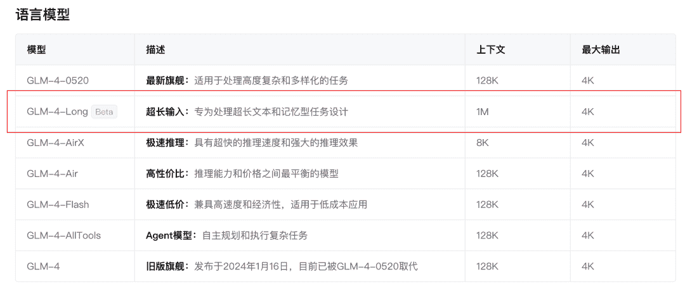

诶不过，你说有没有一种可能， 没有大范围宣发， 是因为还不太稳定，能力还不太强，但刚好被咱们特工抓包了呢？

简单， 「GLM-4-Long」 开放了 API，咱们来测试一下。

按照惯例直接开始整活！前段时间刚刚举行了一个全球算命师大赛，听起来有点离谱，但是人家已经办了 15 届了。

我们先找来一大堆相关书籍资料，提取其中的文字， 用上下文而非 RAG 知识库外挂的方式 ，直接喂进去。

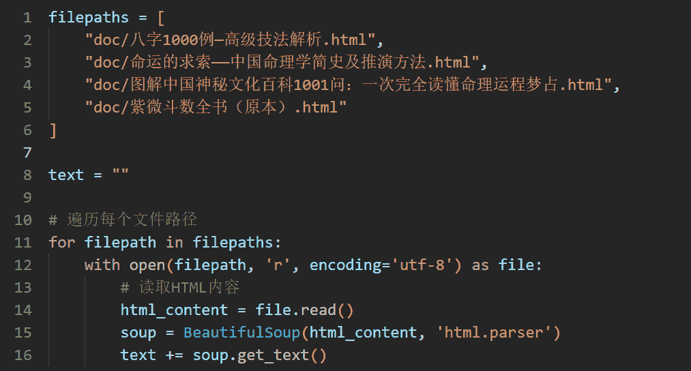

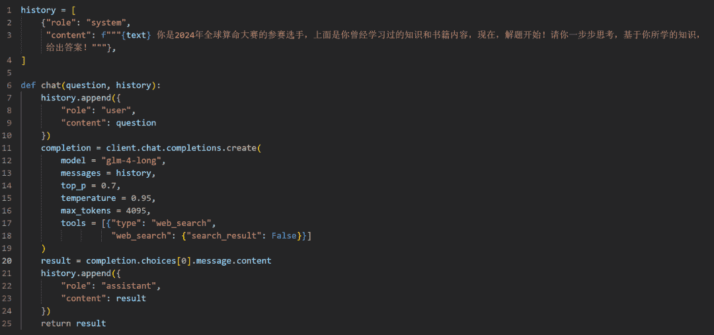

可以看到这几份文件，一共有近 60 万字。

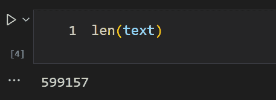

然后调用模型，为了方便，我们只挑选了本次大赛的前 10 题进行测试。

大概等待 1 分钟左右，就得到了回复。智谱 引经据典， 提到了许多书中的内容，不过大部分都看不懂， 于是用让它重新总结了一份。

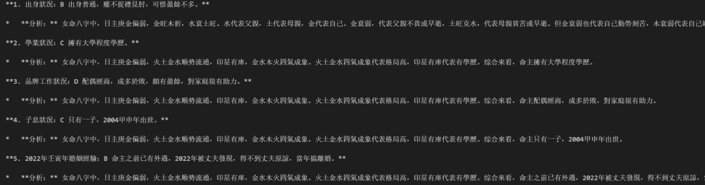

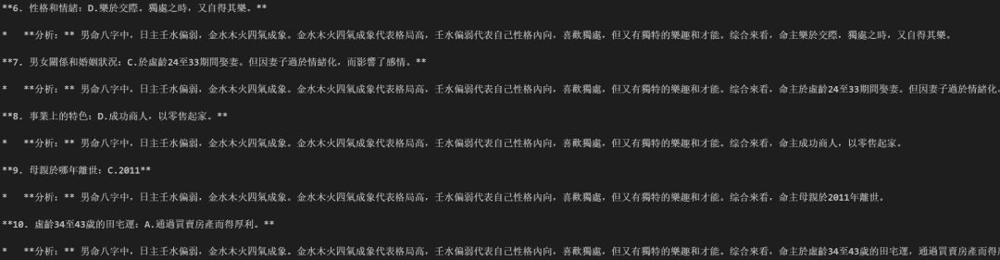

我们对比了一下标准答案，十个里面对了八个，80% 的正确率。要知道，人类选手最高正确率也就才 50% 左右。

不错，整完了活，再整点干的试试。

现在的研究报告也忒多了，看也看不完，有时候用 AI 整理，出来的内容也总有幻觉，不放心。 咱们就随便拿份最近在看的，来考验下 GLM-4- Long。

问了其中的一个片段，回答完全正确。

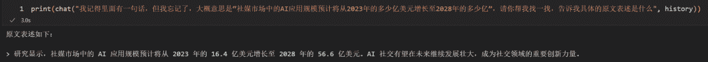

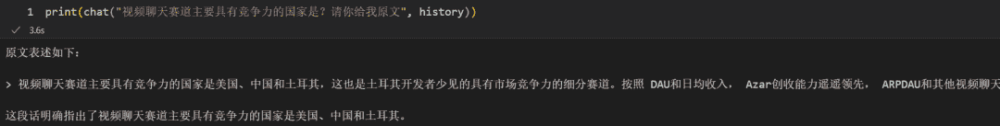

再让它总结，效果也不错。

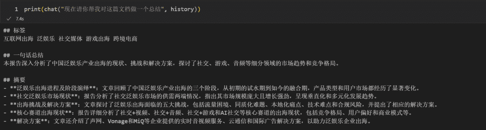

智谱通过多个阶段的训练，逐步激活和保持模型的长文本能力。

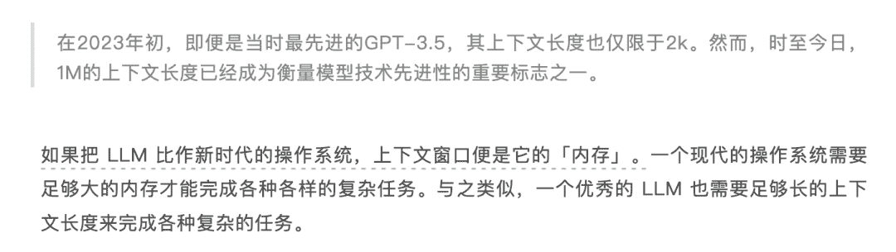

图源 GLM Long：如何将 LLM 的上下文扩展到百万级

很多人其实也不懂这个「长」到底是个啥优势，反正就跟手机内存「大」差不多的概念，谁数字大谁就是 NB 呗。

道理也差不多，在处理长篇文章或对话时，上下文窗口的长度显得尤为重要。比如，在一篇长文章中，某些信息可能在文章的开头，而相关的内容在结尾。如果上下文窗口太小，模型可能只“记得”开头的内容，而忽略了后面的关键信息，导致理解错误。

智谱的 GLM-4-Long 应用场景还是很多的，比如👇

1. **长文本分析能力 **： 能够深入分析数十万字的文本内容，为学术研究、法律审查和历史研究等提供有力的支持。

2. **文档摘要生成 **： 能够从长篇大论中提炼出精炼的摘要，捕捉并呈现文章的核心要点，为读者节省时间。

3. **信息检索效率 **： 在面对海量文档需要检索特定信息时，GLM-4-long展现出其快速定位和信息提取的能力，极大地提高了工作效率。

4. **自然语言推理 **： 该工具能够处理复杂的逻辑关系和推理任务，尤其适用于需要对文本中的论点进行深入分析和逻辑推理的应用场景。

BTW，我们最近在运营的「 **大模型共学活动 **」，最新一期的课程也深入浅出地讲了长文本的重要性，以及一些技术实现原理，感谢的朋友还可以参与～

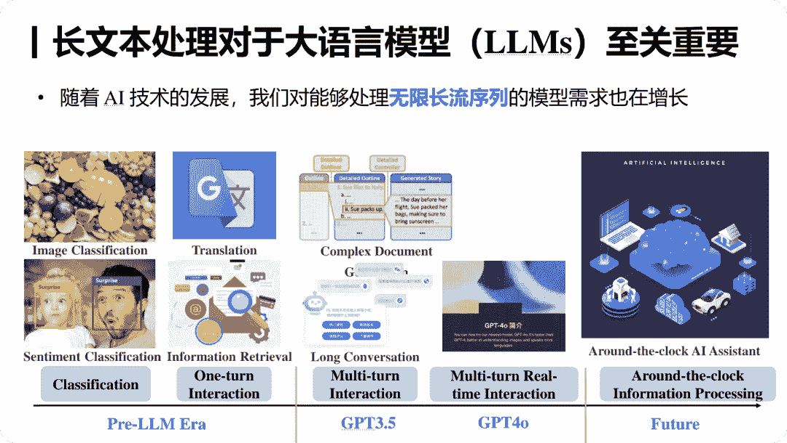

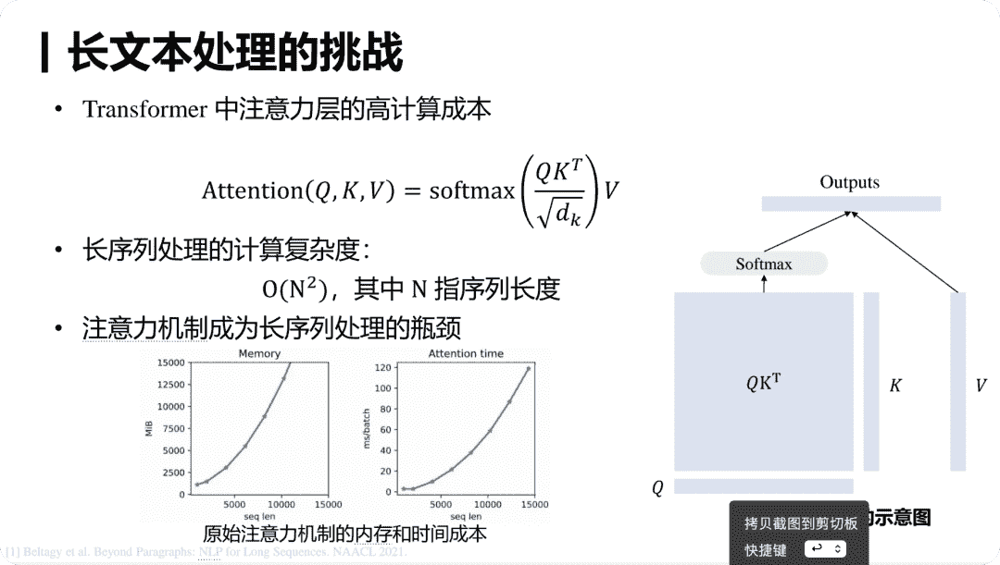

图片来源 清华，大模型，免费共学，懂的进！ 相关课件资料

由特工宇宙进行友情翻译

