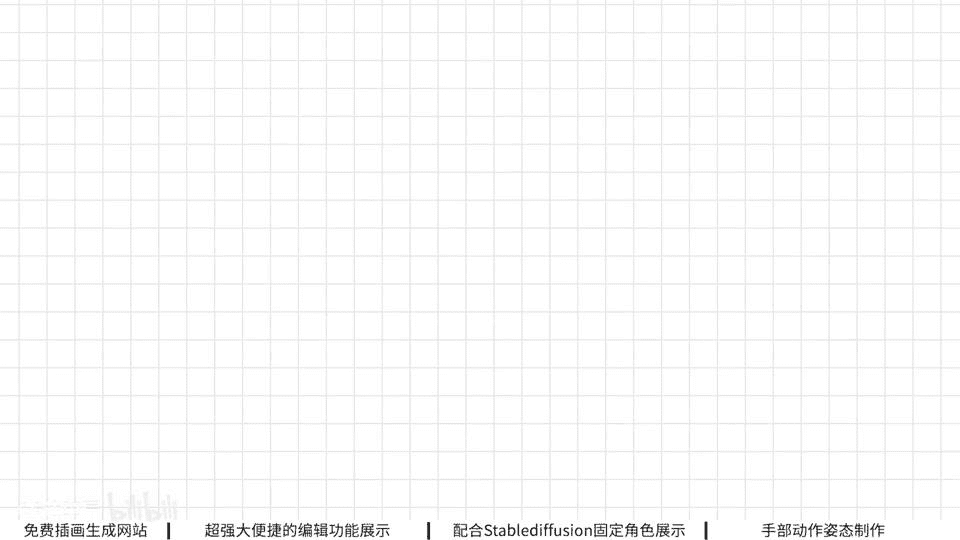

# 插画自由 Stablediffusion手绘角色发型、姿势、服装随意换

> 来源：[https://agijuejin.feishu.cn/docx/XijHde2gfoNR6zxEOIScDVZnnRf](https://agijuejin.feishu.cn/docx/XijHde2gfoNR6zxEOIScDVZnnRf)

# 👀快看👀

> **作者：**[**CG迷李辰**](https://space.bilibili.com/37181032)

> **原文链接：**插画自由 Stablediffusion手绘角色发型、姿势、服装随意换

---

# ⚡️摘要⚡️

> 如何使用 Stablediffusion 软件自由手绘角色，包括发型、姿势、服装等元素的随意更换。

---

# 🤖分集🤖

### 插画自由 Stablediffusion手绘角色发型、姿势、服装随意换

介绍 Stablediffusion 软件使用方法，指导用户选择或上传基础角色模型，利用工具和选项定制外观，包括发型、姿势、服装、表情等细节，软件提供丰富资源和编辑功能，可无限发挥想象创作角色插画，还可能有实际案例演示及易用性和创造潜力的讨论。

[插画自由 Stablediffusion手绘角色发型、姿势、服装随意换.mp4](https://internal-api-drive-stream.feishu.cn/space/api/box/stream/download/all/Ip4FbpmJGoVPAux2W3OcSUiHn9c)

---

# ✏️课代表✏️

+   Stablediffusion 软件是一个强大的角色插画创作工具，它为用户提供了广泛的自定义选项，以满足不同的创作需求。

>

+   该软件的优势在于其高度的用户友好性，使得即使是初学者也能快速上手并开始创作。

>

+   通过 Stablediffusion，创作者可以实现对角色的个性化定制，从而提高插画的创意多样性和艺术性。

>

+   软件的应用案例展示了其在角色设计领域的实用性和灵活性。

>

+   强调了 Stablediffusion 在提升角色插画创作效率和质量方面的潜力。