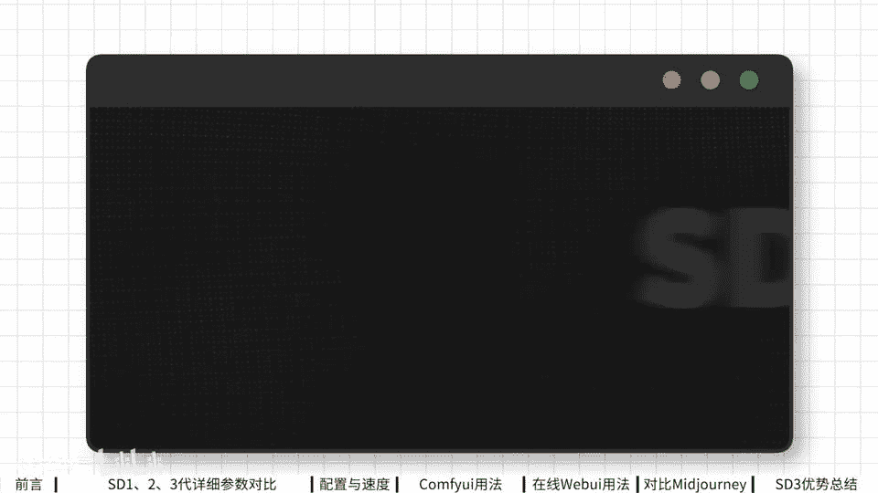

# 【SD3深度评测】对比Midjourney，安装|下载|部署超详细stablediffusion3使用教程

> 来源：[https://agijuejin.feishu.cn/docx/OgwwdMkvoovghSx3yoscMDXKndf](https://agijuejin.feishu.cn/docx/OgwwdMkvoovghSx3yoscMDXKndf)

# 👀快看👀

> **作者：**[**CG迷李辰**](https://space.bilibili.com/37181032)

> **原文链接：**[**【**](https://www.bilibili.com/video/BV1mr421c7qY/?spm_id_from=333.999.0.0&vd_source=5a54577a6bc7d876f6e5df88640c8e9f)SD3深度评测】对比Midjourney，安装|下载|部署超详细stablediffusion3使用教程

---

# ⚡️摘要⚡️

> 对 Stable Diffusion 3（SD3）进行了深度评测，并与 Midjourney 进行了对比，包括安装、下载和部署的过程。

---

# 🤖分集🤖

### 【SD3深度评测】对比Midjourney，安装|下载|部署超详细stablediffusion3使用教程

围绕 Stable Diffusion 3 的使用教程展开，介绍其基本特性和与前代改进点，比较与 Midjourney 的差异，提供安装指南，包括下载、配置和解决安装问题，讲解部署方法以确保不同硬件环境下最佳运行，还给出实用操作技巧和注意事项。

[【SD3深度评测】对比Midjourney，安装_下载_部署超详细stablediffusion3使用教程.mp4](https://internal-api-drive-stream.feishu.cn/space/api/box/stream/download/all/XQd9bCViboFQXExyoHAcApYSnFg)

---

# ✏️课代表✏️

+   Stable Diffusion 3（SD3） 是一个先进的图像生成工具，其在算法稳定性和图像质量上有显著提升。

>

+   与 Midjourney 相比，SD3 在用户友好性和定制化程度上可能更具吸引力。

>

+   教程强调了 SD3 安装和部署过程中的关键步骤，以及如何避免常见错误。

>

+   提供了对于不同用户需求的个性化建议，包括资源占用较小的配置和高性能配置的选择。

>

+   作者认为，通过本教程的学习，用户能够充分利用 SD3 的潜力，创造出更加精彩的图像内容。