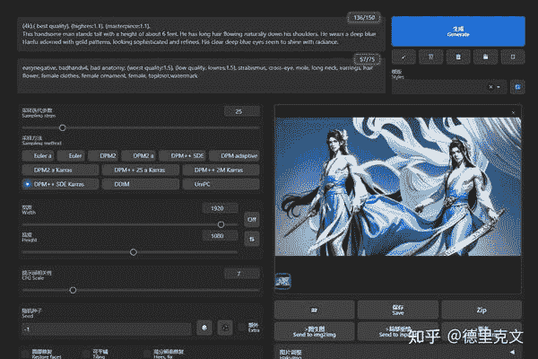
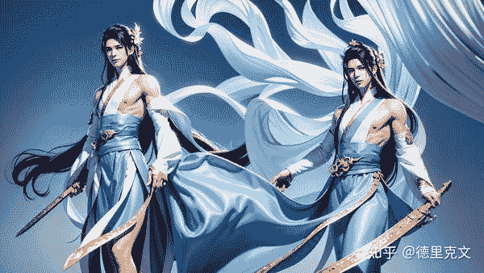
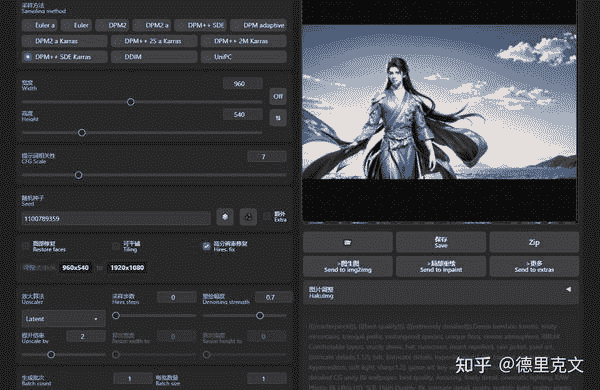
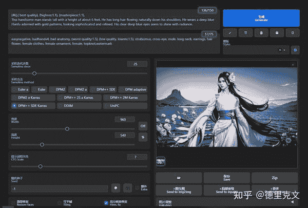

# Stable Diffusion的可控性研究-1

> 来源：[https://agijuejin.feishu.cn/docx/MqzHdegyxotOhqxWvFEcq52Bnbd](https://agijuejin.feishu.cn/docx/MqzHdegyxotOhqxWvFEcq52Bnbd)

> 作者：德里克文

> 原文：[https://zhuanlan.z](https://zhuanlan.zhihu.com/p/638017980)hihu.com/p/638017...

基础可控性研究-1：如何确保画面人数控制

在学习AI绘画的过程中，经常会碰到当我们直接生像素较高的图片，或者16:9或者9:16的图的时候，很大概率会不受到提示词的控制，出现多个人物。

在这种情况下换模型，添加禁止多人并加权重也很难避免，有什么办法能避免这一点，加强可控性呢？

在这里，我分享下我的方法，建议可以进行收藏便于随时回顾。

出现这个问题的原因主要是大模型在制作的时候，原始的图片通常宽度为512像素，如果一旦横幅的像素超出模型的合适范围，往往模型就会自由发挥，添加内容，添加多人以满足提示词要求。

解决办法是什么呢？采用高分辨率修复！

你可以生成比较小分辨率的图片，然后采用高分辨率修复的方式，让SD进行扩大，这样就能够保证你的图像中不至于产生多余的内容啦。怎么操作呢，可以参考下图：

你看，是不是已经完美解决了这个问题呢？

也放上这个图片的Prompt，自己去尝试下吧：

(4k),( best quality), (highres:1.1), (masterpiece:1.1), This handsome man stands tall with a height of about 6 feet. He has long hair flowing naturally down his shoulders. He wears a deep blue Hanfu adorned with gold patterns, looking sophisticated and refined. His clear deep blue eyes seem to shine with radiance.

Behind him, a blooming peony flower complements his attractive facial features. He holds a delicate sword with intricate designs along the blade, adding to his charm. In the distance, towering mountains, vast blue skies, boundless seas, and drifting white clouds bring a sense of mystery and nobility to this ethereal man.

Negative prompt: easynegative, badhandv4, bad anatomy, (worst quality:1.5), (low quality, lowres:1.5), strabismus, cross-eye, mole, long neck, earrings, hair flower, female clothes, female ornament, female, topknot,watermark

Steps: 25, Sampler: DPM++ SDE Karras, CFG scale: 7, Seed: 1100789359, Size: 960x540, Model hash: 4078eb4174, Model: 3Guofeng3_v33, Denoising strength: 0.7, ENSD: 31337, Version: v1.2.1, Hires upscale: 2, Hires upscaler: Latent

与AI对【画】

@知乎科技

---

我是 [德里克文 ](https://www.zhihu.com/search?q=%E5%BE%B7%E9%87%8C%E5%85%8B%E6%96%87&search_source=Entity&hybrid_search_source=Entity&hybrid_search_extra=%7B%22sourceType%22%3A%22answer%22%2C%22sourceId%22%3A3052677444%7D)[，一个对AI](https://www.zhihu.com/search?q=%E5%AE%A4%E5%86%85%E8%AE%BE%E8%AE%A1%E5%B8%88&search_source=Entity&hybrid_search_source=Entity&hybrid_search_extra=%7B%22sourceType%22%3A%22answer%22%2C%22sourceId%22%3A3052677444%7D)绘画，人工智能有强烈兴趣，从业多年的 室内设计师 ！如果对我的文章内容感兴趣，请帮忙关注点赞收藏，谢谢！