# Stable Diffusion的可控性研究-2

> 来源：[https://agijuejin.feishu.cn/docx/GDVVdkR9DoHrWRxui1pcnLiLnYb](https://agijuejin.feishu.cn/docx/GDVVdkR9DoHrWRxui1pcnLiLnYb)

> 作者：德里克文

> 原文：[https://zhuanlan.z](https://zhuanlan.zhihu.com/p/638029315)hihu.com/p/638029...

如何处理低分辨转换成高分辨率过程中，Stable Diffusion在扩散模型中生成多余的内容呢？

相信这也是困扰各位学习AI绘画小伙伴的一大难题，往往在低分辨率情况下生成的内容比较满意，可是在扩大的过程中出现各种不可控的小细节，影响整体效果。那么要怎么解决呢，我这里分享下我的方法。

文章干货较多，建议可以进行收藏便于随时回顾。

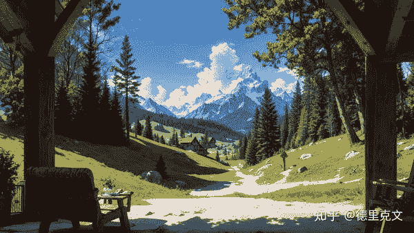

## 一、如何在低显存情况下生成高分辨率图像

上一篇文章介绍了如何保证在宽高比较大的图片（例如16:9或9:16）保证主体生成内容的稳定性。方法就是采用低分辨率进行高清修复进行图像放大，实现在不损失精细程度下的可控性。

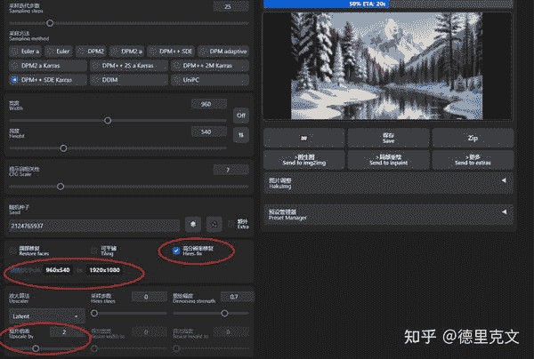

但是对于一般的商用文件来说，2K以下的分辨率是不太够用的，我们通常需要采用更加高的4K~8K分辨率，但是往往大部分家用电脑没有足够的显存来运行，无法支持直接生成大分辨率的图像。

在这种情况下，我们可以采用图生图的功能，重绘幅度选低（个人建议在0.25~0.35之间），然后选择Tile Diffusion 和 Tile VAE 插件进行接力放大，这两个插件可以对图进行分块渲染拼合，具体插件可以在网上下载，如果找不到的话，也可以评论区留言或者私信我发送。

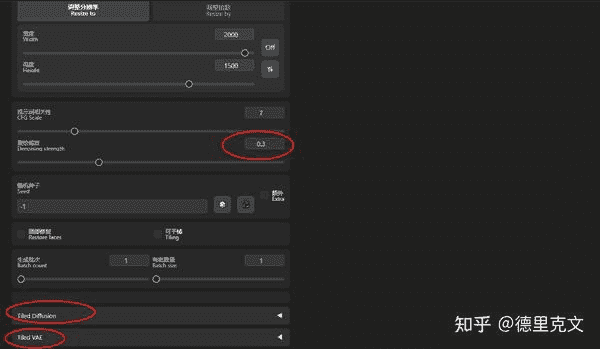

## 二、如何进行不可控细节修正

### 1.固定随机种子

对于采用文生图产生的底图，在进行图生图的过程中，务必记得固定原图的随机种子。如果不太确定，建议在程序UI中将所有生成的图片都附加上相关信息，或保存一个独立的文本信息。

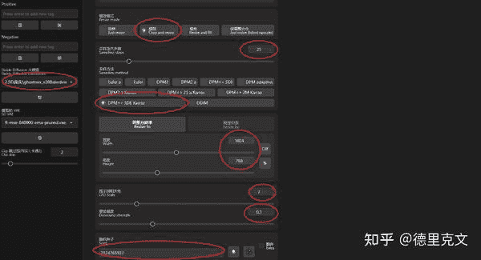

### 2.采用Controlnet加强权重进行控制

在进行图生图的过程中，如果担心出来的图片偏离方向，可以在Controlnet模型里面选择Tile模型，将Controlnet的权重调整至（1~1.2），开始步骤选择0，结束步骤选择1

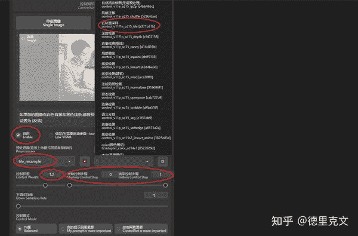

### 3.采用设计软件进行图面修正

对于不可控细节，我们需要在低分辨率情况下，利用Photo Shop，Procreate等设计软件进行初步修正。如果无法判断哪些细节会出现不可控因素，建议可以花一些时间将图片跑出来，在渲染步数过程中如果发现不对劲的区域，可以及时停止。

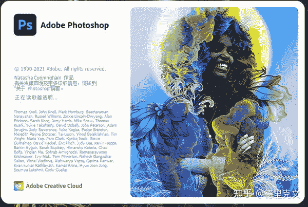

### 4.将修正好的图面再进行高分生成

将Photo Shop，Procreate里面修正好的低分辨图像，放入图生图，进行高分辨率生成

## 三、案例实操

### 1.绘制低分辨率的底图

根据想要的创意，绘制出底图，在这个案例中，我才用抽卡的方式，生成了几十张低分辨率的图（进行高清修复以保证底图本身的精度），从中挑选合适的底图，进行下一步工作。

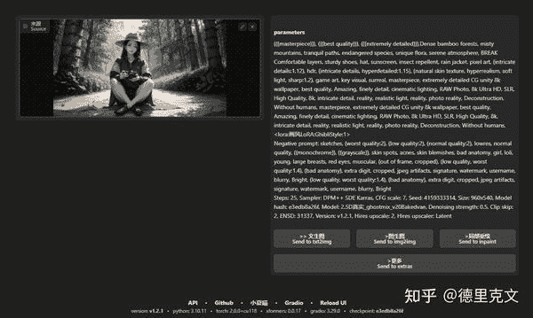

这个案例中，我采用的Prompt是：

(((masterpiece))), (((best quality))), (((extremely detailed))),Dense bamboo forests, misty mountains, tranquil paths, endangered species, unique flora, serene atmosphere, BREAK Comfortable layers, sturdy shoes, hat, sunscreen, insect repellent, rain jacket. pixel art, (intricate details:1.12), hdr, (intricate details, hyperdetailed:1.15), (natural skin texture, hyperrealism, soft light, sharp:1.2), game art, key visual, surreal, masterpiece, extremely detailed CG unity 8k wallpaper, best quality, Amazing, finely detail, cinematic lighting, RAW Photo, 8k Ultra HD, SLR, High Quality, 8k, intricate detail, reality, realistic light, reality, photo reality, Deconstruction, Without humans, masterpiece, extremely detailed CG unity 8k wallpaper, best quality, Amazing, finely detail, cinematic lighting, RAW Photo, 8k Ultra HD, SLR, High Quality, 8k, intricate detail, reality, realistic light, reality, photo reality, Deconstruction, Without humans, <lora:画风LoRA:GhibliStyle:1>, masterpiece,extremely detailed CG unity 8k wallpaper,best quality,Amazing,finely detail,cinematic lighting,RAW Photo, 8k Ultra HD, SLR, High Quality,8k, intricate detail, reality,realistic light, reality, photo reality, Deconstruction,Without humans,

Negative prompt: sketches, (worst quality:2), (low quality:2), (normal quality:2), lowres, normal quality, ((monochrome)), ((grayscale)), skin spots, acnes, skin blemishes, bad anatomy, girl, loli, young, large breasts, red eyes, muscular, (out of frame, cropped), (low quality, worst quality:1.4), (bad anatomy), extra digit, cropped, jpeg artifacts, signature, watermark, username, blurry, Bright, (low quality, worst quality:1.4), (bad anatomy), extra digit, cropped, jpeg artifacts, signature, watermark, username, blurry, Bright, (low quality, worst quality:1.4), (bad anatomy),extra digit,cropped, jpeg artifacts, signature, watermark, username, blurry,Bright,

Steps: 25, Sampler: DPM++ SDE Karras, CFG scale: 7, Seed: 4159333314, Size: 1920x1080, Model hash: 69bc54fc2c, Model: 照片真实_majicmixRealistic_v3, Denoising strength: 0.5, Clip skip: 2, ENSD: 31337,

### 2.生成高分辨率图

底图看上去很完美，没有什么问题，我直接按照刚刚说的方法进行高分出图。

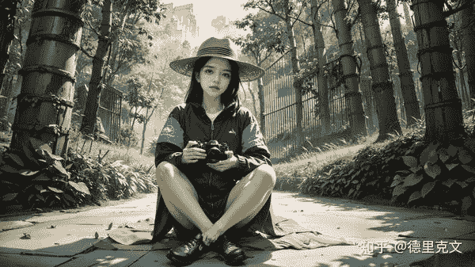

结果在意想不到的地方，出现了重大瑕疵（脚踝）……重复生成了几次，均无法避免。

### 3.采用图片处理工具进行图片修正

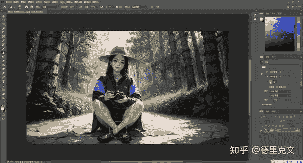

对出现问题的区域，采用Phont Shop中的仿制图章或者填色进行简单处理，或者对于手绘比较熟悉的设计师插画师小伙伴也可以用Procreate进行修正，只需要做到色块逻辑正确就行

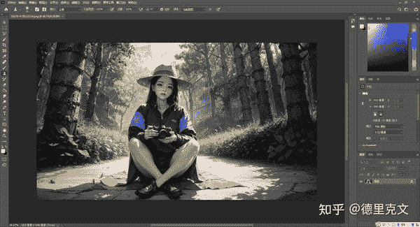

### 4.设置相应的参数进行高分出图

按照文章上面的方法，将修正好的图片放入图生图，设置相应的参数，进行高分辨率出图。

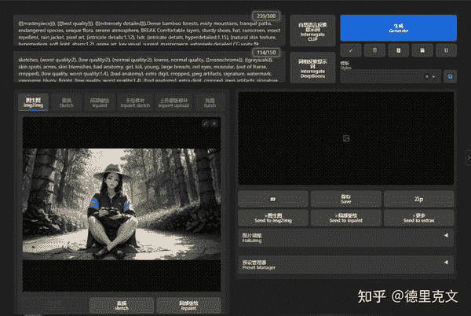

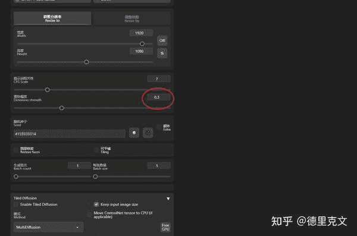

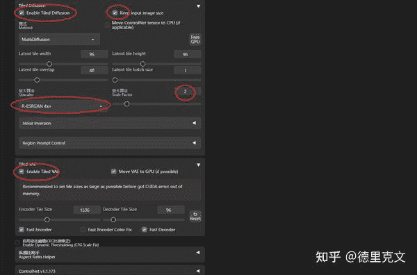

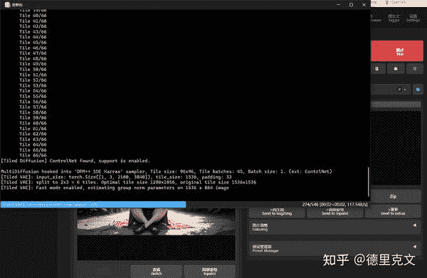

可以看到，之前脚踝部位诡异的问题已经得到了彻底解决。

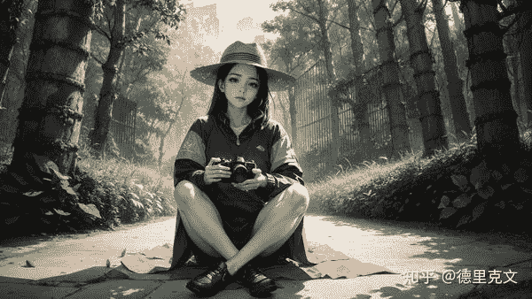

---

通过以上的步骤，你是否了解了如何对Stable Diffusion生成的图像进行进一步控制，制作出我们需要的图纸呢？如果有什么疑问，也欢迎在评论区沟通哦。

与AI对【画】

@知乎科技

我是 [德里克文 ](https://www.zhihu.com/search?q=%E5%BE%B7%E9%87%8C%E5%85%8B%E6%96%87&search_source=Entity&hybrid_search_source=Entity&hybrid_search_extra=%7B%22sourceType%22%3A%22answer%22%2C%22sourceId%22%3A3052677444%7D)[，一个对AI](https://www.zhihu.com/search?q=%E5%AE%A4%E5%86%85%E8%AE%BE%E8%AE%A1%E5%B8%88&search_source=Entity&hybrid_search_source=Entity&hybrid_search_extra=%7B%22sourceType%22%3A%22answer%22%2C%22sourceId%22%3A3052677444%7D)绘画，人工智能有强烈兴趣，从业多年的 室内设计师 ！如果对我的文章内容感兴趣，请帮忙关注点赞收藏，谢谢！