# 如何使stable diffusion更易操作，诸如汉化、参数设置等？

> 来源：[https://agijuejin.feishu.cn/docx/ADj8dIGkWovM6qxwPUIcMkI3nJc](https://agijuejin.feishu.cn/docx/ADj8dIGkWovM6qxwPUIcMkI3nJc)

> 作者：德里克文

> 原文：[https://www.zhihu.](https://www.zhihu.com/question/613980147/answer/3137378395)com/question/6139...

关于Stable Diffusion的参数设置，我这里来进行一些简单的入门科普。

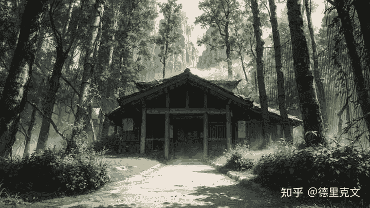

没有看过入门指南1的小伙伴可以点击这个链接查看：

[德里克文：Stable Diffusion 入门指](https://zhuanlan.zhihu.com/p/645820130)南-1 31 赞同 · 1 评论 文章

## 一、采样方案

### **1. 采样迭代步数**

迭代步数是指 Stable Diffuison针对你的提示词描述，使用多少步将其绘制出来。每增加一步迭代，AI都有更多的机会来比对提示和当前结果，并进行调整。更高的迭代步数需要更多的计算时间。但是，并不意味着步数越高，质量就越好。步数高于过高，反而容易产生畸变。

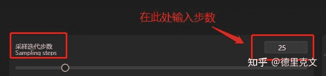

在[参数设置的](https://www.zhihu.com/search?q=%E9%87%87%E6%A0%B7%E8%BF%AD%E4%BB%A3&search_source=Entity&hybrid_search_source=Entity&hybrid_search_extra=%7B%22sourceType%22%3A%22answer%22%2C%22sourceId%22%3A3137378395%7D)第一步，我们需要确定输出画面所需的迭代步数，系统每次采样步骤都是在上一次迭代的基础上生成新的图像。我个人建议将 采样迭代 步数控制在20-30次左右，因为过低的采样步数可能会导致图像计算不完整，而过高的采样步数只会在细节部分进行优化，对输出速度来说得不偿失。

对于二次元和真实照片，通常采用步数也不同，二次元可以设置低一些，真实照片可适当调高。我个人常用的采用次数是二次元系列22次，真实照片28次。可以根据个人电脑状况调节.

### 2.采样方法

看到界面上这么多的选项，是不是有点晕呢，但是其实我们常用的也就几种。

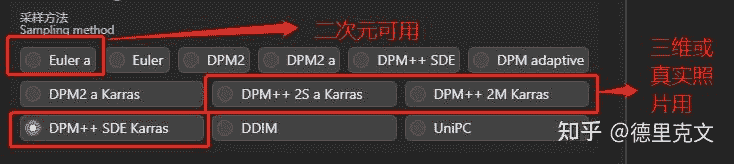

这里的原理比较复杂，我这里直接给出建议：二次元选用一般情况下使用Euler a，三维或者真实照片建议采用DPM++ 家族系列。我来稍微介绍下：

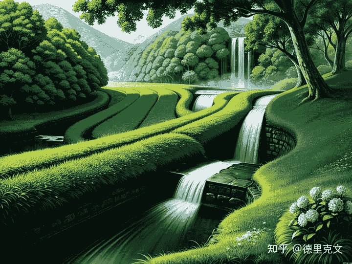

[Euler](https://www.zhihu.com/search?q=%E6%97%B6%E9%97%B4%E6%AD%A5%E9%95%BF&search_source=Entity&hybrid_search_source=Entity&hybrid_search_extra=%7B%22sourceType%22%3A%22answer%22%2C%22sourceId%22%3A3137378395%7D)[ a是](https://www.zhihu.com/search?q=a%E5%80%BC&search_source=Entity&hybrid_search_source=Entity&hybrid_search_extra=%7B%22sourceType%22%3A%22answer%22%2C%22sourceId%22%3A3137378395%7D)一种[可调参数，](https://www.zhihu.com/search?q=%E7%BB%86%E8%8A%82%E6%89%AD%E6%9B%B2&search_source=Entity&hybrid_search_source=Entity&hybrid_search_extra=%7B%22sourceType%22%3A%22answer%22%2C%22sourceId%22%3A3137378395%7D)[用于控制 时](https://www.zhihu.com/search?q=%E4%BA%8C%E6%AC%A1%E5%85%83%E5%9B%BE%E5%83%8F&search_source=Entity&hybrid_search_source=Entity&hybrid_search_extra=%7B%22sourceType%22%3A%22answer%22%2C%22sourceId%22%3A3137378395%7D)间步长 的大小。适当选择合适的Euler a值 可以捕捉到图像的细节和纹理，但若值过大会导致过度拟合，生成图像出现噪点等不良效果。Euler a的采样速度快，但在高细节图像中增加采样步数时，可能引发不可控的突变，如人物脸部扭曲和 细节扭曲 。比较适用的场景是：图标设计、 二次元图像 、小型场景。

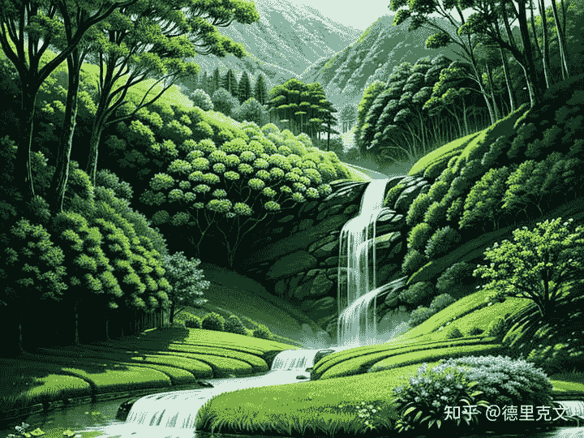

DPM++家族系列是一种用于生成高质量图像的采样方法。它在每个时间步中执行多次操作，这样在相同的分辨率下可以呈现更多的细节。例如，就可以在小图上展示全身画面。然而，由于需要进行多次操作，采样速度会变慢。该方法适用于写实人像和复杂场景的描绘。

### 3. **提示词相关性**

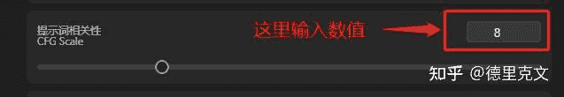

Stable Diffusion中的提示词相关性是指输入提示词对生成图像的影响程度。

当我们增加提示词相关性时，生成的图像将更加符合提示信息；相反地，如果提示词相关性较低，对应的权重也较小，则生成的图像会更为随机。通过调整提示词相关性，我们可以引导模型生成更符合预期的样本，从而提高生成图像的质量。

在具体应用中，对于人物类的提示词，一般将提示词相关性控制在7-15之间；而对于建筑等大场景类的提示词，则一般控制在3-7左右。这样可以在一定程度上突出随机性，同时又不会影响生成图像的可视化效果。因此，通过调整提示词相关性，我们可以更好地引导模型生成符合预期的样本，进而提高生成图像的质量。

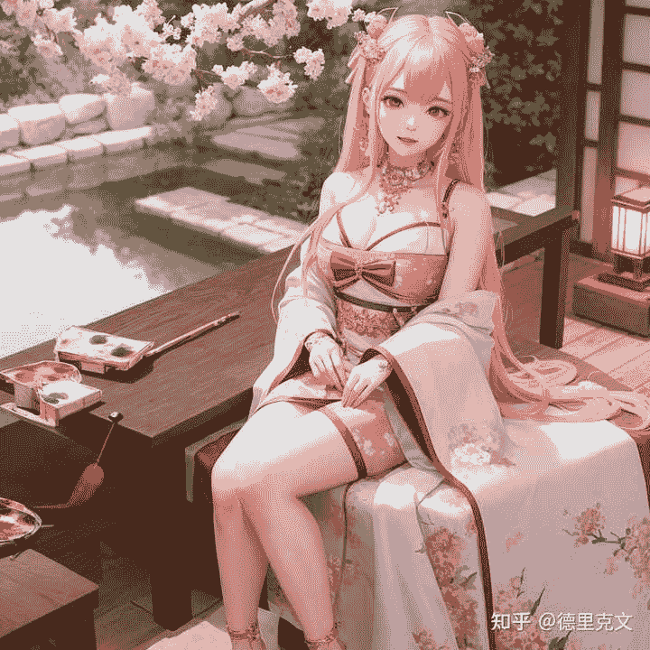

### 4.随机种子

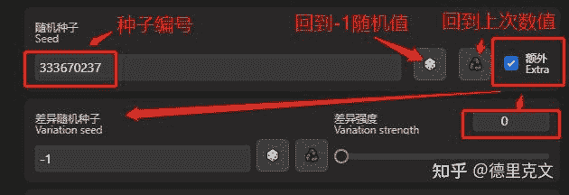

随机种子是一个初始状态值，它会对结果产生影响，可以用来锁定生成图像的状态。每个生成的图像都有对应的随机数种子，如果想要还原或生成相似的图像，必须使用相同的种子值。在保持随机数种子不变的情况下，即使模型发生改变，生成的图像的整体结构和配色也会有相似性。

使用相同的随机种子和其他参数，我们可以重复生成完全相同的图像，在输入框中输入特定的值来固定随机数种子。

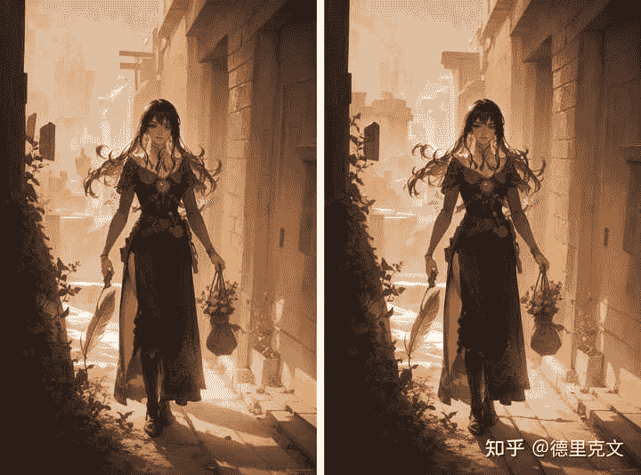

或者我们也可以点击旁边的骰子图标，将其设置为-1（表示随机值），使得模型使用随机的数值生成图像。设置随机种子可以增加模型的可重复性和可比性，在调试和优化模型时，可以观察不同参数对图像的影响。

在 Stable Diffusion 中，常用的随机种子有-1和其他数值。当使用[-1或点击](https://www.zhihu.com/search?q=%E9%9A%8F%E6%9C%BA%E6%95%B0%E5%80%BC&search_source=Entity&hybrid_search_source=Entity&hybrid_search_extra=%7B%22sourceType%22%3A%22answer%22%2C%22sourceId%22%3A3137378395%7D)骰子按钮时，生成的图像将是完全随机的，没有任何规律可言。而当使用其他 随机数值 作为种子时，锁定了随机种子对图像的影响，每次生成的图像只会有微小的变化。因此，通过使用随机种子，可以控制生成图像的变化程度，更好地探索模型的性能和参数的影响。

在实际工作中，如果需要微调模型，我们可以固定某个种子参数并进行批量生成。

[差异随机种](https://www.zhihu.com/search?q=%E5%B7%AE%E5%BC%82%E5%BC%BA%E5%BA%A6&search_source=Entity&hybrid_search_source=Entity&hybrid_search_extra=%7B%22sourceType%22%3A%22answer%22%2C%22sourceId%22%3A3137378395%7D)子可以被理解为加入了第二种特定参数。而 差异强度 则指示了这两种参数的占比，数值越大，越接近第二种参数。当差异强度为0时，表示完全不使用差异随机种子。一般情况下，差异随机种子用于在确定了某张图像后生成其他类似图像。例如，在图像处理中，通过加入差异随机种子，可以生成内容相似但略有差异的图像，从中选择更优的结果。

## 二、分辨率

### 1.出图设置

画面所包含的信息量取决于输出图片的分辨率，一般我们采用512*768（3：4)，或者1024*1024（1：1）做输出分辨率。

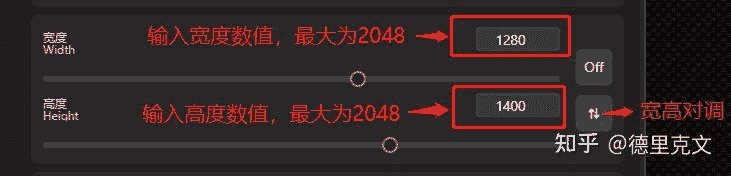

如果绘制的是人物等有主体内容的画面，全身构图中的某些细节，如面部表情、饰品和复杂的纹样，只有在较大的图像中才能充分展示。若图像过小，这些细节可能会被压缩在一起，无法得到充分呈现。

以下面图像为例，采用的是同样的提示词和模型，可以看到随着画面尺寸的增大，展示的内容会更加丰富和精细。

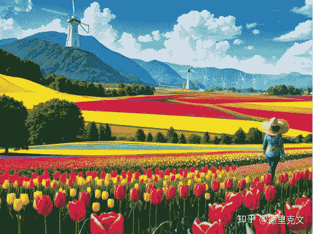

需要注意的是，尽管输出分辨率会影响图像所包含的信息量，然而当直接输出的分辨率较大时，Stable Diffusion可能会尝试将多余的内容填充到图像中。

由于大多数模型是在 [512x512分辨率 ](https://www.zhihu.com/search?q=512x512%E5%88%86%E8%BE%A8%E7%8E%87&search_source=Entity&hybrid_search_source=Entity&hybrid_search_extra=%7B%22sourceType%22%3A%22answer%22%2C%22sourceId%22%3A3137378395%7D)下进行训练的，因此在输出尺寸较大（例如1024x1024）时，处理器可[能会尝试将](https://www.zhihu.com/search?q=%E8%82%A2%E4%BD%93%E6%8B%BC%E6%8E%A5&search_source=Entity&hybrid_search_source=Entity&hybrid_search_extra=%7B%22sourceType%22%3A%22answer%22%2C%22sourceId%22%3A3137378395%7D)两到三张图片的内容合并到一张图像中，这可能导致出现不受控制的情况，如 肢体拼接 、多个人物、多个角度等。

那么，如果需要高分辨率，又不希望出现不受控制的情况怎么办呢？有办法，采用高分辨率修复。

### 2. 高分辨率修复

在这个区域有几个参数，我一一解释下

面[部修复（R](https://www.zhihu.com/search?q=%E5%86%99%E5%AE%9E%E4%BA%BA%E5%83%8F&search_source=Entity&hybrid_search_source=Entity&hybrid_search_extra=%7B%22sourceType%22%3A%22answer%22%2C%22sourceId%22%3A3137378395%7D)estore faces）：可以根据个人喜好开关，非写实风格的人物开启面部修复反而可能导致面部崩坏。个人感觉这个参数在 写实人像 低分辨率情况下有一定作用，对于高分辨率最终成像效果影响不大，还浪费时间，如果是写实人脸近照可以开启，其他情况下我觉得可以不开。

[可平铺（T](https://www.zhihu.com/search?q=%E6%97%A0%E7%BC%9D%E5%9B%BE%E5%83%8F&search_source=Entity&hybrid_search_source=Entity&hybrid_search_extra=%7B%22sourceType%22%3A%22answer%22%2C%22sourceId%22%3A3137378395%7D)iling）：用于生成 无缝图像 ，一般不用，生成平面可拼接图案时候才会用到。

高分辨率修复（Hires.fix）：本小点的重点部分，我来详细介绍下

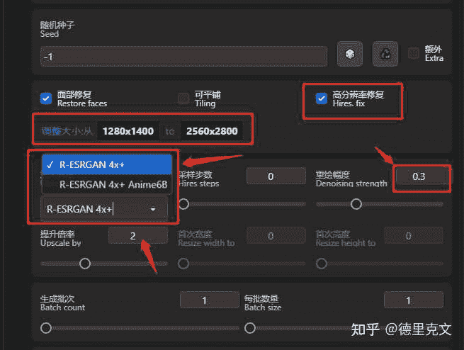

勾选高分辨率修复（Highres. fix）的小勾以启用高分辨率修复功能。

通过使用 [高清修复 ](https://www.zhihu.com/search?q=%E9%AB%98%E6%B8%85%E4%BF%AE%E5%A4%8D&search_source=Entity&hybrid_search_source=Entity&hybrid_search_extra=%7B%22sourceType%22%3A%22answer%22%2C%22sourceId%22%3A3137378395%7D)[，首先以指](https://www.zhihu.com/search?q=%E6%94%BE%E5%A4%A7%E7%AE%97%E6%B3%95&search_source=Entity&hybrid_search_source=Entity&hybrid_search_extra=%7B%22sourceType%22%3A%22answer%22%2C%22sourceId%22%3A3137378395%7D)[定尺寸生成](https://www.zhihu.com/search?q=%E5%9B%BE%E5%83%8F%E5%B0%BA%E5%AF%B8&search_source=Entity&hybrid_search_source=Entity&hybrid_search_extra=%7B%22sourceType%22%3A%22answer%22%2C%22sourceId%22%3A3137378395%7D)一张图像，然后通过 放大算法 将图像的分辨率扩大，以实现高清大图的效果。最终生成的 图像尺寸 为原分辨率乘以缩放系数（Upscale by）。

在放大算法中，Latent在许多情况下表现良好，但当重绘幅度小于0.5时表现不理想。个人建议在0.5以下重绘幅度的算法中采用R-ESRGAN_4x+（真实照片类）或R-ESRGAN_4x+Anime6B（二次元动漫类）算法。

采样步数（Hires step）表示在执行该步骤时计算的步数，不用去管，保持默认就好。

重绘幅度（Denoising [strength ](https://www.zhihu.com/search?q=strength&search_source=Entity&hybrid_search_source=Entity&hybrid_search_extra=%7B%22sourceType%22%3A%22answer%22%2C%22sourceId%22%3A3137378395%7D)）即降噪强度，表示生成图像与原始输入图像内容变化的程度。低降噪强度[意味着](https://www.zhihu.com/search?q=%E9%98%88%E5%80%BC&search_source=Entity&hybrid_search_source=Entity&hybrid_search_extra=%7B%22sourceType%22%3A%22answer%22%2C%22sourceId%22%3A3137378395%7D)主要用于修复原图，而较高的降噪强度表示生成内容与原图差异较大。一般来说， 阈值 约为0.7，超过0.7基本与原图无关，低于0.3则只会做一些微小的调整改变。

[提升倍率 ](https://www.zhihu.com/search?q=%E6%8F%90%E5%8D%87%E5%80%8D%E7%8E%87&search_source=Entity&hybrid_search_source=Entity&hybrid_search_extra=%7B%22sourceType%22%3A%22answer%22%2C%22sourceId%22%3A3137378395%7D)（[Upsca](https://www.zhihu.com/search?q=%E6%94%BE%E5%A4%A7%E5%80%8D%E7%8E%87&search_source=Entity&hybrid_search_source=Entity&hybrid_search_extra=%7B%22sourceType%22%3A%22answer%22%2C%22sourceId%22%3A3137378395%7D)le by）是指最终图像的分辨率与原图的比值。例如，如果默认生成的图像分辨率为512×512，设定 放大倍率 为2倍，那么最终生成的图像分辨率将会是1024×1024。

生成批次（Batch count）和每批数量（Batch Size）是指一次性生成图像的数量。每批数量就是指同一时间生成的图片数量，通常情况下，如果使用的显卡性能不是非常强劲，很容易爆显存。所以我个人建议保持每批数量为1，而通过调整生成批次数来增加一次性生成图像的数量。

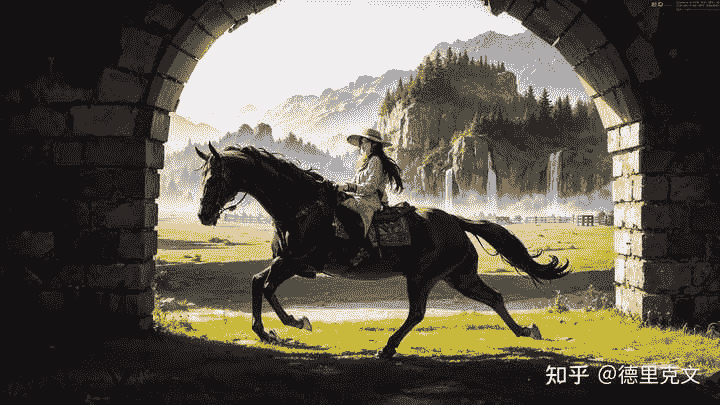

## 三. 分辨率插件

由于显存大小的限制，通常我们即使采用高分辨率修复，也只能将分辨率提高到2048*2048。若我们强行将分辨率调整至2048以上，要么显存直接耗尽无法生成图像，要么生成的图像会出现各种异常问题。

为了解决这一难题，我们还可以使用“Multi diffusion”这个插件进行图像放大。这被视为目前最佳的图像放大解决方案，能够在放大图像的同时增加细节。

### 1.插件安装

在我提供的 [网盘 ](https://www.zhihu.com/search?q=%E7%BD%91%E7%9B%98&search_source=Entity&hybrid_search_source=Entity&hybrid_search_extra=%7B%22sourceType%22%3A%22answer%22%2C%22sourceId%22%3A3137378395%7D)文件中已经自带了[这个插件。如果是你的SD界面里面没有的话，也点击扩展→从网址安装→重启](https://link.zhihu.com/?target=https%3A//github.com/pkuliyi2015/multidiffusion-upscaler-for-automatic1111)ui即可。

安装网址如下： https:// github.com/pkuliyi2015/ multidiffusion-upscaler-for-automatic1111

### 2.插件使用

1. 建议在 [正向提示词 ](https://www.zhihu.com/search?q=%E6%AD%A3%E5%90%91%E6%8F%90%E7%A4%BA%E8%AF%8D&search_source=Entity&hybrid_search_source=Entity&hybrid_search_extra=%7B%22sourceType%22%3A%22answer%22%2C%22sourceId%22%3A3137378395%7D)中的，去除与主体提示词相关有实际意义的部分[，只留下例如"master](https://www.zhihu.com/search?q=best%20quality&search_source=Entity&hybrid_search_source=Entity&hybrid_search_extra=%7B%22sourceType%22%3A%22answer%22%2C%22sourceId%22%3A3137378395%7D)piece, best quality , "等画质描述的词汇。由于该插件的工作原理是将大图分成小块进行绘制，因此在正向提示词中添加了具体对象后，该对象将出现在图像的各个区域。

2.可以将提示词 [引导系数 ](https://www.zhihu.com/search?q=%E5%BC%95%E5%AF%BC%E7%B3%BB%E6%95%B0&search_source=Entity&hybrid_search_source=Entity&hybrid_search_extra=%7B%22sourceType%22%3A%22answer%22%2C%22sourceId%22%3A3137378395%7D)调大，例如调到15左右，这样出图的效果和细节是要好于7的，但是肉眼差别不大，嫌麻烦可以不用调整。

### 3.插件参数设置

首先，在 [图生图 ](https://www.zhihu.com/search?q=%E5%9B%BE%E7%94%9F%E5%9B%BE&search_source=Entity&hybrid_search_source=Entity&hybrid_search_extra=%7B%22sourceType%22%3A%22answer%22%2C%22sourceId%22%3A3137378395%7D)页面发送要生成的图，重绘幅度建议调整数字委0.3，然后向下滚动页面，找到Tiled Diffuision和Tiled VAE两个选项，并点击右侧的箭头展开设置项。分别在展开设置中点击Enable Tile Diffusion 和Enable Tile VAE前面的小勾确定，这样就启用了。

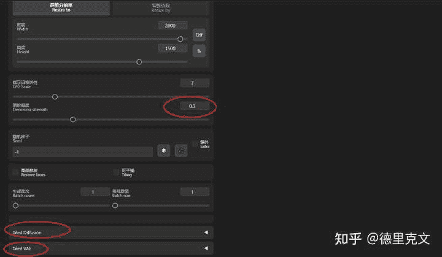

### 4.Tile Diffusion 参数设置

对于Tile Diffusion，常规情况下，我们只需要调整以下几个参数，其他参数保持默认即可，不需要更改。

放大算法（Upscaler）：我建议只采用R-ESRGAN 4x+系列，其中真实图像类使用4x+，二次元动漫图像类使用4x+anime。

放大算法（Scale Factor）：先点选 Keep input image size，保留原始图片尺寸，然后在放大算法的选项中选择最终图像相对于原图的放大倍率（例如选择2就是2倍，可以将1500*1500的图像放大为3000*3000）。

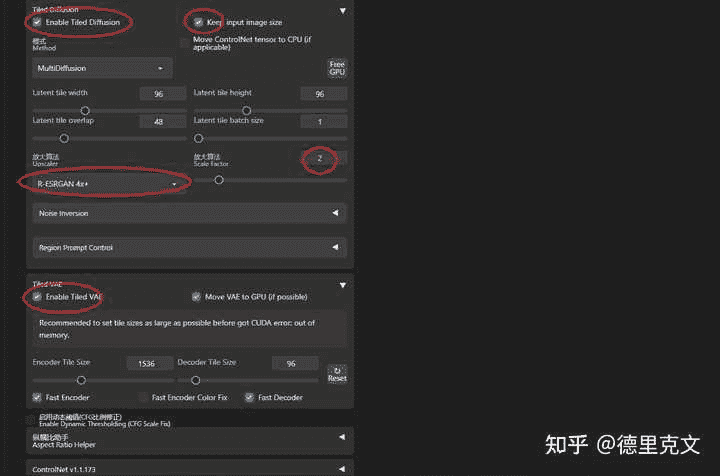

### 5.Tiled VAE参数设置

如果是第一次使用，可以点击Reset进行重置，系统会自动计算[出最适合](https://www.zhihu.com/search?q=%E8%A7%A3%E7%A0%81%E5%99%A8&search_source=Entity&hybrid_search_source=Entity&hybrid_search_extra=%7B%22sourceType%22%3A%22answer%22%2C%22sourceId%22%3A3137378395%7D)当前电脑配置的编码器区块大小和 解码器 区块大小。其他参数不需要调整。然后点击生成即可。

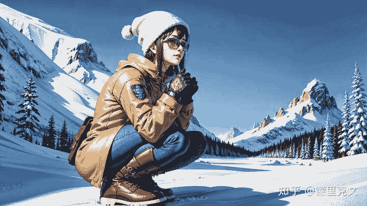

---

[我是德里克文](https://www.zhihu.com/search?q=%E5%AE%A4%E5%86%85%E8%AE%BE%E8%AE%A1%E5%B8%88&search_source=Entity&hybrid_search_source=Entity&hybrid_search_extra=%7B%22sourceType%22%3A%22answer%22%2C%22sourceId%22%3A3137378395%7D)，一个对AI绘画，人工智能有强烈兴趣，从业多年的 室内设计师 ！如果对我的文章内容感兴趣，请帮忙关注点赞收藏，谢谢！