# Stable Diffusion 有什么推荐的Checkpoint 模型、Lora?

> 来源：[https://agijuejin.feishu.cn/docx/OtHPdgcAhomcRUxptLRcRJWin5c](https://agijuejin.feishu.cn/docx/OtHPdgcAhomcRUxptLRcRJWin5c)

> 作者：德里克文

> 原文：[https://www.zhihu.](https://www.zhihu.com/question/603580055/answer/3140053192)com/question/6035...

我这里来推荐下各种实用的Checkpoint 模型、Lora吧！

## **一. 模型下载**

### 1.下载地址

Stable Diffusion最著名和通用的模型下载地址是：

http[s:/](https://www.zhihu.com/search?q=%E9%AD%94%E6%B3%95&search_source=Entity&hybrid_search_source=Entity&hybrid_search_extra=%7B%22sourceType%22%3A%22answer%22%2C%22sourceId%22%3A3140053192%7D)/ civitai.com/  （需要 魔法 ），里面包括各类模型下载,俗称C站。

国内的模型分享平台包括：

可在线生图的 AI 模型分享社区，还是免费的！  tusi.art/

[LiblibAI·哩布哩布AI-中国领先原创AI模型分享社](https://link.zhihu.com/?target=https%3A//www.liblibai.com/)区  www.liblibai.com/

### 2.存放目录

点击进入网站，下载需要的模型文件后，需要放置不同的模型到各自的目录。

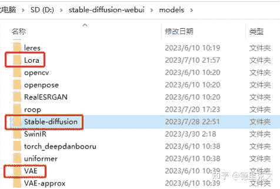

Che[ckpoin](https://www.zhihu.com/search?q=%E4%B8%BB%E7%A8%8B%E5%BA%8F%E7%9B%AE%E5%BD%95&search_source=Entity&hybrid_search_source=Entity&hybrid_search_extra=%7B%22sourceType%22%3A%22answer%22%2C%22sourceId%22%3A3140053192%7D)t模型存放位置： SD 主程序目录 位置/models/Stable-diffusion

**VAE模型存放位置： **SD主程序目录位置/models/VAE

**Embedding存放位置： **SD主程序目录位置/ [embeddings](https://www.zhihu.com/search?q=embeddings&search_source=Entity&hybrid_search_source=Entity&hybrid_search_extra=%7B%22sourceType%22%3A%22answer%22%2C%22sourceId%22%3A3140053192%7D)

[Hypernetworks](https://www.zhihu.com/search?q=hypernetworks&search_source=Entity&hybrid_search_source=Entity&hybrid_search_extra=%7B%22sourceType%22%3A%22answer%22%2C%22sourceId%22%3A3140053192%7D)存放位置： SD主程序目录位置/models/ hypernetworks

**Lora存放位置： **SD主程序目录位置/models/Lora

## 二.Checkpoint大模型介绍

Ch[eckpoint](https://www.zhihu.com/search?q=%E4%BA%8C%E6%AC%A1%E5%85%83%E5%B9%B3%E9%9D%A2%E7%94%BB%E9%A3%8E&search_source=Entity&hybrid_search_source=Entity&hybrid_search_extra=%7B%22sourceType%22%3A%22answer%22%2C%22sourceId%22%3A3140053192%7D)是主模型，是决定整体出图质量最重要的模型。每个Checkpoint大模型都有自己独特的风格，按照我自己的喜好分类，我将模型分成这四大类：真实照片类、2.5D仿真画风类、CG动画画风类、 二次元平面画风 类（另外还有一个NSFW类，因为经常容易渲染出各种限制级画面，我单独分类，这就不展开说了）。

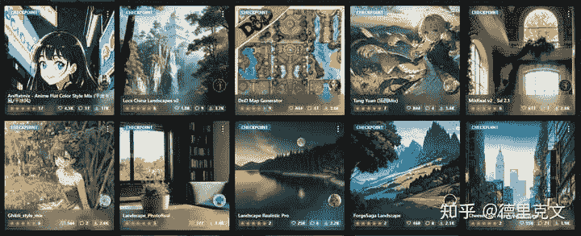

Checkpoint文件是训练过程中[保存的模型](https://www.zhihu.com/search?q=%E9%A3%8E%E6%A0%BC%E6%BB%A4%E9%95%9C&search_source=Entity&hybrid_search_source=Entity&hybrid_search_extra=%7B%22sourceType%22%3A%22answer%22%2C%22sourceId%22%3A3140053192%7D)状态快照，我们可以理解为一种 风格滤镜 ，用于将模型输出结果转换为特定的风格。在下载Checkpoint文件时，建议查看下相应的模型简介和说明事项，作者通常会提供文件和对应的使用说明，以帮助使用者更好地理解和使用。

我推荐我常用常用的Checkpoint模型及不同的分类（对于初学者来说，建议每一种选我给的前3个即可)：

### [**真实照片 **](https://www.zhihu.com/search?q=%E7%9C%9F%E5%AE%9E%E7%85%A7%E7%89%87&search_source=Entity&hybrid_search_source=Entity&hybrid_search_extra=%7B%22sourceType%22%3A%22answer%22%2C%22sourceId%22%3A3140053192%7D)**类**

Chilloutmix(NSFW),

ReallisticVision,

**Deliberate,**

**（MajicmixRealistic, br**aBeautifulRealistic , Lofi, ProtogenX34Photorealistic,）

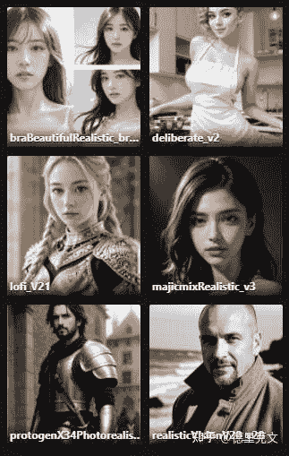

### **2.5D **[**仿真画风 **](https://www.zhihu.com/search?q=%E4%BB%BF%E7%9C%9F%E7%94%BB%E9%A3%8E&search_source=Entity&hybrid_search_source=Entity&hybrid_search_extra=%7B%22sourceType%22%3A%22answer%22%2C%22sourceId%22%3A3140053192%7D)**类**

**3Guofeng3,**

[**ghostmix **](https://www.zhihu.com/search?q=ghostmix&search_source=Entity&hybrid_search_source=Entity&hybrid_search_extra=%7B%22sourceType%22%3A%22answer%22%2C%22sourceId%22%3A3140053192%7D)**,**

**Dreamshaper,**

**(lyriel, Neverendi**ngDream,ProgenAnime）

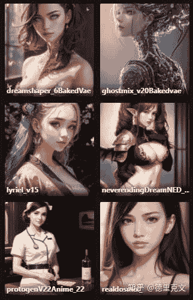

### **CG **[**动画画风 **](https://www.zhihu.com/search?q=%E5%8A%A8%E7%94%BB%E7%94%BB%E9%A3%8E&search_source=Entity&hybrid_search_source=Entity&hybrid_search_extra=%7B%22sourceType%22%3A%22answer%22%2C%22sourceId%22%3A3140053192%7D)**类**

**Abyssorangemix;**

**CetusMix,**

DisneyPixarCartoon,

**DarksushiMixMix**

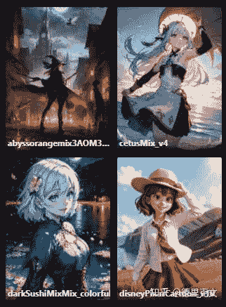

**二次元平面画风类：**

**Anything,**

**Counterfeit,**

**MixProColorbox,**

**(Meinamix,CardosAnime**,DreamlikeDiffusion)

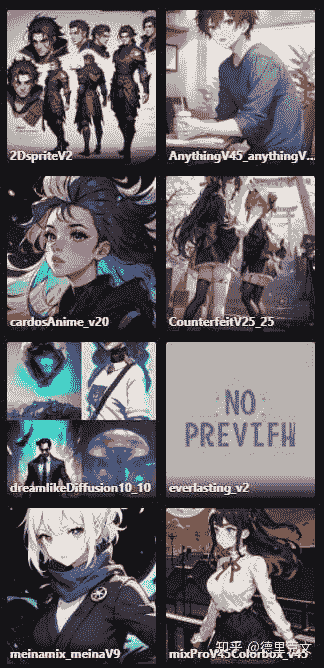

## 三. VAE模型介绍：

VAE 可被看作对模型的微调滤镜，主要给人的直观感受是色彩方面的调整，不同的VAE可能在细节上有一些差异，但不会对输出效果产生影响。

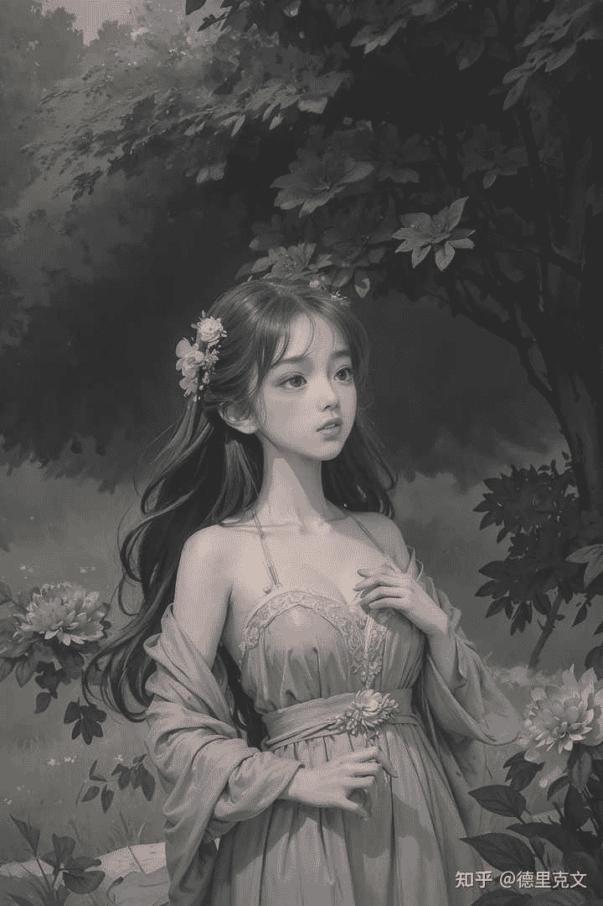

VAE它可以提高模型的性能，有些模型预设了VAE效果，因此除了模型配套的VAE文件外，无需专门下载，可以选择自动模式进行匹配，即可正常使用。

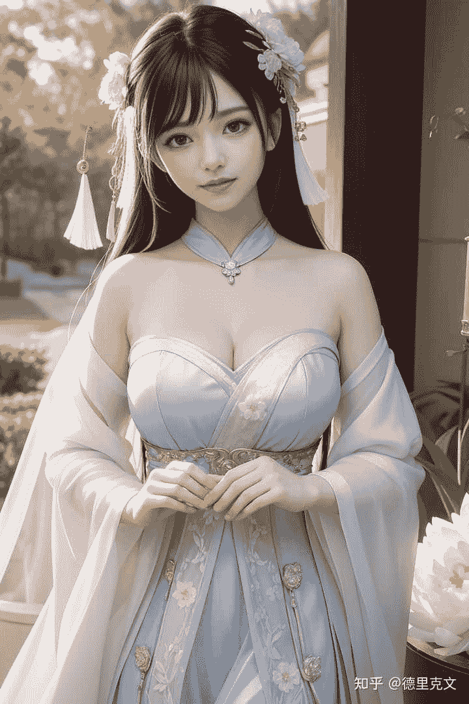

## 四. Embedding介绍：

在Stable Diffusion中，Embedd[ing就像](https://www.zhihu.com/search?q=%E6%95%B0%E6%8D%AE%E8%BD%AC%E6%8D%A2&search_source=Entity&hybrid_search_source=Entity&hybrid_search_extra=%7B%22sourceType%22%3A%22answer%22%2C%22sourceId%22%3A3140053192%7D)是一本使用说明，它能够将输入 数据转换 为向量表示，使得模型能够更方便地进行处理和生成。

[如果拿菜](https://www.zhihu.com/search?q=%E5%9C%B0%E4%B8%89%E9%B2%9C&search_source=Entity&hybrid_search_source=Entity&hybrid_search_extra=%7B%22sourceType%22%3A%22answer%22%2C%22sourceId%22%3A3140053192%7D)谱举例，类似于我们想要做一份 地三鲜 ，在没有Emb[edd](https://www.zhihu.com/search?q=%E9%9D%92%E6%A4%92&search_source=Entity&hybrid_search_source=Entity&hybrid_search_extra=%7B%22sourceType%22%3A%22answer%22%2C%22sourceId%22%3A3140053192%7D)ing的情况下，我们在提示词里需要提到所有的细项特征，比如茄子、土豆、 青椒 、耗油、盐、香油、蒜、姜等配料。但是如果我们有了Embedding，我们只需要在提示词中输入：“地三鲜”，系统就能够通过Embedding自动读取关于地三鲜的相关所有详细特征描述，这样我们就不需要每次都输入很多单词来控制生成的画面了。

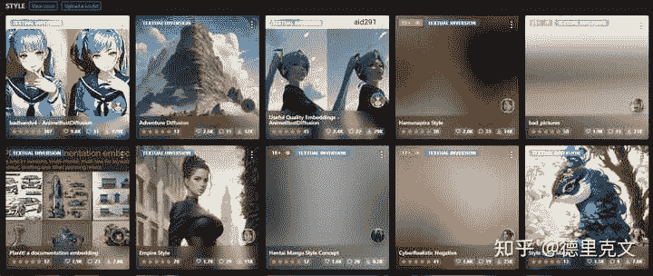

调用Embedding需要在提示词中进行描绘，这样就能启用相应的Embedding效果了。

Embedding与其他模型（比如LORA）相比，Embedding文件的大小只有几十KB，而不是几百兆或几GB。虽然还原度可能相对LORA稍差一些，但在存储和使用方面更加方便。

需要注意的是有些Embedding是用在正面提示词，有些是用在负面提示词，例如 EasyNegative，verybadimage这几个是用于负面的

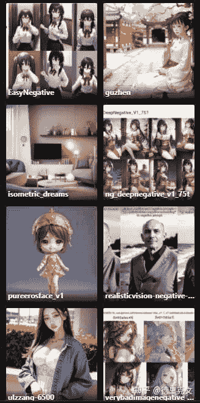

**我这里也介绍一些实用的Embedding: EasyNeg**ative，ng_deepnegative,verybadimagenegative

## 五.Hypernetworks（略过)

这个模型现在基本没人用，又麻烦效果上也比不上Lora，我就不介绍了，对于日常应用，忽略就好。

## 六.Lora介绍

Lora与embedding在本质上有相似之处，都携带着大量的训练数据。因此，LORA能够更加细腻地复制人物和细节特征。

### 1、启动Lora

通常每个Lora模型都有对应训练的Checkpoint大模型和相应的触发词汇，我们可以通过查看LORA作者提供的相关内容来获取信息，并选择一些提示词，来更好的生成图片。

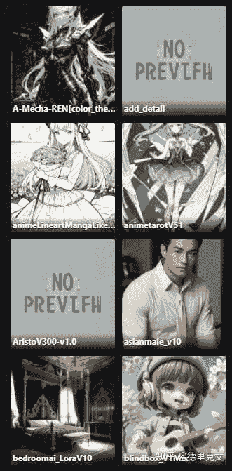

调用Lora需要在提示词中进行描绘，Lora也可以叠加重复采用，例如我在下面的图片示例的，在提示词中加入 <lora:画风LoRA:GhibliStyle:0.8>, <lora:add_detail:1>这样就能启用相应的Lora效果了，0.8和1则分别代表了这个的Lora启用的权重。

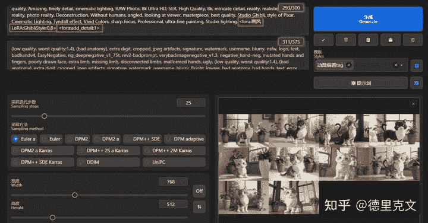

需要特别注意，每个LORA模型都可以在提示词中设置权重属性。权重设置越大，对画面的影响就越大。一般来说，我建议Lora提示词的权重保持在0.3到1之间。权重过低没有效果，权重过高，有可能出现过于拟和，影响出图质量。

我这里也介绍一些我自己常用的的Lora: add_detail,blindbox,animeiLineart

这几个Lora分别有什么效果呢，让我简单介绍下吧

### **2. add_detail**

有了这个Lora，可以给你的画面增加更多的细节,我来用图片举个例子吧。

下面两张图片我用了相同的提示词和参数，仔细看看不同在哪里，细节更加丰富，错误更少了。上方的图是没有加add_detail这个Lora的，下方的图我设置add_detail权重为1，是不是就精致多了呢？你也可以自己试下。

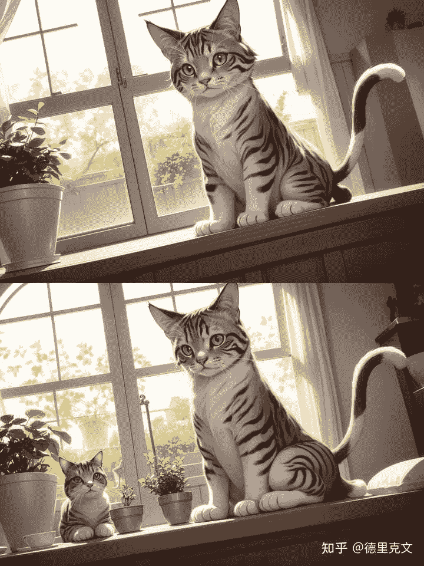

### **3.blindbox**

最好用的生成盲盒类LORA，可以直接当生产力使用，不需言语，就是强烈推荐

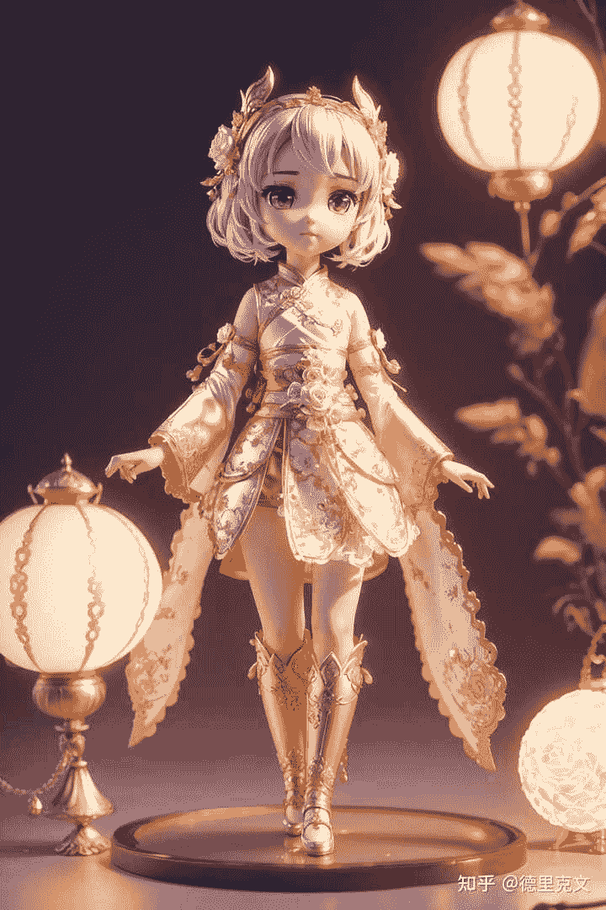

### 4.animeiLineart

这个Lora最大的好处就是可以生成线稿图啦，可以很轻松制作漫画风格哦

好了，关于模型分类你是否了解了呢，如果不清楚可以评论区留言给我哦，我会进行解答。

---

我是 [德里克文 ](https://www.zhihu.com/search?q=%E5%BE%B7%E9%87%8C%E5%85%8B%E6%96%87&search_source=Entity&hybrid_search_source=Entity&hybrid_search_extra=%7B%22sourceType%22%3A%22answer%22%2C%22sourceId%22%3A3140053192%7D)，一个对AI绘画，人工智能有强烈兴趣，从业多年的室内设计师！如果对我的文章内容感兴趣，请帮忙关注点赞收藏，谢谢！