# Stable Diffusion 入门指南-1

> 来源：[https://agijuejin.feishu.cn/docx/XCM5dWkogoWnrQxhVewccfKLnGg](https://agijuejin.feishu.cn/docx/XCM5dWkogoWnrQxhVewccfKLnGg)

> 作者：德里克文

> 原文：[https://zhuanlan.z](https://zhuanlan.zhihu.com/p/645820130)hihu.com/p/645820...

从这一篇开始，我将介绍下Stable Diffusion的基本操作。

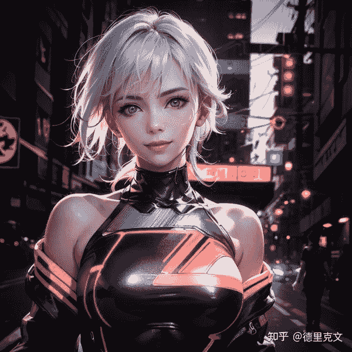

## 一、本地部署安装

关于Stable Diffusion的安装，我之前已经写在这一片文章里面，如果你需要了解，请点击查看。

[  ](https://zhuanlan.zhihu.com/p/643656433)

软件的下载地址详见文章第二章第3点，我已经放上了网盘链接，或者也可以点击这个链接直接下载

[https:// pan.baidu.com/s/1jPqx2](https://link.zhihu.com/?target=https%3A//pan.baidu.com/s/1jPqx2k5L072cda8f4zLQDQ)k 5L072cda8f4zLQDQ  提取码：xoz1

## 二、软件启动

### 1.点击启动程序

在安装Stable Diffusion的根目录找到“启动器”的exe文件，双击打开

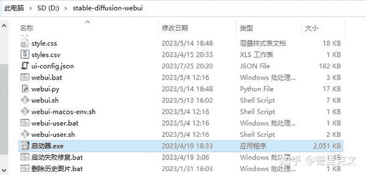

### 2.打开后启动界面

点击“一键启动”，会弹出控制台程序，第一次启动会比较慢，需要更新，等一会就好了。

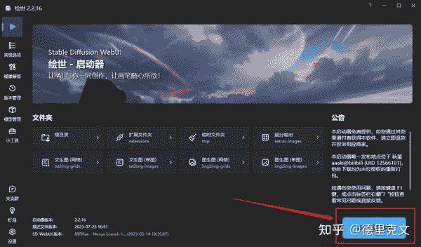

如果有安装插件，会在这个界面加载插件。耐心等待即可

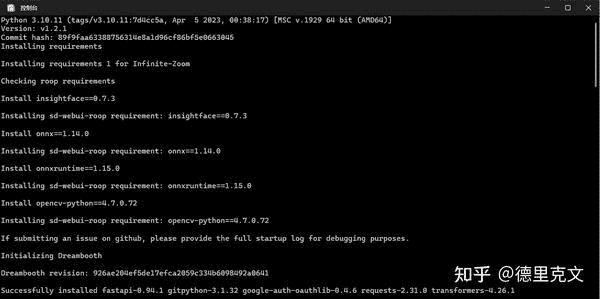

### 3. 进入图形界面

稍等片刻后，你的默认浏览器会自动打开这个网页界面，这样就代表可以使用了

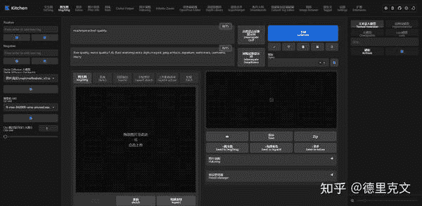

## **二、流程和界面介绍**

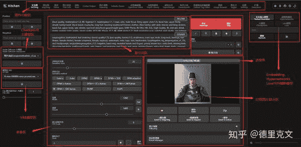

不同启动器的操作界面不太一样，我用了Kithchen界面管理，界面会更加复杂，但是主要的内容并没有变，我来简单介绍下软件的界面整体布局。

界面主要是由三大模块构成的，模型，提示词和参数设置，其他模块主要作为视觉展示和切换插件功能用。后面的章节会具体介绍一下每个模块。

AI绘画的制作过程，你可以把它比喻成烹饪。首先，你需要准备好食材原料（提示词和参数），然后按照菜谱（Checkpoint模型）进行烹饪，在制作过程中，你还可以要求烹饪的手法(Embedding, Hypernetwork，Lora等参数）,并添加不同的调料（VAE模型)使得菜肴更合自己口味，接着就由AI这一个大厨帮助你进行专业的制作，最终就可以得到美味的菜肴（图像）。

## 三、模型分类

正如之前所提到的，模型就像是我们在烹饪中使用的菜谱。每个模型都有自己独特的风格，我认为按照大类来分，可以主要可以分成这四大类：真实照片类、2.5D仿真画风类、CG原画画风类、二次元平面画风类。

在Stable Diffusion中，总共有5种类型的模型可供选择。

### 1. 基础底模型（单独使用）：Checkpoint，

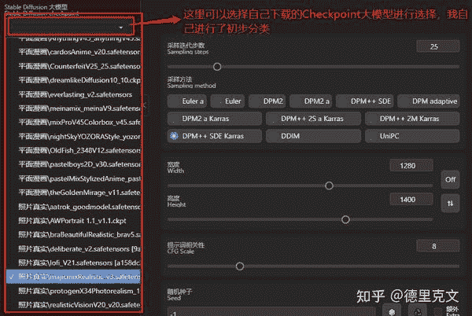

### 2. 辅助类模型（与基础底模型配合使用）：Embedding、Lora、Hypernetwork

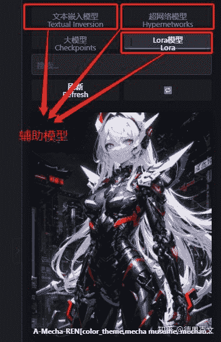

### 3. 美化类模型：VAE

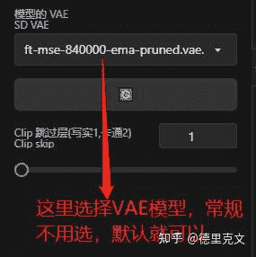

这几种模型的区别和使用方式可以类比于烹饪中的不同烹调方法。

基础底模型就像炒菜，而辅助模型则是更高级的烹调技巧，比如爆炒、小炒。最后的美化模型则是用来加入更精细的调料，来调整整体画面的色彩，就如同烹饪中加入八角，茴香，辣椒等作用。

在SD中，基础底模型是必需且只能选择一种，而后面的模型则没有限制，可以没有，也可以选择一种或多种。

VAE模型我们一般采用默认，如果出图的画面发灰没有色彩，一般就是VAE没选好，这时候就可以调整VAE模型的选择，看下哪个是最适合的。

## 四、提示词介绍

提示词（Prompt）就是我们对AI的具体指令，告诉AI我们想要什么。

提示词主要有2类,分别是正向提示词和反向提示词。

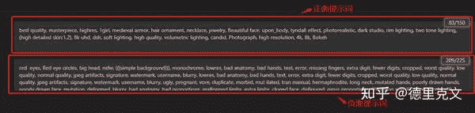

### 1.正向提示词（Prompt）：

即对画面的描述，你想要出现在画面中的内容。

例如你可以这样描述：

```
best quality, masterpiece, highres, 1girl, medieval armor, hair ornament, necklace, jewelry, Beautiful face, upon_body, tyndall effect, photorealistic, dark studio, rim lighting, two tone lighting, (high detailed skin:1.2), 8k uhd, dslr, soft lighting, high quality, volumetric lighting, candid, Photograph, high resolution, 4k, 8k, Bokeh
```

这代表什么呢？翻译成中文是这样的短语，它包含了画面整体的描述，主题内容，场景要求：

“最佳质量，杰作，高分辨率，一个女孩，中世纪盔甲，发饰，项链，珠宝，美丽的脸庞，身体上方，泰因德尔效应，逼真的照片效果，暗室摄影，边缘光照明，双色照明，（高度详细的皮肤：1.2），8K超高清，数码单反相机，柔和的光线，高质量，体积光照明，真实自然的摄影，高分辨率摄影，4K，8K，背景虚化。”

### 2. 反向提示词（Negative prompt）：

指你不想在画面中出现的元素或属性，你不希望在画面中出现的内容。

例如你可以这样描述：

```
red  eyes,  big head, nsfw, monochrome, lowres, bad anatomy, bad hands, text, error, missing fingers, extra digit, fewer digits, cropped, worst quality, low quality, normal quality, jpeg artifacts, signature, watermark, username, blurry, lowres, bad anatomy, bad hands, text, error, extra digit, fewer digits, cropped, worst quality, low quality, normal quality, jpeg artifacts, signature, watermark, username, blurry, ugly, pregnant, vore, duplicate, morbid, mut ilated, tran nsexual, hermaphrodite, long neck, mutated hands, poorly drawn hands, poorly drawn face, mutation, deformed, blurry, bad anatomy, bad proportions, malformed limbs, extra limbs, cloned face, disfigured, gross proportions, (((missing arms))), (((missing legs))), (((extra arms))), (((extra legs))), pubic hair, plump, bad legs, error legs, username, blurry, bad feet
```

这是一些常用的负面词汇清单，我就不再一一赘述，直接拿来用就可以。

### 3.如何使用提示词


以下是两个基本规范需要注意：

1. 在Stable Diffusion软件中提示词需要采用全

英文，提示词中的标点符号也应全部使用英文符号。

2. 单词、短语和句子基本上是等价的。例如，“1boy、Lake、swimming”与“A Boy swimming in lake”在语义上是相同的，但是采用短语更加符合Stable Diffusion的语义习惯。

## 五、编写提示词的整体思路


在给出正向提示词时，我们通常采用分类描述的方式。具体可以分为以下三类：整体描述、主体、场景。

在开始生成图片前，你需要好好考虑以下这些方面内容：

+   你需要的是一张照片还是一幅画作？

+   照片的主题是什么？人物？动物还是风景？

+   您希望添加哪些细节？环境和背景是什么？

+   是否使用特定的艺术风格？3D渲染、吉卜力工作室、电影海报

+   是否需要特定的照片类型？微距、长焦

考虑好以上内容后，我们需要把这些加入到整体描述提示词的中。

### 1.画面整体描述

通常我们需要首先考虑画面的整体质量，需要涵盖以下四个方面：

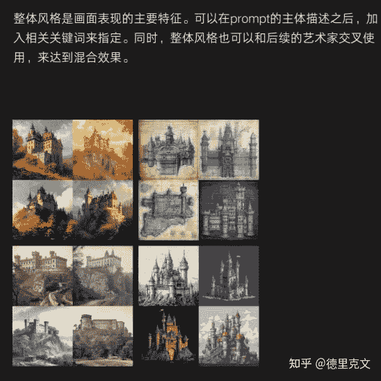

+   **画质描述： **可以分为高画质、中等画质或低画质，2k 、4k高清分辨率等。

+   **艺术风格描述： **CG、二次元、3D渲染、海报、真人照片、油画、水墨画等。

+   **构图镜头描述： **画面中人物的占比，是半身像还是全身像，正面、俯视还是侧面，是否需要摄影镜头。

+   **光线或色调描述： **自然光线、聚光、背光？鲜艳、暗淡、冷色调或暖色调。

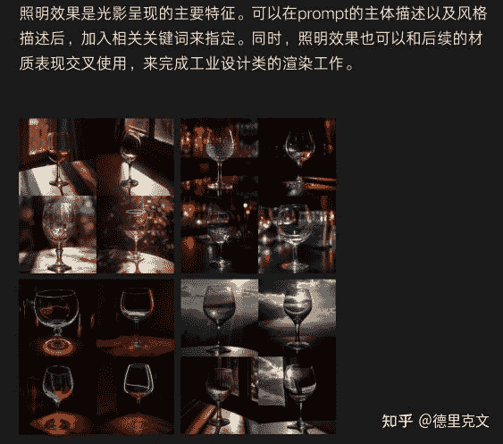

### 2. 主体

以人物为例，主体的描述通常包括以下两个方面：特征、姿势。

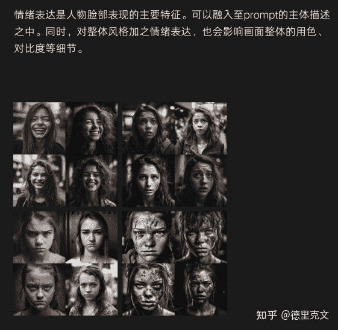

+   **特征： **特征描述通常包括人脸上五官、年龄、皮肤、毛发、服饰及其他装饰细节特征等

+   **姿势： **即主体的动态，例如坐姿、立姿、跑步等。

### 3.场景

基本场景描述通常包括时间、地点、光线、天气、细节等描述，这一点根据实际画面需求进行调整。

## 六、提示词语法


仅仅有了提示词的想法还不够，我们还需要知道怎么把提示词重新组合成Stable Diffusion可以容易识别的格式。

### 1.分隔符

不同的提示词之间要采用英文逗号分隔，这样AI才能判断每一个单词的主体。

### 2.提示词顺序

文字的单词顺序很重要。提示词的重要性取决于其在句子中的位置，通常主要内容应该放在前面。因此建议应该尽可能将每个短语明确、分顺序列出，而不是试图把它们压缩成一个简单的英文短句，这样更加便于机器理解。

### 3.权重调整

我们还可以使用强化和弱化方式来调整提示词的重要性。

例如： (Masterpieces:1.1)，这个形式代表的是（提示词短语：权重系数）。权重数值默认为1。数值小于1表示弱化，数值大于1表示强化，通常我们权重系数会设置在0.3~1.6之间。

### 4.()与[]区别

在提示词中使用()表示强化，使用[]表示弱化。可以使用多层嵌套来进一步增强或减弱提示词的重要性。例如：((Masterpieces))实际效果等于 (Masterpieces:1.1)，每一个扩号等于乘以1.1权重。 [Masterpieces]实际效果约等于 (Masterpieces:0.9)。

好了，通过以上的教程，你应该已经初步入门了，接下来就试着用刚刚教的内容初步生成一个画面吧。

## Prompt尝试


尝试着用我这个这个Prompt来绘制你的第一幅AI绘画作品吧，参数可以采用默认参数或者我下图显示的参数。

正面提示词:

```
best quality, masterpiece, highres, 1girl, medieval armor, hair ornament, necklace, jewelry, Beautiful face, upon_body, tyndall effect, photorealistic, dark studio, rim lighting, two tone lighting, (high detailed skin:1.2), 8k uhd, dslr, soft lighting, high quality, volumetric lighting, candid, Photograph, high resolution, 4k, 8k, Bokeh
```

负面提示词：

```
red  eyes,  big head, nsfw, (((simple background))), monochrome, lowres, bad anatomy, bad hands, text, error, missing fingers, extra digit, fewer digits, cropped, worst quality, low quality, normal quality, jpeg artifacts, signature, watermark, username, blurry, lowres, bad anatomy, bad hands, text, error, extra digit, fewer digits, cropped, worst quality, low quality, normal quality, jpeg artifacts, signature, watermark, username, blurry, ugly, pregnant, vore, duplicate, morbid, mut ilated, tran nsexual, hermaphrodite, long neck, mutated hands, poorly drawn hands, poorly drawn face, mutation, deformed, blurry, bad anatomy, bad proportions, malformed limbs, extra limbs, cloned face, disfigured, gross proportions, (((missing arms))), (((missing legs))), (((extra arms))), (((extra legs))), pubic hair, plump, bad legs, error legs, username, blurry, bad feet
```

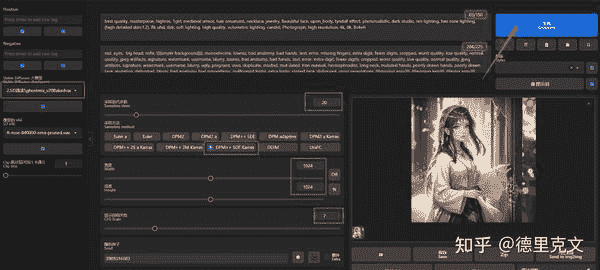

下一篇文章我们将学习怎么进行参数的设置和特色模型的下载应用，想要了解学习AI绘画，请继续关注我的作品吧。

---

我是德里克文，一个对AI绘画，人工智能有强烈兴趣，从业多年的室内设计师！如果对我的文章内容感兴趣，请帮忙关注点赞收藏，谢谢！