# Stable Diffusion 进阶指南-1

> 来源：[https://agijuejin.feishu.cn/docx/EU1bdgZqEoWN9vxXoEpcK9ytnld](https://agijuejin.feishu.cn/docx/EU1bdgZqEoWN9vxXoEpcK9ytnld)

> 作者：德里克文

> 原文： [https://zhuanlan.z](https://zhuanlan.zhihu.com/p/646790144)hihu.com/p/646790...

这一篇文章我来讲解下如何更好优化提示词，关于前三篇入门指南的介绍请点击这个链接依次查看：

[德里克文：Stable Diffusion 入门指](https://zhuanlan.zhihu.com/p/646294193)南-3 19 赞同 · 4 评论 文章

关于提示词的重要性，我想通过前面的教程，大家都能够有初步的了解。AI绘画有些类似于文学家、画家、设计师或摄影师在通过提示词的这个工具，描绘出现在他们脑子里的画面，虽然在电脑生成中存在随机性，但是如何发挥创意，给到电脑一个方向性的指引是十分重要的。

在第一篇内容中我们已经学会怎么采用基础的提示词结构，这一篇内容我将教大家如何更好优化和利用提示词生成心目中的画面。

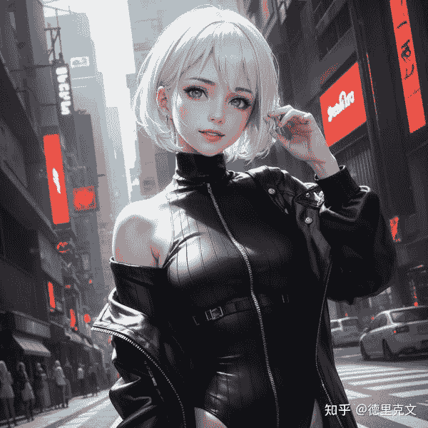

## 一、提示词内容

### 1.提示词顺序

提示词的顺序决定了AI出图时，分步骤时候考虑的内容顺序，后面的词的权重会相对较低。因此重要的提示词应该放在前面。

接下来我将用一个测试来进行详细说明，测试中包括了一个美女和一只狗狗的图片。当把提示词“1 girl”放在前面时，女孩明显占据画面整体部分，狗狗只有可怜的一小角。

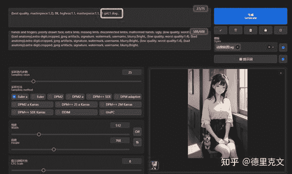

而当我们把"1 dog"放前面的时候，狗狗在画面中的比重和细节都更加突出，甚至AI将狗的耳朵元素添加到了人物身上。

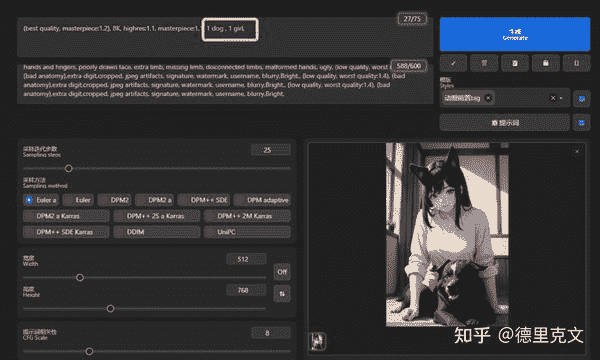

根据这个测试结果可以得出结论：提示词的顺序影响着画面的组织方式，放在前面的提示词对构图的影响更大。

我认为提示词的位置顺序更多影响的是语境，AI会按照顺序去理解你输入的语句，如果你前面的提示词已经构建了完整的画面，后面的提示词无法融入AI对画面的理解，AI就会弱化甚至忽略后面的内容。

当然，这个规律并非绝对有效，对于某些情况或者较为复杂的场景，可能会失效的情况。但是总的从多数图片来说，AI都会遵循这个规律，因此在编写提示词时，将重要想要表达的内容提前，更容易实现自己想要的场景。

按照以上的结论，我们在写提示词的顺序的时候，可以首先提及一些概念性、大范围的关键词，然后是描绘画面内容的关键词，最后是一些细节的描述。我觉得可以按照以下顺序进行编写：

Prompt：

**【画面质量提示词】+ 【画面主体内容**】+【画面艺术风格】+【构图色调及光影】

### **2. 提示词类别**

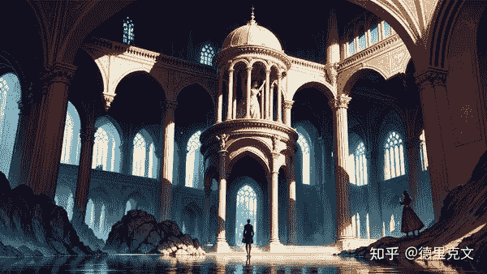

常用的关键词类别包括如下内容，可以根据画面需求增加或减少：

**1.主体 **是指想在图像中看到的主体，要尽可能详细描述以避免出现描述不足的问题。

**2.画风 **是指生成图片的画风，例如插画 illustration、油画 oil painting 或摄影风 photography 等

**3.画家 **是指用特定画家作为参考来生成他们风格的图像。当然也可以使用多个画家名字来生成混合风格。

**4.分辨率 **表示生成图像的清晰度和细节程度。例如“highly detailed, sharp focus”

**5. 构图 **是指主体在画面中的构图方式，拍摄角度。例如“looking at camera，Top view”

**6.色调 **是指通过添加颜色关键字来控制图像整体颜色，可以把颜色应用到某个物品上或者是整体色调。

**7. 光影 **是指图像里的光照描述，改变光照可以对图像效果产生巨大影响。例如“cinematic lighting, dark”

## 二、提示词权重

在模型中，每个词语都有自身的权重，这些权重可能因为在训练集中的出现频率不同而有所差异。

举例来说，如果某个关键词在训练集中出现较多，那么仅输入这个词就能对生成的内容产生较大的影响；相反，如果某个关键词在训练集中出现较少，那么即使输入多个相关词汇，对生成的内容的影响效果也可能有限。

因此，在提示词的写作中，关键词最好具有特异性，比如使用 "Disney" 可以清晰指向Disney迪士尼风格的动画，而使用 "Anime" 动漫这个词则相对泛化。在选择提示词时，最好使用具体的措辞，尽量避免使用抽象的措辞，以减少机器理解和解释的空间。

在对提示词的权重进行人工修改时，可以使用括号来指定权重的倍数。

例如，(red) 表示将该词的权重提高 1.1 倍，[red] 表示将该词的权重降低到原先的 90.91%。还可以使用 (red:1.5) 将该词的权重提高 1.5 倍，或者使用 (red:0.25) 将该词的权重减少为原先的 25%。

需要注意的是，建议不要将权重值调整超过 1.5。

最后再详细解释下括号的意义：括号的数量代表的是权重的倍数，例如 ( n ) 表示 n 的权重增加 1.1 倍，((n))代表的是n的权重公式可以理解为n*1.1*1.1即n的1.21倍，表示将该词的权重提高 1.21 倍（即原先的 1.1 倍的 1.1 倍），((( n ))) 则表示 n 的权重增加 至1.331 倍，以此类推。

## 三、注释用法

有时候，通过提高或削弱权重，也不能阻止部分提示词污染其他提示词的现象，尤其是带有颜色描述的提示词，很容易串台。

那么还有什么办法可以让我们的描述更加精确呢？我建议还可以考虑采用“注释”这一种提示词的用法。

注释写法是：主体描述\(注释内容1,注释内容2\)

怎么用呢，让我来演示下：

### 1.不采用注释

1girl, (yellow hair), black eyes, smile,blue hat,white skin, (pink Sweaters:1.3),upper body,open hands

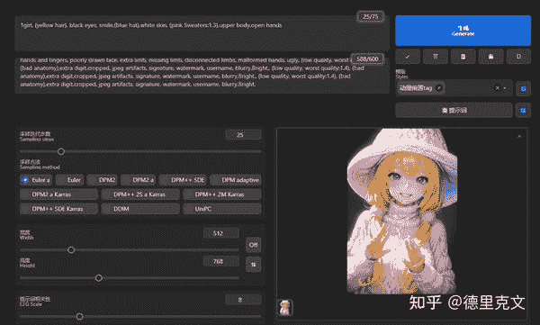

### 2.采用注释

1girl\( (yellow hair), black eyes, smile,blue hat,white skin, (pink Sweaters:1.3)\),upper body,open hands

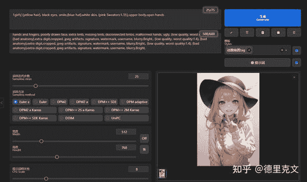

可以看到，采用注释可以有效的仿制颜色污染的情况

## 四、分步描绘

有时候为了更好的控制画面，我们可能会要求在渲染步骤中，描绘的重点不同，以形成我们心目中的画面。

### 1.语法格式

**[To:when] **意思是：在经过指定数量的步骤后，将位于 to 处的提示词添加到提示中。

**[From::when] **意思是：在经过指定数量的步骤后，从提示中删除位于 from 处的提示词。

**[From:to:when] **意思是：在经过指定数量的步骤后，将位于 from 处的提示词替换为 to 处的提示词。

这是什么意思呢，我来解释下:

### 2.语法详解

我来举个例子，我采用的提示词是： "a [handsome:strong:15] boy" **, 共采用25步。Stable** Diffusion在一开始的时候运行的时候，他理解的提示词是 "a handsome boy" ，经过 15 步之后，Stable Diffusion理解的提示词将被替换为 "a strong boy" 。它将基于之前已经生成的第15步的"a handsome boy"的图像上进行继续计算。

接下来，我们来测试下更为复杂的用法，例如我采用提示词是： "a handsome boy wear[Medieval boots:Neon lights :0.25] and [Mechanical armor:cyberpunk clothes:0.75][ in foreground::0.6][ in background:0.25][shoddy:masterful:0.5]，"，进行 100 步的采样。

**一开始的提示词是 "a han**dsome boy wear Medieval boots and Mechanical armor in foreground shoddy "。可以看到生成了一个穿着中世纪长靴和铠甲的人，质量不佳。

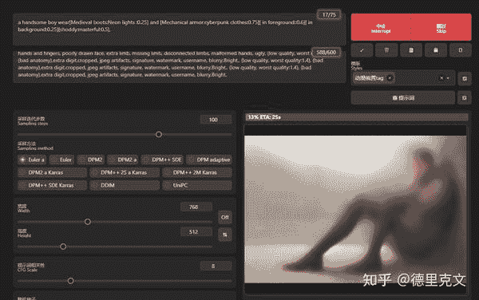

经过 25 步之后，提示词变为 "**a handsome b**oy wear** Neon light**s and Mechanical armor in foreground in background shoddy "。提示词将中世纪长靴替换成了霓虹灯，质量不佳。

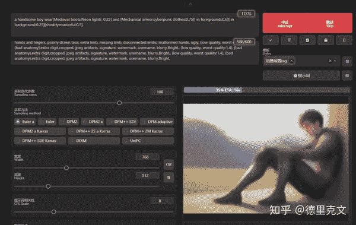

经过 50 步之后，提示词变为" **a handsome b**oy wear** Neon light**s and Mechanical armor in foreground in background Masterful "。可以看到中世纪长靴已经变了，加入了霓虹灯元素，画质改善的作用也出来了。

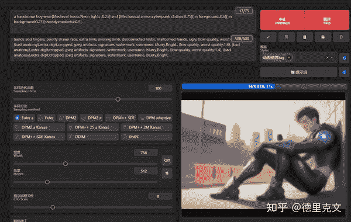

经过 60 步之后，提示词变为 " **a handsome b**oy wear Neon lights and Mechanical armor in background Masterful "。将霓虹灯元素转移至背景。

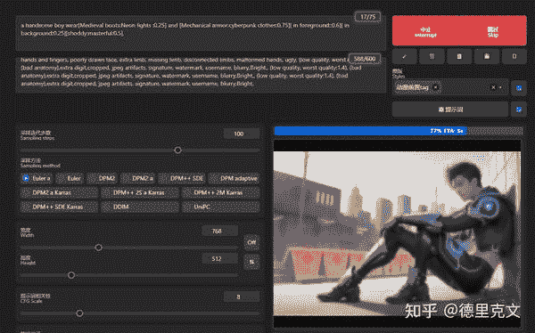

经过 75 步之后，提示词变为 " **a handsome b**oy wear Neon lights and cyberpunk clothes in background Masterful "。最终加入的赛博朋克风的衣物展示了完整的效果，背景也顺利了加入了霓虹灯元素。

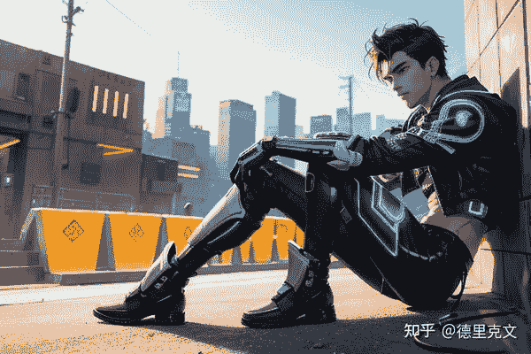

是不是很有趣呢？

### 3.提示词轮转

**提示词也可以进行轮转来**进行提示，采用的格式是 [提示词一|提示词二]

例如 "[clouds|pig] in sky"，在第一步时，提示词为 "clouds in sky "；在第二步时，提示词为 "pig in sky"；在第三步时，提示词为 "clouds in sky"，以此类推, 不断重复轮转。

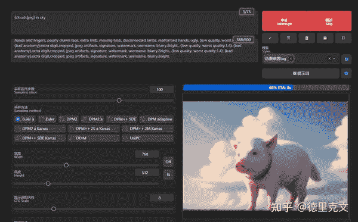

最终结果和我想象中有点区别，我本来是想生成一个猪猪状的云的……看来有点困难。不过原理大家都理解了吧~

## 五、打断语法（Break）的用法

在了解打断语法之前，让我们先了解一个概念，我们的提示词是怎么被程序识别的？

在Stable Diffusion中，程序是通过将输入的关键词转换为标记（Token）的形式，将其传入模型进行计算的。一个单词可能会对应一个或多个标记，而多个单词也有可能对应着相同的标记。

例如下列的提示词和Token的对应关系(本图片来源于

@董步云

文章)：

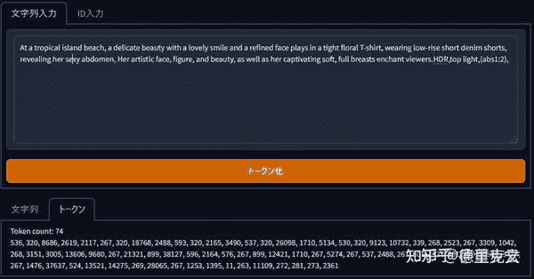

而下图中，右上角的0/75字数统计表示提示词的字符个数限制。

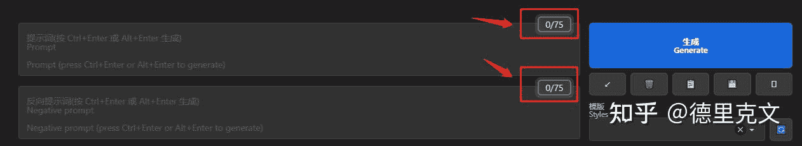

每75个字符会被强制分为一组，组内元素的顺序不会影响权重差异。但正如我们之前提过的，提示词的顺序非常重要，顺序也会影响图像的生成效果。经过验证，在75个Token内，第一个Token的效果最强，接近第75个Token时效果最弱。如果描述超过75个字符，同一组提示词可能被分为两组，导致生成效果不理想。而我们常规的提示词往往超过75，例如下图，可见有111个字符，就会被自动分成2组

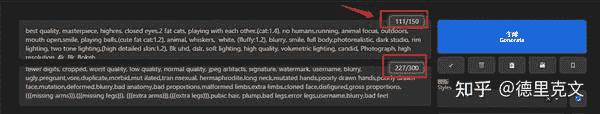

那么，如果我们的图像内容有分前中后景，很多需要表达的内容，我们又应该怎么描述才能更加精确呢？

我来介绍下打断语法（Break）的用法，BREAK是一个特殊提示，插入后它会强制将Token数凑齐调整为75。这样我们就能够控制不同层次提示词的打断效果了。这个语法指令相当于手动分组，确保每组都能描述完整的画面特征。使用BREAK可以切断不同组之间的上下文关联，防止元素相互干扰。

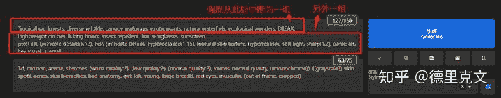

但是需要注意的是，一段描述中尽量不要超过3个BREAK，过多的分组会导致模型学习混乱，得不到想要的结果。

而关于Break在实际使用中的影响效果，可以详见

@董步云

大佬的这一篇文章，我就不再赘述

## 六、画质提示词用法

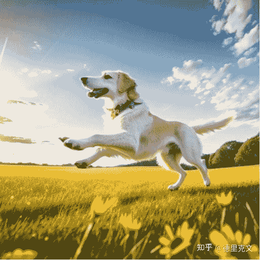

关于画质提示词，是提升画面表现力的重要工具，但是提示词不是越多越好，过多的提示词反而会导致程序忽略重要信息，因此我们需要学会选择如何使用合适的画质提示词。

在这一块，已经有

@董步云

大佬的文章写了很详细的分析文章，我就直接引用：

> **以下是一些推****荐给新手的提高质量的Promp**t和Negative prompt！

> Prompt

> best quality, masterpiece, ultra high res, (photorealistic:1.4), RAW photo

> 喜欢的话可以放8k

> Negative prompt

> illustration, 3d, sepia, painting, cartoons, sketch, (worst quality:2), ((monochrome)), ((grayscale:1.2)), (backlight:1.2), analog, analogphoto

> 以下的提示也推荐用来防止手臂或腿部的破綻，试着将它们与之前的提示组合使用吧！

> bad anatomy, bad hands, double navel, collapsed eyeshadow, multiple eyebrows, freckles, signature, logo, 2faces

大佬的原文分析在这里，希望进阶掌握的小伙伴可以点击下文查看

## 七、借助语言大模型进行主体内容优化

除了自己构思，如果碰到日常配图，想要偷懒快速生成图片，我们也可以借助ChatGPT类的语言大模型来进行提示词生成。

接下来分享一个我自己摸索出来的非常实用的一个提示词语句，这个提示词是我自己在别人分享的prompt基础上，进行调整调试而做的二次创新，效果还可以，记得最后还得自己加上画质提示词进行优化哦。

PROMPT:

**您的任务：根据[ 毛绒绒的熊猫 ]这个描述，最终输出一段30个单词的结果。要求：作为生成人工智能的提示生成器，您将为AI创建图像提示以可视化。我会给你一个概念，你会提供一个详细的提示，用于生成人工智能的图像。请遵守以下结构和格式，并根据所有提示生成一个完整的提示语：不要使用换行符，每行写一个提示。结构： [1] = masterpiece， best quality**，ultra high res, [2] = [PROMPT] [3] = [2]的详细描述，包括具体的图像细节。 [4] =场景环境的详细描述。 [5] =场景气氛、感受和氛围的详细描述。 [6]= 专业的摄影镜头及构图语言的描述 格式：按照以下提示结构进行： prompt：[1]，[2]，[3]，[4]，[5]，[6]；最后提取每一行描述里面的关键信息，整合成一段Prompt，请注意，只需要输出最终Prompt即可，所有输出为英文。

我采用文心一言做示意（不同大模型效果不一，可以多试一下），将结果分享给各位。

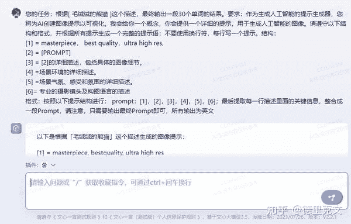

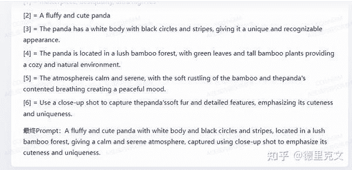

## 八、提示词模板参考网站

此外，还可以参考一些优质博主的文章获取更多的Prompt灵感，比如

@董步云

大佬的众多文章，推荐这一篇：

下一篇文章我们将学习重要插件Controlnet的使用和图生图功能的应用，想要了解学习AI绘画，请继续关注我的作品吧。

---

我是德里克文，一个对AI绘画，人工智能有强烈兴趣，从业多年的室内设计师！如果对我的文章内容感兴趣，请帮忙关注点赞收藏，谢谢！