# Stable Diffusion 进阶指南-2

> 来源：[https://agijuejin.feishu.cn/docx/GC1ed59TMoytKsxvx2KcovrGnWe](https://agijuejin.feishu.cn/docx/GC1ed59TMoytKsxvx2KcovrGnWe)

> 作者：德里克文

> 原文：[https://zhuanlan.zhihu.com/p/648390183](https://zhuanlan.zhihu.com/p/648390183)

这一篇文章我来讲解下如何使用`ControlNet`插件，这是如果需要进阶掌握`Stable Diffusion`这个软件，必须要学会的一个插件，直接影响出图可控性。关于之前进阶指南的介绍请点击这个链接依次查看：

[德里克文：Stable Diffusion 进阶指南](https://zhuanlan.zhihu.com/p/646790144)-1 43 赞同 · 10 评论 文章

## 一、`ControlNet`是什么

### 1. `ControlNet`的意义

`Stable Diffusion`采用的是扩散模型的算法，以呈现出独特且富有趣味性的效果。然而，这种方法在生成图片的可控性方面存在问题。简而言之就是不可控，类似于游戏抽卡一样，你无法控制最终生成的是什么东西，有可能是一副精品，也有可能是各种稀奇古怪的东西，这个对于需要稳定控制的商业化应用是致命的缺陷。

然而，随着`ControlNet`技术的出现，这个问题得到了极大的改善。`ControlNet`是一个工具，它通过添加额外的控制条件来指导`Stable Diffusion`生成图像，从而提高了AI图像生成的可控性和准确性。

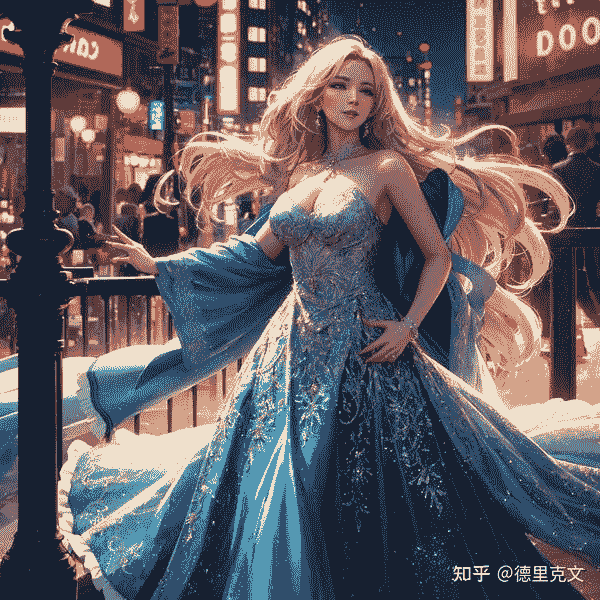

`ControlNet`的作者是中国人张吕敏，他于2021年本科毕业并目前在斯坦福大学攻读博士学位，有趣的是，他本科专业是医学，在苏州大学就读后转向编程。然而，他自大一开始就一直在发表与人工智能相关的论文。自2017年以来，他一直专注于AI填色领域，并开发了当时全球最热门的一款AI填色程序。在2023年，他提出了一个新的神经网络概念，叫做`ControlNet`。`ControlNet`通过额外的输入来控制预训练的大型模型。

这种方法实际上是一种端对端的训练方式，在2017年就有类似的AI模型出现过，但是`ControlNet`通过引入高质量的大型模型，比如应用在`Stable Diffusion`上，为这种端对端训练提供了更好的应用空间。它有效解决了文生图大型模型的一个关键问题：传统的关键词控制方式无法满足对细节精确控制的需求。

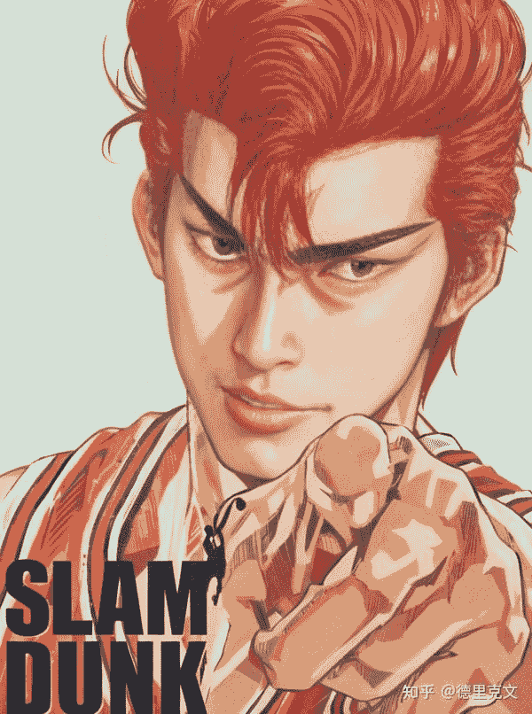

### 2. `ControlNet`的用处

`ControlNet`能帮助我们更好地控制AI绘画的生成过程，让这个工具更符合我们的实际工作需求。由于有了`Controlnet`，AI绘画不再仅仅是供人娱乐的小玩具，而是逐渐发展成为一种实用工具，可以真正帮助我们提高工作效率。虽然`Controlnet`的可控性还有提升的空间，但与之前的技术相比，已经取得了质的飞跃。

`ControlNet`插件的本质是利用图像作为输入信息的方式，以弥补语言在某些情况下的局限性。相对于语言，图像更直观、简洁、易于理解，能更准确地传达信息。因此，`ControlNet`利用图像作为输入方式可以更好地帮助AI理解我们的需求，并生成我们所需要的图片。

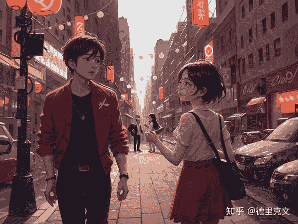

图像中包含了多种信息，例如线条轮廓、表面凹凸等。`ControlNet`插件的工作原理是使用特定的模型提取出特定的图像信息，然后将其输入给AI，引导AI生成图片。可以理解成相当于使用图片作为提示词，用来提高补充控制条件。

## 二.`ControlNet`安装

### 1. 整合包下载

在使用`ControlNet`之前，需要确保正确安装了`Stable Diffusion`和`ControlNet`插件。

在我之前教程提供的整合包已经包含了`controlnet`插件，不需要额外安装。如果没有下载的小伙伴也可以点击这个链接直接下载整合包

[https:// pan.baidu.com/s/1jPqx2](https://link.zhihu.com/?target=https%3A//pan.baidu.com/s/1jPqx2k5L072cda8f4zLQDQ)k 5L072cda8f4zLQDQ  提取码：xoz1

### 2. 其他途径下载：

如果没有下载整合包，可以在`Stable Diffusion WebUI`的扩展界面,点击从网址安装，把网址填到扩展里安装，安装完后记得点击重新启动，网址是： https://github.com/Mikubill/sd-webui-controlnet


也可以选择直接到从Github网址下载进行安装：

[https:// github.com/Mikubill/sd- webui-](https://link.zhihu.com/?target=https%3A//github.com/Mikubill/sd-webui-controlnet/archive/refs/heads/main.zip)controlnet/archive/refs/heads/main.zip  ，然后将相关文件解压到你的电脑上`Stable Diffusion`存放主文件夹里面的`extension`下面

### 3. `ControlNet`模型下载

整合包里已经包含`ControlNet`模型，或者我们也可以直接去

[h](https://link.zhihu.com/?target=https%3A//huggingface.co/lllyasviel/ControlNet-v1-1)ttps:// huggingface.co/lllyasvi el/ControlNet-v1-1

去下载对应的模型，把后缀为`safetensors`的文件下载下来，然后放到

电脑`Stable Diffusion`存放主文件夹/`extension/sd-webui-controlnet/models` 文件夹下即可。

## 三.`ControlNet`模型简要介绍

`ControlNet` 截止至目前最新的版本是1.1，主要有以下模型类型（表格图片为我在网上找到的图片，涵盖了大部分的`ControlNet`模型，但是有些新出来的模型不全），除了下表内容外还有很多新的一些模型插件，包括非常重要的`Tile`模型，以及最近很火的二维码`QR Code`, 后面的章节我将把重要常用的模型进行介绍。

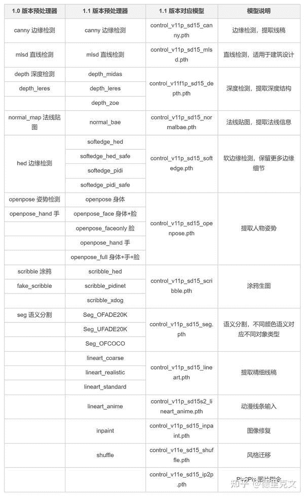

可以看到模型有很多，但是我自己主要应用的其实主要就这几种：`Canny`、`OpenPose`、`Lineart`、`Hed`、`Mlsd`、`Depth`、`Tile`, 接下来我来先把这些模型做一个简要介绍，详细的内容将在具体操作中阐述。

### `Canny`模型

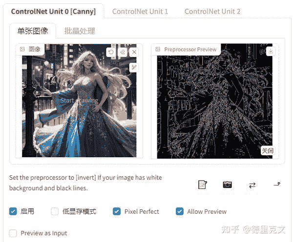

`Canny`模型是一种利用边缘检测的技术，可以从原始图片中提取出线稿，并根据给定的提示词生成与线稿相似的画面。此外，该模型还可以用来给提取出的线稿上色。

### `OpenPose`模型

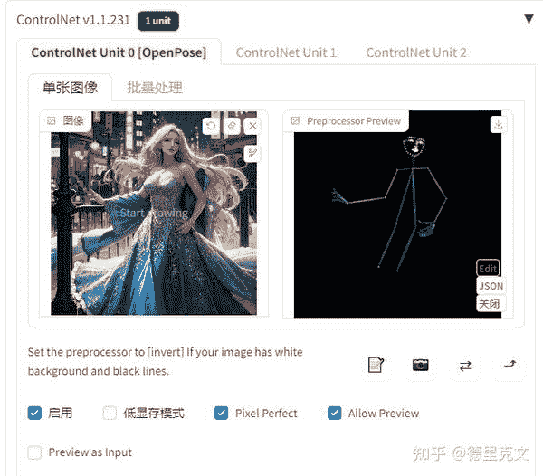

`OpenPose`姿势识别可以实现精确控制人体动作。这项技术不仅可以生成单人的姿势，还可以生成多人的姿势。

这些预处理器都使用了真人素材，因此在生成过程中，使用真人图片是最为适合的选择。`openpose`可以识别身体的姿态，`openposefull`可以识别姿态、手部和脸部，`openposehand`仅对身体的姿态和手部进行识别，`openposefaceonly`仅对脸部进行识别，而`openposeface`可以同时识别身体姿态和脸部。

通过选用不同的预处理器，可以适应不同的需求，实现对动作骨骼中间图的生成。

### `Lineart`模型

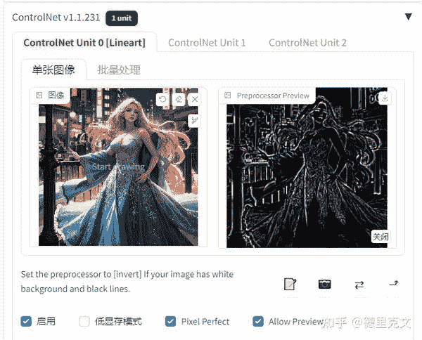

`Lineart`是一种能够提取画线稿的模型，它是`ControlNet1.1`版本中引入的新模型。它能够针对不同类型的图像进行多样化的处理。相比于`Canny`算法，`Lineart`提供了更精细、更丰富的线稿提取效果。

### `HED`模型

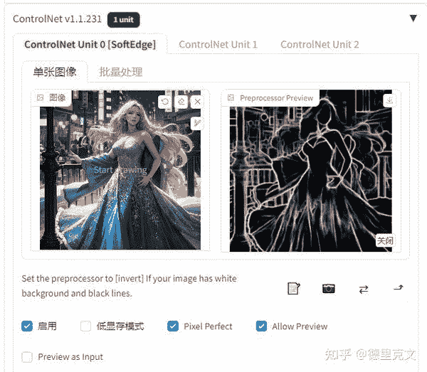

`HED`边界检测方法与`Canny`方法相似，但更具灵活性。`HED`边界检测能够保留输入图像的细节，并突出绘制人物的明暗对比，使轮廓更加鲜明。因此，当需要在保持原有构图的基础上改变画面风格时，`HED`边界检测是一个合适的选择。

### `MLSD`模型

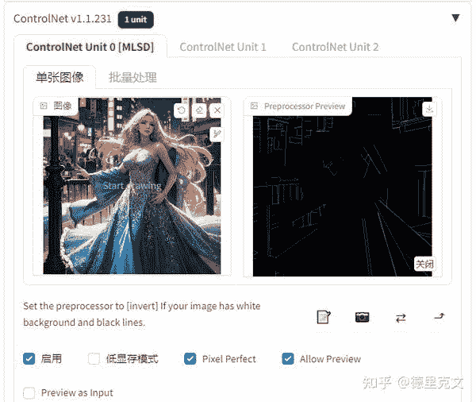

`MLSD`利用对图片线条结构和几何形状的分析，可以实现建筑外框结构的构建，非常适用于建筑、室内设计等领域使用。

### `Depth`模型

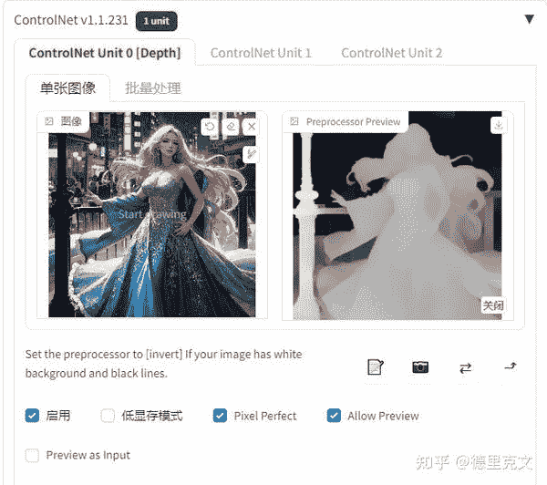

`Depth`利用原始图像中的深度信息，可以生成具有相同深度结构的图像。我们还可以通过使用3D建模软件，例如`SketchUp`，构建一个简单的素模场景，然后通过深度模型渲染出图像。

### `Tile`模型

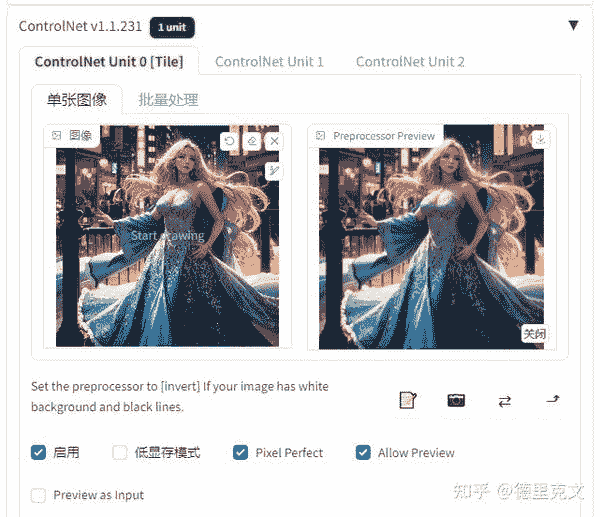

`Tile`模型的应用非常广泛，可以用它来放大图像，也可以用它通过大模型的调整，来对原图进行风格的转换。它的工作原理是将图片的细节进行一定程度的忽略，然后通过添加一些自动生成的细节来生成最终的图片。

### `Scribble`模型

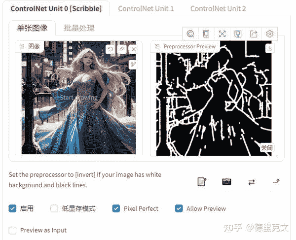

`Scribble`涂鸦成图是一种比较自由的绘图方式，它比`HED`和`Canny`算法具有更高的发挥程度，用这个模型生成的内容会更加富有创意和未知性。它也可以用于对手绘线稿进行着色处理。

### `Normal Map`模型

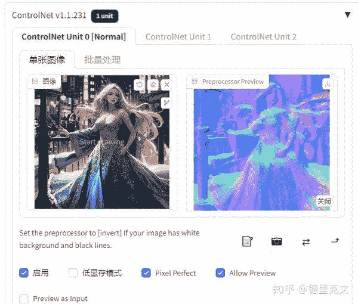

`Normal Map`适用于三维立体图的场景绘制，它通过从用户提供的输入图片中提取出3D物体的法线向量，并利用这些法线向量来绘制一幅新的图像。这幅新图像能够完全还原原始图像的光影效果。

### `Seg`模型

`Seg`通过对原始图像进行语义分割，可以将图像分割为不同的区域，并根据各个区域的语义信息进行画风的改变。这种方法适用于处理大场景的图像。

### `Shuffle`模型

`Shuffle` 模型能够从参考图中提取出其独特的风格，并结合给定的提示词将这种风格迁移到生成的图像上。

### `Inpaint`模型

`Inpaint`在作用上就是局部重绘，但是与图生图中的局部重绘相比，`Inpaint`在将重绘区域与原图进行融合时效果表现得更好，融合更加自然。

其他模型我没有用过，就不再做介绍。

## 四、具体操作

### 1. 界面介绍

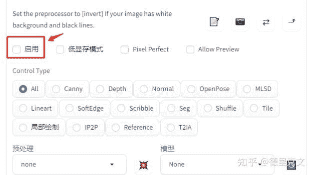

开启: 勾选此选项来开启 `ControlNet`，必须勾选。

低显存模式: 这个选项会让你电脑渲染的速度变慢，主要是为了让硬件配件不足的家用机也可以跑`SD`而不至于内存溢出（我建议显存小于8GB的电脑才勾选，大于8G的机器没必要）。

完美像素(`Pixel Perfect`): `ControlNet` 会根据输入的图像自动匹配合适的预处理器参数，一般可以点上。

预览(`Allow Preview`): 顾名思义就是你上传了图像，进行预处理以后，通过预览可以检查下是否是想要的效果。开启了后，左侧的是你上次的图像，右侧就是进行预处理后的图像，`ControlNet`将根据预处理后的图像和你选择的`Controlnet`模型进行控制。

控制类型(`Control Type`): 就是第三点介绍的不同模型

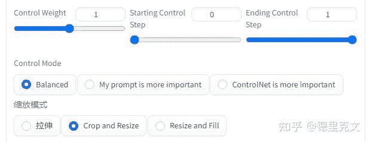

控制权重 (`Control Weight`) : 这个选项是指当你使用 `ControlNet` 生成图片的时候，这个控制模式被应用的权重占比。数字越高代表权重指数越大，控制效果越强。需要注意的是并不是数字越高越好，越高给到AI模型的可操作空间就越小，很可能生成不出好的作品。

引导介入时机 (`Starting Control Step`) : 简单的说就是`ControlNet` 在生成步骤中，什么时候开始介入，例如这个数值设置为 0 即代表`ControlNet`模型控制是从一开始时就介入，如果设置为 0.5 时即代表 图像渲染到50% 步数的时候，`ControlNet` 才开始正式介入计算。

引导退出时机( `Ending Control Step`): 和引导介入时机对应，如果设置为1，表示`ControlNet`模型控制会一直介入直到渲染结束，如果设置为 0.8 时就意味着到80%的时候，画面将不再受到`ControlNet`模型的控制。

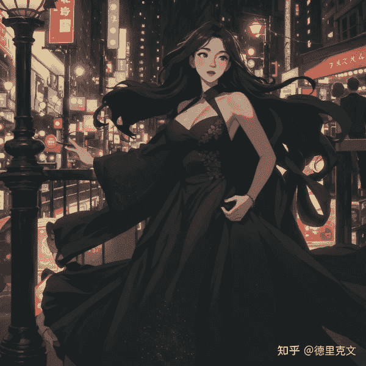

控制模式 (`Control Mode`) : 3 个选项分别是平衡、提示词更重要、控制网更重要，一般情况下我们选择平衡，当主要靠`Controlnet`控制图像的时候可以选择控制网更重要。

缩放模式：分别是拉伸、裁减并重新调整尺寸，填充并调整尺寸，提供了调整 `ControlNet` 大小和上传图像的纵横比。

拉伸: 不保留纵横比的情况下，改变 `CntrolNet` 图像的大小以匹配 `Txt2Img` 设置的宽度和高度。这包括拉伸或压缩图像以适应指定的尺寸

裁减并重新调整尺寸（`Crop and Resize`）: 调整 `ControlNet` 图像的大小以适应 `Txt2Image` 的尺寸

填充并调整尺寸(`Resize and fill`): 调整 `Txt2Image` 的大小以适应 `ControlNet` 图像的尺寸。画布宽度 和 画布高度:它会调整空白画布的大小来进行绘制，不会影响上传的原始图像.

### 2. `ControlNet`单模型应用

接下来我采用`lineart`边缘检测举例，模式选择文生图，给大家做一个演示。例如我想生成一个芭蕾舞演员，我先去网上找了一张颇有美感，但是像素不足的图片，接下来我来演示怎么用`ControlNet`可控的生成多样高清的芭蕾舞演员。

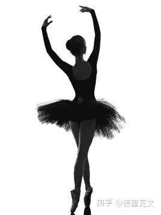

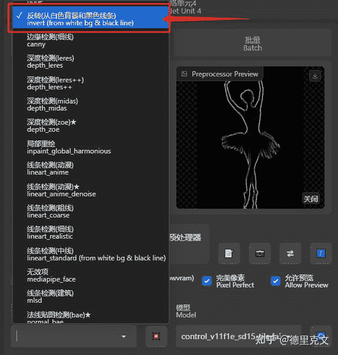

颜色反转(`Invert`): 把底图中的黑色和白色交换。这个选项最主要的用途是，当你上传手绘的白底黑线的线稿图的时候，可以通过颜色反转来进行处理，因为`ControlNet` 的控制默认是需要黑色为背景，控制线条是白色的，如果你是直接在操作界面画的，就不用管他。

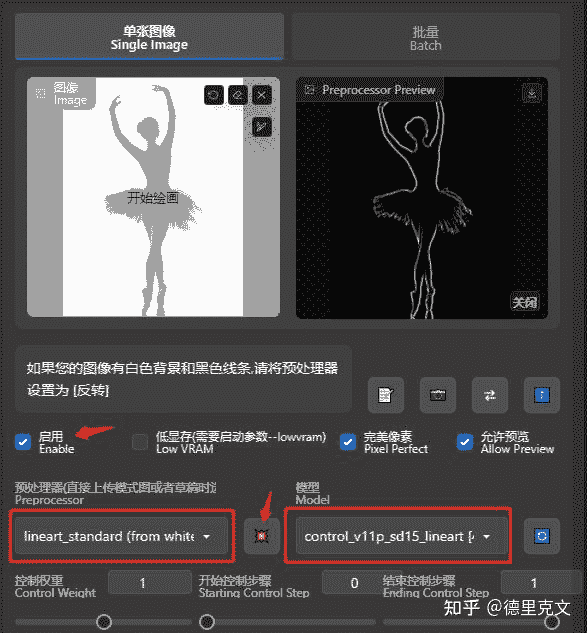

常规情况下我们选择`Standard`标准模式，本次由于我希望生成的是更具有动漫效果的感受，所以最后我选择了`Lineart_Anime`。这个根据自己想要的效果进行选择就好

然后控制权重选择1，开始步骤0，结束控制步骤1。然后输入提示词。

在这个图片中，我希望生成的是一个芭蕾舞演员，我的提示词是:

```
masterpiece, best quality, 1girl, ballerina, solo, ballet, tutu, ballet slippers, arms up, monochrome, white background, simple background, greyscale, full body, short hair, dress, from behind, dancing, tiptoes, standing, pantyhose, leotard,Vivid Colors, (EOS R8, 50mm, F1.2, 8K, RAW photo:1.2), physically-based rendering, sharp focus, extremely detailed CG unity 8k wallpaper, best quality, Amazing, finely detail, cinematic lighting, RAW Photo, 8k Ultra HD, SLR, High Quality, 8k, intricate detail, reality, realistic light, reality, photo reality, Deconstruction, masterpiece, extremely detailed CG unity 8k wallpaper, best quality, Amazing, finely detail, cinematic lighting, RAW Photo, 8k Ultra HD, SLR, High Quality, 8k, intricate detail, reality, realistic light, reality, photo reality, &lt;lora:add_detail:1&gt;, &lt;lora:FilmG4:1&gt;, 
```

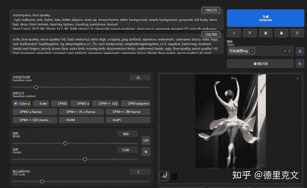

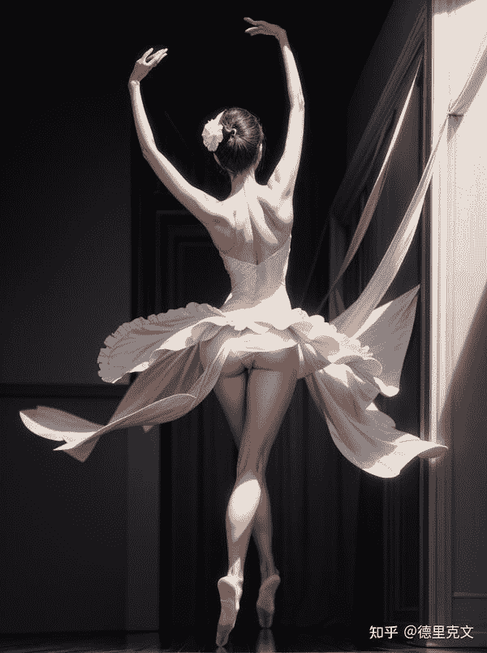

画面就生成好了，但是可以看到还是有比较多的缺陷，包括手指以及裙子生成并不是我们想要的结果，那怎么办办呢？我们可以增加`ControlNet`数量。

### 3. `ControlNet`多模型应用

在控制网络单元1中，我们继续增加插件，这次我选择用`Openpose`进行姿态检测，识别手指

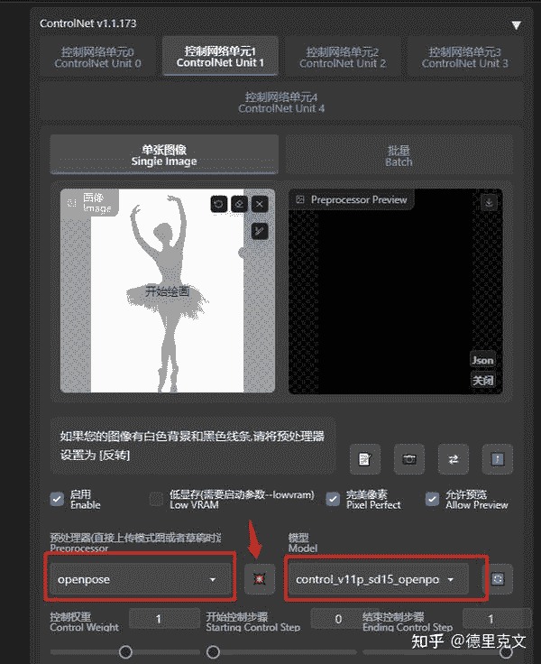

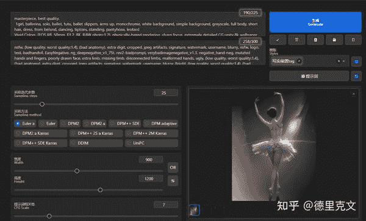

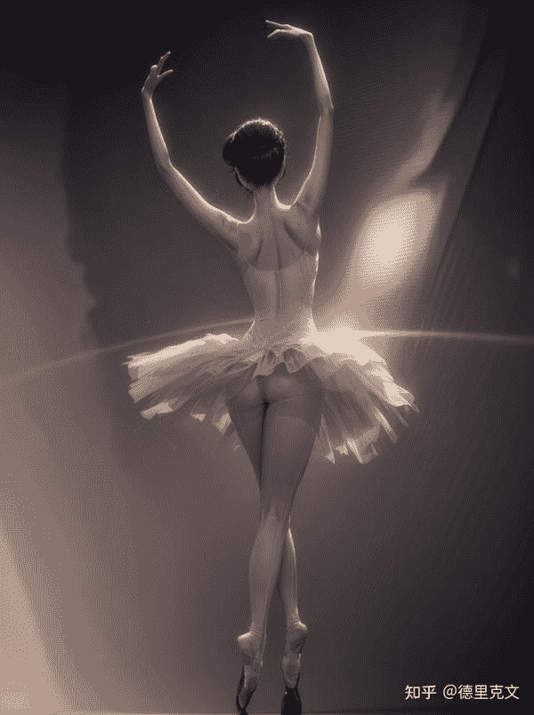

可以看到，手指体态已经被修改正确了。


# 如果我想让生成的图像与原作更加接近，应该怎么做呢？

我们还可以再增加控制网3，为了让颜色和整体感觉更为接近，我启用了Tile模型

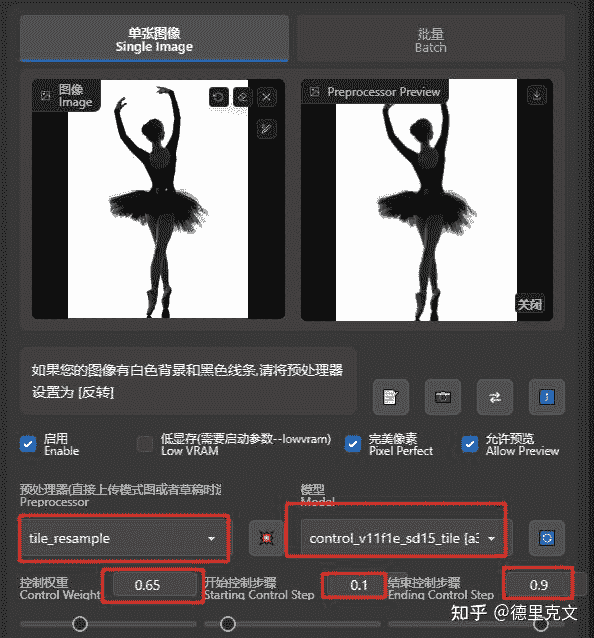

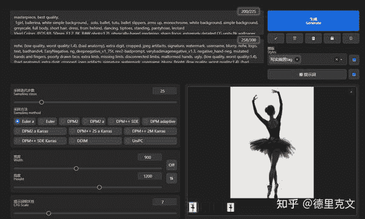

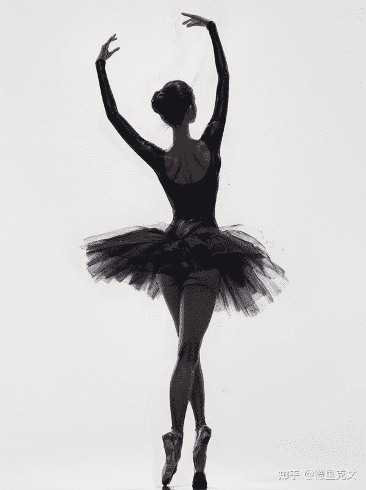

怎么样，在几个控制网的作用下，对原作进行了各种诠释，通过对ControlNet的学习，我们能够更加好的控制画面效果，在成图后，只需要通过Photo Shop进行简单的后期调整即可出图。

下一篇文章我们将学习图生图功能以及各种插件的应用，想要了解学习AI绘画，请继续关注我的作品吧。

---

我是 [德里克文 ](https://www.zhihu.com/search?q=%E5%BE%B7%E9%87%8C%E5%85%8B%E6%96%87&search_source=Entity&hybrid_search_source=Entity&hybrid_search_extra=%7B%22sourceType%22%3A%22answer%22%2C%22sourceId%22%3A3120995466%7D)，一个对AI绘画，人工智能有强烈兴趣，从业多年的室内设计师！如果对我的文章内容感兴趣，请帮忙关注点赞收藏，谢谢！
