# AI绘画生成视频——Stable Diffusion插件Deforum动画大师教程

> 来源：[https://agijuejin.feishu.cn/docx/LcbtdE6wsoYRvlxnaVwco5Bxn5e](https://agijuejin.feishu.cn/docx/LcbtdE6wsoYRvlxnaVwco5Bxn5e)

> 作者：德里克文

> 原文：[https://zhuanlan.z](https://zhuanlan.zhihu.com/p/685099575)hihu.com/p/685099...

想知道如何采用AI绘画工具来制作下面这张变换场景的动画视频吗?

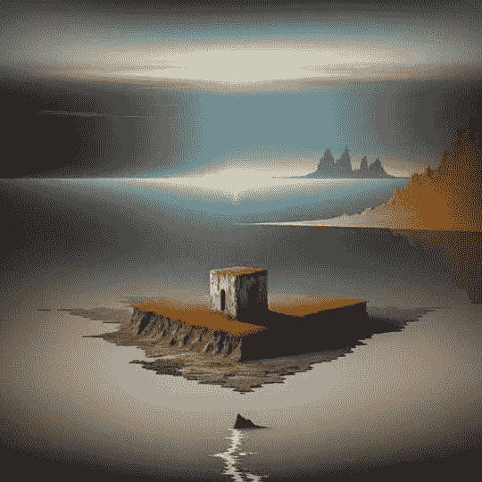

[d142068e-d9f1-11ee-b9dd-d246a47ad65d-v8_f2_t1_50EX40dc.mp4](https://internal-api-drive-stream.feishu.cn/space/api/box/stream/download/all/BxajbMp9roBOvhxwPincxhGNnXf)

Sora的公布，让大众对AI生成视频的能力有了一个极高的期待。但是Sora的公开测试还没有任何消息，而且从公布的视频来看都是属于文生视频的做法，对于精确控制的能力不知能达到什么程度。

要知道要形成工作中能用的工具，对于具体内容的精确控制是非常重要的，在此之前，让我们关注下目前能够进行精确控制并实际应用的工具。

那么如何采用AI绘画软件来制作动态的视频画面呢？让我来介绍下Stable Diffusion里面的一个插件Defoum（动画大师）效果。

## 一、Deforum插件介绍

Stable Diffusion的Deforum插件，这是一个运用了稳定扩散技术的动画制作工具，能依赖于文字描述或者参照视频，生成一系列连续的图像，并且将这些图像无缝拼接为视频。

[8d29ed62-d9f7-11ee-89ad-0e801389f6a4-v8_f2_t1_0rvRq9KP.mp4](https://internal-api-drive-stream.feishu.cn/space/api/box/stream/download/all/HCfbbrq2roPcCzx2CMycdyXJneb)

这个插件所应用的"image-to-image function"技术，能微调图像帧，并采用稳定扩散的方法来产生接下去的一帧。正因为帧与帧之间的变化非常细微，从而带来了流畅的视频播放体验。

而关于Stable Diffusion，Stable Diffusion是一种基于深度学习的文本到图像生成模型，于2022年发布。它能够根据文本描述生成详细的图像，同时也可以应用于其他任务，例如图生图，生成简短视频等。

Stable Diffusion Web UI是一个基于Web的用户界面，用于使用Stable Diffusion进行图像生成和其他任务。该Web UI由AUTOMATIC1111开发，并开源上传至Github，也是目前使用最多的WebUI版本。

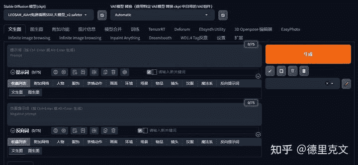

Stable Diffusion Web UI提供了易于使用的图形界面，可以帮助用户更直观地了解和使用Stable Diffusion的功能，并在基本不需要编写代码的情况下启动和监视训练过程。

## 二、实操教程

### 1.操作界面

在进入操作界面后，我们选择插件栏的Deforum。

然后进入界面进行设置，主要需要设置的就是采样器、采样迭代步数、宽度、高度以及输出目录（Batch name），其他保持默认就可以了。

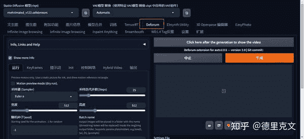

采样器建议可以采用Euler a或者DDIM加快速度，选其他也没关系，不同采样风格而已，可以自己实验

几个主要的区别我也列出来：

Euler(基础采样，适合范围广)、DDIM(加速采样，生成速度较快)、Euler a(生成结果多样性)、Dpm 2 M Karras(适合二次元风格)、Dpm Sde Karras(增强颜色与光影)

采样迭代步数一般在20~30之间，建议设置25就可以，步数越多时间越长，效果也会更好一些。

宽度高度根据自己想要的出图尺寸自己设置。

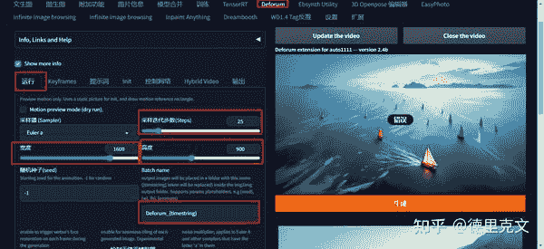

输出目录（Batch name）建议保持默认，这样方便找，就是做出视频后存放的地方。

接下来是关键帧（Keyframes）,我建议新手先从2D图像开始做起，保持默认就好，下面的坐标都是

最大帧（Max frames）数量调整根据想要的时间调节，如果每秒20帧，8秒就是160帧。

然后下面有一个画面强度表（Strength schedule），这个我在提示词准备再说，先保持默认。

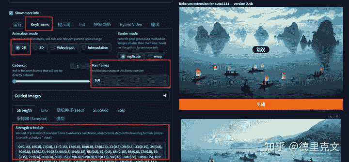

在输出这一栏FPS里面就是每秒的帧数了，通常我们设置15~45帧，帧数越多要渲染的图越多，花的时间越长，不过图片之间的链接也会更加丝滑。

另外建议打开删除图片（Delete Imges）这样可以节约显存。

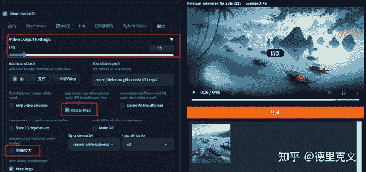

图像放大可以根据自己需求，放大后会占用较大显存。

### 2.提示词处理

接下来我们来设置提示词，我建议可以采用Boogie进行辅助生成deforum参数，网址：

[Boogie](https://link.zhihu.com/?target=https%3A//lewington-pitsos.github.io/tools/boogie.html)

进入这个界面后，根据你实际的关键帧，设置同样的内容，然后放入你想要做的提示词

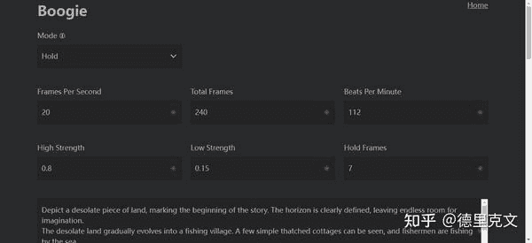

千万记得如果要做分镜处理，需要在提示词那里回车，这样才能区分不同的分镜，下面就是输出结果，直接拷贝就可以。

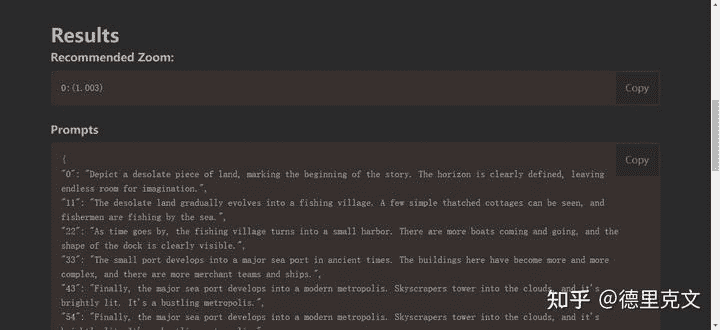

将Prompts拷贝回SD界面的提示词板块，整个替换。

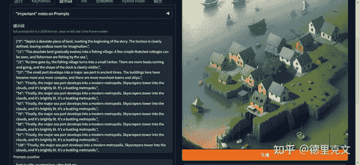

然后回到Boogie界面，将最后的Strengths内容拷贝。

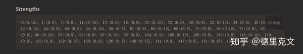

复制到SD界面

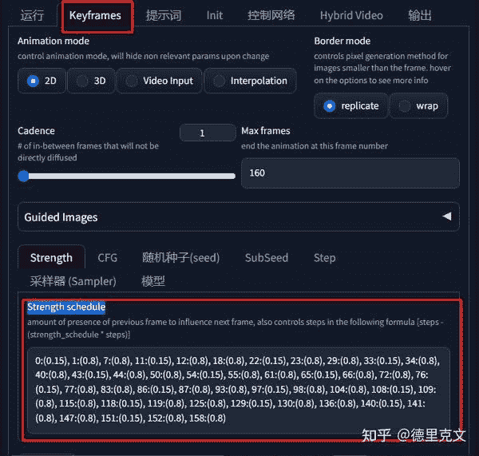

准备好提示词后，复制到画面强度表（Strength schedule）。

这些工作准备完了后，你就可以直接开始渲染试试效果啦！

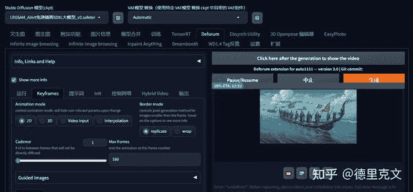

三、云平台介绍

说完了Deforum的操作，可以看到想要制作流畅画面效果好的视频，需要高清的图片分辨率和尽可能流畅的帧数，如果自己的电脑配置不够的话，是没办法做出好看的视频的。

如果有小伙伴本地硬件不够，又想用4090、3090、A100资源的云端资源来出图或视频的话

给大家推荐一个我自己一直在用的：揽睿星舟

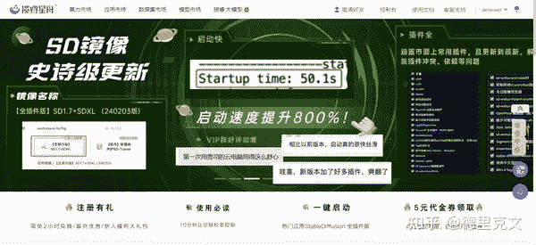

之前我用的很多云平台，操作繁琐而且插件不全，如果要自己额外安装插件的话非常折腾。而揽睿星舟的镜向插件齐全，一键部署非常方便，还带白嫖的在线时长，可谓非常优秀，下面我就分享给大家这个好用的产品吧。

我对比了包括之前我使用的云平台，这个平台可谓是一个宝藏，推荐的理由主要有以下几点：

1、【久】数据持久化：和别家不一样，不会因为你之前用的资源被租了，你的部署和数据都没了，只能排队或者痛苦地再部署或者解决一遍报错。这家持久化做的很不错，好评！

2、【爽】官方镜像优秀：我见过最用心的官方镜像，有和秋叶大佬等合作的镜像，SD全插件版，一个云平台还维持2周一次的更新频率，帮大家解决了各种环境部署的疑难杂症。也支持自由部署插件和模型。炼丹镜像、ComfyUI一应俱全

3、【省】用我的链接注册可以免费体验3090 2小时，加他们客服完成部署后，再多2小时4090免费！平时活动多多，自己买一套3090的钱能在平台上玩10年！

真的所言非虚，下面我就来教大家如何白嫖如此优秀的云平台，

首先进行注册，然后注意在邀请码一栏填上白嫖邀请码9071，系统就会免费赠送3.8元（充值3.8元-3.8元券一张），也就是2小时，即可免费白嫖之旅。

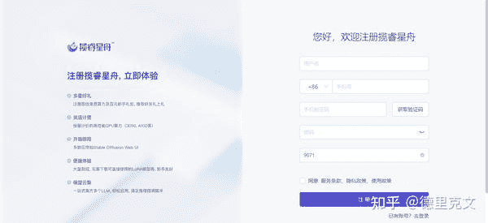

进入界面，点击右上角用户名边上的小箭头，在下拉菜单中选择充值

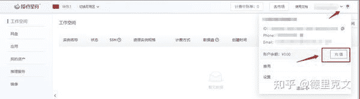

进入充值界面，可以看到刚刚我们填写的邀请码里面送了一个新人专享券，点击3.8元的专享券，充值金额选择其他金额，想要白嫖就填写3.8元，然后点确定0元支付即可白嫖。

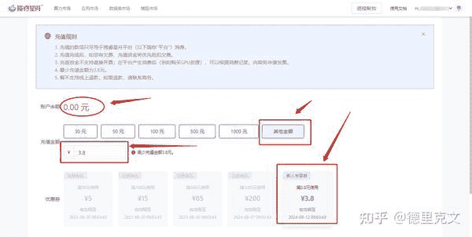

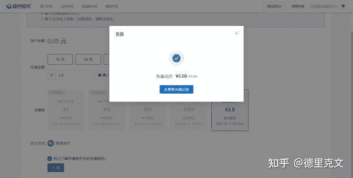

好了，基础工作已经做好，现在让我们开启超强显卡3090的SDXL运行之旅吧！

回到刚刚的“控制台”操作界面，然后点击“创建工作空间”。

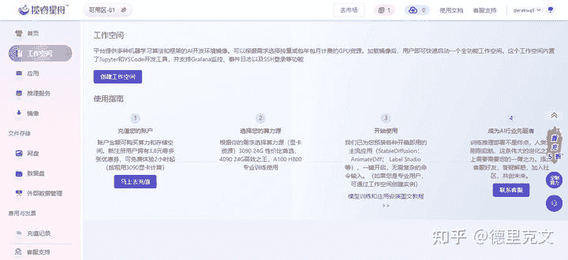

接下来创建属于具体的云平台，根据下列图片教程选择即可。

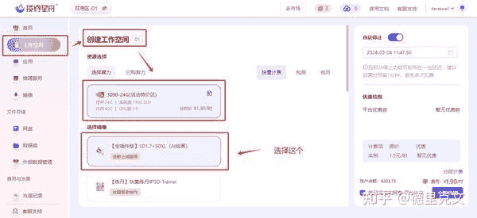

工作空间可以选择WEBUI或者ComfyUI，我这里以WEBUI举例，建议选择自启动，数据集和模型要选择设置，另外可以设置下自动停止时间，避免忘记关闭欠费。

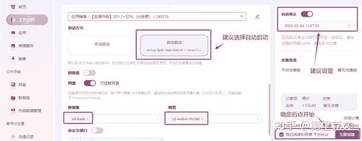

名称就用默认的名称即可，然后运行环境镜像，数据集选择sd-base，模型选择sd-webui-model，点击“立即创建"。

这样属于自己的云端SD平台已经创造好了（相当于配置了一台装了Stable Diffusion的电脑），等待几分钟让云系统创建完毕即可。

等到状态从启动中变成运行中，大概等个5分钟，点击“打开调试地址”打开就好

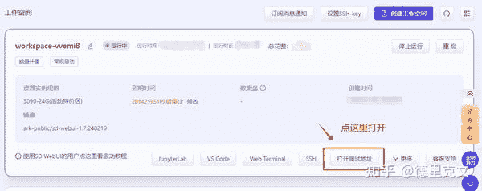

进入后如果可以看到这个界面，就代表启动成功了。

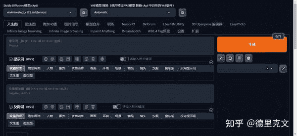

而如果你没有选择自动启动，或者想看云空间保存的内容，我们需要打开JupyterLab这个按钮

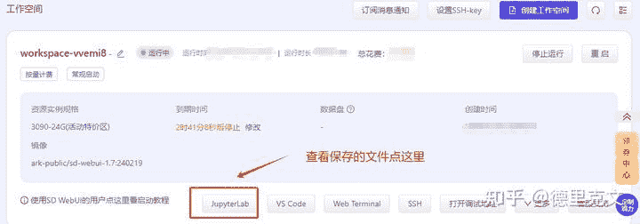

然后在进入界面后，选择这里。

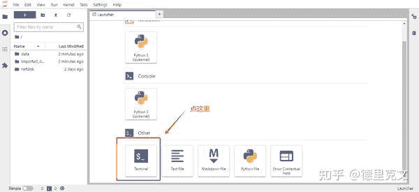

根据提示输入命令：

bash /app/start.sh --skip-prepare-environment

然后按回车就会开启配置，等一会打开调试地址就可以进入网页界面了

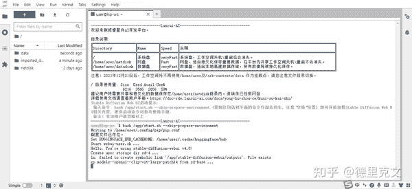

从左侧的目录中找到OUTPUTS，里面就是云平台生成的内容存档啦。

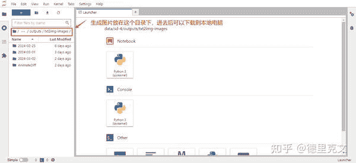

## 结语

怎么样，小伙伴们学会怎么用SD来制作简单的动画场景视频了吗？

---

我是 [德里克文 ](https://www.zhihu.com/search?q=%E5%BE%B7%E9%87%8C%E5%85%8B%E6%96%87&search_source=Entity&hybrid_search_source=Entity&hybrid_search_extra=%7B%22sourceType%22%3A%22answer%22%2C%22sourceId%22%3A3162454823%7D)[，一个对AI](https://www.zhihu.com/search?q=%E5%AE%A4%E5%86%85%E8%AE%BE%E8%AE%A1%E5%B8%88&search_source=Entity&hybrid_search_source=Entity&hybrid_search_extra=%7B%22sourceType%22%3A%22answer%22%2C%22sourceId%22%3A3161270553%7D)绘画，人工智能有强烈兴趣，从业多年的 室内设计师 ！如果对我的文章内容感兴趣，请帮忙关注点赞收藏，谢谢！