# AI作画，如何生成远看时看着与垫图相似，实则完全不同的画？(例如，各种抽象版cxk)?

> 来源：[https://agijuejin.feishu.cn/docx/Q84rdkUASogpyNxlgNZclzgmn6g](https://agijuejin.feishu.cn/docx/Q84rdkUASogpyNxlgNZclzgmn6g)

> 作者：德里克文

> 原文：[https://www.zhihu.](https://www.zhihu.com/question/614324100/answer/3142558941)com/question/6143...

使用Stable Diffusion不难实现，首先我来展示下效果(一次看个够)：

## 一、图片展示(仔细看系列）

### 1.钢铁侠

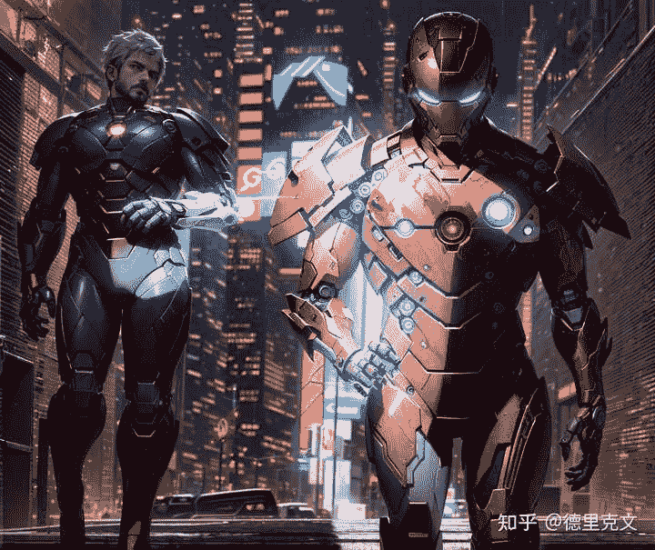

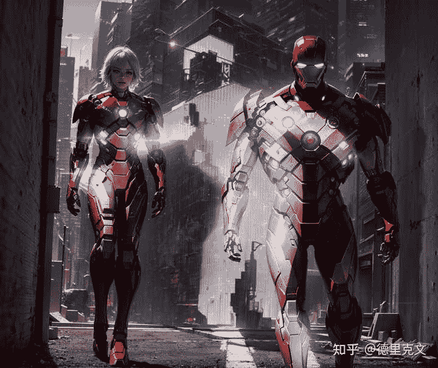

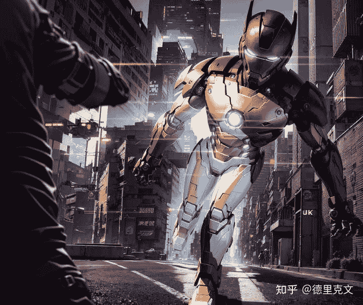

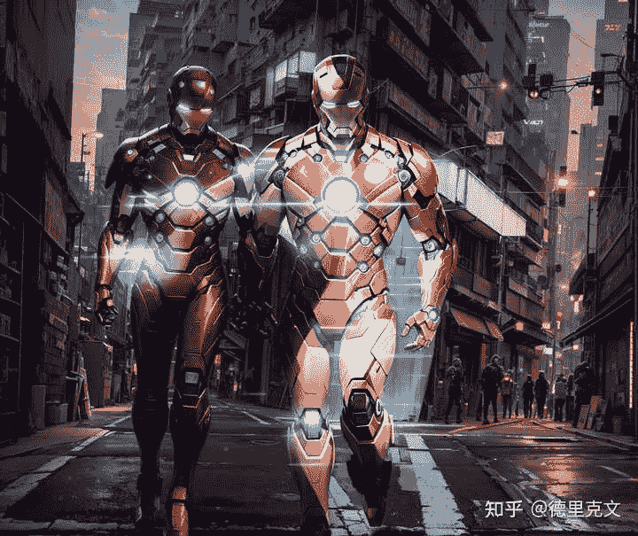

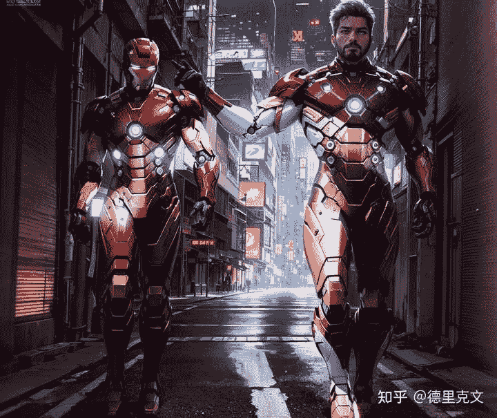

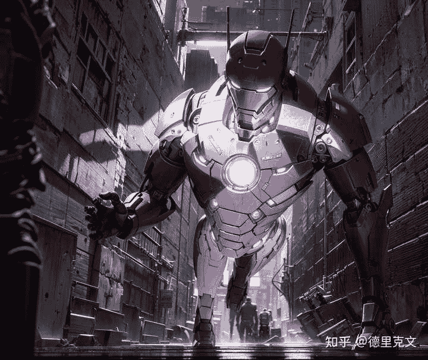

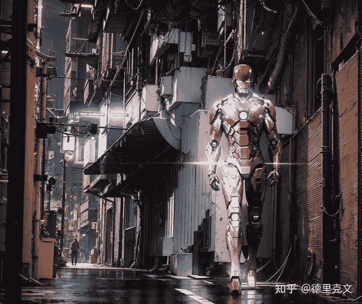

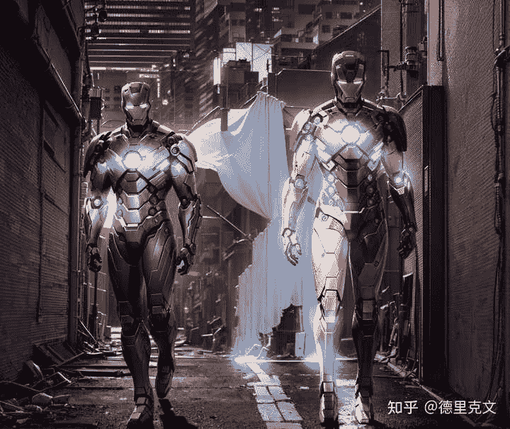

这些图片的Prompt是：

```
1 iron man, Best quality, masterpiece, ultra high res, (photorealistic:1.4), city lights, raw photo, cyberpunk edgerunners, solo, (cyberpunk\), looking at viewer, full body, ((masterpiece)), cyberpunk, neon trim, street, white hair, 8k uhd, dslr, soft lighting, high quality, film grain, photorealistic, dark studio, rim lighting, two tone lighting, (high detailed skin:1.2), 8k uhd, dslr, soft lighting, high quality, volumetric lighting, candid, Photograph, high resolution, 4k, 8k, Bokeh, mecha musume, mecha musume, mechanical parts, robot joints, headgear, full armor, :1&gt;, masterpiece, best quality, masterpiece, best quality, &lt;lora:服饰LoRA:Mecha:1&gt;, &lt;lora:A-Mecha-REN(color_theme:0.9524), masterpiece,extremely detailed CG unity 8k wallpaper,best quality,Amazing,finely detail,cinematic lighting,RAW Photo, 8k Ultra HD, SLR, High Quality,8k, intricate detail, reality,realistic light, reality, photo reality, Deconstruction,Without humans,, masterpiece,extremely detailed CG unity 8k wallpaper,best quality,Amazing,finely detail,cinematic lighting,RAW Photo, 8k Ultra HD, SLR, High Quality,8k, intricate detail, reality,realistic light, reality, photo reality, &lt;lora:add_detail:1&gt; , lens  flare, Cinematic  Lighting
```

### 2.城堡

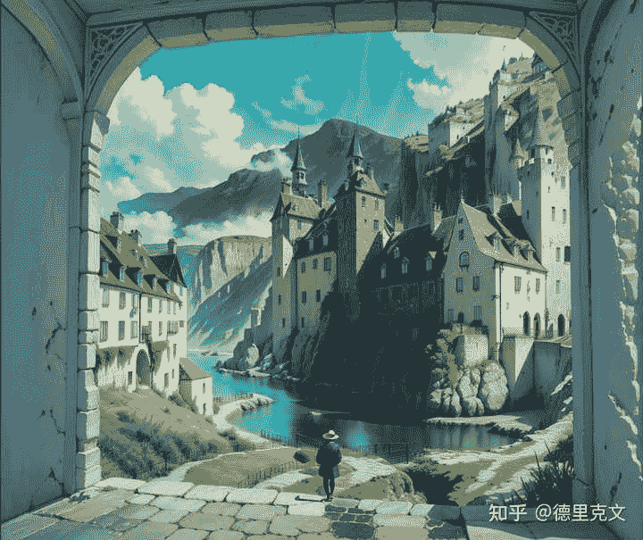

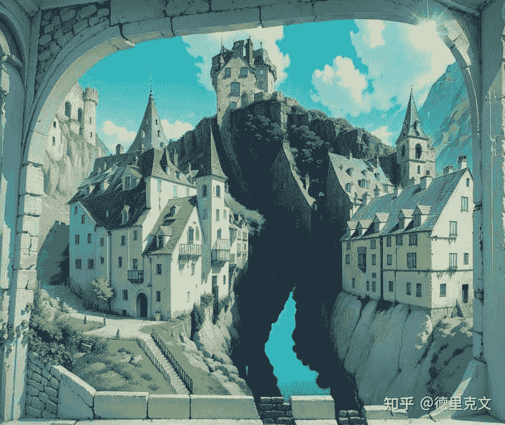

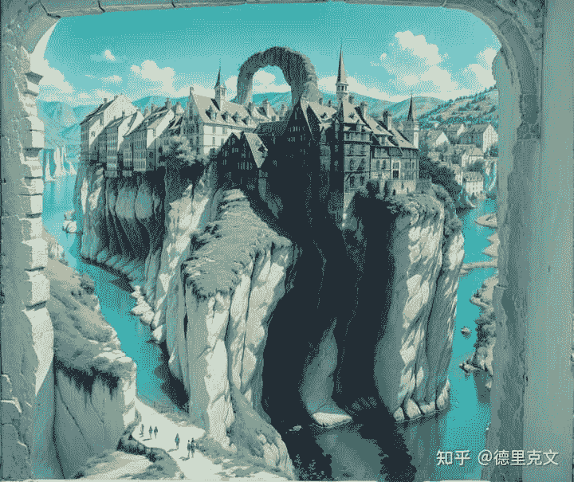

Prompt是：

```
Winding river valleys, steep cliffs, verdant vineyards, historic castles, picturesque landscapes, charming villages, BREAK,Comfortable clothing, walking shoes, light jacket, hat, sunglasses, sunscreen,pixel art, (intricate details:1.12), hdr, (intricate details, hyperdetailed:1.15), (natural skin texture, hyperrealism, soft light, sharp:1.2), game art, key visual, surreal，&lt;lora:画风LoRA：GhibliStyle:1&gt;, masterpiece,extremely detailed CG unity 8k wallpaper,best quality,Amazing,finely detail,cinematic lighting,RAW Photo, 8k Ultra HD, SLR, High Quality,8k, intricate detail, reality,realistic light, reality, photo reality, Deconstruction,Without humans,, masterpiece,best quality,
```

### 3. 崇山峻岭

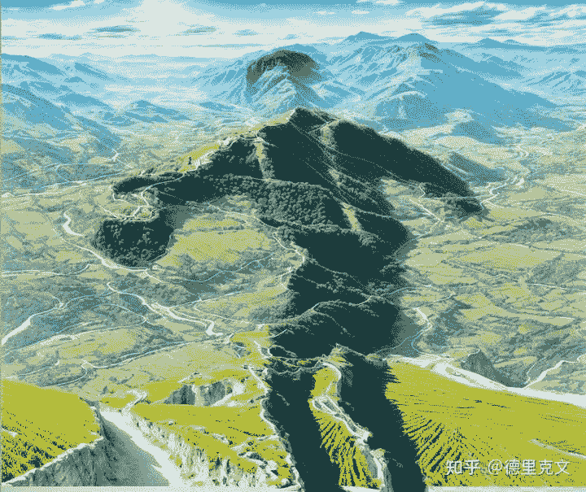

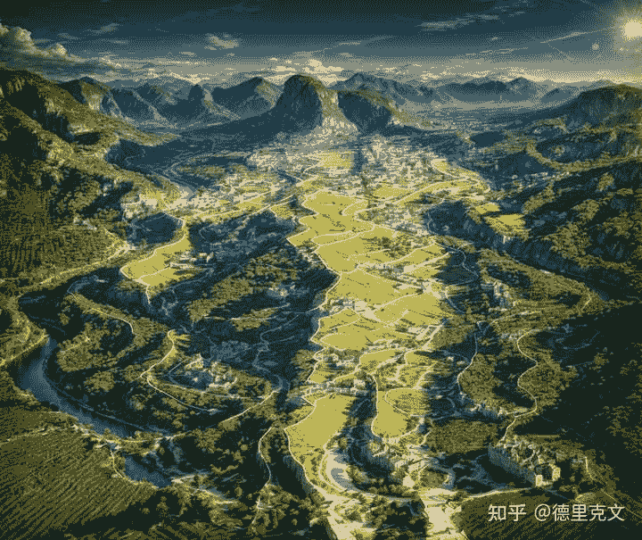

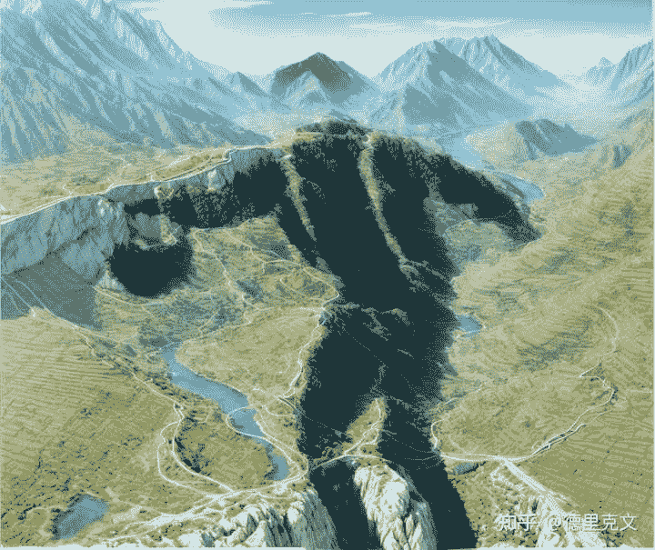

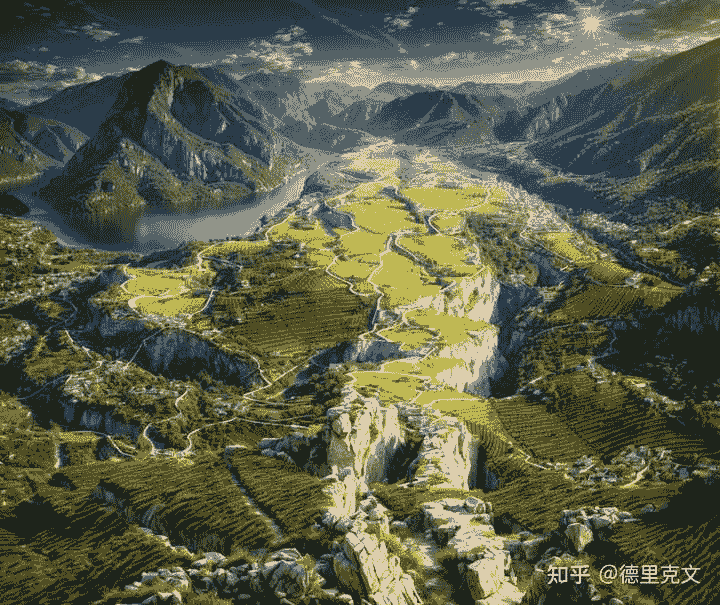

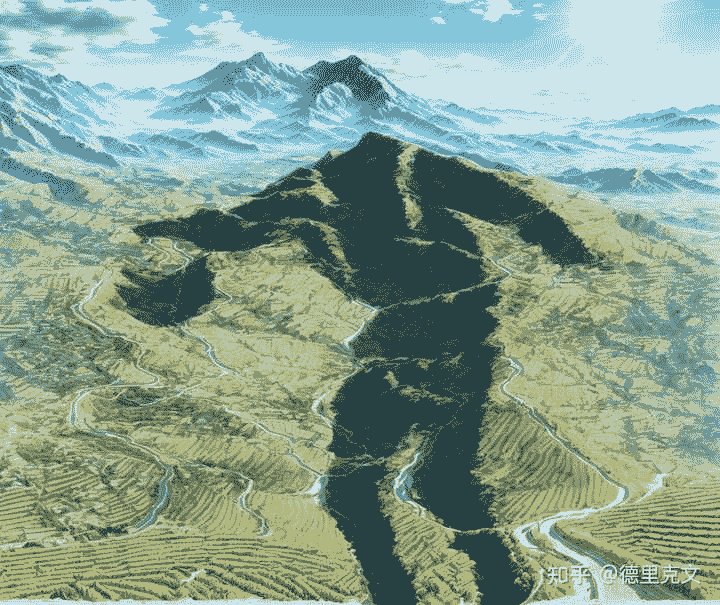

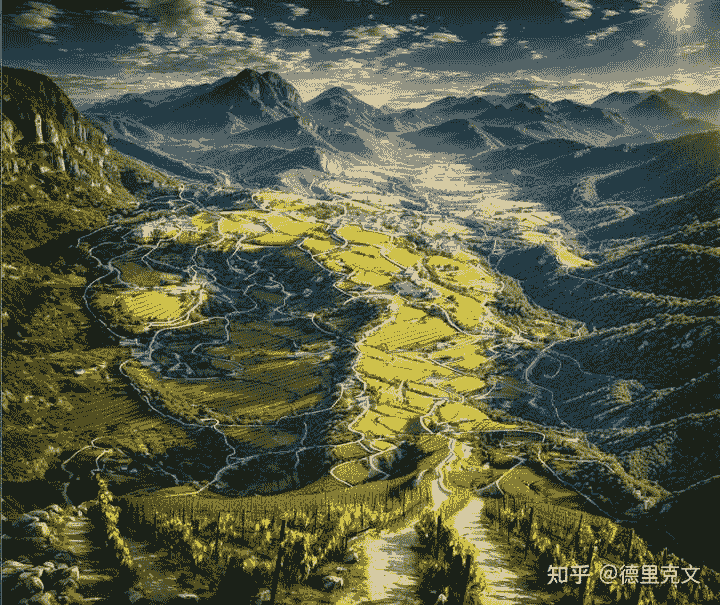

除了上面的图片，还有另外一种玩法，你觉得怎么样：

##  二、图片展示(不言而喻系列)

### 1. [时空转移](https://www.zhihu.com/search?q=%E6%97%B6%E7%A9%BA%E8%BD%AC%E7%A7%BB&search_source=Entity&hybrid_search_source=Entity&hybrid_search_extra=%7B%22sourceType%22%3A%22answer%22%2C%22sourceId%22%3A3142558941%7D)

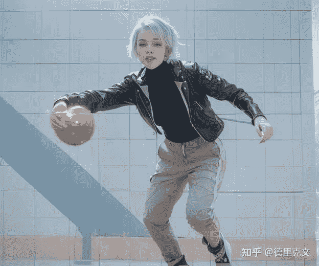

### 2.像素世界

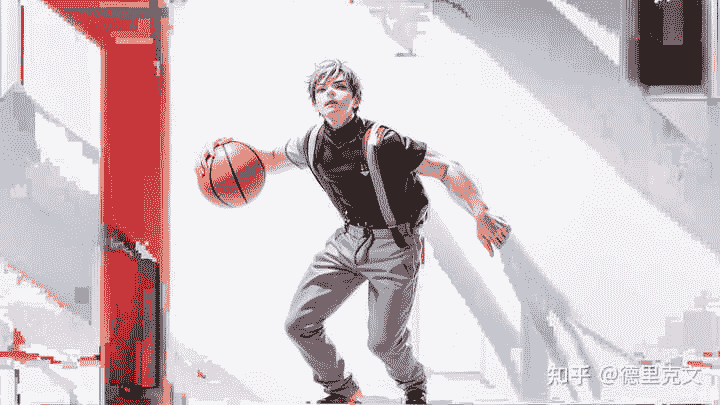

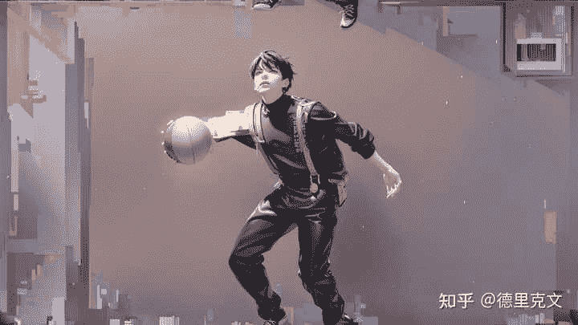

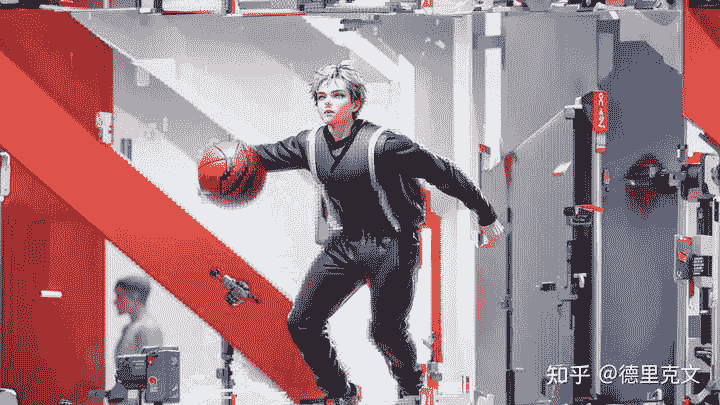

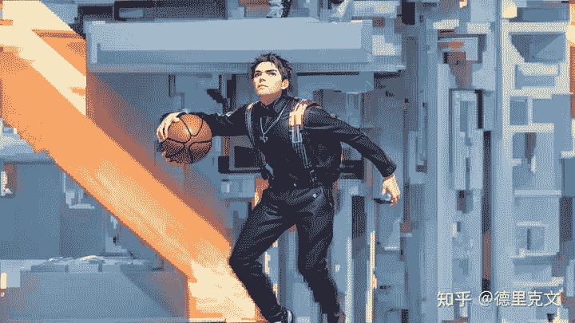

### 3.多彩世界

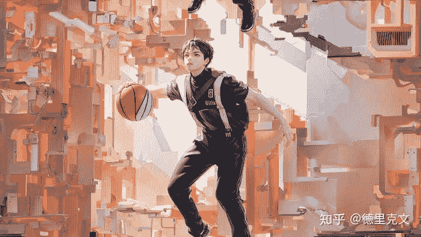

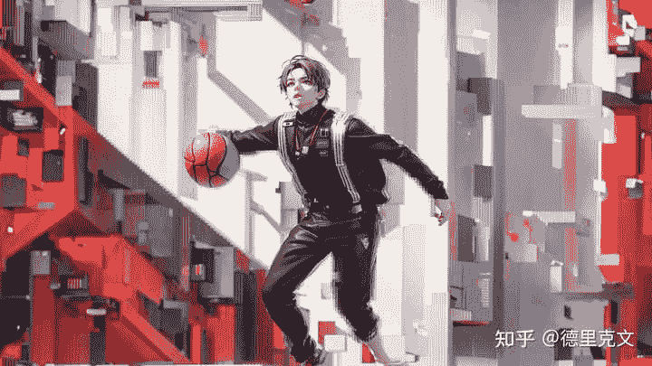

### 4.认真打球系列

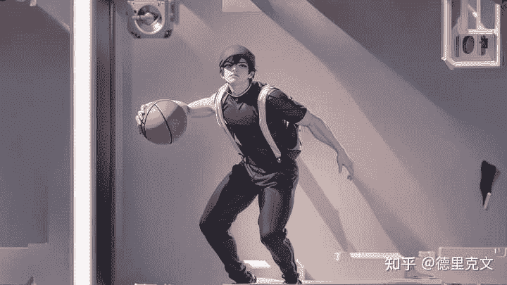

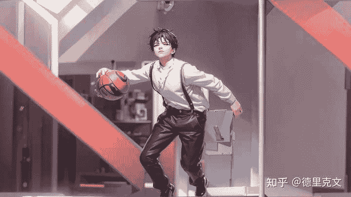

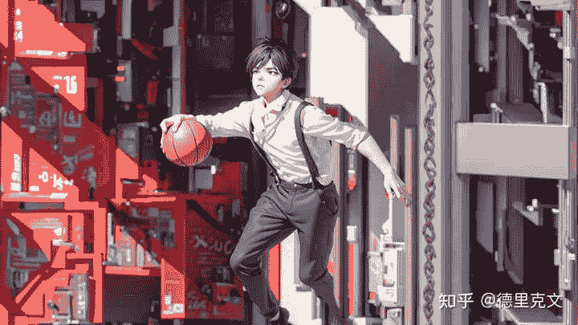

## 制作原理

[这个并](https://www.zhihu.com/search?q=%E6%8F%92%E4%BB%B6&search_source=Entity&hybrid_search_source=Entity&hybrid_search_extra=%7B%22sourceType%22%3A%22answer%22%2C%22sourceId%22%3A3142558941%7D)不复杂，生成原理挺简单的，就是通过Controlnet 插件 的Tile模型进行实现，关键步骤不在于Prompt，而在于Controlnet的应用，这个原理类似于我之前写的利用文字嵌入的文章，感兴趣可以点击查看：

[  ](https://zhuanlan.zhihu.com/p/643811027)

如果对于Stable Diffusion的操作不太熟悉，需要从头入门的新手，也可以查看下我这个教程哦：

[  ](https://zhuanlan.zhihu.com/p/645820130)

如果觉得好玩的话，记得点赞收藏哦~！

---

我是 [德里克文 ](https://www.zhihu.com/search?q=%E5%BE%B7%E9%87%8C%E5%85%8B%E6%96%87&search_source=Entity&hybrid_search_source=Entity&hybrid_search_extra=%7B%22sourceType%22%3A%22answer%22%2C%22sourceId%22%3A3120995466%7D)，一个对AI绘画，人工智能有强烈兴趣，从业多年的室内设计师！如果对我的文章内容感兴趣，请帮忙关注点赞收藏，谢谢！