# 如何使用Ai绘画辅助创作？

> 来源：[https://agijuejin.feishu.cn/docx/I9Sud3GmxoihaPxTE61cGNHznDe](https://agijuejin.feishu.cn/docx/I9Sud3GmxoihaPxTE61cGNHznDe)

> 作者：德里克文

> 原文：[https://www.zhihu.](https://www.zhihu.com/question/585120068/answer/3110744963)com/question/5851...

有很多和答主一样的人，其实对的AI绘画对动画和漫画创作情有独钟，但是也并非一定要去学习专业的AI绘画软件，只想用最快捷方便的方法，来进行生成质量不算差的漫画甚至动画，我建议可以先收藏我这篇文章，从简单起步，慢慢有兴趣了再进行进阶。

## 起步建议

[首先我建议](https://www.zhihu.com/search?q=%E6%96%87%E5%BF%83%E4%B8%80%E6%A0%BC&search_source=Entity&hybrid_search_source=Entity&hybrid_search_extra=%7B%22sourceType%22%3A%22answer%22%2C%22sourceId%22%3A3110744963%7D)[的是起步](https://www.zhihu.com/search?q=%E5%A4%9A%E6%A8%A1%E6%80%81&search_source=Entity&hybrid_search_source=Entity&hybrid_search_extra=%7B%22sourceType%22%3A%22answer%22%2C%22sourceId%22%3A3110744963%7D)用国内的平替软件，我知道的包括有 文心一格 、无界AI、6Pen、Vega AI等等众多的平替，而且很多 多模态 的AI工具也可以生成。采用中文的形式简单的实现绘制，我就以🛰️头像的绘制为例，开展说明。

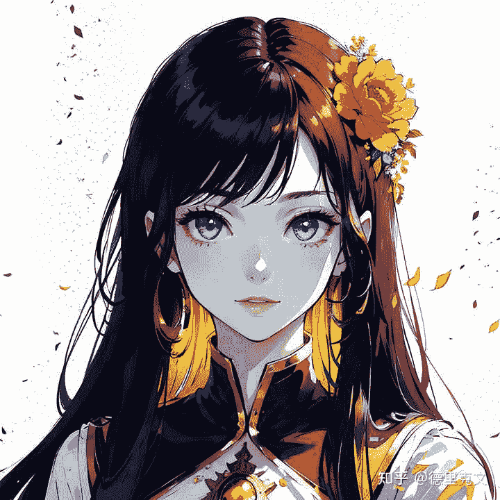

## 简笔画生成漫画方法

如果想要进一步进阶，做到“是否可以用one一样的原画，生成质量不算差的漫画甚至动画？”是完全可以的，通过Stable Diffusion里面的Controlnet和MOV2MOV可以实现，但是这属于进阶的内容，我将在后续我的文章中进行说明怎么操作，如果想了解的话可以关注下我的账户。

## 入门级🛰️ [头像制作 ](https://www.zhihu.com/search?q=%E5%A4%B4%E5%83%8F%E5%88%B6%E4%BD%9C&search_source=Entity&hybrid_search_source=Entity&hybrid_search_extra=%7B%22sourceType%22%3A%22answer%22%2C%22sourceId%22%3A3110744963%7D)方法

我[这里就撰写](https://www.zhihu.com/search?q=%E6%96%87%E5%BF%83%E4%B8%80%E8%A8%80&search_source=Entity&hybrid_search_source=Entity&hybrid_search_extra=%7B%22sourceType%22%3A%22answer%22%2C%22sourceId%22%3A3110744963%7D)一个生成🛰️头像的Prompt，主体词为“二次元女生人物”做一个示意，做一个0门槛的🛰️头像制作分享吧：本文分别采用 文心一言 和国内无界AI进行绘画生成。

首先采用这两个因为这两个国内平替软件都支持中文的Prompt, 便于大家理解使用，大家可以看下生成的效果：

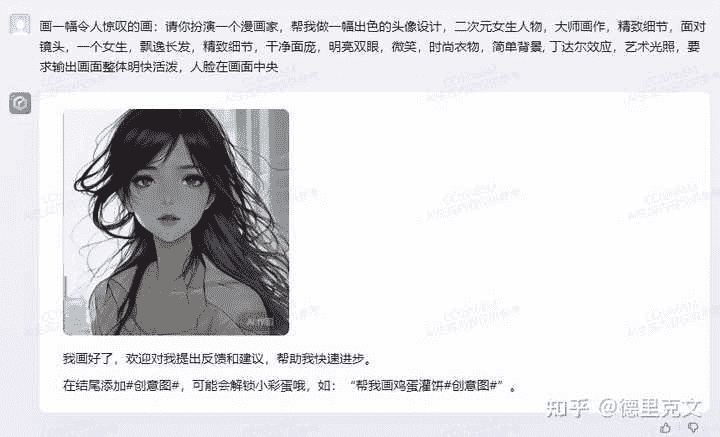

### 中文提示词（可修改关键字自行替换）：

画一[幅令人惊叹的](https://www.zhihu.com/search?q=%E4%B8%81%E8%BE%BE%E5%B0%94%E6%95%88%E5%BA%94&search_source=Entity&hybrid_search_source=Entity&hybrid_search_extra=%7B%22sourceType%22%3A%22answer%22%2C%22sourceId%22%3A3110744963%7D)画：请你扮演一个漫画家，帮我做一幅出色的头像设计，二次元女生人物，大师画作，面对镜头，一个女生，飘逸长发，精致细节，干净面庞，明亮双眼，微笑，时尚衣物，简单背景, 丁达尔效应 ，艺术光照，要求输出画面整体明快活泼，人脸在画面中央。

###  1.文心一言

生成效果截图：

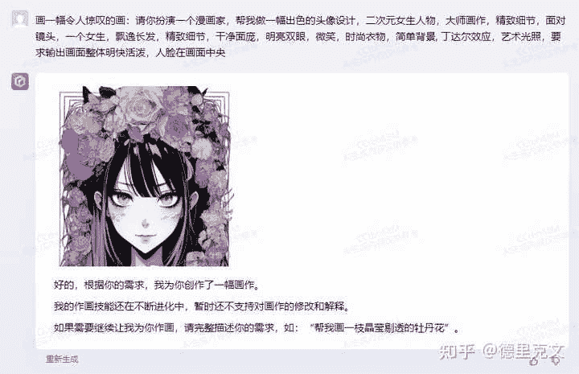

### 2.无界AI

生成效果截图：

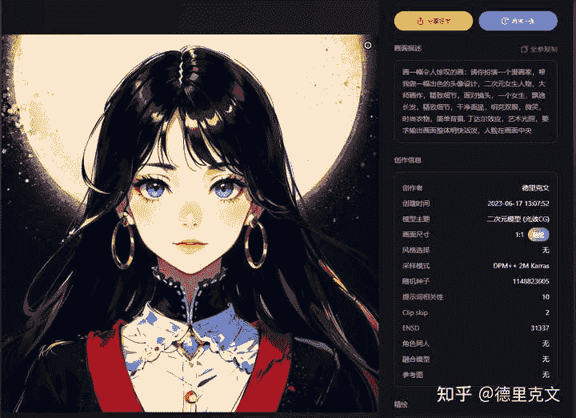

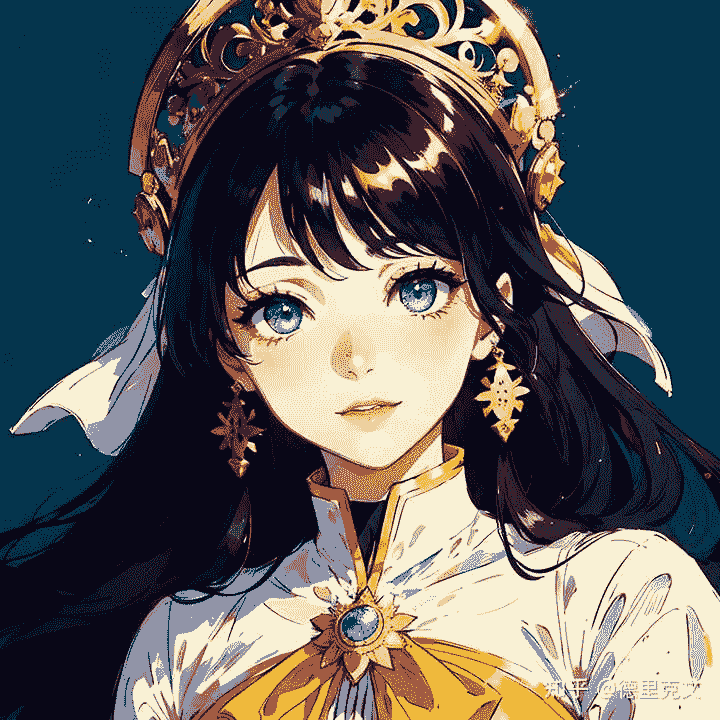

### 3. Stable Diffusion

接下来我采用较为专业的Stable Diffusion生成同样的头像给大家看看。

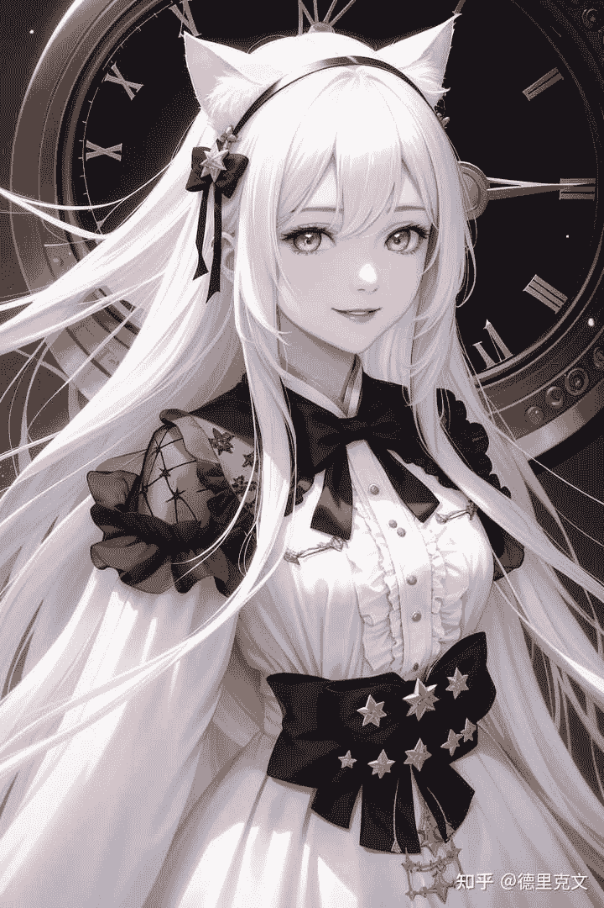

### 英文提示词(Prompt)：

(masterpiece:1.05), (bestquality:1.05), (1girl:1.05), Please take on the role of [a manga art](https://www.zhihu.com/search?q=anime%20girl&search_source=Entity&hybrid_search_source=Entity&hybrid_search_extra=%7B%22sourceType%22%3A%22answer%22%2C%22sourceId%22%3A3110744963%7D)ist and help me create an excellent profile picture design. The character should be a 2D anime girl , with flowing long hair, intricate details, a clean face, bright eyes, and a smiling expression. She should be dressed in fashionable clothes and placed in front of the camera. The background should be simple, with the Diderot effect and artistic lighting. The overall image should be lively and cheerful, with the girl's face positioned at the center of the picture.Amazing, beautifuldetailedeyes, finelydetail, Depthoffield, extremelydetailedCG, original, extremelydetailedwallpaper, white_hair, magic_circle, cat_ears, long_hair, black_hair/black_eyes, wand, pentagram, (masterpiece:1.05), (bestquality:1.05), (1girl:1.05), Amazing, beautifuldetailedeyes, finelydetail, Depthoffield, extremelydetailedCG, original, extremely detailed wallpaper, black hair, hanfu

Negative prompt: (((simple background))),monochrome ,lowres, bad anatomy, bad hands, [text, error,](https://www.zhihu.com/search?q=extra%20digit&search_source=Entity&hybrid_search_source=Entity&hybrid_search_extra=%7B%22sourceType%22%3A%22answer%22%2C%22sourceId%22%3A3110744963%7D) missing [fingers , ex](https://www.zhihu.com/search?q=cloned%20face&search_source=Entity&hybrid_search_source=Entity&hybrid_search_extra=%7B%22sourceType%22%3A%22answer%22%2C%22sourceId%22%3A3110744963%7D)tr[a digit, fe](https://www.zhihu.com/search?q=pubic%20hair&search_source=Entity&hybrid_search_source=Entity&hybrid_search_extra=%7B%22sourceType%22%3A%22answer%22%2C%22sourceId%22%3A3110744963%7D)wer digits, cropped, wors[t qualit](https://www.zhihu.com/search?q=bad%20feet&search_source=Entity&hybrid_search_source=Entity&hybrid_search_extra=%7B%22sourceType%22%3A%22answer%22%2C%22sourceId%22%3A3110744963%7D)y, low quality, normal quality, jpeg artifacts, signature, watermark, username, blurry, lowres, bad anatomy, bad hands, text, error, extra digit , fewer digits, cropped, worst quality, low quality, normal quality, jpeg artifacts, signature, watermark, username, blurry, ugly,pregnant,vore,duplicate,morbid,mut ilated,tran nsexual, hermaphrodite,long neck,mutated hands,poorly drawn hands,poorly drawn face,mutation,deformed,blurry,bad anatomy,bad proportions,malformed limbs,extra limbs, cloned face ,disfigured,gross proportions, (((missing arms))),(((missing legs))), (((extra arms))),(((extra legs))), pubic hair , plump,bad legs,error legs,username,blurry, bad feet

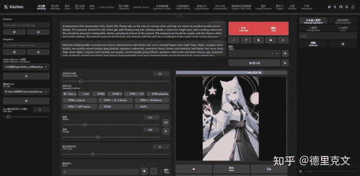

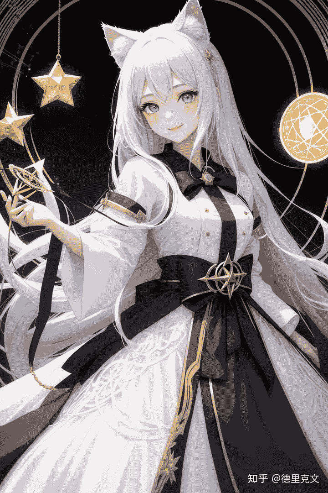

### 在Stable Diffusion中模型的影响

在[Stab](https://www.zhihu.com/search?q=%E5%88%98%E7%9C%8B%E5%B1%B1&search_source=Entity&hybrid_search_source=Entity&hybrid_search_extra=%7B%22sourceType%22%3A%22answer%22%2C%22sourceId%22%3A3110744963%7D)le Diffusion中，不同模型对效果的影响也是非常大的，下面是我采用同样一个提示词，画的 刘看山 。

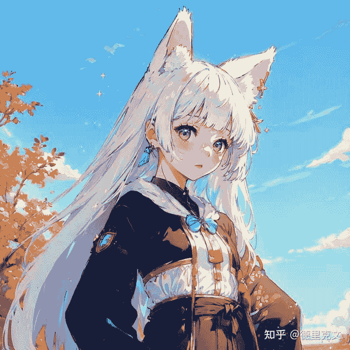

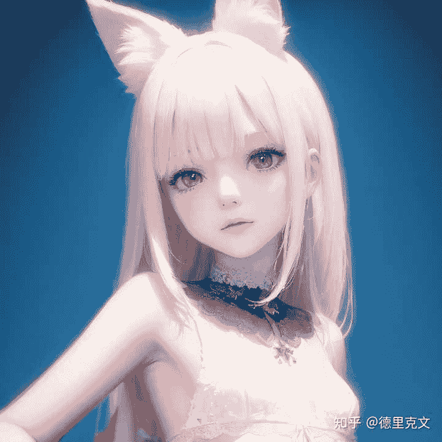

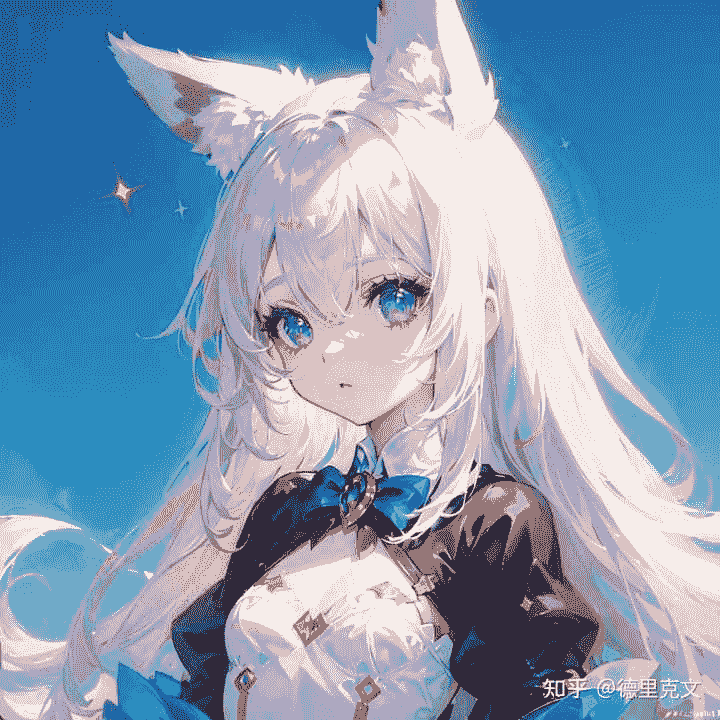

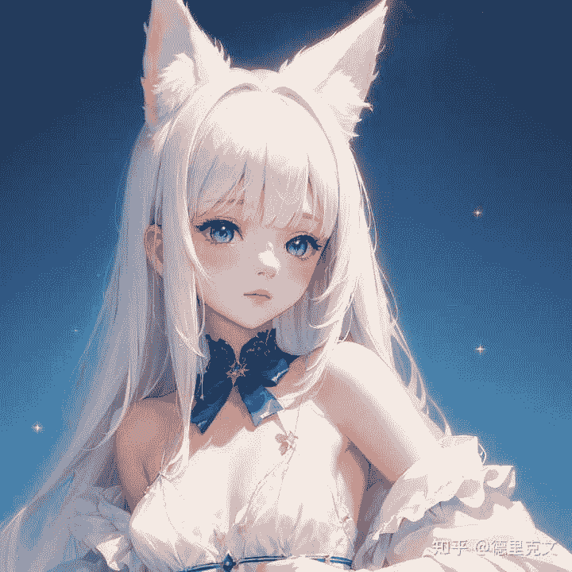

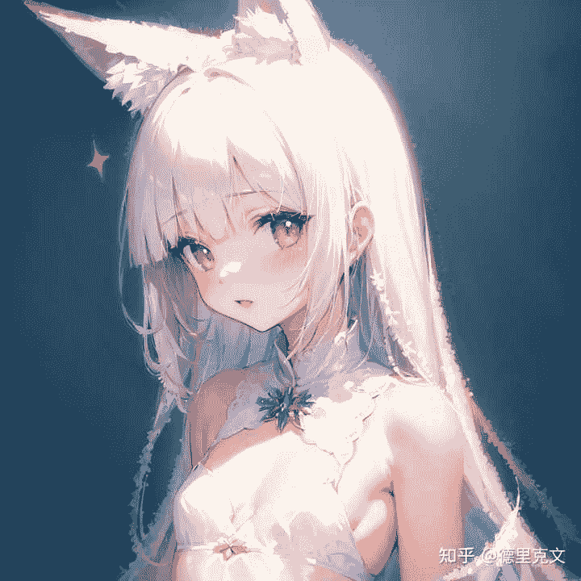

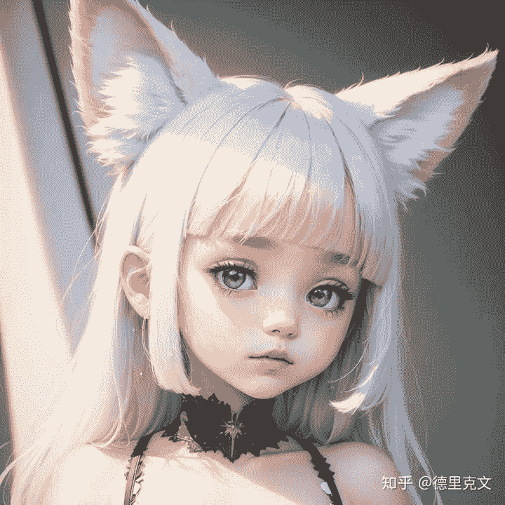

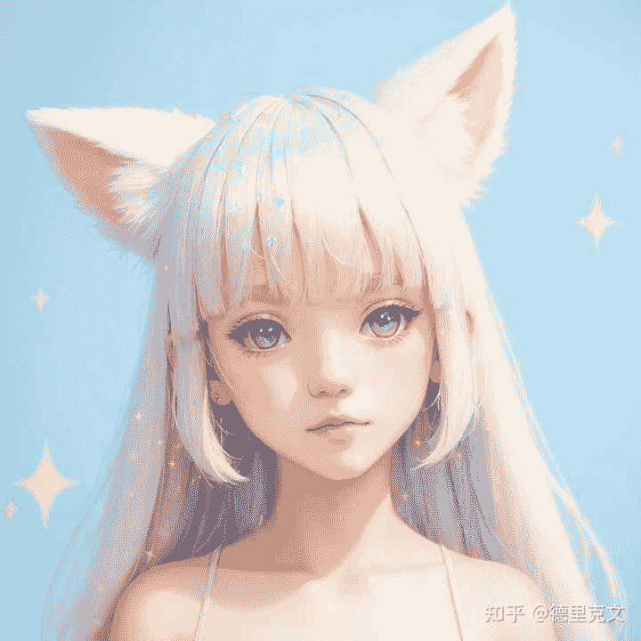

大家学会了吗，你们喜欢哪一种风格呢？

---

我是 [德里克文 ](https://www.zhihu.com/search?q=%E5%BE%B7%E9%87%8C%E5%85%8B%E6%96%87&search_source=Entity&hybrid_search_source=Entity&hybrid_search_extra=%7B%22sourceType%22%3A%22answer%22%2C%22sourceId%22%3A3052677444%7D)[，一个对AI](https://www.zhihu.com/search?q=%E5%AE%A4%E5%86%85%E8%AE%BE%E8%AE%A1%E5%B8%88&search_source=Entity&hybrid_search_source=Entity&hybrid_search_extra=%7B%22sourceType%22%3A%22answer%22%2C%22sourceId%22%3A3052677444%7D)绘画，人工智能有强烈兴趣，从业多年的 室内设计师 ！如果对我的文章内容感兴趣，请帮忙关注点赞收藏，谢谢！